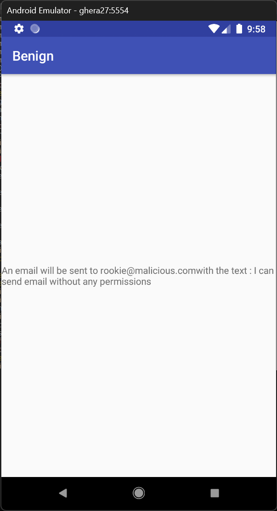
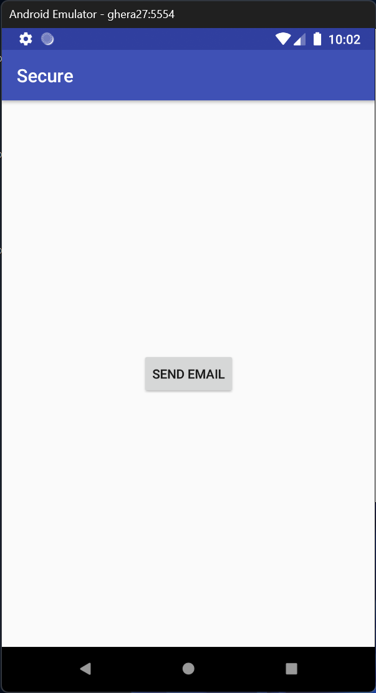
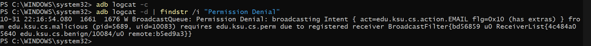
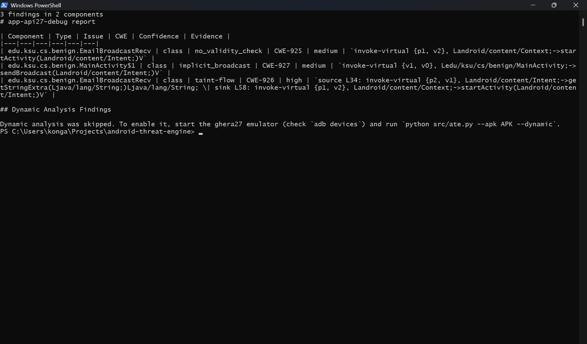
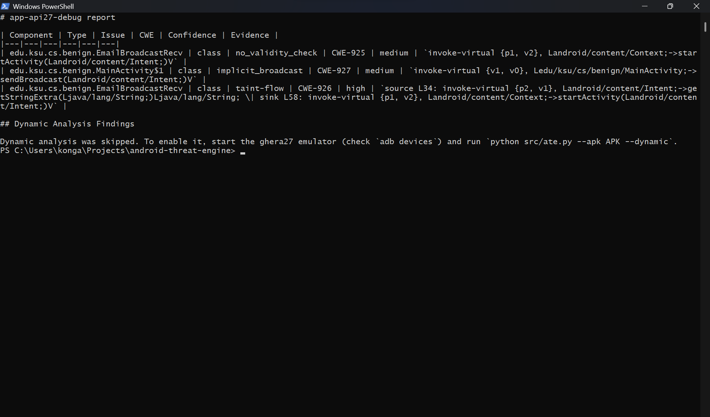

# android-threat-engine

android-threat-engine is an Android app security research project built on the [Ghera](https://bitbucket.org/secure-it-i/android-app-vulnerability-benchmarks) benchmark repository (tag `Jan2019`, 57 benchmarks). It combines a library of code-referenced threat models for the benchmarks, a ground truth dataset mapped to CWE and OWASP MASVS, MASWE and MASTG, a plan and matrix for measuring how each vulnerability behaves on newer Android versions, and a command line tool that decodes an APK and reports its manifest attack surface, scored against the ground truth.

## Features

- **Threat model library**: 24 full threat models (ICC and Web) with STRIDE, LINDDUN, attack trees, standards mappings and Mermaid diagrams, plus standards mappings for the 31 benchmarks in the other categories. Every claim points to a file and line in the benchmark.
- **Verified standards reference**: every CWE, MASVS, MASWE and MASTG ID used is checked against its official page and recorded with its exact title.
- **Ground truth dataset**: one row per benchmark with the expected Benign and Secure results and the mapped IDs (`data/ground-truth.csv`).
- **Drift matrix**: one row per benchmark and API level (22 to 34) for recording whether exploits and fixes still hold on newer Android versions (`data/drift-matrix.csv`).
- **Benchmark issues log**: 234 differences between the Ghera READMEs, code and tests, including Secure apps whose fix looks incomplete.
- **APK analysis tool**: decodes an APK with apktool, extracts exported components, intent filters, permissions and provider settings from the manifest, detects insecure code patterns in the smali code (weak ciphers, hard-coded keys, trust managers, WebView settings, SQL, intents and broadcasts), traces intent extras and user input to sensitive sinks with taint analysis, optionally exercises the app on an emulator over adb (`--dynamic`), and writes findings with CWE IDs, confidence levels and evidence as JSON and Markdown.
- **Evaluator and docs lint**: scores the tool against the ground truth, and checks the documentation for unknown IDs, wrong titles, missing sections, broken links and invalid diagrams.

## Architecture


`src/ate.py` runs the three stages in order and prints a one-line summary. `tools/evaluate.py` runs the CLI on the Benign and Secure APK of each built benchmark and compares the findings with `data/ground-truth.csv`.

## Tools and tech stack

| Area | Tools |
|------|-------|
| Analysis tool | Python 3 (standard library), apktool 3.0.3, Java 8 (Eclipse Temurin) |
| Tests | pytest |
| Benchmark builds | Gradle 4.4, Android Gradle plugin 3.1.2, Android SDK Platform 27, Build-Tools 27.0.3, JDK 8 |
| Emulators | Android SDK Command-line Tools 23.0 (with JDK 17), Android Emulator, Google APIs x86 system images |
| Automation | PowerShell (`env.ps1`, `tools/build_all.ps1`, `tools/create_avds.ps1`), Python (`tools/lint_docs.py`, `tools/evaluate.py`, `tools/render_diagrams.py`) |
| Diagrams | Mermaid, rendered with mermaid-cli on a portable Node.js |
| Standards | CWE, OWASP MASVS v2, MASWE, MASTG |

## Results

Static evaluation (`python tools/evaluate.py --no-dynamic`) on the 19 benchmarks with an `api27` build (5 Crypto, 14 ICC), after adding code pattern analysis (Layer 2) and taint analysis (Layer 3):

| Run | TP | FP | Precision | Recall |
|-----|---:|---:|----------:|-------:|
| Manifest rules only | 9 | 19 | 0.32 | 0.47 |
| Manifest, code patterns and taint | 11 | 19 | 0.37 | 0.58 |

By category: Crypto precision 0.44, recall 0.80 (5 benchmarks); ICC precision 0.33, recall 0.50 (14 benchmarks). Every Secure APK counts as a false positive because the exported launcher activity is always reported; counting only Secure findings whose CWE is in the ground truth gives precision 0.52. Networking, Storage, System and Web benchmarks are not built yet, so their code rules are not measured. Details and limits: [docs/notes/evaluation-report.md](docs/notes/evaluation-report.md).

## Screenshots

**Exploit succeeds against Benign** (Malicious triggers an email with no permissions):



**Exploit blocked by Secure** (no message appears after SEND BROADCAST):



**System log confirming the block** (Permission Denial from adb logcat):



## Tool in Action


*The analysis tool detecting CWE-925, CWE-927 and a taint flow (CWE-926) in the DynamicRegBroadcastReceiver Benign APK*


*The generated Markdown report showing component, issue type, CWE, confidence and evidence*

## Repo structure

```text
android-threat-engine/
  src/                 analysis tool: apk.py, surface.py, code_analyzer.py, call_graph.py,
                       taint_analyzer.py, dynamic_analyzer.py, report.py, ate.py (CLI)
  tests/               pytest tests for the tool
  tools/               build, emulator, lint, evaluation and diagram scripts
  data/                ground truth, drift matrix, evaluation results
  docs/
    threat-models/     threat models, standards reference, benchmark index, mappings
    diagrams/          SVG renderings of the threat model diagrams
    notes/             setup log, benchmark issues, designs, reports
    screenshots/       emulator screenshots from Step 1 smoke test and extra emulator runs
  results/             drift run output (empty until the drift runs start)
  benchmarks/          Ghera checkout (not committed; see Getting started)
  env.ps1              per-session toolchain environment
  requirements.txt     Python packages for the tests
  .github/CITATION.cff citations for Ghera and Rekha
```

## Getting started

### Prerequisites

- Java 8 or later (the tool uses `JAVA_HOME`, then `C:\Android\jdk8`, then `java` on `PATH`)
- Python 3
- Internet access on the first run: `src/apk.py` downloads the latest stable apktool jar to `tools/apktool.jar` and checks its SHA-256
- For the benchmark builds and the evaluator: the Android SDK and the Ghera repository cloned into `benchmarks/ghera` at tag `Jan2019` (see `docs/notes/SETUP_LOG.md`)

### Install

```powershell
python -m venv .venv
.venv\Scripts\python -m pip install -r requirements.txt   # pytest, needed only for the tests
```

### Example

```powershell
python src\ate.py --apk path\to\app.apk --out results
python src\ate.py --apk path\to\app.apk --out results --dynamic   # with the emulator running
```

This writes `results\app-report.json` and `results\app-report.md` and prints a summary such as `5 findings in 3 components`. Run the tests with `.venv\Scripts\python -m pytest tests`.

## Citation

If you use this project, please cite the Ghera and Rekha papers listed in [.github/CITATION.cff](.github/CITATION.cff).
