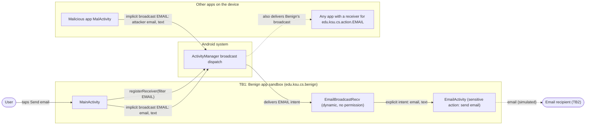
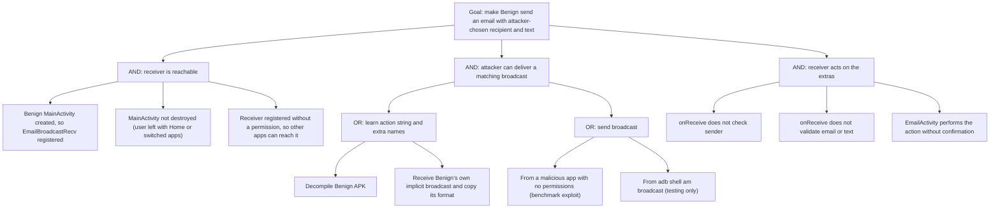

# Threat Model: DynamicRegBroadcastReceiver-UnrestrictedAccess-Lean

## 1. Benchmark

| Field | Value |
|-------|-------|
| Name | DynamicRegBroadcastReceiver-UnrestrictedAccess-Lean |
| Category | ICC (inter-component communication) |
| Ghera path | `benchmarks/ghera/ICC/DynamicRegBroadcastReceiver-UnrestrictedAccess-Lean` |
| Affected Android versions (from README) | "Tested on Android 5.1.1 - Android 8.1" |
| Ghera tag | `Jan2019` (commit `6289f39d`) |
| Build flavors available | `api22` to `api27`, `apiDIST` (from `benchmarks/ghera/Misc/sdkFlavors.gradle`) |
| Date of model | 2026-10-31 |

The Benign app registers a broadcast receiver at runtime with `registerReceiver(receiver, filter)` and no permission. A receiver registered this way can be invoked by any app on the device that sends a broadcast with the matching action. The Malicious app sends that action and makes Benign show an "email will be sent" screen with a recipient and text chosen by the attacker, without holding any permission.

## 2. System description

### Components

| Component | App | Type | Exported or reachable from other apps | Notes |
|-----------|-----|------|----------------------------------------|-------|
| `MainActivity` | Benign (`edu.ksu.cs.benign`) | Activity, launcher | Yes (launcher intent filter) | Registers `EmailBroadcastRecv` in `onCreate` for action `edu.ksu.cs.action.EMAIL`; unregisters in `onDestroy`. Send-email button sends an implicit broadcast with `email=diagnostics@startup.com` and `text="I am user"`. |
| `EmailBroadcastRecv` | Benign | Broadcast receiver, registered dynamically | Yes, while `MainActivity` is alive | `onReceive` copies the `email` and `text` extras into an explicit intent and starts `EmailActivity`. No check of sender or extras. |
| `EmailActivity` | Benign | Activity | No (no intent filter, not exported) | Displays "An email will be sent to <email>with the text : <text>". Stands in for the sensitive operation (sending an email). |
| `MalActivity` | Malicious (`edu.ksu.cs.malicious`) | Activity, launcher | n/a | Button sends implicit broadcast `edu.ksu.cs.action.EMAIL` with `email=rookie@malicious.com` and `text="I can send email without any permissions"`. Manifest declares no permissions. |

Source files:
- `Benign/app/src/main/java/edu/ksu/cs/benign/MainActivity.java`
- `Benign/app/src/main/java/edu/ksu/cs/benign/EmailBroadcastRecv.java`
- `Benign/app/src/main/java/edu/ksu/cs/benign/EmailActivity.java`
- `Malicious/app/src/main/java/edu/ksu/cs/malicious/MalActivity.java`

### Trust boundaries

| ID | Boundary | What crosses it |
|----|----------|-----------------|
| TB1 | Benign app sandbox vs. other apps on the device | Implicit broadcasts with action `edu.ksu.cs.action.EMAIL` and extras `email`, `text`, routed through the Android system (ActivityManager). |
| TB2 | Benign app vs. the outside world (email recipient) | The email that `EmailActivity` represents. In this Lean benchmark no email is actually sent; the screen text is the observable effect. |

### Data flow diagram



## 3. Assets and attacker model

### Assets

| Asset | Why it matters |
|-------|----------------|
| The send-email capability of Benign | Lets the app send messages in the user's or the app's name. Misuse can spam, phish, or harm reputation. |
| Integrity of email recipient and body | The extras decide who receives the message and what it says. |
| Diagnostic data in Benign's own broadcast (`"I am " + username`) | Identifies the user. Sent as an implicit broadcast, so other apps can receive it. |
| User attention and UI | Each received broadcast starts `EmailActivity` in front of the user. |

### Attacker

A third-party app installed on the same device. It runs in its own sandbox with no special permissions. This matches the Malicious app in the benchmark.

### Attacker requirements

- Installed on the same device as Benign.
- No Android permissions (the Malicious manifest declares none).
- Knows the action string `edu.ksu.cs.action.EMAIL` and the extra names `email` and `text`. These are easy to recover by decompiling the Benign APK.
- Benign's `MainActivity` must be alive (created and not yet destroyed), because the receiver exists only between `onCreate` and `onDestroy`. Leaving the activity with Home or switching apps does not destroy it, so the receiver usually stays registered.
- No user interaction with Benign at attack time is needed. In the benchmark the user taps a button in Malicious, but a real attacker could send the broadcast from a background component.

## 4. STRIDE

| Category | Threat | Applies | Why |
|----------|--------|---------|-----|
| Spoofing | Malicious app sends a broadcast that Benign treats as if it came from its own `MainActivity`. | Yes | `EmailBroadcastRecv.onReceive` never checks the sender, and the receiver was registered without a permission, so any app can pose as the legitimate sender. Demonstrated in the smoke test. |
| Tampering | Attacker controls the recipient and body of the email. | Yes | The `email` and `text` extras are copied unchanged into the intent for `EmailActivity`. The smoke test showed `rookie@malicious.com` and attacker text. |
| Repudiation | Emails triggered by the attacker look like they were sent by Benign; nothing records which app asked for them. | Yes | Benign keeps no log of the broadcast origin, and a plain broadcast does not tell the receiver which app sent it. The user or developer cannot prove that the Malicious app was responsible. |
| Information disclosure | Benign's own broadcast (`email=diagnostics@startup.com`, `text="I am user"`) can be received by any app that registers for the same action. | Yes (not demonstrated) | `MainActivity` uses an implicit `sendBroadcast(intent)` with no receiver permission and no target package. This is a second issue next to the one in the README. The Secure app keeps it. |
| Denial of service | Attacker floods the action, so `EmailActivity` keeps being started in front of the user and email sending is abused. | Partially | Each broadcast starts an activity in Benign, which can disrupt the user and exhaust any email quota. Impact is limited to Benign and the user's attention; the device stays usable. Not tested. |
| Elevation of privilege | An app with no permissions makes Benign do a privileged action (send email) for it. A confused deputy. | Yes | README: the malicious app can "send emails even if the malicious app is not authorized to send emails". The Malicious manifest has no permissions, yet the action runs with Benign's identity. |

## 5. LINDDUN

| Category | Threat | Applies | Why |
|----------|--------|---------|-----|
| Linkability | An eavesdropping app links Benign usage events over time through the broadcasts it receives. | Partially | Possible only through the implicit broadcast that Benign itself sends. In this Lean benchmark the payload is fixed (`"I am user"`), so there is little to link. |
| Identifiability | An eavesdropping app learns the username from Benign's diagnostic broadcast. | Partially | `text` holds `"I am " + username`. Here the username is the constant `"user"`, but in a real app it would identify the person. |
| Non-repudiation | Emails written by the attacker are sent in the user's or app's name, and the user cannot easily show they did not send them. | Yes | The recipient sees a message from Benign. Nothing ties it to the Malicious app (see Repudiation above). |
| Detectability | An app can tell when the user presses Send email in Benign by watching for the broadcast. | Partially | Same implicit broadcast. Only reveals that the action took place. |
| Disclosure of information | Diagnostic data leaks to other apps through the implicit broadcast. | Yes (not demonstrated) | Same cause as Information disclosure in STRIDE. |
| Unawareness | The user is not asked to confirm, and is not told, that a third party started an email. | Yes | `EmailActivity` only displays the message; there is no confirmation step and no indication of which app triggered it. |
| Non-compliance | Personal data is sent to recipients chosen by a third party, without consent. | Partially | Would break data minimization and consent rules in a real product. Out of scope for a synthetic benchmark that processes no real personal data. |

## 6. Attack tree



## 7. Standards mapping

Confidence values:
- **Verified**: the ID and title were checked against the official page on 2026-10-31, and the mapping to this benchmark is direct.
- **Needs check**: the ID or title could not be confirmed against the official page, or the mapping is indirect or debatable.

| Standard | ID | Title | Confidence |
|----------|----|-------|------------|
| CWE | CWE-925 | Improper Verification of Intent by Broadcast Receiver | Verified |
| CWE | CWE-926 | Improper Export of Android Application Components | Verified |
| CWE | CWE-927 | Use of Implicit Intent for Sensitive Communication (applies to Benign's own diagnostic broadcast, not the main exploit) | Verified |
| OWASP MASVS v2 | MASVS-PLATFORM-1 | The app uses IPC mechanisms securely. | Needs check |
| OWASP MASTG test | MASTG-TEST-0029 | Testing for Sensitive Functionality Exposure Through IPC | Verified |
| OWASP MASTG test | MASTG-TEST-0366 | Exported And Unprotected Broadcast Receivers That Expose Sensitive Functionality | Needs check |
| MITRE ATT&CK for Mobile | T1404 | Exploitation for Privilege Escalation | Needs check |

Notes:
- MASVS-PLATFORM-1: the official control page could not be read, so neither the ID nor the title was confirmed.
- MASTG-TEST-0366: the ID and title appear in the MASTG site navigation under MASVS-PLATFORM, but the test page itself was not read.
- T1404: the ID and title are confirmed on attack.mitre.org. The mapping is debatable because the benchmark is a confused deputy (one app abusing another app's privileges), not an exploit that elevates privileges at the OS level.

## 8. Evidence

### Screenshots

No screenshots have been captured yet; `docs/screenshots/` holds only `.gitkeep`. Planned file names:

| Pair | Step | Screenshot |
|------|------|------------|
| Benign + Malicious | Benign `EmailActivity` showing the attacker message | `docs/screenshots/DynamicRegBroadcastReceiver-UnrestrictedAccess-Lean-benign-malicious.png` (not yet captured) |
| Secure + Malicious | Secure app after the Malicious broadcast, no message | `docs/screenshots/DynamicRegBroadcastReceiver-UnrestrictedAccess-Lean-secure-malicious.png` (not yet captured) |

### Commands

These are the commands recorded in `docs/notes/SETUP_LOG.md` (smoke test, 2026-10-31), run in PowerShell on Windows on the `ghera27` emulator (Pixel, API 27). The APK paths are the outputs present in the benchmark build folders.

```powershell
# From the project root: set JAVA_HOME (JDK 8), ANDROID_HOME and PATH for this session
. .\env.ps1

# Start the emulator
emulator -avd ghera27

# Build (Gradle 4.4, JDK 8). local.properties in each app folder contains sdk.dir=C:/Android/Sdk
$B = "benchmarks\ghera\ICC\DynamicRegBroadcastReceiver-UnrestrictedAccess-Lean"
Push-Location "$B\Benign";    .\gradlew.bat assembleDebug; Pop-Location
Push-Location "$B\Malicious"; .\gradlew.bat assembleDebug; Pop-Location
Push-Location "$B\Secure";    .\gradlew.bat assembleDebug; Pop-Location

# Pair 1: Benign + Malicious
adb install -r "$B\Benign\app\build\outputs\apk\api27\debug\app-api27-debug.apk"
adb install -r "$B\Malicious\app\build\outputs\apk\api27\debug\app-api27-debug.apk"
# Open Benign on the emulator, press Home, open Malicious, tap its button.

# Pair 2: Secure + Malicious (Secure shares the package name edu.ksu.cs.benign)
adb uninstall edu.ksu.cs.benign
adb install -r "$B\Secure\app\build\outputs\apk\api27\debug\app-api27-debug.apk"
# Open Secure on the emulator, press Home, open Malicious, tap its button.
```

The launch and tap steps were done by hand in the emulator UI. The following command sends the same broadcast without the Malicious app and can be used for the screenshots. **It has not been run yet:**

```powershell
adb shell am broadcast -a edu.ksu.cs.action.EMAIL --es email rookie@malicious.com --es text "I can send email without any permissions"
```

### Observed result

From `docs/notes/SETUP_LOG.md`:

| Pair | Outcome | Observation |
|------|---------|-------------|
| Benign + Malicious | Exploit succeeded | Benign displayed "An email will be sent to rookie@malicious.com with the text : I can send email without any permissions". |
| Secure + Malicious | Exploit had no effect | Secure showed no message. |

## 9. Mitigation

### What the Secure app does differently

A diff of the Benign and Secure source finds two changes. `EmailBroadcastRecv.java` and `EmailActivity.java` are the same in both apps, and so is the code that sends the broadcast.

| File | Benign | Secure |
|------|--------|--------|
| `app/src/main/AndroidManifest.xml` | No custom permission. | Declares `<permission android:name="edu.ksu.cs.perm" android:protectionLevel="dangerous" />` and `<uses-permission android:name="edu.ksu.cs.perm" />`. |
| `app/src/main/java/edu/ksu/cs/benign/MainActivity.java` (`onCreate`) | `registerReceiver(emailBroadcastRecv, new IntentFilter("edu.ksu.cs.action.EMAIL"));` | `registerReceiver(emailBroadcastRecv, new IntentFilter("edu.ksu.cs.action.EMAIL"), "edu.ksu.cs.perm", null);` |

With the `broadcastPermission` argument set, Android delivers a broadcast to the receiver only if the sender holds `edu.ksu.cs.perm`. The Malicious app does not request that permission, so its broadcast is dropped. This matches the smoke test result.

### Assessment of the fix

The fix blocks the benchmark exploit but leaves residual risk:

1. **`dangerous` protection level is weak.** Any app can add `<uses-permission android:name="edu.ksu.cs.perm" />`. On API 22 dangerous permissions are granted at install time, so a Malicious app that requests it gets it without the user being asked. On API 23 and later the user must grant it at runtime, so a well-crafted prompt could still trick them. `android:protectionLevel="signature"` would restrict senders to apps signed with the same key.
2. **The implicit broadcast is still sent.** `MainActivity` still calls `sendBroadcast(intent)` with no receiver permission and no `setPackage`, so the diagnostic data (CWE-927) can still be received by other apps.
3. **No validation in `onReceive`.** The receiver still trusts `email` and `text` from any sender that gets past the permission check.
4. **Stronger alternatives** not used by the Secure app: send and receive within one app using an explicit intent (`setPackage(getPackageName())`) or an in-process mechanism instead of a system broadcast; on API 33 and later, register with `Context.RECEIVER_NOT_EXPORTED`.

## 10. Open questions

- The README says the email is sent "when the user leaves the particular activity", but in the Lean code the broadcast is sent when the Send email button is tapped. The model follows the code.
- On API 23 and later, the Secure app also needs a runtime grant of its own dangerous permission `edu.ksu.cs.perm` before its own broadcast reaches its receiver. Check whether the Secure app's Send email button still works on the `ghera27` emulator; the smoke test only checked the Malicious path.
- Confirm MASVS-PLATFORM-1, MASTG-TEST-0366, and the T1404 mapping, then update their confidence.
- Capture the two screenshots listed in section 8.
