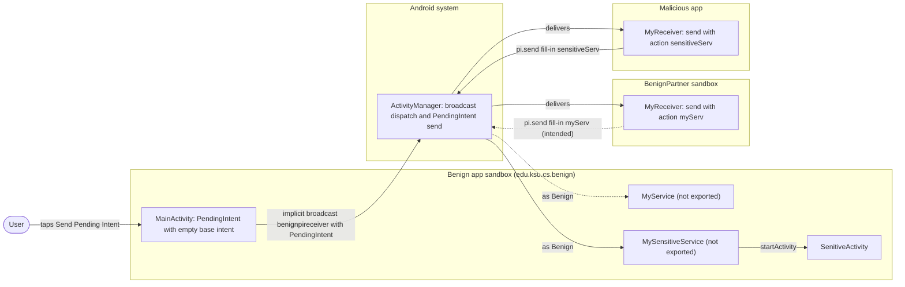
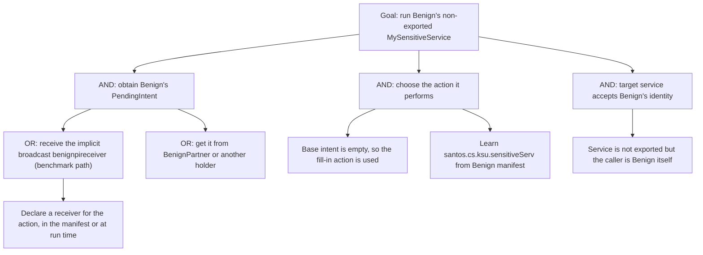

# Threat Model: EmptyPendingIntent-PrivEscalation-Lean

## 1. Benchmark

| Field | Value |
|-------|-------|
| Name | EmptyPendingIntent-PrivEscalation-Lean |
| Category | ICC (inter-component communication) |
| Ghera path | `benchmarks/ghera/ICC/EmptyPendingIntent-PrivEscalation-Lean` |
| Affected Android versions (from README) | "Tested on Android 5.1.1 - Android 8.1" (heading: "Android versions affected") |
| Ghera tag | `Jan2019` (commit `6289f39d`) |
| Build flavors available | `api22` to `api27`, `apiDIST` (from `benchmarks/ghera/Misc/sdkFlavors.gradle`) |
| Date of model | 2026-10-31 |

Benign creates a pending intent for a service with an empty base intent (`new Intent()`) and sends it in an implicit broadcast meant for BenignPartner. The Malicious app also receives the broadcast, fills in the empty intent with the action `santos.cs.ksu.sensitiveServ` and fires it. Because the pending intent runs with Benign's identity, this starts Benign's non-exported `MySensitiveService`, which brings up `SenitiveActivity` ("Sensitive Activity visible").

## 2. System description

### Components

| Component | App | Type | Exported or reachable from other apps | Notes |
|-----------|-----|------|----------------------------------------|-------|
| `MainActivity` | Benign (`edu.ksu.cs.benign`) | Activity, launcher | Yes (launcher intent filter) | The button "Send Pending Intent" (`R.id.send_pi_button`) creates `PendingIntent.getService(getApplicationContext(), 0, new Intent(), FLAG_UPDATE_CURRENT)`, puts it in a Bundle, and calls `sendBroadcast(new Intent("santos.cs.ksu.edu.benignpireceiver").putExtra("bundle", bundle))` (`MainActivity.java` lines 26 to 31). No target package, no permission. |
| `MyService` | Benign | Service | No (`android:exported="false"`), intent filter for `santos.cs.ksu.myServ` (manifest lines 27 to 33) | Logs "Do something trivial" with tag `PendingIntent...` and calls `startActivity` for `MainActivity` (`MyService.java` lines 14 to 15). The intended target of the pending intent. |
| `MySensitiveService` | Benign | Service | No (`android:exported="false"`), intent filter for `santos.cs.ksu.sensitiveServ` (manifest lines 20 to 26) | Logs "Do something important" and starts `SenitiveActivity` with `FLAG_ACTIVITY_NEW_TASK` (`MySensitiveService.java` lines 14 to 15). The README: "meant for internal use within the benign app". |
| `SenitiveActivity` | Benign | Activity | No intent filter, no `exported` attribute | Shows "Sensitive Activity visible" in `R.id.sensitive_activity_msg` (`SenitiveActivity.java` lines 19 to 21). `onDestroy` stops `MySensitiveService` (line 27). |
| `MyReceiver` | BenignPartner (`edu.ksu.cs.benignpartner`) | Broadcast receiver, declared in manifest | Yes (`android:exported="true"`, intent filter for `santos.cs.ksu.edu.benignpireceiver`, no permission) | Takes the pending intent and calls `pi.send(context, 0, new Intent("santos.cs.ksu.myServ"))` (`MyReceiver.java` lines 15 to 20). |
| `MyReceiver` | Malicious (`edu.ksu.cs.malicious`) | Broadcast receiver, declared in manifest and also registered at run time | Yes (`android:exported="true"`, intent filter priority 1 for `santos.cs.ksu.edu.benignpireceiver`, Malicious manifest lines 19 to 26). `MalActivity.onCreate` registers another instance for the same action (`MalActivity.java` line 13). | Takes the pending intent and calls `pi.send(context, 0, new Intent("santos.cs.ksu.sensitiveServ"))`, then logs "sensitive service called successfully..." (`MyReceiver.java` lines 15 to 20). |
| `MalActivity` | Malicious | Activity, launcher | n/a | Shows "Hello World!" and registers the run-time receiver. |
| `MainActivity` | Secure (Java package `edu.cs.ksu.benign`, `applicationId` `edu.ksu.cs.benign`) | Activity, launcher | Same as Benign | Uses `new Intent("santos.cs.ksu.myServ")` as the base intent (Secure `MainActivity.java` line 27). The broadcast is unchanged (line 29). |
| `MySensitiveService` | Secure | Service | Same as Benign | Only logs; it does **not** start `SenitiveActivity` (Secure `MySensitiveService.java` lines 13 to 15). |

Manifest permissions: none of the four apps declares or requests a permission.

Source files:
- `Benign/app/src/main/java/edu/ksu/cs/benign/MainActivity.java`
- `Benign/app/src/main/java/edu/ksu/cs/benign/MyService.java`
- `Benign/app/src/main/java/edu/ksu/cs/benign/MySensitiveService.java`
- `Benign/app/src/main/java/edu/ksu/cs/benign/SenitiveActivity.java`
- `BenignPartner/app/src/main/java/edu/ksu/cs/benignpartner/MyReceiver.java`
- `Malicious/app/src/main/java/edu/ksu/cs/malicious/MyReceiver.java`
- `Malicious/app/src/main/java/edu/ksu/cs/malicious/MalActivity.java`
- `Secure/app/src/main/java/edu/cs/ksu/benign/MainActivity.java`
- `Secure/app/src/main/java/edu/cs/ksu/benign/MyService.java`
- `Secure/app/src/main/java/edu/cs/ksu/benign/MySensitiveService.java`
- `Secure/app/src/main/java/edu/cs/ksu/benign/SenitiveActivity.java`
- `AndroidManifest.xml` and `app/build.gradle` of each app

### Trust boundaries

| ID | Boundary | What crosses it |
|----|----------|-----------------|
| TB1 | Benign app sandbox vs. all other apps on the device | The implicit broadcast `santos.cs.ksu.edu.benignpireceiver` carrying the pending intent. Any app with a matching receiver gets it, not only BenignPartner. |
| TB2 | Other apps vs. Benign's internal components, through the pending intent | The fill-in intent chosen by whoever holds the pending intent, which the system runs with Benign's identity. This is how Malicious reaches the non-exported `MySensitiveService`. |
| TB3 | Inside Benign: services vs. activities | `MySensitiveService` starts `SenitiveActivity`; `MyService` starts `MainActivity`. |

### Data flow diagram



## 3. Assets and attacker model

### Assets

| Asset | Why it matters |
|-------|----------------|
| Benign's non-exported services, in particular `MySensitiveService` | The README: "This service is not exported and is meant for internal use within the benign app." The attack reaches it anyway. |
| Benign's identity and permissions | The README: the Android system grants the receiving app "the same permissions as" the sender while it performs the action. Benign declares no permissions, so in the benchmark the gain is access to its private components. |
| `SenitiveActivity` | Brought to the front by the attack. It is the visible proof used by the README and the Testing code. |

### Attacker

A third-party app installed on the same device. This matches the Malicious app in the benchmark.

### Attacker requirements

- Installed on the same device as Benign.
- No permission needed. The Malicious manifest declares none.
- Knows the broadcast action `santos.cs.ksu.edu.benignpireceiver` (in `MainActivity.java` line 29 and BenignPartner's manifest line 25) and the action of the target service, `santos.cs.ksu.sensitiveServ` (Benign manifest line 24).
- Declares a receiver for the broadcast action. The benchmark does both a manifest receiver and a run-time one.
- The user taps the button in Benign. README step 8 opens BenignPartner and Malicious first; `Testing/benign_app/.../Tests.java` lines 67 to 68 open only Malicious and Benign.

## 4. STRIDE

| Category | Threat | Applies | Why |
|----------|--------|---------|-----|
| Spoofing | Malicious makes the system start a service as if Benign had asked for it. | Yes | The pending intent carries Benign's identity; Malicious picks the target (`MyReceiver.java` line 17). |
| Tampering | Malicious decides what action Benign's pending intent performs. | Yes | The base intent is empty (`MainActivity.java` line 27), so the fill-in intent from Malicious supplies the action. |
| Repudiation | Benign keeps no record that another app chose the action. | Yes | `MySensitiveService` logs only "Do something important". |
| Information disclosure | Data is returned to Malicious. | No | `MySensitiveService` returns nothing to the caller. In a real app the reached component could leak data. |
| Denial of service | Malicious can start Benign services and bring Benign activities to the front at will. | Partially | Each fired pending intent starts `SenitiveActivity` in a new task. Malicious may fire twice, once for each registered receiver. |
| Elevation of privilege | An app with no rights in Benign starts Benign's non-exported service. | Yes | This is the impact named in the README ("Malicious app can escalate its own privilege and can start MySensitiveService"). |

## 5. LINDDUN

| Category | Threat | Applies | Why |
|----------|--------|---------|-----|
| Linkability | No personal data is processed. | No | The benchmark handles no user data. |
| Identifiability | No personal data is processed. | No | Same reason. |
| Non-repudiation | An action taken by Malicious is recorded as Benign's. | Partially | The system runs the service as Benign. No user is blamed in the benchmark. |
| Detectability | Any app can learn that the user tapped the button in Benign by receiving the broadcast. | Partially | The broadcast is implicit (`MainActivity.java` line 29). Not used by the benchmark code. |
| Disclosure of information | No data is disclosed in the benchmark. | No | See STRIDE Information disclosure. |
| Unawareness | The user sees `SenitiveActivity` without knowing another app caused it. | Yes | Nothing on the screen names the caller. |
| Non-compliance | A real app's private operation could run without the user's consent. | Partially | Applies to a real app. |

## 6. Attack tree



## 7. Standards mapping

Confidence values:
- **Verified**: the ID and title were checked against the official page.
- **Needs check**: the ID or title could not be confirmed against the official page.

Fit values:
- **Direct**: the standard describes this benchmark's weakness or test as it is.
- **Partial**: the standard covers part of this benchmark, or covers it only with a caveat given in the Fit cell.

CWE and MASVS titles are copied from `docs/threat-models/standards-reference.md`.

| Standard | ID | Title | Confidence | Fit |
|----------|----|-------|------------|-----|
| CWE | CWE-441 | Unintended Proxy or Intermediary | Verified | Partial. `MainActivity.java` line 27 hands out a pending intent with an empty base intent, so the system performs an action chosen by Malicious (`MyReceiver.java` lines 17 to 19) with Benign's identity: Benign acts as the deputy and the original requester is not preserved. Mapping notes review (saved page, 2026-10-31): the Rationale says this is a Class that might have Base-level children that are more appropriate, and the Comment says to examine the children for a better fit. Children shown on the page: CWE-918 (Server-Side Request Forgery) and CWE-1021 (Improper Restriction of Rendered UI Layers or Frames). Neither fits better: CWE-918 is about servers fetching URLs and CWE-1021 about UI layering, so CWE-441 is kept. Partial because the CWE's wording is about forwarding requests to an external actor, while here the deputy action stays inside Benign. Usage ALLOWED-WITH-REVIEW. |
| CWE | CWE-927 | Use of Implicit Intent for Sensitive Communication | Verified | Partial. `MainActivity.java` lines 29 to 31 send the pending intent in an implicit broadcast with no package and no permission, so Malicious receives it. Partial because what leaks is a capability (the pending intent), not data, and the empty base intent is the main fault. Usage ALLOWED. |
| OWASP MASVS v2 | MASVS-PLATFORM-1 | The app uses IPC mechanisms securely. | Verified | Direct. Pending intents and broadcasts are IPC; the fix changes the base intent (Secure `MainActivity.java` line 27). |
| OWASP MASWE | MASWE-0032 | Insecure Intents | Verified | Direct. `MainActivity.java` line 27 creates a pending intent with an empty base intent that any holder can fill in, and lines 29 to 31 send it in an implicit broadcast; the page covers "creating PendingIntents that other apps can modify or replay" and sensitive data in implicit intents. Controls shown on the page: MASVS-PLATFORM-1, MASVS-STORAGE-2. |
| OWASP MASTG test | MASTG-TEST-0029 | Testing for Sensitive Functionality Exposure Through IPC | Verified | Partial. Deprecated, kept for reference only. The non-exported `MySensitiveService` (Benign manifest lines 20 to 26) becomes reachable from another app through the pending intent. |

MASTG-TEST-0366 is not in the table: it is about receivers in the target app, and Benign has no receiver; the weakness is in what Benign sends (`MainActivity.java` lines 27 to 31). MASWE-0018 is not in the table: Benign's services are not exported (manifest lines 20 to 33); they are reached through the pending intent, which MASWE-0032 covers.

Candidates to check (not in the table):
- MASTG-TEST-0030 (Testing for Vulnerable Implementation of PendingIntent) and MASTG-TEST-0381 (References to Insecure PendingIntent Creation), both listed in the MASTG site navigation. Not in the reference file.

MITRE ATT&CK for Mobile: No direct match. No technique on attack.mitre.org was verified that describes filling in another app's empty pending intent to start its private components.

## 8. Evidence

All steps below are **Not yet run**. No result has been observed.

### Commands

Build. PowerShell on Windows from the project root, Gradle 4.4, JDK 8 through `env.ps1`. **Not yet run.**

```powershell
. .\env.ps1
$B = "benchmarks\ghera\ICC\EmptyPendingIntent-PrivEscalation-Lean"
# Each app folder needs local.properties with sdk.dir=C:/Android/Sdk (none is present yet)
foreach ($a in "Benign","BenignPartner","Malicious","Secure") {
    Set-Content "$B\$a\local.properties" "sdk.dir=C:/Android/Sdk"
    Push-Location "$B\$a"; .\gradlew.bat assembleDebug; Pop-Location
}
```

Start the emulator and install pair 1 with BenignPartner (README steps 5 to 7). **Not yet run.**

```powershell
. .\env.ps1
emulator -avd ghera27
$B = "benchmarks\ghera\ICC\EmptyPendingIntent-PrivEscalation-Lean"
adb install -r "$B\Benign\app\build\outputs\apk\api27\debug\app-api27-debug.apk"
adb install -r "$B\BenignPartner\app\build\outputs\apk\api27\debug\app-api27-debug.apk"
adb install -r "$B\Malicious\app\build\outputs\apk\api27\debug\app-api27-debug.apk"
```

Pair 1, Benign + Malicious, by hand (README steps 8 and 9). **Not yet run.**

1. `adb logcat -c`
2. Open BenignPartner, then press Home.
3. Open Malicious, then press Home.
4. Open Benign and tap "Send Pending Intent".
5. Read the screen that comes to the front.
6. `adb logcat -d -s "PendingIntent...:D" BenignPartner:D Malicious:D AndroidRuntime:E`
7. `adb shell dumpsys activity services edu.ksu.cs.benign`

Pair 2, Secure + Malicious. Secure is installed under the same `applicationId`, `edu.ksu.cs.benign` (Secure `app/build.gradle`). **Not yet run.**

```powershell
adb uninstall edu.ksu.cs.benign
adb install -r "$B\Secure\app\build\outputs\apk\api27\debug\app-api27-debug.apk"
```

Repeat steps 1 to 7 with Secure in place of Benign. Because Secure's `MySensitiveService` no longer starts `SenitiveActivity`, use the log line "Do something important" (step 6) and the service list (step 7), not the screen, to tell whether the sensitive service ran.

Without the Malicious app. The shell cannot obtain Benign's pending intent, so no `am` line reproduces the exploit. The closest line sends Benign's broadcast action with no bundle; from `MyReceiver.java` lines 15 to 16 in BenignPartner (and in Malicious, if installed) it is expected to end in a `NullPointerException` rather than start any Benign service. **Not yet run.**

```powershell
adb shell am broadcast -a santos.cs.ksu.edu.benignpireceiver
adb logcat -d -s BenignPartner:D Malicious:D AndroidRuntime:E
```

### Expected result (from README and Testing code)

| Pair | Expected | Source | Status |
|------|----------|--------|--------|
| Benign + Malicious | `SenitiveActivity` comes to the front with "Sensitive Activity visible". | README step 9 ("You will see a message "Sensitive Activity Visible""); `Testing/benign_app/.../Tests.java` lines 67 to 76 open Malicious and Benign, tap the button and assert `sensitive_activity_msg` is "Sensitive Activity visible". | Not yet run |
| Secure + Malicious | No "Sensitive Activity visible" text is found. | `Testing/secure_app/.../Tests.java` lines 69 to 79 expect `UiObjectNotFoundException` when reading `sensitive_activity_msg`. The README gives no Secure steps. That `MySensitiveService` does not run follows from Secure `MainActivity.java` line 27 only if a fill-in cannot replace a set action (see Open questions). | Not yet run |

### Observed result

| Pair | Outcome | Observation |
|------|---------|-------------|
| Benign + Malicious | Not yet observed | Not yet observed |
| Secure + Malicious | Not yet observed | Not yet observed |

## 9. Mitigation

### What the Secure app does differently

Diff of `Benign/` and `Secure/` (excluding build output, the prebuilt APKs, `local.properties` and the timestamp line in `gradle-wrapper.properties`). Benign's Java package is `edu.ksu.cs.benign`; Secure's is `edu.cs.ksu.benign`, so the sources are in different folders. Line numbers below are from each file.

| File | Benign | Secure |
|------|--------|--------|
| `MainActivity.java` line 27 | `PendingIntent pi = PendingIntent.getService(getApplicationContext(), 0, new Intent(), PendingIntent.FLAG_UPDATE_CURRENT);` | `PendingIntent pi = PendingIntent.getService(getApplicationContext(), 0, new Intent("santos.cs.ksu.myServ"), PendingIntent.FLAG_UPDATE_CURRENT);` |
| `MainActivity.java` line 21 | `findViewById(R.id.send_pi_button)` | `findViewById(R.id.button)` |
| `MySensitiveService.java` line 15 (Benign only) | `startActivity(new Intent(getApplicationContext(), SenitiveActivity.class).addFlags(Intent.FLAG_ACTIVITY_NEW_TASK));` | Removed. The service only logs. |
| `MyService.java` line 15 (Benign only) | `startActivity(new Intent(getApplicationContext(), MainActivity.class));` | Removed. |
| `SenitiveActivity.java` lines 24 to 28 (Benign only) | `onDestroy` calls `stopService(... MySensitiveService.class)` | Removed. |
| `app/src/main/AndroidManifest.xml` line 3 | `package="edu.ksu.cs.benign"` | `package="edu.cs.ksu.benign"`. `app/build.gradle` in both sets `applicationId "edu.ksu.cs.benign"`. |
| `AndroidManifest.xml` lines 12, 21, 28 (Secure 12, 23, 31) | `edu.ksu.cs.benign.MainActivity`, `.MySensitiveService`, `.MyService` | `edu.cs.ksu.benign.MainActivity`, `edu.cs.ksu.benign.MySensitiveService`, `edu.cs.ksu.benign.MyService` |
| `AndroidManifest.xml` line 35 (Secure line 20) | `<activity android:name=".SenitiveActivity">` after the services | Same entry, moved before the services |
| `app/src/main/res/layout/activity_main.xml` lines 6 and 9 | `tools:context="edu.ksu.cs.ksu.benign.MainActivity"`, `android:id="@+id/send_pi_button"` | `tools:context="edu.cs.ksu.benign.MainActivity"`, `android:id="@+id/button"` |
| `app/src/main/res/layout/activity_senitive.xml` line 6 | `tools:context="edu.ksu.cs.ksu.benign.SenitiveActivity"` | `tools:context="edu.cs.ksu.benign.SenitiveActivity"` |
| `app/src/main/res/values/strings.xml` line 2 | `Benign` | `Secure` |

The broadcast (implicit action `santos.cs.ksu.edu.benignpireceiver`, no permission), the `FLAG_UPDATE_CURRENT` flag and both service intent filters are the same in both apps.

### Assessment of the fix

The fix is **not complete**, and the Secure test cannot show whether it works. Residual points:

1. **The Secure test cannot fail for the right reason.** Secure's `MySensitiveService` no longer starts `SenitiveActivity`, so "Sensitive Activity visible" never appears, whether or not Malicious reaches the service. The Secure test (`Tests.java` lines 75 to 79) passes in both cases. The log line "Do something important" is the only sign left.
2. **The fix relies on fill-in rules.** The base intent now has an action. Per the `PendingIntent` and `Intent.fillIn` API reference (not part of the benchmark), a fill-in intent does not replace an action that is already set unless the sender allowed it, so Malicious's `santos.cs.ksu.sensitiveServ` would be ignored and `MyService` would run instead. This is the intended effect but has not been run.
3. **The base intent is still implicit.** `new Intent("santos.cs.ksu.myServ")` names no component, which is the weakness in `ImplicitPendingIntent-IntentHijack-Lean`: another app with a service for `santos.cs.ksu.myServ` could receive it.
4. **The pending intent is still mutable and still broadcast to every app.** `FLAG_UPDATE_CURRENT` only; the broadcast still has no package and no permission (Secure `MainActivity.java` line 29). Any app still gets the pending intent and can add extras or data to it.
5. **Stronger alternatives** not used by the Secure app: an explicit component in the base intent (`new Intent(context, MyService.class)`); an explicit broadcast to `edu.ksu.cs.benignpartner` or a signature permission on it; and an immutable pending intent. Hypothesis, to test in Step 3: on Android 12 and later a pending intent must state `FLAG_IMMUTABLE` or `FLAG_MUTABLE`, and on Android 14 apps that target it cannot create a mutable pending intent with an implicit or empty base intent, which would block the Benign code.

## 10. Open questions

- Whether a fill-in intent can replace an action already set in the base intent on API 27 (section 9, item 2) has not been checked in this repo. The Secure result depends on it.
- The README says the message is "Sensitive Activity Visible"; the code and the Benign test use "Sensitive Activity visible" (`SenitiveActivity.java` line 20). The layout's default text is "Sensitive Activity".
- The README calls the service "MySenitiveService" in step 9 and "MySensitiveService" elsewhere; the class is `MySensitiveService` and the activity is `SenitiveActivity`.
- README step 5 has no `cd Benign`, unlike steps 6 and 7.
- README step 8 opens BenignPartner and Malicious before Benign; neither Testing class starts BenignPartner.
- The README's Issue section gives an example of writing files with Benign's permissions. Benign declares no permissions, so the benchmark shows only access to non-exported components.
- Malicious registers its receiver twice, in the manifest and at run time in `MalActivity` (line 13). Whether the pending intent is then fired twice when `MalActivity` is running has not been checked.
- Benign's `MyService` calls `startActivity` from a service without `FLAG_ACTIVITY_NEW_TASK` (`MyService.java` line 15). What happens on API 27 when BenignPartner fires the intended path has not been checked.
- The Secure manifest `package` is `edu.cs.ksu.benign` while `applicationId` is `edu.ksu.cs.benign`. The Benign layouts have `tools:context` values starting `edu.ksu.cs.ksu.benign`, which matches neither.
- No prebuilt APK is present for BenignPartner; it must be built.
- Lean vs Fat: there is no Fat variant of this benchmark under `benchmarks/ghera/ICC/`, so there is nothing to compare.
- Running the build commands in section 8 writes `local.properties` and `build/` folders under `benchmarks/`.
