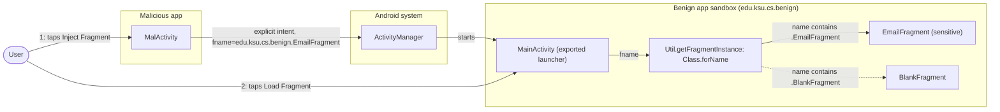
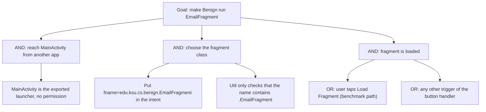

# Threat Model: FragmentInjection-PrivEscalation-Lean

## 1. Benchmark

| Field | Value |
|-------|-------|
| Name | FragmentInjection-PrivEscalation-Lean |
| Category | ICC (inter-component communication) |
| Ghera path | `benchmarks/ghera/ICC/FragmentInjection-PrivEscalation-Lean` |
| Affected Android versions (from README) | "Tested on Android 4.4 - Android 7.1" (heading: "Versions of Android affected") |
| Ghera tag | `Jan2019` (commit `6289f39d`) |
| Build flavors available | `api22` to `api27`, `apiDIST` (from `benchmarks/ghera/Misc/sdkFlavors.gradle`) |
| Date of model | 2026-11-01 |

Benign's launcher activity `MainActivity` reads a fragment class name from the intent extra `fname` and, when the user taps "Load Fragment", instantiates that class through reflection (`Class.forName(fname).newInstance()`) and shows it. Any app can start `MainActivity` with `fname="edu.ksu.cs.benign.EmailFragment"`, so the Malicious app makes Benign load `EmailFragment`, which the README describes as sending an email.

**Start order (README steps 7 to 10):** open Malicious, tap "Inject Fragment"; Benign comes to the front; tap "Load Fragment". Benign is not opened by hand first. The Testing code uses the same order.

## 2. System description

### Components

| Component | App | Type | Exported or reachable from other apps | Notes |
|-----------|-----|------|----------------------------------------|-------|
| `MainActivity` | Benign (`edu.ksu.cs.benign`) | Activity, launcher | Yes (launcher intent filter, no permission) | `onResume` reads `fname` from the intent (`MainActivity.java` line 23). On "Load Fragment" (`R.id.load_frag`), if `fname` is not empty it replaces `R.id.my_placeholder` with `Util.getFragmentInstance(fname)` (lines 28 to 31); otherwise it toasts "fragment name missing". |
| `Util.getFragmentInstance` | Benign | Helper class | n/a | If the name contains `.EmailFragment`, returns `(EmailFragment) Class.forName(fname).newInstance()`; if it contains `.BlankFragment`, the same for `BlankFragment`; otherwise returns `null`. Reflection errors are rethrown as `RuntimeException` (`Util.java` lines 10 to 28). |
| `EmailFragment` | Benign | Fragment | Loaded only through `MainActivity` | Inflates `fragment_email.xml`, a TextView `R.id.email_msg` with the string "Email sent successfully". No email code. |
| `BlankFragment` | Benign | Fragment | Loaded only through `MainActivity` | Inflates `fragment_blank.xml`, TextView `R.id.msg` with "Hello blank fragment". |
| `MalActivity` | Malicious (`edu.ksu.cs.malicious`) | Activity, launcher | n/a | "Inject Fragment" starts `edu.ksu.cs.benign/.MainActivity` with `fname="edu.ksu.cs.benign.EmailFragment"` (`MalActivity.java` lines 24 to 28). |
| `MainActivity` | Secure (`edu.ksu.cs.benign`) | Activity, launcher | Same as Benign | Loads the requested fragment only if `isValidFragment(fname)` is true, which is when the name does not contain `.EmailFragment`; otherwise it loads `BlankFragment` (Secure `MainActivity.java` lines 25 to 33 and 38 to 40). |

Manifest permissions: none of the three apps declares a permission.

Source files:
- `Benign/app/src/main/java/edu/ksu/cs/benign/MainActivity.java`
- `Benign/app/src/main/java/edu/ksu/cs/benign/Util.java`
- `Benign/app/src/main/java/edu/ksu/cs/benign/EmailFragment.java`
- `Benign/app/src/main/java/edu/ksu/cs/benign/BlankFragment.java`
- `Malicious/app/src/main/java/edu/ksu/cs/malicious/MalActivity.java`
- `Secure/app/src/main/java/edu/ksu/cs/benign/MainActivity.java`
- `AndroidManifest.xml` of each app

### Trust boundaries

| ID | Boundary | What crosses it |
|----|----------|-----------------|
| TB1 | Benign app sandbox vs. other apps | The explicit intent to `MainActivity` and its `fname` extra, chosen by the caller. |
| TB2 | Inside Benign: intent data vs. code selection | `fname` flows from the intent into `Class.forName`, so caller data decides which class Benign instantiates. |
| TB3 | User vs. Benign UI | The user taps "Load Fragment" on a Benign screen that another app opened. |

### Data flow diagram



## 3. Assets and attacker model

### Assets

| Asset | Why it matters |
|-------|----------------|
| `EmailFragment`'s function | The README: it "performs sensitive operations" and lets Malicious "send email on behalf of Malicious app". In the code it only shows "Email sent successfully". |
| The integrity of Benign's code paths | Caller data selects which class Benign instantiates through reflection (`Util.java` lines 13 and 21). |
| Benign's availability | A name that passes the substring check but names no class makes `Util` throw `RuntimeException` (`Util.java` lines 15 to 16 and 23 to 24). |

### Attacker

A third-party app installed on the same device. This matches the Malicious app in the benchmark.

### Attacker requirements

- Installed on the same device as Benign.
- No permission needed. The Malicious manifest declares none.
- Knows Benign's package, the class `edu.ksu.cs.benign.MainActivity`, the extra name `fname` and the fragment class name `edu.ksu.cs.benign.EmailFragment`. The first is in the manifest; the others are in Benign's code.
- The user taps "Load Fragment" after Benign comes to the front (README step 10). The fragment is not loaded without that tap.

## 4. STRIDE

| Category | Threat | Applies | Why |
|----------|--------|---------|-----|
| Spoofing | Malicious drives Benign as if the request came from Benign's own flow. | Yes | `MainActivity` does not check who sent `fname` (`MainActivity.java` line 23). |
| Tampering | Caller data changes which code Benign runs. | Yes | `fname` reaches `Class.forName` (`Util.java` line 13). |
| Repudiation | Benign keeps no record of which app requested the fragment. | Yes | No logging. |
| Information disclosure | Data is returned to Malicious. | No | Nothing is sent back to the caller. |
| Denial of service | A crafted name crashes Benign. | Partially | From the code: a name containing `.BlankFragment` or `.EmailFragment` that is not a real class leads to `RuntimeException` (`Util.java` lines 15 to 16 and 23 to 24), which nothing catches. Not in the README or Testing code. |
| Elevation of privilege | Malicious reaches an internal function of Benign. | Yes | README: Malicious can make Benign "send email on behalf of Malicious app". This is the impact named in the benchmark title. |

## 5. LINDDUN

| Category | Threat | Applies | Why |
|----------|--------|---------|-----|
| Linkability | No personal data is processed. | No | The fragments show constant strings. |
| Identifiability | Same. | No | Same reason. |
| Non-repudiation | An email sent by Benign on Malicious's behalf would be attributed to the user. | Partially | Applies to a real email function; the benchmark only shows a message. |
| Detectability | An app can tell that Benign is installed by starting `MainActivity`. | Partially | Not used by the benchmark code. |
| Disclosure of information | No data is disclosed. | No | See STRIDE Information disclosure. |
| Unawareness | The user taps "Load Fragment" without knowing another app chose the fragment. | Yes | Benign's screen does not show the caller. |
| Non-compliance | A real app could send messages without the user's consent. | Partially | Applies to a real app. |

## 6. Attack tree



## 7. Standards mapping

Confidence values:
- **Verified**: the ID and title were checked against the official page.
- **Needs check**: the ID or title could not be confirmed against the official page.

Fit values:
- **Direct**: the standard describes this benchmark's weakness or test as it is.
- **Partial**: the standard covers part of this benchmark, or covers it only with a caveat given in the Fit cell.

CWE, MASVS, MASTG and MASWE titles are copied from `docs/threat-models/standards-reference.md`.

| Standard | ID | Title | Confidence | Fit |
|----------|----|-------|------------|-----|
| CWE | CWE-470 | Use of Externally-Controlled Input to Select Classes or Code | Verified | Direct. `fname` comes from the caller's intent (`MainActivity.java` line 23) and selects the class instantiated by `Class.forName(fname).newInstance()` (`Util.java` lines 13 and 21). The substring checks at lines 11 and 19 narrow the choice but do not tie it to the caller. Usage ALLOWED. |
| CWE | CWE-926 | Improper Export of Android Application Components | Verified | Partial. `MainActivity` is reachable by any app (Benign manifest lines 11 to 17) and accepts `fname` from any caller. Partial because it is the launcher activity and has to be exported; the fault is in how it handles the extra. Usage ALLOWED. |
| OWASP MASVS v2 | MASVS-PLATFORM-1 | The app uses IPC mechanisms securely. | Verified | Direct. The attack is an intent from another app; the fix filters the intent data (Secure `MainActivity.java` line 25). |
| OWASP MASVS v2 | MASVS-CODE-4 | The app validates and sanitizes all untrusted inputs. | Verified | Partial. The fix validates `fname` (Secure `MainActivity.java` lines 38 to 40). The control is broader than IPC. |
| OWASP MASTG test | MASTG-TEST-0364 | Exported And Unprotected Activities That Expose Sensitive Functionality | Verified | Partial. `MainActivity` is exported without `android:permission` (Benign manifest line 11) and exposes `EmailFragment`. Partial because it is the launcher, so the test's remedy (a permission) does not apply; the fault is the reflection on caller data. |
| OWASP MASTG test | MASTG-TEST-0029 | Testing for Sensitive Functionality Exposure Through IPC | Verified | Partial. Deprecated; the page points to MASTG-TEST-0364 and others. Kept for reference only. |
| OWASP MASWE | MASWE-0018 | Lack of Authentication or Authorization on App Components | Verified | Partial. `MainActivity` loads a sensitive fragment for any caller with no authorization check (`MainActivity.java` lines 28 to 31). Partial because the weakness page is about access control on components, while here the component is meant to be public and the missing check is on the input. |

CWE-20 (Improper Input Validation) was considered and is DISCOURAGED in `standards-reference.md`, so it is not in the table; CWE-470 is the more specific entry used instead.

Candidates to check (not in the table):
- None beyond the IDs above.

MITRE ATT&CK for Mobile: No direct match. No technique on attack.mitre.org was verified that describes making another app instantiate a fragment through reflection.

## 8. Evidence

All steps below are **Not yet run**. No result has been observed.

The README range is Android 4.4 to 7.1. The `ghera27` emulator runs API 27 (Android 8.1), which is outside that range but inside the Testing code's range (`@SdkSuppress(minSdkVersion = 22, maxSdkVersion = 27)`).

### Commands

Build. PowerShell on Windows from the project root, Gradle 4.4, JDK 8 through `env.ps1`. **Not yet run.**

```powershell
. .\env.ps1
$B = "benchmarks\ghera\ICC\FragmentInjection-PrivEscalation-Lean"
# Each app folder needs local.properties with sdk.dir=C:/Android/Sdk (none is present yet)
foreach ($a in "Benign","Malicious","Secure") {
    Set-Content "$B\$a\local.properties" "sdk.dir=C:/Android/Sdk"
    Push-Location "$B\$a"; .\gradlew.bat assembleDebug; Pop-Location
}
```

Start the emulator and install pair 1. **Not yet run.**

```powershell
. .\env.ps1
emulator -avd ghera27
$B = "benchmarks\ghera\ICC\FragmentInjection-PrivEscalation-Lean"
adb install -r "$B\Benign\app\build\outputs\apk\api27\debug\app-api27-debug.apk"
adb install -r "$B\Malicious\app\build\outputs\apk\api27\debug\app-api27-debug.apk"
```

Pair 1, Benign + Malicious, by hand, in the README start order. **Not yet run.**

1. `adb logcat -c`
2. Open Malicious (README step 7). Tap "Inject Fragment" (step 8).
3. Check that Benign comes to the front (step 9).
4. Tap "Load Fragment" (step 10).
5. Read the text in the fragment area.
6. `adb logcat -d -s AndroidRuntime:E`

Pair 2, Secure + Malicious. Secure shares the package name `edu.ksu.cs.benign`. **Not yet run.**

```powershell
adb uninstall edu.ksu.cs.benign
adb install -r "$B\Secure\app\build\outputs\apk\api27\debug\app-api27-debug.apk"
```

Repeat steps 1 to 6 with Secure in place of Benign. The Secure app's label is still "Benign" (`Secure/app/src/main/res/values/strings.xml` line 2).

No-attacker check. This exploit uses no broadcast, so the `adb shell am broadcast` line is replaced by an `am start` that sends the same intent from the shell. **Not yet run.**

```powershell
adb shell am start -n edu.ksu.cs.benign/.MainActivity --es fname edu.ksu.cs.benign.EmailFragment
# then tap "Load Fragment" on the emulator
adb shell am start -n edu.ksu.cs.benign/.MainActivity --es fname x.BlankFragment
# then tap "Load Fragment" and read: adb logcat -d -s AndroidRuntime:E
```

What it can show: that `MainActivity` accepts `fname` from a caller outside Benign and loads the named fragment, without the Malicious app; and, with the second line, whether a crafted name crashes the app (section 4, Denial of service). What it cannot show: anything specific to a third-party app's identity, since the shell user is a different caller from an installed app.

### Expected result (from README and Testing code)

| Pair | Expected | Source | Status |
|------|----------|--------|--------|
| Benign + Malicious | After "Load Fragment", Benign shows "Email sent successfully". | README step 11; `Testing/benign_app/.../Tests.java` lines 65 to 80 tap `inject_frag`, then `load_frag`, and assert `email_msg` is "Email sent successfully". | Not yet run |
| Secure + Malicious | After "Load Fragment", Secure shows "Hello blank fragment". | `Testing/secure_app/.../Tests.java` lines 67 to 82 assert `msg` is "Hello blank fragment". The README gives no Secure steps. | Not yet run |

### Observed result

| Pair | Outcome | Observation |
|------|---------|-------------|
| Benign + Malicious | Not yet observed | Not yet observed |
| Secure + Malicious | Not yet observed | Not yet observed |

## 9. Mitigation

### What the Secure app does differently

Diff of `Benign/` and `Secure/` (excluding build output, the prebuilt APKs and `local.properties`). The two `gradle-wrapper.properties` files are the same.

| File | Benign | Secure |
|------|--------|--------|
| `app/src/main/java/edu/ksu/cs/benign/MainActivity.java` line 28 (Secure line 25) | `if(fname != null && !fname.equals("")){` | `if (fname != null && !fname.equals("") && isValidFragment(fname)) {` |
| `MainActivity.java` lines 33 to 35 (Secure lines 29 to 33) | `else{ Toast.makeText(..., "fragment name missing", ...).show(); }` | `} else {` replace `R.id.my_placeholder` with `new BlankFragment()` and commit |
| `MainActivity.java` (Secure lines 38 to 40) | none | `private Boolean isValidFragment(String fname) { return (!(fname.contains(".EmailFragment"))); }` |
| `MainActivity.java` lines 3, 4, 10 | Imports `Intent`, `IntentFilter`, `Toast` | Removed (unused) |
| `app/src/main/java/edu/ksu/cs/benign/Util.java` | Original formatting | Reformatted only; same logic |

The manifest and `strings.xml` are the same; the Secure label is "Benign".

### Assessment of the fix

The fix stops the benchmark exploit: a name containing `.EmailFragment` is refused, and `Util` only ever instantiates `EmailFragment` for such names. Residual points:

1. **Deny-list, not allow-list.** `isValidFragment` blocks one substring. Any fragment added to `Util` later is loadable by other apps unless someone also adds it to the deny-list. An allow-list of the fragments that callers may request would be safer.
2. **Reflection on caller data remains.** `Util` still calls `Class.forName(fname)` with the caller's string (Secure `Util.java` lines 13 and 20). A name such as `x.BlankFragment` passes `isValidFragment`, matches the `.BlankFragment` check, and fails in `Class.forName`; `Util` rethrows it as `RuntimeException`, which nothing catches. From the code this crashes Secure as well as Benign.
3. **`null` fragment.** A name that matches neither check makes `Util` return `null`, which is passed to `ft.replace`. What the platform does with it has not been checked.
4. **Still exported.** `MainActivity` is the launcher and has to be exported, so the only protection is input handling. Separating the fragment loader from the launcher, and not exporting it, would remove the exposure.
5. **Newer Android versions.** Hypothesis, to test in Step 3: on newer Android versions the support-library `FragmentManager` and stricter intent handling do not change this pattern, because the reflection is in app code, not in a platform class.

The fix is complete for the benchmark exploit. Points 1 to 3 leave the same pattern open for other fragments and for a crash.

## 10. Open questions

- The README says Malicious can make Benign "send email". `EmailFragment` only shows the string "Email sent successfully" (`strings.xml`, `email_msg_fragment`); no email code exists. The model follows the code.
- The README range is Android 4.4 to 7.1, while the Testing code and the build flavors cover API 22 to 27. What to expect on `ghera27` is stated only by the Testing code.
- The README calls this "fragment injection", a term usually tied to a platform class; the benchmark's loader is app code (`Util.java`). The README reference is an external article and was not checked.
- What happens when `ft.replace` receives `null` (section 9, item 3) has not been checked.
- The Secure app's label is "Benign", the same as Benign's.
- Lean vs Fat: there is no Fat variant of this benchmark under `benchmarks/ghera/ICC/`, so there is nothing to compare.
- Running the build commands in section 8 writes `local.properties` and `build/` folders under `benchmarks/`. Prebuilt APKs are in each app folder; which flavor they were built with has not been checked.
