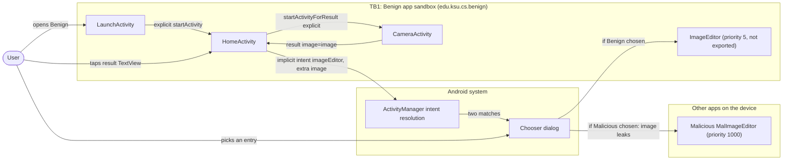
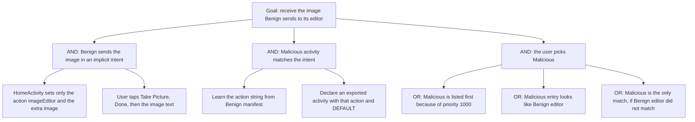

# Threat Model: HighPriority-ActivityHijack-Lean

## 1. Benchmark

| Field | Value |
|-------|-------|
| Name | HighPriority-ActivityHijack-Lean |
| Category | ICC (inter-component communication) |
| Ghera path | `benchmarks/ghera/ICC/HighPriority-ActivityHijack-Lean` |
| Affected Android versions (from README) | "Tested on Android 5.1.1 - Android 8.1" (heading: "Android versions affected") |
| Ghera tag | `Jan2019` (commit `6289f39d`) |
| Build flavors available | `api22` to `api27`, `apiDIST` (from `benchmarks/ghera/Misc/sdkFlavors.gradle`) |
| Date of model | 2026-10-31 |

Benign's `HomeActivity` opens its own image editor with an implicit intent (action `edu.ksu.cs.benign.imageEditor`) that carries the "image" as an extra. The Malicious app declares an activity, `MalImageEditor`, with an intent filter for the same action and a higher priority. When the user taps the image, a chooser lists Malicious before Benign; if the user picks Malicious, `MalImageEditor` receives and displays the image.

## 2. System description

### Components

| Component | App | Type | Exported or reachable from other apps | Notes |
|-----------|-----|------|----------------------------------------|-------|
| `LaunchActivity` | Benign (`edu.ksu.cs.benign`) | Activity, launcher | Yes (launcher intent filter) | `onResume` starts `HomeActivity` with an explicit intent. |
| `HomeActivity` | Benign | Activity | No (`android:exported="false"`) | "Take Picture" (`R.id.takePic`) starts `CameraActivity` for a result. Tapping the TextView `R.id.result` sends an implicit intent with action `edu.ksu.cs.benign.imageEditor` and extra `image` set to the TextView text (`HomeActivity.java` lines 31 to 34). |
| `CameraActivity` | Benign | Activity | No intent filter, no `exported` attribute | The "Done" button (`R.id.done_btn`) returns `RESULT_OK` with extra `image="image"` (`CameraActivity.java` line 24). Stand-in for a camera. |
| `ImageEditor` | Benign | Activity | No (`android:exported="false"`), but has an intent filter with `android:priority="5"` for `edu.ksu.cs.benign.imageEditor` and `DEFAULT` (manifest lines 21 to 29) | Shows the `image` extra in `R.id.text`. |
| `MalActivity` | Malicious (`edu.ksu.cs.malicious`) | Activity, launcher | n/a | Has `android:priority="10"` on the `<activity>` element (manifest line 13), not on an intent filter. Its button "gotoImageEditor" starts `MalImageEditor` with an explicit intent. Not part of the exploit path. |
| `MalImageEditor` | Malicious | Activity | Yes (intent filter, no `exported` attribute) | Intent filter with `android:priority="1000"` for `edu.ksu.cs.benign.imageEditor` and `DEFAULT` (manifest lines 20 to 25). `onResume` shows the `image` extra in `R.id.disp` (`MalImageEditor.java` lines 23 to 26). |
| `HomeActivity` | Secure (`edu.ksu.cs.benign`) | Activity | Same as Benign | Opens `ImageEditor` with an explicit intent: `new Intent(getApplicationContext(), ImageEditor.class)` (Secure `HomeActivity.java` line 31). |
| `ImageEditor` | Secure | Activity | No (`android:exported="false"`), no intent filter | The intent filter is removed (Secure manifest lines 21 to 23). |

Manifest permissions: none of the three apps declares or uses a permission.

Source files:
- `Benign/app/src/main/java/edu/ksu/cs/benign/LaunchActivity.java`
- `Benign/app/src/main/java/edu/ksu/cs/benign/HomeActivity.java`
- `Benign/app/src/main/java/edu/ksu/cs/benign/CameraActivity.java`
- `Benign/app/src/main/java/edu/ksu/cs/benign/ImageEditor.java`
- `Malicious/app/src/main/java/edu/ksu/cs/malicious/MalActivity.java`
- `Malicious/app/src/main/java/edu/ksu/cs/malicious/MalImageEditor.java`
- `Secure/app/src/main/java/edu/ksu/cs/benign/HomeActivity.java`
- `AndroidManifest.xml` of each app

### Trust boundaries

| ID | Boundary | What crosses it |
|----|----------|-----------------|
| TB1 | Benign app sandbox vs. other apps on the device | The implicit intent with action `edu.ksu.cs.benign.imageEditor` and extra `image`, which leaves Benign and is resolved by the Android system against every installed app's intent filters. |
| TB2 | Benign vs. the user (chooser dialog) | The system chooser, in which the user decides which app receives the intent. The chooser lists Malicious first (README). |
| TB3 | Inside Benign: `CameraActivity` to `HomeActivity` | The `image` result, passed with `setResult` and explicit intents only. Does not leave Benign. |

### Data flow diagram



## 3. Assets and attacker model

### Assets

| Asset | Why it matters |
|-------|----------------|
| The `image` extra | Stand-in for a user's image. The README: "If the image contains sensitive information then it is leaked via MalActivity." In the code it is the constant string `"image"` (`CameraActivity.java` line 24). |
| The user's choice in the chooser | The user decides where the data goes. A look-alike entry listed first can mislead that choice. |
| Benign's image editing workflow | If the user picks Malicious, Benign's own editor never runs for that image. |

### Attacker

A third-party app installed on the same device. This matches the Malicious app in the benchmark.

### Attacker requirements

- Installed on the same device as Benign.
- No permission needed. The Malicious manifest declares none.
- Knows the action string `edu.ksu.cs.benign.imageEditor`. It is in Benign's manifest (line 25) and in `HomeActivity.java` line 32.
- Declares an exported activity with an intent filter for that action, with a priority higher than 5 (the benchmark uses 1000).
- The user must pick the Malicious entry in the chooser. The README says Malicious is listed first and that "MalActivity will have to look very similar to ImageEditor" for the user to choose it.
- The user must first take a picture in Benign, so that the TextView holds the image, then tap it.

## 4. STRIDE

| Category | Threat | Applies | Why |
|----------|--------|---------|-----|
| Spoofing | Malicious poses as Benign's image editor. | Yes | `MalImageEditor` declares Benign's own action string (Malicious manifest line 22). README: MalActivity "will have to look very similar to ImageEditor". |
| Tampering | Malicious changes Benign's data. | No | `HomeActivity` uses `startActivity`, not `startActivityForResult`, for the editor (line 34), so no result comes back from Malicious. |
| Repudiation | Benign keeps no record of which app received the image. | Partially | Benign logs nothing about the hand-off. The user made the choice in the chooser, so the event is not hidden from the user. |
| Information disclosure | The image is delivered to Malicious. | Yes | `MalImageEditor.java` lines 23 to 26 read the `image` extra and display it. This is the impact named in the README. |
| Denial of service | Benign's editor does not run when the user picks Malicious. | Partially | Only for that tap. The user can pick Benign next time. |
| Elevation of privilege | Malicious gains access to Benign's non-exported editor. | No | `ImageEditor` stays unreachable to other apps. Malicious only receives the data Benign sends out. |

## 5. LINDDUN

| Category | Threat | Applies | Why |
|----------|--------|---------|-----|
| Linkability | Images taken in Benign could be linked to the user by the receiving app. | Partially | Applies to a real app with real images. The benchmark data is a constant string. |
| Identifiability | A real image could identify the user. | Partially | Same reason. |
| Non-repudiation | No user action is attributed. | No | Nothing is recorded against the user. |
| Detectability | Malicious can tell that Benign is in use when it receives the intent. | Partially | Receiving the intent reveals that the user tapped the image in Benign. Not used by the benchmark code. |
| Disclosure of information | The image goes to an unintended app. | Yes | See STRIDE Information disclosure. |
| Unawareness | The user may not know that the first chooser entry is a different app. | Yes | README: the malicious activity appears first and should look like `ImageEditor` so the user "does not understand that her images are being leaked". |
| Non-compliance | Personal data is shared with a third party without consent. | Partially | Applies to a real app with user images. |

## 6. Attack tree



## 7. Standards mapping

Confidence values:
- **Verified**: the ID and title were checked against the official page.
- **Needs check**: the ID or title could not be confirmed against the official page.

Fit values:
- **Direct**: the standard describes this benchmark's weakness or test as it is.
- **Partial**: the standard covers part of this benchmark, or covers it only with a caveat given in the Fit cell.

CWE and MASVS titles are copied from `docs/threat-models/standards-reference.md`.

| Standard | ID | Title | Confidence | Fit |
|----------|----|-------|------------|-----|
| CWE | CWE-927 | Use of Implicit Intent for Sensitive Communication | Verified | Direct. `HomeActivity.java` lines 31 to 34 send the image in an intent that sets only an action, so any app with a matching intent filter can receive it; `MalImageEditor` does (Malicious manifest lines 20 to 25). Usage ALLOWED. |
| OWASP MASVS v2 | MASVS-PLATFORM-1 | The app uses IPC mechanisms securely. | Verified | Direct. The fix replaces the implicit intent with an explicit one (Secure `HomeActivity.java` line 31). |
| OWASP MASWE | MASWE-0032 | Insecure Intents | Verified | Direct. `HomeActivity.java` lines 31 to 34 send the image in an intent that sets only an action; the page covers "sending sensitive data via implicit intents that any matching app can receive". Controls shown on the page: MASVS-PLATFORM-1, MASVS-STORAGE-2. |

OWASP MASTG test: No direct match among the IDs in the reference file. MASTG-TEST-0364, MASTG-TEST-0365, MASTG-TEST-0366 and MASTG-TEST-0029 are about exported components that expose functionality, while this benchmark sends data out through an implicit activity intent (`HomeActivity.java` line 32). MASWE-0018 is not in the table: Benign's `ImageEditor` is not exported (manifest line 23).

Candidates to check (not in the table):
- A MASTG test about sending sensitive data in implicit intents. No such test is in the reference file.

MITRE ATT&CK for Mobile: No direct match. No technique on attack.mitre.org was verified that describes intercepting another app's implicit activity intent through intent filter priority.

## 8. Evidence

All steps below are **Not yet run**. No result has been observed.

### Commands

Build. PowerShell on Windows from the project root, Gradle 4.4, JDK 8 through `env.ps1`. **Not yet run.**

```powershell
. .\env.ps1
$B = "benchmarks\ghera\ICC\HighPriority-ActivityHijack-Lean"
# Each app folder needs local.properties with sdk.dir=C:/Android/Sdk (none is present yet)
foreach ($a in "Benign","Malicious","Secure") {
    Set-Content "$B\$a\local.properties" "sdk.dir=C:/Android/Sdk"
    Push-Location "$B\$a"; .\gradlew.bat assembleDebug; Pop-Location
}
```

Start the emulator and install pair 1. **Not yet run.**

```powershell
. .\env.ps1
emulator -avd ghera27
$B = "benchmarks\ghera\ICC\HighPriority-ActivityHijack-Lean"
adb install -r "$B\Benign\app\build\outputs\apk\api27\debug\app-api27-debug.apk"
adb install -r "$B\Malicious\app\build\outputs\apk\api27\debug\app-api27-debug.apk"
```

Pair 1, Benign + Malicious, by hand (README step 7 and the step numbered 9). **Not yet run.**

1. `adb logcat -c`
2. Open Benign. `LaunchActivity` moves on to `HomeActivity`.
3. Tap "Take Picture".
4. Tap "Done". The TextView should now read "image" (`Testing/benign_app/.../Tests.java` line 75).
5. Tap the text "image".
6. Read the chooser: note which entries it lists and in which order.
7. Tap "Malicious". On API 27 the Testing code does not tap "Just once" (it does so only below SDK 26, `Tests.java` lines 80 to 84); tap it if it appears.
8. Read the screen that comes to the front.
9. `adb shell dumpsys activity activities | findstr mResumedActivity`

Pair 2, Secure + Malicious. Secure shares the package name `edu.ksu.cs.benign`. **Not yet run.**

```powershell
adb uninstall edu.ksu.cs.benign
adb install -r "$B\Secure\app\build\outputs\apk\api27\debug\app-api27-debug.apk"
```

Repeat steps 1 to 9 with Secure in place of Benign. At step 6, note whether any chooser appears.

The same intent without the Malicious app. This exploit is not a broadcast, so the shell equivalent is an `am start` with Benign's action; the shell cannot start Benign's `ImageEditor` because it is not exported. With Malicious installed and Benign or Secure installed: **Not yet run.**

```powershell
adb shell am start -a edu.ksu.cs.benign.imageEditor --es image image
adb shell cmd package query-activities -a edu.ksu.cs.benign.imageEditor
```

### Expected result (from README and Testing code)

| Pair | Expected | Source | Status |
|------|----------|--------|--------|
| Benign + Malicious | A chooser lists Malicious before Benign. After picking Malicious, `MalImageEditor` shows "image" in `R.id.disp`. | README step 7 ("a chooser pops up showing Malicious before Benign") and step 9 ("image will be displayed in Malicious"); `Testing/benign_app/.../Tests.java` lines 77 to 91 tap "Malicious" and assert `disp` is "image". | Not yet run |
| Secure + Malicious | No entry named "Malicious" appears; Secure's `ImageEditor` opens. | `Testing/secure_app/.../Tests.java` lines 80 to 83 expect `UiObjectNotFoundException` when tapping "Malicious". The README gives no Secure steps. That `ImageEditor` opens follows from Secure `HomeActivity.java` line 31. | Not yet run |

### Observed result

| Pair | Outcome | Observation |
|------|---------|-------------|
| Benign + Malicious | Not yet observed | Not yet observed |
| Secure + Malicious | Not yet observed | Not yet observed |

## 9. Mitigation

### What the Secure app does differently

Diff of `Benign/` and `Secure/` (excluding build output, the prebuilt APKs and `local.properties`). The two `gradle-wrapper.properties` files are the same.

| File | Benign | Secure |
|------|--------|--------|
| `app/src/main/java/edu/ksu/cs/benign/HomeActivity.java` lines 31 to 32 (Secure line 31) | `Intent intent = new Intent();` and `intent.setAction("edu.ksu.cs.benign.imageEditor");` | `Intent intent = new Intent(getApplicationContext(), ImageEditor.class);` |
| `app/src/main/AndroidManifest.xml` lines 22 to 29 (Secure lines 22 to 23) | `ImageEditor` with `android:exported="false"` and `<intent-filter android:priority="5">` for `edu.ksu.cs.benign.imageEditor` and `DEFAULT` | `ImageEditor` with `android:exported="false"` and no intent filter |
| `AndroidManifest.xml` lines 11, 19, 30 (Secure 11, 19, 24) | `.LaunchActivity`, `.HomeActivity`, `.CameraActivity` | Fully qualified `edu.ksu.cs.benign.` names (same classes) |
| `app/src/main/res/values/strings.xml` line 2 | `Benign` | `Secure` |

`LaunchActivity`, `CameraActivity`, `ImageEditor` and the layouts are the same in both apps.

### Assessment of the fix

The fix is complete for this data flow. The image now goes to a named class in the same app, so the system does not resolve it against other apps' intent filters, and removing the intent filter leaves no action string for an attacker to copy. Residual points:

1. **Other implicit flows are not present.** The only other hand-offs in Secure (`LaunchActivity` to `HomeActivity`, `HomeActivity` to `CameraActivity`) already use explicit intents, so nothing else is open to the same attack.
2. **Priority is not a defence.** Benign set priority 5 and Malicious used 1000. The README's design point is that a higher priority wins the chooser order; the fix does not rely on priority at all, which is the right choice.
3. **Newer Android versions.** The comment in `MalImageEditor.java` lines 8 to 11 says "Android 7.0 fixes this problem by giving preference to an intent filter inside the app." Hypothesis, to test in Step 3: on Android 7.0 and later the system resolves the implicit intent to Benign's own `ImageEditor` without a chooser. This contradicts the README range (5.1.1 to 8.1) and the Testing code, which expects the chooser up to API 27; see Open questions.

## 10. Open questions

- The README says the Malicious activity is `MalActivity` with priority 10 and the same action. In the code, `MalActivity` has `android:priority="10"` on the `<activity>` element (Malicious manifest line 13) and no matching intent filter; the activity that matches is `MalImageEditor`, with priority 1000 on its intent filter (line 21). The model follows the code.
- The README links to the `<intent-filter>` priority documentation; whether `android:priority` on an `<activity>` element has any effect has not been checked.
- The comment in `MalImageEditor.java` (Android 7.0 prefers an intent filter inside the app) contradicts the README range and `Testing/benign_app/.../Tests.java`, which runs up to SDK 27 and expects the chooser. Which is right on API 27 is the main thing the ghera27 run should settle.
- Benign's `ImageEditor` is `android:exported="false"` but has an intent filter. Whether a non-exported activity of the sending app is listed in the chooser at all, next to an exported one from another app, has not been checked.
- Whether the system honours an intent filter priority of 1000 from a third-party app for activities, or caps it, has not been checked. Hypothesis, to test in Step 3: newer Android versions ignore or cap activity intent filter priority for non-system apps.
- The README step numbers jump from 7 to 9.
- The "image" is the string `"image"`, not image data (`CameraActivity.java` line 24).
- Lean vs Fat: there is no Fat variant of this benchmark under `benchmarks/ghera/ICC/`, so there is nothing to compare.
- Running the build commands in section 8 writes `local.properties` and `build/` folders under `benchmarks/`. Prebuilt APKs are in each app folder (for example `Benign/HighPriority-ActivityHijack-Lean-benign.apk`); which flavor they were built with has not been checked.
