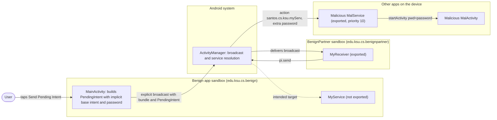
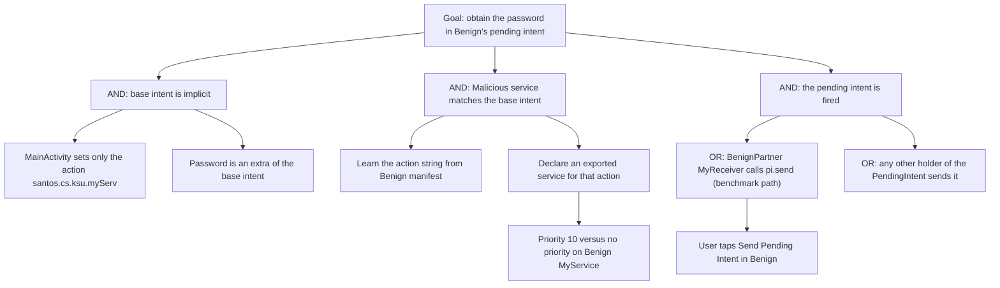

# Threat Model: ImplicitPendingIntent-IntentHijack-Lean

## 1. Benchmark

| Field | Value |
|-------|-------|
| Name | ImplicitPendingIntent-IntentHijack-Lean |
| Category | ICC (inter-component communication) |
| Ghera path | `benchmarks/ghera/ICC/ImplicitPendingIntent-IntentHijack-Lean` |
| Affected Android versions (from README) | "Tested on Android 5.1.1 - Android 8.1" (heading: "Android versions affected") |
| Ghera tag | `Jan2019` (commit `6289f39d`) |
| Build flavors available | `api22` to `api27`, `apiDIST` (from `benchmarks/ghera/Misc/sdkFlavors.gradle`) |
| Date of model | 2026-10-31 |

Benign creates a pending intent for a service whose base intent is implicit (action `santos.cs.ksu.myServ`) and carries the extra `password`. It hands the pending intent to the BenignPartner app, which fires it. The Malicious app declares an exported service, `MalService`, with an intent filter for the same action and priority 10, so when BenignPartner fires the pending intent, `MalService` receives the intent and the password instead of Benign's `MyService`.

## 2. System description

### Components

| Component | App | Type | Exported or reachable from other apps | Notes |
|-----------|-----|------|----------------------------------------|-------|
| `MainActivity` | Benign (`edu.ksu.cs.benign`) | Activity, launcher | Yes (launcher intent filter) | The button "Send Pending Intent" (`R.id.button`) builds `Intent i` with only `setAction("santos.cs.ksu.myServ")` and `putExtra("password", "password")`, wraps it in `PendingIntent.getService(..., 0, i, FLAG_UPDATE_CURRENT)`, puts it in a Bundle and sends an explicit broadcast to `edu.ksu.cs.benignpartner.MyReceiver` (`MainActivity.java` lines 26 to 36). |
| `MyService` | Benign | Service | No (`android:exported="false"`), but has an intent filter for `santos.cs.ksu.myServ` (manifest lines 20 to 26) | `onStartCommand` logs "Do something trivial" with tag `PendingIntent...`. It does not read the password. |
| `MainActivity` | BenignPartner (`edu.ksu.cs.benignpartner`) | Activity, launcher | Yes (launcher intent filter) | `onCreate` also registers a `MyReceiver` at run time for the action `edu.ksu.cs.benignpartner.MyReceiver` (`MainActivity.java` line 13). |
| `MyReceiver` | BenignPartner | Broadcast receiver, declared in manifest | Yes (`android:exported="true"`, no intent filter, no permission) | Reads the `bundle` extra, takes the `pendingIntent` parcelable and calls `pi.send()` with no fill-in intent (`MyReceiver.java` lines 15 to 18). |
| `MalService` | Malicious (`edu.ksu.cs.malicious`) | Service | Yes (`android:exported="true"`, intent filter `android:priority="10"` for `santos.cs.ksu.myServ`, manifest lines 29 to 36) | Reads the `password` extra, starts `MalActivity` with extra `pwd`, and logs "Malicious service steals " plus the password (`MalService.java` lines 14 to 19). |
| `MalActivity` | Malicious | Activity, launcher | n/a | Shows the `pwd` extra in `R.id.disp` when present (`MalActivity.java` lines 19 to 21). |
| `MyReceiver` | Malicious | Broadcast receiver | Yes (`android:exported="true"`, intent filter priority 1 for `santos.cs.ksu.edu.benignpireceiver`) | Would fire a received pending intent with `pi.send()`. Benign never sends that action in this benchmark, so it is not on the exploit path. |
| `MainActivity` | Secure (`edu.ksu.cs.benign`) | Activity, launcher | Same as Benign | Sets the base intent's component to `edu.ksu.cs.benign.MyService` with `setComponent` instead of setting an action (Secure `MainActivity.java` lines 29 to 30). |
| `MyService` | Secure | Service | Same manifest entry as Benign | Also starts `SomeActivity` with `FLAG_ACTIVITY_NEW_TASK` (Secure `MyService.java` lines 15 to 16). |
| `SomeActivity` | Secure | Activity | No intent filter, no `exported` attribute | Shows the text "SomeActivity" in `R.id.disp`. Used by the Secure test as proof that Secure's own service ran. |

Manifest permissions: none of the four apps declares or uses a permission.

Source files:
- `Benign/app/src/main/java/edu/ksu/cs/benign/MainActivity.java`
- `Benign/app/src/main/java/edu/ksu/cs/benign/MyService.java`
- `BenignPartner/app/src/main/java/edu/ksu/cs/benignpartner/MainActivity.java`
- `BenignPartner/app/src/main/java/edu/ksu/cs/benignpartner/MyReceiver.java`
- `Malicious/app/src/main/java/edu/ksu/cs/malicious/MalService.java`
- `Malicious/app/src/main/java/edu/ksu/cs/malicious/MalActivity.java`
- `Malicious/app/src/main/java/edu/ksu/cs/malicious/MyReceiver.java`
- `Secure/app/src/main/java/edu/ksu/cs/benign/MainActivity.java`
- `Secure/app/src/main/java/edu/ksu/cs/benign/MyService.java`
- `Secure/app/src/main/java/edu/ksu/cs/benign/SomeActivity.java`
- `AndroidManifest.xml` of each app

### Trust boundaries

| ID | Boundary | What crosses it |
|----|----------|-----------------|
| TB1 | Benign sandbox vs. BenignPartner sandbox | The explicit broadcast to `edu.ksu.cs.benignpartner/.MyReceiver` carrying the pending intent. BenignPartner is trusted by Benign. |
| TB2 | Benign sandbox vs. all other apps, at the moment the pending intent fires | The base intent, sent with Benign's identity but resolved by action against every installed app's service intent filters. The password crosses here. |
| TB3 | BenignPartner sandbox vs. other apps | `MyReceiver` is exported with no permission, so any app can make BenignPartner fire a pending intent. Not used by the benchmark exploit. |

### Data flow diagram



## 3. Assets and attacker model

### Assets

| Asset | Why it matters |
|-------|----------------|
| The `password` extra in the base intent | The README calls it "sensitive information like password". In the code it is the constant string `"password"` (`MainActivity.java` line 29). |
| Benign's identity when the pending intent fires | The README says the receiving app acts with the same permissions as the sender. The intent is sent as Benign. |
| Benign's `MyService` work | If Malicious takes the intent, Benign's own service may not run for that request. |

### Attacker

A third-party app installed on the same device. This matches the Malicious app in the benchmark. It does not need to send anything: it only declares a service and waits.

### Attacker requirements

- Installed on the same device as Benign and BenignPartner.
- No permission needed. The Malicious manifest declares none.
- Knows the action string `santos.cs.ksu.myServ`. It is in Benign's manifest (line 24).
- Declares an exported service with an intent filter for that action. The benchmark uses priority 10; Benign's filter has no priority.
- The user taps the button in Benign. BenignPartner must be installed so that the pending intent is fired. README step 10 also opens Malicious and BenignPartner first.

## 4. STRIDE

| Category | Threat | Applies | Why |
|----------|--------|---------|-----|
| Spoofing | Malicious stands in for Benign's `MyService`. | Yes | `MalService` declares Benign's action (Malicious manifest line 34) and receives the intent meant for Benign. |
| Tampering | Malicious changes Benign's data. | No | `MalService` only reads the intent. Nothing is returned to Benign. |
| Repudiation | Neither Benign nor BenignPartner records which service received the intent. | Yes | Benign logs nothing at send time; BenignPartner logs only "called" (`MyReceiver.java` line 14). |
| Information disclosure | The password is delivered to Malicious. | Yes | `MalService.java` line 15 reads `password`; line 19 writes it to the log and lines 16 to 18 show it in `MalActivity`. This is the impact named in the README. |
| Denial of service | Benign's `MyService` does not run when Malicious takes the intent. | Partially | Follows from a single service being started for the intent. Not checked by the README or the Testing code. |
| Elevation of privilege | Malicious receives an intent sent with Benign's identity. | Partially | Benign holds no permissions, so nothing beyond the data is gained in the benchmark. The README describes the general risk of the pending intent's permissions. |

## 5. LINDDUN

| Category | Threat | Applies | Why |
|----------|--------|---------|-----|
| Linkability | A real credential could link the user's accounts. | Partially | The benchmark password is a constant. |
| Identifiability | A real credential could identify the user. | Partially | Same reason. |
| Non-repudiation | No user action is attributed. | No | Nothing is recorded against the user. |
| Detectability | Malicious learns that the user acted in Benign when the intent arrives. | Partially | Not used by the benchmark code. |
| Disclosure of information | The password is disclosed to an unintended app. | Yes | See STRIDE Information disclosure. |
| Unawareness | The user is not told that another app received the data. | Yes | Nothing in Benign shows where the intent went. `MalActivity` is shown, but as a Malicious screen. |
| Non-compliance | Personal data or credentials are shared without consent. | Partially | Applies to a real app with user data. |

## 6. Attack tree



## 7. Standards mapping

Confidence values:
- **Verified**: the ID and title were checked against the official page.
- **Needs check**: the ID or title could not be confirmed against the official page.

Fit values:
- **Direct**: the standard describes this benchmark's weakness or test as it is.
- **Partial**: the standard covers part of this benchmark, or covers it only with a caveat given in the Fit cell.

CWE and MASVS titles are copied from `docs/threat-models/standards-reference.md`.

| Standard | ID | Title | Confidence | Fit |
|----------|----|-------|------------|-----|
| CWE | CWE-927 | Use of Implicit Intent for Sensitive Communication | Verified | Direct. `MainActivity.java` lines 27 to 30 put the password in an intent that has only an action and wrap it in a pending intent; when it fires, `MalService` matches the action and reads the password (`MalService.java` line 15). Usage ALLOWED. |
| OWASP MASVS v2 | MASVS-PLATFORM-1 | The app uses IPC mechanisms securely. | Verified | Direct. The fix makes the base intent explicit (Secure `MainActivity.java` lines 29 to 30). |
| OWASP MASWE | MASWE-0032 | Insecure Intents | Verified | Direct. `MainActivity.java` lines 27 to 30 put the password in an intent that has only an action and wrap it in a pending intent; the page covers "sending sensitive data via implicit intents that any matching app can receive" and "creating PendingIntents that other apps can modify or replay". Controls shown on the page: MASVS-PLATFORM-1, MASVS-STORAGE-2. |

OWASP MASTG test: No direct match among the IDs in the reference file. MASTG-TEST-0364, MASTG-TEST-0365, MASTG-TEST-0366 and MASTG-TEST-0029 are about exported components that expose functionality in the target app, while this weakness is the implicit base intent of a pending intent (`MainActivity.java` line 28).

Candidates to check (not in the table):
- MASTG-TEST-0030 (Testing for Vulnerable Implementation of PendingIntent) and MASTG-TEST-0381 (References to Insecure PendingIntent Creation), both listed in the MASTG site navigation. Not in the reference file.
- MASWE-0018 for BenignPartner's `MyReceiver` (exported, no permission, fires any pending intent it is given). This is the partner app, not the benchmark target, so it is not in the table.

MITRE ATT&CK for Mobile: No direct match. No technique on attack.mitre.org was verified that describes declaring a service to intercept another app's implicit pending intent.

## 8. Evidence

All steps below are **Not yet run**. No result has been observed.

### Commands

Build. PowerShell on Windows from the project root, Gradle 4.4, JDK 8 through `env.ps1`. **Not yet run.**

```powershell
. .\env.ps1
$B = "benchmarks\ghera\ICC\ImplicitPendingIntent-IntentHijack-Lean"
# Each app folder needs local.properties with sdk.dir=C:/Android/Sdk (none is present yet)
foreach ($a in "Benign","BenignPartner","Malicious","Secure") {
    Set-Content "$B\$a\local.properties" "sdk.dir=C:/Android/Sdk"
    Push-Location "$B\$a"; .\gradlew.bat assembleDebug; Pop-Location
}
```

Start the emulator and install Benign and BenignPartner first (README steps 5 and 6). **Not yet run.**

```powershell
. .\env.ps1
emulator -avd ghera27
$B = "benchmarks\ghera\ICC\ImplicitPendingIntent-IntentHijack-Lean"
adb install -r "$B\Benign\app\build\outputs\apk\api27\debug\app-api27-debug.apk"
adb install -r "$B\BenignPartner\app\build\outputs\apk\api27\debug\app-api27-debug.apk"
```

Baseline without Malicious (README steps 7 and 8). **Not yet run.**

1. `adb logcat -c`
2. Open Benign and tap "Send Pending Intent".
3. `adb logcat -d -s "PendingIntent...:D" BenignPartner:D` (README expects "Do something trivial").

Install Malicious. **Not yet run.**

```powershell
adb install -r "$B\Malicious\app\build\outputs\apk\api27\debug\app-api27-debug.apk"
```

Pair 1, Benign + Malicious, by hand (README steps 10 and 11). **Not yet run.**

1. `adb logcat -c`
2. Open Malicious, then press Home.
3. Open BenignPartner, then press Home.
4. Open Benign and tap "Send Pending Intent".
5. Read the screen that comes to the front, and the text in Malicious.
6. `adb logcat -d -s "PendingIntent...:D" BenignPartner:D "Malicious...:D"`

Pair 2, Secure + Malicious. Secure shares the package name `edu.ksu.cs.benign`. **Not yet run.**

```powershell
adb uninstall edu.ksu.cs.benign
adb install -r "$B\Secure\app\build\outputs\apk\api27\debug\app-api27-debug.apk"
```

Repeat pair 1 steps 1 to 6 with Secure in place of Benign.

Without the Malicious app. The exploit has no broadcast from Malicious: Malicious only waits for the intent, and the shell cannot create a pending intent owned by Benign. The closest line reaches BenignPartner's receiver directly; it carries no bundle, so from `MyReceiver.java` lines 15 to 16 it is expected to end in a `NullPointerException` in BenignPartner rather than reproduce the leak. **Not yet run.**

```powershell
adb shell am broadcast -n edu.ksu.cs.benignpartner/.MyReceiver
adb logcat -d -s BenignPartner:D AndroidRuntime:E
```

### Expected result (from README and Testing code)

| Pair | Expected | Source | Status |
|------|----------|--------|--------|
| Baseline (Benign + BenignPartner) | Log shows "Do something trivial". | README step 8; `MyService.java` line 14. | Not yet run |
| Benign + Malicious | Malicious shows "password" in `R.id.disp`. | README step 11 ("You will see password displayed in Malicious"); `Testing/benign_app/.../Tests.java` lines 66 to 75 open Malicious, BenignPartner and Benign, tap the button and assert Malicious `disp` is "password". | Not yet run |
| Secure + Malicious | Secure shows `SomeActivity` with the text "SomeActivity". Malicious does not show the password. | `Testing/secure_app/.../Tests.java` lines 66 to 75 assert Secure `disp` is "SomeActivity". The README gives no Secure steps. That Malicious gets nothing follows from Secure `MainActivity.java` lines 29 to 30. | Not yet run |

### Observed result

| Pair | Outcome | Observation |
|------|---------|-------------|
| Benign + Malicious | Not yet observed | Not yet observed |
| Secure + Malicious | Not yet observed | Not yet observed |

## 9. Mitigation

### What the Secure app does differently

Diff of `Benign/` and `Secure/` (excluding build output, the prebuilt APKs, `local.properties` and the timestamp line in `gradle-wrapper.properties`).

| File | Benign | Secure |
|------|--------|--------|
| `app/src/main/java/edu/ksu/cs/benign/MainActivity.java` line 28 (Secure lines 29 to 30) | `i.setAction("santos.cs.ksu.myServ");` | `ComponentName componentName = new ComponentName(getApplicationContext().getPackageName(), "edu.ksu.cs.benign.MyService");` and `i.setComponent(componentName);` |
| `MainActivity.java` (Secure line 4) | none | `import android.content.ComponentName;` |
| `app/src/main/java/edu/ksu/cs/benign/MyService.java` (Secure lines 15 to 16) | none | `startActivity(new Intent(getApplicationContext(), SomeActivity.class).addFlags(Intent.FLAG_ACTIVITY_NEW_TASK));` |
| `app/src/main/java/edu/ksu/cs/benign/SomeActivity.java` | not present | New activity that shows `activity_some.xml` |
| `app/src/main/res/layout/activity_some.xml` | not present | New layout with TextView `R.id.disp`, text "SomeActivity" |
| `app/src/main/AndroidManifest.xml` line 28 | blank line | `<activity android:name="edu.ksu.cs.benign.SomeActivity"></activity>` |
| `app/src/main/res/values/strings.xml` line 2 | `Benign` | `Secure` |
| `app/src/main/java/edu/ksu/cs/benign/` | none | Extra files `MyService.java~HEAD`, `MyService.java~c5d7a334...`, `SomeActivity.java~HEAD`, `SomeActivity.java~HEAD_0`, `SomeActivity.java~c5d7a334...`, `SomeActivity.java~c5d7a334..._0`. They do not end in `.java`, so they are not compiled. |

The password extra, the `FLAG_UPDATE_CURRENT` flag, the explicit broadcast to BenignPartner and the manifest entry for `MyService` (still with its intent filter) are the same in both apps.

### Assessment of the fix

The fix stops the benchmark exploit: the base intent names Benign's own `MyService`, so the system does not resolve it against Malicious's intent filter. Residual points:

1. **The service still has an intent filter.** `MyService` keeps the filter for `santos.cs.ksu.myServ` (Secure manifest lines 23 to 25). It is no longer used and still publishes the action string. Removing it would leave nothing to copy.
2. **The pending intent is still mutable.** It is created with `FLAG_UPDATE_CURRENT` only. Any holder can add a fill-in intent when sending it; with an explicit component, the main effect is extra extras delivered to `MyService`, which ignores them. Hypothesis, to test in Step 3: on Android 12 and later a pending intent must state `FLAG_IMMUTABLE` or `FLAG_MUTABLE`, so this code would need a change to build for those targets.
3. **The password still travels inside the pending intent.** Whether the holder (BenignPartner, or any app BenignPartner hands it to) can read the base intent's extras has not been checked. Keeping secrets out of intents altogether would avoid the question.
4. **BenignPartner's receiver is open.** `MyReceiver` is exported with no permission and fires whatever pending intent it is given. This is outside Benign and the Secure app does not change it.
5. **Newer Android versions.** Hypothesis, to test in Step 3: Android 14 blocks apps that target it from creating a mutable pending intent with an implicit base intent, which would stop the Benign code from running at all on that target.

The fix is complete for the data flow in this benchmark. Points 1 and 2 are hardening that the Secure app does not do.

## 10. Open questions

- The README "Example" says the base intent is "an implicit intent to Benign/.../MyService.java". In the code it is an intent with only an action; which service runs depends on resolution, which is the point of the benchmark.
- Benign sends the pending intent with an explicit broadcast to BenignPartner (`MainActivity.java` lines 33 to 34). Malicious's `MyReceiver` listens for `santos.cs.ksu.edu.benignpireceiver`, which nothing in this benchmark sends. It looks like a leftover from `EmptyPendingIntent-PrivEscalation-Lean`, which uses that action.
- BenignPartner's `MainActivity` registers a second `MyReceiver` at run time for the action `edu.ksu.cs.benignpartner.MyReceiver` (line 13). Benign never sends that action.
- The Secure `app/src/main/java/edu/ksu/cs/benign/` folder contains six merge leftover files ending in `~HEAD` or `~c5d7a334...`. They are not compiled but are not in Benign.
- The Secure test checks for `SomeActivity`, which only Secure's `MyService` starts. Benign's `MyService` starts nothing, so the Benign and Secure tests check different things.
- Since API 21, an app cannot start a service with an implicit intent through `startService`. Whether the same rule applies when the system fires an implicit service pending intent on API 27 has not been checked; the README and the Testing code expect the leak up to API 27.
- No prebuilt APK is present for BenignPartner; it must be built.
- Lean vs Fat: there is no Fat variant of this benchmark under `benchmarks/ghera/ICC/`, so there is nothing to compare.
- Running the build commands in section 8 writes `local.properties` and `build/` folders under `benchmarks/`.
