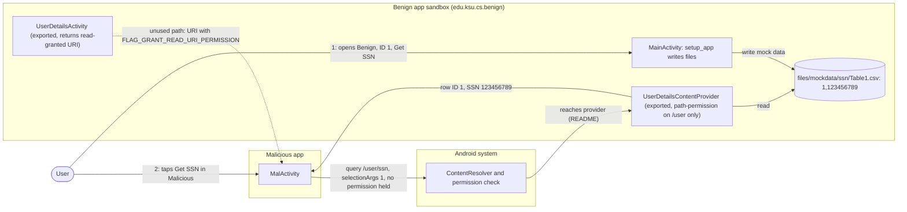
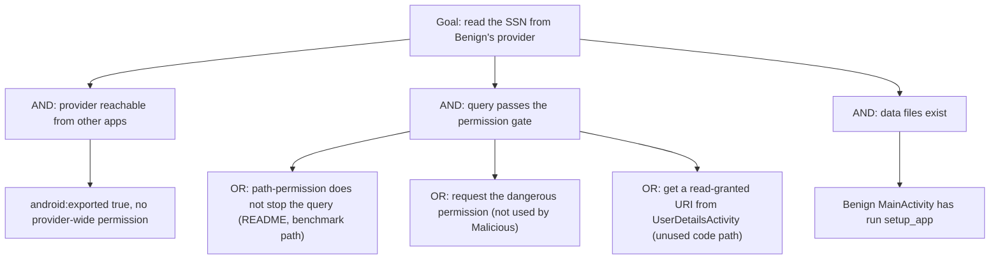

# Threat Model: InadequatePathPermission-InformationExposure-Lean

## 1. Benchmark

| Field | Value |
|-------|-------|
| Name | InadequatePathPermission-InformationExposure-Lean |
| Category | ICC (inter-component communication) |
| Ghera path | `benchmarks/ghera/ICC/InadequatePathPermission-InformationExposure-Lean` |
| Affected Android versions (from README) | "Tested on Android 5.1.1 - Android 8.1" (heading: "Versions of Android in which the vulnerability can occur") |
| Ghera tag | `Jan2019` (commit `6289f39d`) |
| Build flavors available | `api22` to `api27`, `apiDIST` (from `benchmarks/ghera/Misc/sdkFlavors.gradle`) |
| Date of model | 2026-11-01 |

Benign exports a content provider, `UserDetailsContentProvider`, and protects it only with a `<path-permission>` that requires `edu.ksu.cs.benign.permission.internalRead` for paths starting with `/user`. There is no provider-wide permission. The Malicious app, which holds no permission, queries `/user/ssn` and, according to the README and the Testing code, receives the SSN.

**Start order (README steps 7 to 9):** open Benign first, enter 1 as the ID and tap "Get SSN" (this also runs `setup_app`, which writes the data files). Then open Malicious and tap "Get SSN". The Testing code opens Benign, then Malicious, but does not enter an ID or tap anything in Benign (`Testing/benign_app/.../Tests.java` lines 65 to 69).

## 2. System description

### Components

| Component | App | Type | Exported or reachable from other apps | Notes |
|-----------|-----|------|----------------------------------------|-------|
| Permission `edu.ksu.cs.benign.permission.internalRead` | Benign (`edu.ksu.cs.benign`) | `<permission>`, `protectionLevel="dangerous"` (manifest lines 5 to 7) | n/a | Used only by the path permission. |
| `UserDetailsContentProvider` | Benign | Content provider, authority `edu.ksu.cs.benign.userdetails` | Yes (`android:exported="true"`, manifest lines 22 to 30). No `android:permission`, `readPermission` or `writePermission` on the provider. One `<path-permission android:pathPrefix="/user" android:readPermission="edu.ksu.cs.benign.permission.internalRead" />` (lines 27 to 29). | `UriMatcher` entries `/user/school`, `/user/address`, `/user/ssn` (`UserDetailsContentProvider.java` lines 23 to 25). `query` reads CSV files from internal storage and returns rows whose first field equals `selectionArgs[0]`; for `/user/ssn` the columns are `ID` and `SSN` (lines 113 to 136). No caller check in code. |
| `MainActivity` | Benign | Activity, launcher | Yes (launcher intent filter) | `setup_app` writes `files/mockdata/User.csv` ("Joy,Mitra,KSU"), `address/Table1.csv` ("1,Manhattan") and `ssn/Table1.csv` ("1,123456789") (`MainActivity.java` lines 97 to 123). "Get SSN" queries `/user/ssn` with the typed ID and shows column 1 (lines 82 to 95). |
| `UserDetailsActivity` | Benign | Activity | Yes (intent filter for `edu.ksu.cs.benign.expose.userDetails`, manifest lines 33 to 39) | Builds `content://edu.ksu.cs.benign.userdetails` + the caller's `path` extra and returns it as the result with `FLAG_GRANT_READ_URI_PERMISSION` (`UserDetailsActivity.java` lines 21 to 27). Not used by the benchmark exploit. |
| `MalActivity` | Malicious (`edu.ksu.cs.malicious`) | Activity, launcher | n/a | "Get SSN" queries `content://edu.ksu.cs.benign.userdetails` with path `/user/ssn` and `selectionArgs={"1"}` and shows column 1; on `SecurityException` it shows "SecurityException" (`MalActivity.java` lines 47 to 65). It also has an `onActivityResult` for request code 99 and result code 100 (lines 33 to 45), but nothing in Malicious starts an activity for a result. |
| Provider and permission | Secure (`edu.ksu.cs.benign`) | Same provider class | Permission is `protectionLevel="signature"` (Secure manifest line 7); the provider has `android:permission="edu.ksu.cs.benign.permission.internalRead"` and no path permission (lines 22 to 27). | Java code is the same apart from the log tag. |

Manifest permissions: Benign and Secure declare the permission above; neither requests it with `uses-permission`. Malicious declares and requests none.

Source files:
- `Benign/app/src/main/java/edu/ksu/cs/benign/MainActivity.java`
- `Benign/app/src/main/java/edu/ksu/cs/benign/provider/UserDetailsContentProvider.java`
- `Benign/app/src/main/java/edu/ksu/cs/benign/UserDetailsActivity.java`
- `Malicious/app/src/main/java/edu/ksu/cs/malicious/MalActivity.java`
- `AndroidManifest.xml` of each app

### Trust boundaries

| ID | Boundary | What crosses it |
|----|----------|-----------------|
| TB1 | Benign app sandbox vs. other apps | `ContentResolver.query` calls to `edu.ksu.cs.benign.userdetails` and the cursor rows that come back. The path permission is the only intended gate. |
| TB2 | Provider vs. Benign's internal storage | The provider reads `files/mockdata/...` and returns the contents to any caller that gets past TB1. |
| TB3 | Benign vs. other apps through `UserDetailsActivity` | A content URI with a read grant flag, returned to any caller. Not used by the exploit. |

### Data flow diagram



## 3. Assets and attacker model

### Assets

| Asset | Why it matters |
|-------|----------------|
| The SSN in `files/mockdata/ssn/Table1.csv` | The README calls it sensitive information protected by the path permission. The value is the constant `123456789` (`MainActivity.java` line 103). |
| The other user records (name, school, address) | Served by the same provider under `/user/school` and `/user/address`. |

### Attacker

A third-party app installed on the same device. This matches the Malicious app in the benchmark.

### Attacker requirements

- Installed on the same device as Benign.
- No permission requested. The Malicious manifest declares none.
- Knows the authority `edu.ksu.cs.benign.userdetails` (in Benign's manifest), the path `/user/ssn` and that the first selection argument is the record ID. The path and the argument format are in Benign's code.
- The data files must exist, which happens once Benign's `MainActivity` has been created (`setup_app`, line 27). README step 7 opens Benign first.

## 4. STRIDE

| Category | Threat | Applies | Why |
|----------|--------|---------|-----|
| Spoofing | Malicious reads data meant for holders of the permission. | Yes | README: the provider returns the data "in spite of Malicious not having requested the necessary path-permission". |
| Tampering | Malicious changes provider data. | No | `insert`, `update` and `delete` do nothing (`UserDetailsContentProvider.java` lines 32 to 48, 141 to 146). |
| Repudiation | Benign keeps no record of who queried the provider. | Yes | `query` has no caller logging. |
| Information disclosure | The SSN is disclosed to Malicious. | Yes | `MalActivity.java` lines 54 to 58 read column 1 of the `/user/ssn` cursor. This is the impact named in the README. |
| Denial of service | A query without selection arguments crashes the provider. | Partially | From the code: `query` reads `selectionArgs[0]` (line 122) without a null or length check. Not in the README or the Testing code. |
| Elevation of privilege | An app without the permission reads data the permission is meant to guard. | Yes | Same as Information disclosure; the gate is bypassed rather than broken. |

## 5. LINDDUN

| Category | Threat | Applies | Why |
|----------|--------|---------|-----|
| Linkability | An SSN links the user across services. | Yes | The disclosed value is labelled SSN (README, provider column `SSN`). |
| Identifiability | An SSN identifies the user. | Yes | Same. |
| Non-repudiation | No user action is attributed. | No | Nothing is recorded against the user. |
| Detectability | An app can tell that Benign holds a record for an ID. | Yes | A non-empty cursor for an ID reveals that the record exists. |
| Disclosure of information | The SSN is disclosed. | Yes | See STRIDE Information disclosure. |
| Unawareness | The user is not told that another app read the data. | Yes | Nothing in Benign shows provider access. |
| Non-compliance | Personal identifiers shared without consent. | Yes | Applies directly to SSN-type data. |

## 6. Attack tree



## 7. Standards mapping

Confidence values:
- **Verified**: the ID and title were checked against the official page.
- **Needs check**: the ID or title could not be confirmed against the official page.

Fit values:
- **Direct**: the standard describes this benchmark's weakness or test as it is.
- **Partial**: the standard covers part of this benchmark, or covers it only with a caveat given in the Fit cell.

CWE, MASVS, MASTG and MASWE titles are copied from `docs/threat-models/standards-reference.md`.

| Standard | ID | Title | Confidence | Fit |
|----------|----|-------|------------|-----|
| CWE | CWE-926 | Improper Export of Android Application Components | Verified | Direct. Benign manifest lines 22 to 30 export the provider with no provider-wide permission, so other apps can reach the data it serves; the CWE's description is an exported component that "does not properly restrict which applications can ... access the data it contains". Usage ALLOWED. |
| CWE | CWE-863 | Incorrect Authorization | Verified | Partial. Benign does have an authorization check, the path permission on `/user` (manifest lines 27 to 29), but per the README it does not stop Malicious's query of `/user/ssn` (`MalActivity.java` lines 48 to 54). Mapping notes review (saved page, 2026-11-01): the Rationale says this is a Class that might have Base-level children that are more appropriate, and the Comment says to examine the children for a better fit. Children shown on the page: CWE-551, CWE-639, CWE-647, CWE-804, CWE-942 and CWE-1244. CWE-647 (Use of Non-Canonical URL Paths for Authorization Decisions) would fit better if the bypass comes from the URI path form (see Open questions); it is not in the reference file and is listed under "Candidates to check". The others are about CAPTCHAs, cross-domain policies, debug access, user-controlled keys, or ordering of parsing, and do not fit. Partial because why the path permission fails is not shown by the code. Usage ALLOWED-WITH-REVIEW. |
| OWASP MASVS v2 | MASVS-PLATFORM-1 | The app uses IPC mechanisms securely. | Verified | Direct. The fix is a provider-wide signature permission (Secure manifest lines 7 and 27). |
| OWASP MASTG test | MASTG-TEST-0355 | References to Unauthorized Database Access through Content Providers | Verified | Partial. The test checks that an exported provider sets `android:readPermission`, `android:writePermission` or `android:permission`; Benign's provider sets none of them (manifest lines 22 to 26). Partial because the test page speaks of an underlying database, and this provider reads CSV files (`UserDetailsContentProvider.java` lines 114 to 119). |
| OWASP MASTG test | MASTG-TEST-0356 | Runtime Verification of Unauthorized Database Access through Content Providers | Verified | Partial. The runtime check (querying the exported provider without the permission) is the benchmark exploit (`MalActivity.java` line 54) and the no-attacker check in section 8. Partial for the same database wording as above. |
| OWASP MASTG test | MASTG-TEST-0007 | Determining Whether Sensitive Stored Data Has Been Exposed via IPC Mechanisms | Verified | Partial. Deprecated; the page points to MASTG-TEST-0355, MASTG-TEST-0356 and others. Kept for reference only. The provider exposes stored data (`ssn/Table1.csv`) through IPC. |
| OWASP MASWE | MASWE-0018 | Lack of Authentication or Authorization on App Components | Verified | Direct. The page lists "Missing or Weak Permissions on Exported Components" as a mode of introduction; Benign's provider has only a path permission and a `dangerous` permission level (manifest lines 7 and 27 to 29). |

CWE-284 (Improper Access Control), the index draft, was considered and is DISCOURAGED in `standards-reference.md`, so it is not in the table. Mapping notes review (saved page, 2026-11-01): the Rationale says it is a Pillar that is often misused; the Comment says to use descendants more specific to the kind of access control; its Suggestions list CWE-862, CWE-863, CWE-732, CWE-306, CWE-1390, CWE-286 and CWE-923. Its children one level down include CWE-285 (Improper Authorization), which is not in the reference file. Outcome: CWE-863, from the Suggestions, is in the table; CWE-926 was considered on its own as the Android-specific entry.

MASTG-TEST-0357 is not in the table: it is about `FileProvider` path configurations, and Benign uses a custom provider. MASTG-TEST-0366 does not apply, since the benchmark has no broadcast receiver.

Candidates to check (not in the table):
- CWE-647 (Use of Non-Canonical URL Paths for Authorization Decisions), a child of CWE-863. Fits only if the hypothesis in Open questions holds. Not in the reference file.
- CWE-732 (Incorrect Permission Assignment for Critical Resource), suggested by CWE-284's notes, for the `dangerous` protection level. Not in the reference file and not reviewed.

MITRE ATT&CK for Mobile: No direct match. No technique on attack.mitre.org was verified that describes querying another app's exported content provider.

## 8. Evidence

All steps below are **Not yet run**. No result has been observed.

### Commands

Build. PowerShell on Windows from the project root, Gradle 4.4, JDK 8 through `env.ps1`. **Not yet run.**

```powershell
. .\env.ps1
$B = "benchmarks\ghera\ICC\InadequatePathPermission-InformationExposure-Lean"
# Each app folder needs local.properties with sdk.dir=C:/Android/Sdk (none is present yet)
foreach ($a in "Benign","Malicious","Secure") {
    Set-Content "$B\$a\local.properties" "sdk.dir=C:/Android/Sdk"
    Push-Location "$B\$a"; .\gradlew.bat assembleDebug; Pop-Location
}
```

Start the emulator and install pair 1. **Not yet run.**

```powershell
. .\env.ps1
emulator -avd ghera27
$B = "benchmarks\ghera\ICC\InadequatePathPermission-InformationExposure-Lean"
adb install -r "$B\Benign\app\build\outputs\apk\api27\debug\app-api27-debug.apk"
adb install -r "$B\Malicious\app\build\outputs\apk\api27\debug\app-api27-debug.apk"
```

Pair 1, Benign + Malicious, by hand, in the README start order. **Not yet run.**

1. `adb logcat -c`
2. Open Benign (README step 7). Enter `1` in the ID field and tap "Get SSN". Note the number shown.
3. `adb shell run-as edu.ksu.cs.benign ls files/mockdata/ssn`
4. Press Home. Open Malicious and tap "Get SSN" (step 8).
5. Read the text in Malicious (step 9).
6. `adb logcat -d -s Benign:D AndroidRuntime:E`

Pair 2, Secure + Malicious. Secure shares the package name `edu.ksu.cs.benign`. **Not yet run.**

```powershell
adb uninstall edu.ksu.cs.benign
adb install -r "$B\Secure\app\build\outputs\apk\api27\debug\app-api27-debug.apk"
```

Repeat steps 1 to 6 with Secure in place of Benign.

No-attacker check. This exploit uses no broadcast, so the `adb shell am broadcast` line is replaced by a content query from the shell, which holds no Benign permission. **Not yet run.**

```powershell
adb shell content query --uri content://edu.ksu.cs.benign.userdetails/user/ssn
adb shell content query --uri content://edu.ksu.cs.benign.userdetails//user/ssn
adb logcat -d -s AndroidRuntime:E
```

What it can show: whether the system's permission check lets a caller without the permission reach the provider at all. A `SecurityException` means the gate held; reaching the provider shows up, from the code, as a `NullPointerException` at `UserDetailsContentProvider.java` line 122, because the shell command passes no selection arguments. The second line tests the URI path hypothesis in Open questions. What it cannot show: the SSN itself, since without selection arguments no row is returned; and anything specific to a third-party app's identity.

### Expected result (from README and Testing code)

| Pair | Expected | Source | Status |
|------|----------|--------|--------|
| Benign + Malicious | Malicious shows `123456789`, the same number Benign shows. | README step 9; `Testing/benign_app/.../Tests.java` lines 65 to 72 open Benign, then Malicious, tap `getSsn` and assert `ssnDisp` is "123456789". | Not yet run |
| Secure + Malicious | Malicious shows "SecurityException". | `Testing/secure_app/.../Tests.java` lines 67 to 73 assert `ssnDisp` is "SecurityException". The README gives no Secure steps. | Not yet run |

### Observed result

| Pair | Outcome | Observation |
|------|---------|-------------|
| Benign + Malicious | Not yet observed | Not yet observed |
| Secure + Malicious | Not yet observed | Not yet observed |

## 9. Mitigation

### What the Secure app does differently

Diff of `Benign/` and `Secure/` (excluding build output, the prebuilt APKs, `local.properties` and the timestamp line in `gradle-wrapper.properties`).

| File | Benign | Secure |
|------|--------|--------|
| `app/src/main/AndroidManifest.xml` line 7 | `android:protectionLevel="dangerous" />` | `android:protectionLevel="signature" />` |
| `AndroidManifest.xml` lines 26 to 30 (Secure lines 26 to 27) | `android:exported="true">` then `<path-permission android:pathPrefix="/user" android:readPermission="edu.ksu.cs.benign.permission.internalRead" />` and `</provider>` | `android:exported="true"` and `android:permission="edu.ksu.cs.benign.permission.internalRead" />` |
| `AndroidManifest.xml` lines 14, 23, 33 (Secure 14, 23, 30) | `.MainActivity`, `.provider.UserDetailsContentProvider`, `.UserDetailsActivity` | Fully qualified `edu.ksu.cs.benign.` names (same classes) |
| `app/src/main/java/edu/ksu/cs/benign/MainActivity.java` line 21 | `private static String TAG = "Benign";` | `public static String TAG = "Secure";` |
| `UserDetailsActivity.java` line 9 | Blank line | Removed (no effect) |
| `app/src/main/res/values/strings.xml` line 2 | `Benign` | `Secure` |

The provider code, `UserDetailsActivity` and its intent filter are unchanged.

### Assessment of the fix

The fix replaces a path-scoped `dangerous` permission with a provider-wide `signature` permission, which closes both ways in for the benchmark's Malicious app. Residual points:

1. **`UserDetailsActivity` is still exported.** It returns a URI for any caller-chosen path with `FLAG_GRANT_READ_URI_PERMISSION` (Secure `UserDetailsActivity.java`, same code). The provider declares no `android:grantUriPermissions`. Hypothesis, to test in Step 3: without that attribute the grant has no effect, so this path stays closed. If the grant did work, any app could read the SSN through this activity despite the signature permission.
2. **No caller check in code.** The provider relies only on the manifest. Code-level checks are not needed with a signature permission, but there is no second layer.
3. **`selectionArgs[0]` without a check.** A permitted caller (or Benign itself) that passes no selection arguments crashes the provider (line 122). With the signature permission this is limited to apps signed with Benign's key.
4. **Export still needed?** Only Benign queries the provider in the benchmark. If no other app needs it, `android:exported="false"` would remove the exposure entirely.
5. **Newer Android versions.** Hypothesis, to test in Step 3: on newer Android versions, providers declared without an explicit `android:exported` default to not exported, but Benign sets `exported="true"` explicitly, so the weakness would remain.

The fix is complete for the benchmark exploit. Point 1 is the one open path that the Secure app leaves in place.

## 10. Open questions

- The README says the path prefix is protected "with a signature-level permission". In Benign the permission is `protectionLevel="dangerous"` (manifest line 7); only Secure uses `signature`. The model follows the code.
- Why the path permission does not stop Malicious is not shown in the benchmark. Hypothesis, to test in Step 3: `Uri.Builder.appendEncodedPath("/user/ssn")` (`MalActivity.java` line 50) produces a path that does not start with `/user` as the system compares it (for example `//user/ssn`), while the provider's `UriMatcher` still matches it. The second `content query` line in section 8 is meant to check this. If it holds, CWE-647 fits better than CWE-863.
- `User.csv` holds three fields ("Joy,Mitra,KSU", `MainActivity.java` line 101), but the provider requires four fields and compares the first field with the ID (`UserDetailsContentProvider.java` lines 72 to 74). From the code, "Get School" never returns data.
- Benign's layout has a "Get Address" button (`R.id.getAddr`) with no click handler in `MainActivity.java`.
- Malicious has an `onActivityResult` handler for request code 99 (`MalActivity.java` lines 33 to 45) that nothing triggers; it looks like an unfinished second attack through `UserDetailsActivity`.
- The Testing code does not enter an ID or tap "Get SSN" in Benign before opening Malicious (lines 65 to 66), unlike README step 7. Opening Benign is enough to run `setup_app`.
- Lean vs Fat: there is no Fat variant of this benchmark under `benchmarks/ghera/ICC/`, so there is nothing to compare.
- Running the build commands in section 8 writes `local.properties` and `build/` folders under `benchmarks/`. Prebuilt APKs are in each app folder; which flavor they were built with has not been checked.
