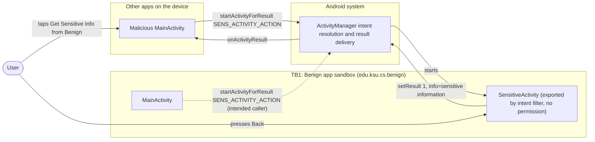
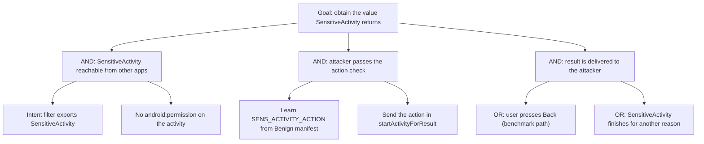

# Threat Model: IncorrectHandlingImplicitIntent-UnauthorizedAccess-Lean

## 1. Benchmark

| Field | Value |
|-------|-------|
| Name | IncorrectHandlingImplicitIntent-UnauthorizedAccess-Lean |
| Category | ICC (inter-component communication) |
| Ghera path | `benchmarks/ghera/ICC/IncorrectHandlingImplicitIntent-UnauthorizedAccess-Lean` |
| Affected Android versions (from README) | "Tested on Android 5.1.1 - Android 8.1" (heading: "Versions of Android where the vulnerability is possible") |
| Ghera tag | `Jan2019` (commit `6289f39d`) |
| Build flavors available | `api22` to `api27`, `apiDIST` (from `benchmarks/ghera/Misc/sdkFlavors.gradle`) |
| Date of model | 2026-10-31 |

Benign's `SensitiveActivity` has an intent filter for the action `edu.ksu.cs.benign.SENS_ACTIVITY_ACTION`, which exports it, and no permission. When it is started with that action it sets a result with the extra `info="sensitive information"`. The Malicious app starts it for a result with the same action and, when the user presses Back, receives and displays the sensitive information.

## 2. System description

### Components

| Component | App | Type | Exported or reachable from other apps | Notes |
|-----------|-----|------|----------------------------------------|-------|
| `MainActivity` | Benign (`edu.ksu.cs.benign`) | Activity, launcher | Yes (launcher intent filter) | The button "Goto SensitiveActivity" calls `startActivityForResult(new Intent("edu.ksu.cs.benign.SENS_ACTIVITY_ACTION"), 100)` (`MainActivity.java` lines 31 to 32). On result code 1 it shows `info` in `R.id.disp` and logs it with tag `Benign` (lines 39 to 43). |
| `SensitiveActivity` | Benign | Activity | Yes. No `android:exported` attribute; has an intent filter for `edu.ksu.cs.benign.SENS_ACTIVITY_ACTION` and `DEFAULT` (manifest lines 17 to 22). No permission. | `onResume` reads the action and, if it equals `edu.ksu.cs.benign.SENS_ACTIVITY_ACTION`, calls `setResult(1, new Intent().putExtra("info", "sensitive information"))` (`SensitiveActivity.java` lines 18 to 21). No check of the caller. |
| `MainActivity` | Malicious (`edu.ksu.cs.malicious`) | Activity, launcher | n/a | The button "Get Sensitive Info from Benign" calls `startActivityForResult(new Intent("edu.ksu.cs.benign.SENS_ACTIVITY_ACTION"), 100)`; on `SecurityException` it shows "SecurityException" in `R.id.disp` (`MainActivity.java` lines 31 to 37). On result code 1 it shows `info` and logs it with tag `Malicious` (lines 44 to 48). |
| `SensitiveActivity` | Secure (`edu.ksu.cs.benign`) | Activity | Intent filter unchanged; adds `android:permission="edu.ksu.cs.secure.perm"` (Secure manifest lines 21 to 28) | Same code as Benign apart from a blank line. |
| Permission `edu.ksu.cs.benign.perm` | Secure | `<permission>`, `protectionLevel="signature"` (Secure manifest lines 5 to 7) | n/a | Declared but not used by any component. The activity requires `edu.ksu.cs.secure.perm`, a different name that no app in the benchmark declares. |

Manifest permissions: Benign and Malicious declare and request none. Secure declares `edu.ksu.cs.benign.perm` and requests none.

Source files:
- `Benign/app/src/main/java/edu/ksu/cs/benign/MainActivity.java`
- `Benign/app/src/main/java/edu/ksu/cs/benign/SensitiveActivity.java`
- `Malicious/app/src/main/java/edu/ksu/cs/malicious/MainActivity.java`
- `Secure/app/src/main/java/edu/ksu/cs/benign/SensitiveActivity.java`
- `AndroidManifest.xml` of each app

### Trust boundaries

| ID | Boundary | What crosses it |
|----|----------|-----------------|
| TB1 | Benign app sandbox vs. other apps on the device | The implicit intent with action `edu.ksu.cs.benign.SENS_ACTIVITY_ACTION` sent by any app into `SensitiveActivity`, and the result intent with `info` sent back out to that app. |
| TB2 | Inside Benign: `MainActivity` to `SensitiveActivity` | Benign's own call to its activity, which also uses the implicit action rather than the class name. |

### Data flow diagram



## 3. Assets and attacker model

### Assets

| Asset | Why it matters |
|-------|----------------|
| The `info` value returned by `SensitiveActivity` | The README says the activity "returns sensitive information to its callers". In the code it is the constant `"sensitive information"` (`SensitiveActivity.java` line 20). |
| Access to `SensitiveActivity` | The README frames the issue as malicious apps performing "sensitive operations ... without the user's knowledge and consent". |
| Benign's availability | `SensitiveActivity` calls `action.equals(...)` without a null check (line 19), so an intent without an action reaches a call on `null`. |

### Attacker

A third-party app installed on the same device. This matches the Malicious app in the benchmark.

### Attacker requirements

- Installed on the same device as Benign.
- No permission needed. The Malicious manifest declares none.
- Knows the action string `edu.ksu.cs.benign.SENS_ACTIVITY_ACTION`. It is in Benign's manifest (line 19).
- The user taps the button in Malicious and then presses Back (README step 7). The result is delivered only when `SensitiveActivity` finishes. A real attacker would still need the user, or something else, to close `SensitiveActivity`.

## 4. STRIDE

| Category | Threat | Applies | Why |
|----------|--------|---------|-----|
| Spoofing | Malicious calls `SensitiveActivity` as if it were Benign's own `MainActivity`. | Yes | `SensitiveActivity.java` line 19 checks only the action, which the caller sets. Malicious sets the same action (`MainActivity.java` line 31). |
| Tampering | Malicious changes Benign's data. | No | `SensitiveActivity` only returns a value. |
| Repudiation | Benign keeps no record of which app received the result. | Yes | `SensitiveActivity` does not log or check the caller. |
| Information disclosure | The sensitive value is returned to Malicious. | Yes | `SensitiveActivity.java` line 20 sets the result for any caller with the action; Malicious shows and logs it (`MainActivity.java` lines 45 to 48). This is the impact named in the README. |
| Denial of service | Another app can crash `SensitiveActivity` with an explicit intent that has no action. | Partially | From the code: `getIntent().getAction()` returns no action and line 19 calls `equals` on it. Not part of the README or the Testing code. |
| Elevation of privilege | An app with no rights in Benign uses an internal-looking screen to obtain its data. | Yes | Nothing in the manifest or the code limits who may start the activity. |

## 5. LINDDUN

| Category | Threat | Applies | Why |
|----------|--------|---------|-----|
| Linkability | A real sensitive value could link the user across apps. | Partially | The benchmark value is a constant. |
| Identifiability | A real sensitive value could identify the user. | Partially | Same reason. |
| Non-repudiation | No user action is attributed. | No | Nothing is recorded against the user. |
| Detectability | An app can tell that Benign is installed from whether the action resolves. | Partially | Not used by the benchmark code. |
| Disclosure of information | Benign's sensitive value is disclosed to an unintended app. | Yes | See STRIDE Information disclosure. |
| Unawareness | The user sees Benign's `SensitiveActivity` screen but is not told that its result goes to Malicious. | Yes | README: "without the user's knowledge and consent". |
| Non-compliance | Personal data is shared with a third party without consent. | Partially | Applies to a real app with user data. |

## 6. Attack tree



## 7. Standards mapping

Confidence values:
- **Verified**: the ID and title were checked against the official page.
- **Needs check**: the ID or title could not be confirmed against the official page.

Fit values:
- **Direct**: the standard describes this benchmark's weakness or test as it is.
- **Partial**: the standard covers part of this benchmark, or covers it only with a caveat given in the Fit cell.

CWE and MASVS titles are copied from `docs/threat-models/standards-reference.md`.

| Standard | ID | Title | Confidence | Fit |
|----------|----|-------|------------|-----|
| CWE | CWE-926 | Improper Export of Android Application Components | Verified | Direct. Benign manifest lines 17 to 22 export `SensitiveActivity` through its intent filter with no permission, and `SensitiveActivity.java` line 20 returns sensitive data to any caller. Usage ALLOWED. |
| CWE | CWE-862 | Missing Authorization | Verified | Partial. `SensitiveActivity.java` lines 18 to 21 return the sensitive value after checking only the action string, with no check of who the caller is. Mapping notes review (saved page, 2026-10-31): the Rationale says this is a Class that might have Base-level children that are more appropriate, and the Comment says to examine the children for a better fit. Children shown on the page: CWE-425 (Direct Request), CWE-638 (Not Using Complete Mediation), CWE-939 (Improper Authorization in Handler for Custom URL Scheme) and CWE-1314 (Missing Write Protection for Parametric Data Values). None fits better: CWE-425 is about web requests to unlinked URLs, CWE-939 about custom URL scheme handlers, CWE-1314 about hardware data values, and CWE-638 about not re-checking on every access, while here there is no check at all. Partial because CWE-926 is the Android-specific form. Usage ALLOWED-WITH-REVIEW. |
| OWASP MASVS v2 | MASVS-PLATFORM-1 | The app uses IPC mechanisms securely. | Verified | Direct. The fix puts a permission on the exported activity (Secure manifest line 23). |
| OWASP MASTG test | MASTG-TEST-0364 | Exported And Unprotected Activities That Expose Sensitive Functionality | Verified | Direct. The test fails an exported activity with no `android:permission` that "displays or returns sensitive data". `SensitiveActivity` is exported by its intent filter with no permission (Benign manifest lines 17 to 22) and returns "sensitive information" to any caller through `setResult` (`SensitiveActivity.java` line 20). |
| OWASP MASTG test | MASTG-TEST-0029 | Testing for Sensitive Functionality Exposure Through IPC | Verified | Partial. Deprecated, kept for reference only. An exported activity (Benign manifest line 17) exposes a function that returns sensitive data. |
| OWASP MASWE | MASWE-0018 | Lack of Authentication or Authorization on App Components | Verified | Direct. `SensitiveActivity` is exported by its intent filter with no permission (Benign manifest lines 17 to 22) and returns sensitive data to any caller (`SensitiveActivity.java` line 20); the page lists "Missing or Weak Permissions on Exported Components" and names activities. Controls shown on the page: MASVS-AUTH-1, MASVS-PLATFORM-1, MASVS-STORAGE-2. |

MASTG-TEST-0366 is not in the table: it is about broadcast receivers, and this benchmark exposes an activity (Benign manifest line 17).

Candidates to check (not in the table):
- CWE-863 (Incorrect Authorization) for the Secure app's permission name mismatch (see section 9). It is about the fix, not the benchmark weakness, so it is not in the table and was not reviewed.

MITRE ATT&CK for Mobile: No direct match. No technique on attack.mitre.org was verified that describes starting another app's exported activity for a result to obtain its data.

## 8. Evidence

All steps below are **Not yet run**. No result has been observed.

### Commands

Build. PowerShell on Windows from the project root, Gradle 4.4, JDK 8 through `env.ps1`. **Not yet run.**

```powershell
. .\env.ps1
$B = "benchmarks\ghera\ICC\IncorrectHandlingImplicitIntent-UnauthorizedAccess-Lean"
# Each app folder needs local.properties with sdk.dir=C:/Android/Sdk (none is present yet)
foreach ($a in "Benign","Malicious","Secure") {
    Set-Content "$B\$a\local.properties" "sdk.dir=C:/Android/Sdk"
    Push-Location "$B\$a"; .\gradlew.bat assembleDebug; Pop-Location
}
```

Start the emulator and install pair 1. **Not yet run.**

```powershell
. .\env.ps1
emulator -avd ghera27
$B = "benchmarks\ghera\ICC\IncorrectHandlingImplicitIntent-UnauthorizedAccess-Lean"
adb install -r "$B\Benign\app\build\outputs\apk\api27\debug\app-api27-debug.apk"
adb install -r "$B\Malicious\app\build\outputs\apk\api27\debug\app-api27-debug.apk"
```

Pair 1, Benign + Malicious, by hand (README steps 7 and 8). **Not yet run.**

1. `adb logcat -c`
2. Open Malicious and tap "Get Sensitive Info from Benign".
3. Read the screen that comes to the front (expected from the code: Benign's `SensitiveActivity`, text "SensitiveActivity").
4. Press Back.
5. Read the text in Malicious (`R.id.disp`).
6. `adb logcat -d -s Malicious:D Benign:D`

Pair 2, Secure + Malicious. Secure shares the package name `edu.ksu.cs.benign`. **Not yet run.**

```powershell
adb uninstall edu.ksu.cs.benign
adb install -r "$B\Secure\app\build\outputs\apk\api27\debug\app-api27-debug.apk"
```

Repeat steps 1 to 6 with Secure in place of Benign. At step 3, note whether any Secure screen opens; skip step 4 if Malicious is still in front.

The same intent without the Malicious app. This exploit is not a broadcast, so the shell equivalent is an `am start` with the action. The shell does not receive the activity result, so this shows only whether the activity can be started from outside. **Not yet run.**

```powershell
adb shell am start -W -a edu.ksu.cs.benign.SENS_ACTIVITY_ACTION
```

### Expected result (from README and Testing code)

| Pair | Expected | Source | Status |
|------|----------|--------|--------|
| Benign + Malicious | After Back, Malicious shows "sensitive information". | README step 8 ("You will see a message - sensitive information displayed"); `Testing/benign_app/.../Tests.java` lines 64 to 71 tap the button, press Back and assert Malicious `disp` is "sensitive information". | Not yet run |
| Secure + Malicious | Malicious shows "SecurityException" right after the tap. | `Testing/secure_app/.../Tests.java` lines 66 to 71 tap the button (no Back) and assert `disp` is "SecurityException". The README gives no Secure steps. The text comes from Malicious `MainActivity.java` lines 34 to 36. | Not yet run |
| `am start` line, Benign | `SensitiveActivity` opens. | Follows from Benign manifest lines 17 to 22 (exported, no permission). | Not yet run |
| `am start` line, Secure | A permission denial for `edu.ksu.cs.secure.perm`. | Follows from Secure manifest line 23. | Not yet run |

### Observed result

| Pair | Outcome | Observation |
|------|---------|-------------|
| Benign + Malicious | Not yet observed | Not yet observed |
| Secure + Malicious | Not yet observed | Not yet observed |

## 9. Mitigation

### What the Secure app does differently

Diff of `Benign/` and `Secure/` (excluding build output, the prebuilt APKs, `local.properties` and the timestamp line in `gradle-wrapper.properties`).

| File | Benign | Secure |
|------|--------|--------|
| `app/src/main/AndroidManifest.xml` (Secure lines 5 to 8) | none | `<permission android:name="edu.ksu.cs.benign.perm" android:protectionLevel="signature" />` and a blank line |
| `AndroidManifest.xml` line 17 (Secure lines 21 to 23) | `<activity android:name=".SensitiveActivity">` | `<activity android:name="edu.ksu.cs.benign.SensitiveActivity" android:permission="edu.ksu.cs.secure.perm">` |
| `AndroidManifest.xml` line 11 (Secure line 15) | `.MainActivity` | `edu.ksu.cs.benign.MainActivity` (same class) |
| `app/src/main/java/edu/ksu/cs/benign/SensitiveActivity.java` (Secure line 18) | none | Blank line |
| `app/src/main/res/values/strings.xml` line 2 | `Benign` | `Secure` |

`MainActivity.java`, the code of `SensitiveActivity.java` and the intent filter are the same in both apps.

### Assessment of the fix

The fix is **not complete as written**. Its intent is clear: protect `SensitiveActivity` with a signature permission, so that only apps signed with Benign's key can start it. But the permission the activity requires (`edu.ksu.cs.secure.perm`, Secure manifest line 23) is not the permission Secure declares (`edu.ksu.cs.benign.perm`, line 6). Residual points:

1. **Undeclared permission name.** No app in the benchmark declares `edu.ksu.cs.secure.perm`, so Malicious cannot hold it and the benchmark exploit fails, as the Secure test expects. Hypothesis, to test in Step 3: a third-party app installed before Secure can declare `edu.ksu.cs.secure.perm` itself with a normal protection level, request it, and so pass the check. If that holds, the protection can be bypassed.
2. **The declared signature permission is unused.** `edu.ksu.cs.benign.perm` protects nothing. The intended fix is to require that name on the activity.
3. **Still exported.** The activity keeps its intent filter. If only Benign calls it, `android:exported="false"` and an explicit intent from `MainActivity` would remove the exposure entirely.
4. **Benign calls itself implicitly.** `MainActivity.java` line 31 (same in Secure) uses the action string, not the class. Another app with an intent filter for the same action could be offered to the user in place of `SensitiveActivity`, the pattern in `HighPriority-ActivityHijack-Lean`.
5. **Null action.** `SensitiveActivity.java` line 19 (Secure line 20) still calls `equals` on a possibly missing action. The permission, if enforced, limits who can reach this.
6. **Newer Android versions.** Hypothesis, to test in Step 3: Android 12 and later require `android:exported` to be set explicitly on components with intent filters for apps that target those versions, so this manifest would need a change to build for them.

## 10. Open questions

- Secure declares `edu.ksu.cs.benign.perm` but requires `edu.ksu.cs.secure.perm` (Secure manifest lines 6 and 23). Whether this is a typo in the benchmark and whether it can be bypassed (section 9, item 1) has not been checked.
- Whether Secure's own `MainActivity` can still start `SensitiveActivity` when the activity requires a permission that Secure itself does not hold has not been checked.
- README step 7 and the summary say the button is "Get Sensitive Information from Benign"; the layout text is "Get Sensitive Info from Benign" (`Malicious/app/src/main/res/layout/activity_main.xml`).
- The README says `SensitiveActivity` "can be accessed by any component that sends it an implicit intent"; from the manifest it can also be reached with an explicit intent, which would then hit the null action check (section 4, Denial of service). This has not been run.
- The Benign test presses Back before reading the result; the Secure test does not. The README describes only the Benign flow.
- Lean vs Fat: there is no Fat variant of this benchmark under `benchmarks/ghera/ICC/`, so there is nothing to compare.
- Running the build commands in section 8 writes `local.properties` and `build/` folders under `benchmarks/`.
