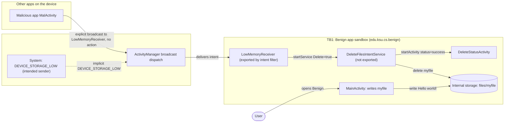
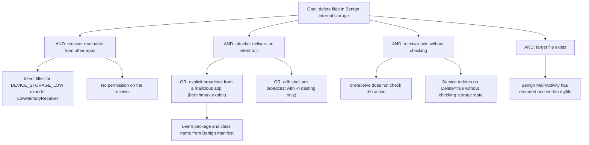

# Threat Model: NoValidityCheckOnBroadcastMsg-UnintendedInvocation-Lean

## 1. Benchmark

| Field | Value |
|-------|-------|
| Name | NoValidityCheckOnBroadcastMsg-UnintendedInvocation-Lean |
| Category | ICC (inter-component communication) |
| Ghera path | `benchmarks/ghera/ICC/NoValidityCheckOnBroadcastMsg-UnintendedInvocation-Lean` |
| Affected Android versions (from README) | "Tested on Android 5.1.1 - Android 8.1" (heading: "Versions of Android where the vulnerability is possible") |
| Ghera tag | `Jan2019` (commit `6289f39d`) |
| Build flavors available | `api22` to `api27`, `apiDIST` (from `benchmarks/ghera/Misc/sdkFlavors.gradle`) |
| Date of model | 2026-10-31 |

The Benign app has a receiver, `LowMemoryReceiver`, with an intent filter for the system broadcast `android.intent.action.DEVICE_STORAGE_LOW`. The intent filter exports the receiver, and `onReceive` does not check the action. The Malicious app sends an explicit intent with no action to `LowMemoryReceiver`, which starts a service that deletes the file `myfile` from Benign's internal storage.

## 2. System description

### Components

| Component | App | Type | Exported or reachable from other apps | Notes |
|-----------|-----|------|----------------------------------------|-------|
| `MainActivity` | Benign (`edu.ksu.cs.benign`) | Activity, launcher | Yes (launcher intent filter) | In `onResume` writes `"Hello world!"` to the internal file `myfile` with `openFileOutput(filename, Context.MODE_PRIVATE)`. |
| `LowMemoryReceiver` | Benign | Broadcast receiver, declared in manifest | Yes. No `android:exported` attribute; has an intent filter for `android.intent.action.DEVICE_STORAGE_LOW`. The README says the intent filter exports it. No permission. | `onReceive` logs "Delete files from internal storage" and starts `DeleteFilesIntentService` with extra `Delete=true`. No check of the action. |
| `DeleteFilesIntentService` | Benign | `IntentService` | No (`android:exported="false"`) | If `Delete` is true and `myfile` exists, deletes it and starts `DeleteStatusActivity` with `status=success`. If `Delete` is false, starts `DeleteStatusActivity` with `status=fail`. |
| `DeleteStatusActivity` | Benign | Activity | No intent filter, no `exported` attribute | Shows the `status` extra in the TextView `R.id.status`. |
| `MalActivity` | Malicious (`edu.ksu.cs.malicious`) | Activity, launcher | n/a | The button sends `sendBroadcast(i)` where `i` has `setPackage("edu.ksu.cs.benign")` and `setClassName("edu.ksu.cs.benign", "edu.ksu.cs.benign.LowMemoryReceiver")` and no action. |
| `LowMemoryReceiver` | Secure (`edu.ksu.cs.benign`) | Broadcast receiver | Same manifest entry as Benign | Starts the service with `Delete=true` only if the action is `DEVICE_STORAGE_LOW`; otherwise starts it with `Delete=false`. |

Manifest permissions: Benign and Malicious both declare `android.permission.PROCESS_OUTGOING_CALLS`, which no code in either app uses. Secure does not declare it.

Source files:
- `Benign/app/src/main/java/edu/ksu/cs/benign/MainActivity.java`
- `Benign/app/src/main/java/edu/ksu/cs/benign/LowMemoryReceiver.java`
- `Benign/app/src/main/java/edu/ksu/cs/benign/DeleteFilesIntentService.java`
- `Benign/app/src/main/java/edu/ksu/cs/benign/DeleteStatusActivity.java`
- `Malicious/app/src/main/java/edu/ksu/cs/malicious/MalActivity.java`
- `Secure/app/src/main/java/edu/ksu/cs/benign/LowMemoryReceiver.java`
- `AndroidManifest.xml` of each app

### Trust boundaries

| ID | Boundary | What crosses it |
|----|----------|-----------------|
| TB1 | Benign app sandbox vs. other apps on the device | An explicit broadcast to `edu.ksu.cs.benign/.LowMemoryReceiver`, routed through the Android system. |
| TB2 | Benign app sandbox vs. the Android system | The system broadcast `DEVICE_STORAGE_LOW`, which is the only sender the receiver was designed for. |
| TB3 | Inside Benign: receiver vs. service and storage | The `Delete=true` extra passed from `LowMemoryReceiver` to the non-exported `DeleteFilesIntentService`, which then deletes from internal storage. The service trusts the receiver. |

### Data flow diagram



## 3. Assets and attacker model

### Assets

| Asset | Why it matters |
|-------|----------------|
| Files in Benign's internal storage (`myfile`) | Stand-in for app data. The README says the service deletes "all files in the internal storage of the app"; the Lean code deletes only `myfile`. |
| Availability of Benign's data | Deleted data is lost to the user and the app. |
| Benign's UI | Each successful call brings `DeleteStatusActivity` to the front. |

### Attacker

A third-party app installed on the same device. This matches the Malicious app in the benchmark.

### Attacker requirements

- Installed on the same device as Benign.
- No permission needed for the attack. The Malicious manifest declares only `PROCESS_OUTGOING_CALLS`, which `MalActivity` does not use.
- Knows Benign's package name and the receiver class name `edu.ksu.cs.benign.LowMemoryReceiver`. Both are in Benign's manifest.
- `myfile` must exist, which happens after Benign's `MainActivity` has resumed at least once. README step 6 opens Benign first.
- The user taps the button in Malicious. A real attacker could send the broadcast from any component.

## 4. STRIDE

| Category | Threat | Applies | Why |
|----------|--------|---------|-----|
| Spoofing | Malicious triggers the receiver, which acts as if the system reported low storage. | Yes | `LowMemoryReceiver.onReceive` does not check the action or the sender. README: the receiver "can be triggered by an app, including unintended apps, via an explicit intent". |
| Tampering | Malicious causes deletion of Benign's file. | Yes | The service calls `file.delete()` on `myfile`. Deleting data changes Benign's stored state. |
| Repudiation | Benign keeps no record that another app caused the deletion. | Yes | Benign logs only "Delete files from internal storage" and the file name. |
| Information disclosure | No data leaves Benign. | No | The attack only deletes. `DeleteStatusActivity` shows only "success" or "fail". |
| Denial of service | Benign's data is destroyed whenever the attacker wants. | Yes | This is the impact named in the README: "delete all files in the benign app's internal memory". |
| Elevation of privilege | An app with no access to Benign's private storage causes a deletion there. | Yes | The non-exported service is reachable only through the exported receiver. Malicious uses Benign's own identity to delete Benign's file. |

## 5. LINDDUN

| Category | Threat | Applies | Why |
|----------|--------|---------|-----|
| Linkability | No personal data is processed. | No | The file holds `"Hello world!"`. |
| Identifiability | No personal data is processed. | No | Same reason. |
| Non-repudiation | No user action is attributed. | No | The user is not made responsible for anything. |
| Detectability | An app could tell whether Benign is installed from whether the broadcast is delivered. | Partially | Not in the benchmark code. |
| Disclosure of information | No data is disclosed. | No | See STRIDE Information disclosure. |
| Unawareness | The user is not told why the data was deleted. | Partially | `DeleteStatusActivity` shows only "success". It does not say which app asked for the deletion. |
| Non-compliance | Personal data could be deleted without the user's consent. | Partially | Applies to a real app with user data. The benchmark data is a constant string. |

## 6. Attack tree



## 7. Standards mapping

Confidence values:
- **Verified**: the ID and title were checked against the official page.
- **Needs check**: the ID or title could not be confirmed against the official page.

Fit values:
- **Direct**: the standard describes this benchmark's weakness or test as it is.
- **Partial**: the standard covers part of this benchmark, or covers it only with a caveat given in the Fit cell.

CWE and MASVS titles are copied from `docs/threat-models/standards-reference.md`.

| Standard | ID | Title | Confidence | Fit |
|----------|----|-------|------------|-----|
| CWE | CWE-925 | Improper Verification of Intent by Broadcast Receiver | Verified | Direct. The CWE's extended description is this case: a receiver for a system intent also receives explicit intents from other apps and assumes they are the system intent. Usage ALLOWED. |
| CWE | CWE-926 | Improper Export of Android Application Components | Verified | Partial. The receiver is exported by its intent filter with no permission. The README explains it cannot be protected by a permission because it must receive a system broadcast, so the fix is in verification, not in export. Usage ALLOWED. |
| CWE | CWE-360 | Trust of System Event Data | Verified | Partial. `LowMemoryReceiver.java` lines 13 to 15 start the file deletion for any intent, as if it were the system `DEVICE_STORAGE_LOW` event. The CWE's extended description says events often cannot be verified as coming from a trusted source and that a process must check their validity. Partial because the page's text and its only child (CWE-422, Unprotected Windows Messaging Channel) are about Windows messages; CWE-925 is the Android-specific form. Usage ALLOWED. |
| OWASP MASVS v2 | MASVS-PLATFORM-1 | The app uses IPC mechanisms securely. | Verified | Direct. |
| OWASP MASVS v2 | MASVS-CODE-4 | The app validates and sanitizes all untrusted inputs. | Verified | Partial. The Secure fix validates the incoming intent's action. The control is broader than IPC. |
| OWASP MASTG test | MASTG-TEST-0366 | Exported And Unprotected Broadcast Receivers That Expose Sensitive Functionality | Verified | Direct. An exported receiver without a permission exposes file deletion. |
| OWASP MASTG test | MASTG-TEST-0029 | Testing for Sensitive Functionality Exposure Through IPC | Verified | Partial. Deprecated, kept for reference only. |
| OWASP MASWE | MASWE-0063 | Insecure Broadcast Receivers | Verified | Direct. Beta, ID may change. |

CWE-20 (Improper Input Validation) was considered and is DISCOURAGED in `standards-reference.md`, so it is not in the table; none of its children fits better.

Candidates to check (not in the table):
- None beyond the IDs above.

MITRE ATT&CK for Mobile: No direct match. No technique on attack.mitre.org was verified that describes triggering another app's exported receiver to delete its data.

## 8. Evidence

All steps below are **Not yet run**. No result has been observed.

### Commands

Build. PowerShell on Windows from the project root, Gradle 4.4, JDK 8 through `env.ps1`. **Not yet run.**

```powershell
. .\env.ps1
$B = "benchmarks\ghera\ICC\NoValidityCheckOnBroadcastMsg-UnintendedInvocation-Lean"
# Each app folder needs local.properties with sdk.dir=C:/Android/Sdk (none is present yet)
foreach ($a in "Benign","Malicious","Secure") {
    Set-Content "$B\$a\local.properties" "sdk.dir=C:/Android/Sdk"
    Push-Location "$B\$a"; .\gradlew.bat assembleDebug; Pop-Location
}
```

Start the emulator and install pair 1. **Not yet run.**

```powershell
. .\env.ps1
emulator -avd ghera27
$B = "benchmarks\ghera\ICC\NoValidityCheckOnBroadcastMsg-UnintendedInvocation-Lean"
adb install -r "$B\Benign\app\build\outputs\apk\api27\debug\app-api27-debug.apk"
adb install -r "$B\Malicious\app\build\outputs\apk\api27\debug\app-api27-debug.apk"
```

Pair 1, Benign + Malicious, by hand (README steps 6 to 8). **Not yet run.**

1. `adb logcat -c`
2. Open Benign, then press Home.
3. `adb shell run-as edu.ksu.cs.benign ls files` (README step 6: `myfile` should be listed).
4. Open Malicious and tap the button (its layout text is "Button").
5. Read the screen that comes to the front.
6. `adb shell run-as edu.ksu.cs.benign ls files` (do not reopen Benign first: its `onResume` writes `myfile` again).
7. `adb logcat -d -s Benign DeleteFilesService Malicious`

Pair 2, Secure + Malicious. Secure shares the package name `edu.ksu.cs.benign`. **Not yet run.**

```powershell
adb uninstall edu.ksu.cs.benign
adb install -r "$B\Secure\app\build\outputs\apk\api27\debug\app-api27-debug.apk"
```

Repeat steps 1 to 7 with Secure in place of Benign.

The same explicit broadcast without the Malicious app. **Not yet run.**

```powershell
adb shell am broadcast -n edu.ksu.cs.benign/.LowMemoryReceiver
```

### Expected result (from README and Testing code)

| Pair | Expected | Source | Status |
|------|----------|--------|--------|
| Benign + Malicious | Benign shows "success". `myfile` is gone from `files`. | README step 8 ("You will see a message success in Benign"); `Testing/benign_app/.../Tests.java` asserts `status` is "success". The file check follows from `DeleteFilesIntentService.java` line 31. | Not yet run |
| Secure + Malicious | Secure shows "fail". `myfile` is still in `files`. | `Testing/secure_app/.../Tests.java` asserts "fail". The README gives no Secure steps. The file check follows from Secure `LowMemoryReceiver.java` line 19 (`Delete=false`). | Not yet run |

### Observed result

| Pair | Outcome | Observation |
|------|---------|-------------|
| Benign + Malicious | Not yet observed | Not yet observed |
| Secure + Malicious | Not yet observed | Not yet observed |

## 9. Mitigation

### What the Secure app does differently

Diff of `Benign/` and `Secure/` (excluding build output, the prebuilt APKs and the timestamp line in `gradle-wrapper.properties`).

| File | Benign | Secure |
|------|--------|--------|
| `app/src/main/java/edu/ksu/cs/benign/LowMemoryReceiver.java` lines 14 to 15 (Secure lines 14 to 20) | `Log.d("Benign", "Delete files from internal storage");` and `context.startService(new Intent(context, DeleteFilesIntentService.class).putExtra("Delete", true));` with no condition | `if (intent.getAction() != null && intent.getAction().equals("android.intent.action.DEVICE_STORAGE_LOW")) {` log and start the service with `Delete=true` `} else {` `context.startService(new Intent(context, DeleteFilesIntentService.class).putExtra("Delete", false));` `}` |
| `app/src/main/AndroidManifest.xml` lines 5 to 6 | `<uses-permission android:name="android.permission.PROCESS_OUTGOING_CALLS" />` and a blank line | Removed |
| `AndroidManifest.xml` lines 13, 22, 29, 32 (Secure 11, 20, 27, 30) | `.MainActivity`, `.LowMemoryReceiver`, `.DeleteStatusActivity`, `.DeleteFilesIntentService` | Fully qualified `edu.ksu.cs.benign.` names (same classes) |
| `AndroidManifest.xml` line 33 (Secure line 31) | `android:exported="false"></service>` | `android:exported="false" />` (same meaning) |
| `app/src/main/res/values/strings.xml` line 2 | `Benign` | `Secure` |

`DeleteFilesIntentService`, `DeleteStatusActivity` and `MainActivity` are the same in both apps. The receiver is still exported and still has no permission.

### Assessment of the fix

The fix stops the benchmark exploit, which sends no action. Residual points:

1. **Relies on the action string alone.** Secure trusts any intent whose action is `DEVICE_STORAGE_LOW`. Hypothesis, to test in Step 3: Android refuses to let a third-party app send a protected system action like `DEVICE_STORAGE_LOW`, even in an explicit intent. If that holds, checking the action is enough to tell the system from other apps; if not, the fix can be bypassed by adding the action to the explicit intent.
2. **The else branch still has a visible effect.** For any other intent, Secure starts the service with `Delete=false`, and the service starts `DeleteStatusActivity` with "fail". Any app can still bring this screen to the front at will.
3. **The action is destructive and unconditional.** Even a genuine low-storage broadcast deletes the file without checking actual free space or asking the user.
4. **Stronger alternatives** not used by the Secure app: check the real storage state (for example with `StatFs`) before deleting; set `android:exported="false"` and react to low storage some other way, such as checking free space when the app starts. Hypothesis, to test in Step 3: on newer Android versions, `DEVICE_STORAGE_LOW` is deprecated and apps may not receive it through a manifest receiver at all, which would leave the receiver reachable only by explicit intents from other apps.

## 10. Open questions

- The README says the service deletes "all files in the internal storage of the app". The Lean code deletes only the file named `myfile` (`DeleteFilesIntentService.java` lines 27 to 31). The model follows the code.
- The README summary refers to "memory" and "low on memory", while the action is `DEVICE_STORAGE_LOW` (storage). The model uses "storage".
- Benign and Malicious both declare `PROCESS_OUTGOING_CALLS`, which neither uses; Secure drops it. It looks like a leftover and has no effect on the exploit.
- Whether `adb shell am broadcast -n ...` from the shell user reaches the receiver in the same way as the Malicious app has not been checked.
- Whether the attacker can bypass Secure by setting the action in an explicit intent (see section 9, item 1). Hypothesis, to test in Step 3.
- The CWE for improper input validation was checked: CWE-20 is DISCOURAGED and none of its children fits better. CWE-360 is in the table in section 7 instead.
