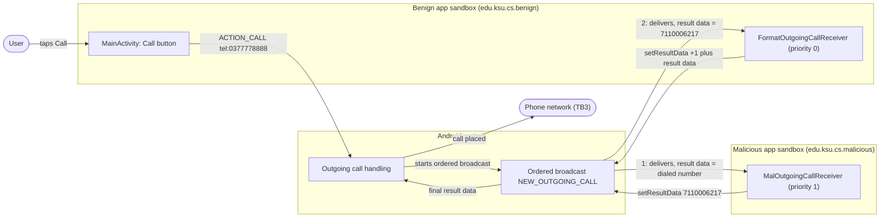
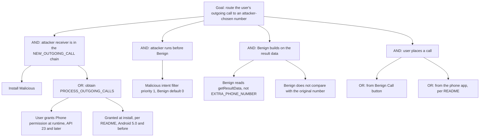

# Threat Model: OrderedBroadcast-DataInjection-Lean

## 1. Benchmark

| Field | Value |
|-------|-------|
| Name | OrderedBroadcast-DataInjection-Lean |
| Category | ICC (inter-component communication) |
| Ghera path | `benchmarks/ghera/ICC/OrderedBroadcast-DataInjection-Lean` |
| Affected Android versions (from README) | "Tested on Android 5.1.1 - Android 8.1" |
| Ghera tag | `Jan2019` (commit `6289f39d`) |
| Build flavors available | `api22` to `api27`, `apiDIST` (from `benchmarks/ghera/Misc/sdkFlavors.gradle`) |
| Date of model | 2026-10-31 |

The Benign app has a receiver for the system's ordered `NEW_OUTGOING_CALL` broadcast that prepends `+1` to the number it gets from `getResultData()`. The Malicious app registers a receiver for the same broadcast with a higher priority (1) and replaces the result data with its own number. Benign runs later in the chain and builds on the attacker's value, so the call goes to the attacker's number. The README states the assumption that Benign's receiver is the last one in the chain.

## 2. System description

### Components

| Component | App | Type | Exported or reachable from other apps | Notes |
|-----------|-----|------|----------------------------------------|-------|
| `MainActivity` | Benign (`edu.ksu.cs.benign`) | Activity, launcher | Yes (launcher intent filter) | On API 23 and later requests `CALL_PHONE` and `PROCESS_OUTGOING_CALLS` in `onCreate`; throws `RuntimeException(new SecurityException())` if either is denied. The Call button starts `Intent.ACTION_CALL` with `tel:0377778888`. |
| `FormatOutgoingCallReceiver` | Benign | Broadcast receiver, declared in manifest | Yes (`android:exported="true"`, intent filter for `android.intent.action.NEW_OUTGOING_CALL`, no priority set) | `onReceive` reads `getResultData()`, calls `setResultData("+1" + phNm)`, logs the value and toasts "outgoing call...". It does not check the action or compare with the original number. |
| `MalActivity` | Malicious (`edu.ksu.cs.malicious`) | Activity, launcher | n/a | On API 23 and later requests `PROCESS_OUTGOING_CALLS`; throws `RuntimeException("Permission denied.")` if denied. No other logic. |
| `MalOutgoingCallReceiver` | Malicious | Broadcast receiver, declared in manifest | `android:exported="true"`, intent filter for `NEW_OUTGOING_CALL` with `android:priority="1"` | `onReceive` calls `setResultData("7110006217")`. |
| Android system (outgoing call) | n/a | System broadcast sender | n/a | Per the README, sends an intent "whenever an outgoing call is placed" to receivers in order of priority. |
| `FormatOutgoingCallReceiver` | Secure (`edu.ksu.cs.benign`) | Broadcast receiver | Same manifest entry as Benign | Checks that the action is `NEW_OUTGOING_CALL`, then reads `intent.getStringExtra(Intent.EXTRA_PHONE_NUMBER)` instead of `getResultData()`. |

Manifest permissions: Benign and Secure declare `PROCESS_OUTGOING_CALLS` and `CALL_PHONE`. Malicious declares only `PROCESS_OUTGOING_CALLS`.

Source files:
- `Benign/app/src/main/java/edu/ksu/cs/benign/MainActivity.java`
- `Benign/app/src/main/java/edu/ksu/cs/benign/FormatOutgoingCallReceiver.java`
- `Malicious/app/src/main/java/edu/ksu/cs/malicious/MalActivity.java`
- `Malicious/app/src/main/java/edu/ksu/cs/malicious/MalOutgoingCallReceiver.java`
- `Secure/app/src/main/java/edu/ksu/cs/benign/FormatOutgoingCallReceiver.java`
- `Secure/app/src/main/java/edu/ksu/cs/benign/MainActivity.java`
- `AndroidManifest.xml` of each app

### Trust boundaries

| ID | Boundary | What crosses it |
|----|----------|-----------------|
| TB1 | Android system vs. receivers in other apps | The ordered `NEW_OUTGOING_CALL` broadcast. Each receiver in the chain can read and replace the result data. |
| TB2 | Malicious app sandbox vs. Benign app sandbox | Not crossed directly. The attacker's value reaches Benign only as result data passed along the ordered broadcast. |
| TB3 | Device vs. the phone network | The outgoing call, placed to the final result data. |

### Data flow diagram



## 3. Assets and attacker model

### Assets

| Asset | Why it matters |
|-------|----------------|
| The number that is actually dialed | Decides who the user talks to. Redirecting it can cost money or enable fraud. |
| Every outgoing call on the device | The README says that "even if the user dials a number from the original phone app of her device, the number chosen by the malicious app will get dialed". |
| The dialed numbers themselves | Every receiver for `NEW_OUTGOING_CALL` is in the chain, so it is in a position to see each outgoing number. |
| Benign's formatting feature | Its output is only correct if its input has not been changed earlier in the chain. |

### Attacker

A third-party app installed on the same device. This matches the Malicious app in the benchmark.

### Attacker requirements

- Installed on the same device.
- Holds `PROCESS_OUTGOING_CALLS`. README step 8: launch Malicious and grant Phone permission when asked. The README notes that the user may be convinced to grant it, and that "For Android 5.0 and before this permission will be granted as soon as Malicious is installed."
- Registers for `NEW_OUTGOING_CALL` with a priority higher than Benign's (the Malicious manifest uses 1; the README says Benign's default is 0).
- No knowledge of Benign is needed. The attacker only needs the system action name.
- The user must place a call. The README assumes Benign's receiver is last in the chain.

## 4. STRIDE

| Category | Threat | Applies | Why |
|----------|--------|---------|-----|
| Spoofing | The attacker's number reaches Benign as if it were the number the user dialed. | Yes | Benign reads `getResultData()`, which any earlier receiver can set. It cannot tell the system's value from the attacker's. |
| Tampering | Malicious replaces the number with `7110006217`. | Yes | `MalOutgoingCallReceiver.onReceive` calls `setResultData("7110006217")`. README: "intercepts the call and replaces the number with a number of its choice". |
| Repudiation | Nothing shows which receiver changed the number. | Yes | Benign logs only `"+1" + phNm`. The Malicious receiver logs nothing. |
| Information disclosure | Malicious is in a position to read every outgoing number. | Partially | The receiver gets every `NEW_OUTGOING_CALL` broadcast. The benchmark code does not read the number; it only overwrites it. |
| Denial of service | A higher-priority receiver could stop the broadcast or cancel the call. | Partially | The CWE-927 description mentions this for ordered broadcasts. Not part of the benchmark code and not tested. Separately, Benign and Malicious both throw a `RuntimeException` if the user denies a permission. |
| Elevation of privilege | Malicious, which does not declare `CALL_PHONE`, causes calls to its own number. | Partially | The user starts the call, and Malicious still needs `PROCESS_OUTGOING_CALLS`. It gains control over the destination, not a new capability. |

## 5. LINDDUN

| Category | Threat | Applies | Why |
|----------|--------|---------|-----|
| Linkability | An app in the chain can link the user's calls over time. | Partially | Possible because the receiver sees every outgoing call. Not in the benchmark code. |
| Identifiability | Dialed numbers can identify the user's contacts. | Partially | Same reason. |
| Non-repudiation | Calls to the attacker's number appear to have been placed by the user. | Yes | The call is placed from the user's device after the user tapped Call. |
| Detectability | An app can tell when the user places a call. | Yes | Every receiver for `NEW_OUTGOING_CALL` is invoked on each outgoing call. |
| Disclosure of information | Outgoing numbers are available to a third-party app. | Partially | Same as Information disclosure in STRIDE. |
| Unawareness | The user is not asked before the number is changed. | Partially | No prompt. The Testing code finds the replaced number on screen after the call starts, so the user may notice afterwards. |
| Non-compliance | Call data is processed by a third party without consent. | Partially | Would matter in a real product. |

## 6. Attack tree



## 7. Standards mapping

Confidence values:
- **Verified**: the ID and title were checked against the official page.
- **Needs check**: the ID or title could not be confirmed against the official page.

Fit values:
- **Direct**: the standard describes this benchmark's weakness or test as it is.
- **Partial**: the standard covers part of this benchmark, or covers it only with a caveat given in the Fit cell.

CWE and MASVS titles are copied from `docs/threat-models/standards-reference.md`.

| Standard | ID | Title | Confidence | Fit |
|----------|----|-------|------------|-----|
| CWE | CWE-927 | Use of Implicit Intent for Sensitive Communication | Verified | Partial. The CWE description says a receiver in an ordered broadcast may alter the data and that downstream components cannot tell. That is this benchmark, but the broadcast is sent by the system, not by Benign. Usage ALLOWED. |
| CWE | CWE-925 | Improper Verification of Intent by Broadcast Receiver | Verified | Partial. `FormatOutgoingCallReceiver` trusts the result data without checking it. The CWE is about verifying the source of the intent; here the intent is genuine and only the result data is changed. Usage ALLOWED. |
| OWASP MASVS v2 | MASVS-PLATFORM-1 | The app uses IPC mechanisms securely. | Verified | Direct. The weakness is in how Benign consumes an IPC broadcast. |
| OWASP MASVS v2 | MASVS-CODE-4 | The app validates and sanitizes all untrusted inputs. | Verified | Partial. The Secure fix is a form of input validation (check the action, use the original extra), but the input is not sanitized. |
| OWASP MASTG test | MASTG-TEST-0366 | Exported And Unprotected Broadcast Receivers That Expose Sensitive Functionality | Verified | Partial. Benign's receiver is exported without a permission, but the exploit does not call it directly. |
| OWASP MASTG test | MASTG-TEST-0029 | Testing for Sensitive Functionality Exposure Through IPC | Verified | Partial. Deprecated, kept for reference only. |
| OWASP MASWE | MASWE-0063 | Insecure Broadcast Receivers | Verified | Partial. Covers receiver weaknesses in general; ordered-broadcast result data is not singled out. Beta, ID may change. |

Candidates to check (not in the table):
- A MASWE or MASTG v2 entry that covers trusting data from ordered broadcasts. No ID has been verified.

MITRE ATT&CK for Mobile: No direct match. No technique on attack.mitre.org was verified that describes redirecting outgoing calls through an ordered broadcast receiver.

## 8. Evidence

All steps below are **Not yet run**. No result has been observed.

### Commands

Build. PowerShell on Windows from the project root, Gradle 4.4, JDK 8 through `env.ps1`. **Not yet run.**

```powershell
. .\env.ps1
$B = "benchmarks\ghera\ICC\OrderedBroadcast-DataInjection-Lean"
# Each app folder needs local.properties with sdk.dir=C:/Android/Sdk (none is present yet)
foreach ($a in "Benign","Malicious","Secure") {
    Set-Content "$B\$a\local.properties" "sdk.dir=C:/Android/Sdk"
    Push-Location "$B\$a"; .\gradlew.bat assembleDebug; Pop-Location
}
```

Start the emulator and install pair 1. **Not yet run.**

```powershell
. .\env.ps1
emulator -avd ghera27
$B = "benchmarks\ghera\ICC\OrderedBroadcast-DataInjection-Lean"
adb install -r "$B\Benign\app\build\outputs\apk\api27\debug\app-api27-debug.apk"
adb install -r "$B\Malicious\app\build\outputs\apk\api27\debug\app-api27-debug.apk"
```

Pair 1, Benign + Malicious, by hand (README steps 6 to 9). **Not yet run.**

1. `adb logcat -c`
2. Open Malicious. Grant the Phone permission.
3. Open Benign. Grant both permission prompts (if either is denied, Benign throws a `RuntimeException`).
4. Tap Call.
5. Read the number on the in-call screen.
6. End the call.
7. `adb logcat -d -s OutgoingCall`

Pair 2, Secure + Malicious. Secure shares the package name `edu.ksu.cs.benign`. **Not yet run.**

```powershell
adb uninstall edu.ksu.cs.benign
adb install -r "$B\Secure\app\build\outputs\apk\api27\debug\app-api27-debug.apk"
```

Repeat steps 1 to 7 with Secure in place of Benign.

### Expected result (from README and Testing code)

| Pair | Expected | Source | Status |
|------|----------|--------|--------|
| Benign + Malicious | The call is routed to "7110006217", the number hard-coded in Malicious. | README step 9; `Testing/benign_app/.../Tests.java` looks for on-screen text ending in "6217". | Not yet run |
| Secure + Malicious | The on-screen number ends in "8888" (the original `0377778888`). | `Testing/secure_app/.../Tests.java`. The README gives no Secure steps. | Not yet run |

### Observed result

| Pair | Outcome | Observation |
|------|---------|-------------|
| Benign + Malicious | Not yet observed | Not yet observed |
| Secure + Malicious | Not yet observed | Not yet observed |

## 9. Mitigation

### What the Secure app does differently

Diff of `Benign/` and `Secure/` (excluding build output, the prebuilt APKs and the timestamp line in `gradle-wrapper.properties`).

| File | Benign | Secure |
|------|--------|--------|
| `app/src/main/java/edu/ksu/cs/benign/FormatOutgoingCallReceiver.java` lines 15 to 20 (Secure lines 15 to 23) | `Log.d(...)`; `String phNm = getResultData();` then `setResultData("+1" + phNm);`, log and toast, with no condition | Wrapped in `if (intent.getAction() != null && intent.getAction().equals("android.intent.action.NEW_OUTGOING_CALL")) { ... }`, and line 18 reads `String phNm = intent.getStringExtra(Intent.EXTRA_PHONE_NUMBER);` |
| `app/src/main/java/edu/ksu/cs/benign/MainActivity.java` line 28 | `requestPermissions(new String[]{"android.permission.CALL_PHONE", "android.permission.PROCESS_OUTGOING_CALLS"}, REQ_CODE);` | Same call with the two permissions in the opposite order |
| `MainActivity.java` lines 42 to 43 (Secure lines 43 to 44) | Checks `permissions[0]` is `CALL_PHONE` and `permissions[1]` is `PROCESS_OUTGOING_CALLS` | Checks `permissions[1]` is `CALL_PHONE` and `permissions[0]` is `PROCESS_OUTGOING_CALLS` (matches the new order) |
| `MainActivity.java` Secure line 60 | Not present | `callIntent.putExtra(Intent.EXTRA_PHONE_NUMBER, "0377778888");` on the `ACTION_CALL` intent |
| `MainActivity.java` Secure line 38 and line 51 | n/a | Blank line added; `performAction() {` becomes `performAction(){` (no effect) |
| `app/src/main/AndroidManifest.xml` lines 14 and 23 | `.MainActivity`, `.FormatOutgoingCallReceiver` | Fully qualified `edu.ksu.cs.benign.MainActivity`, `edu.ksu.cs.benign.FormatOutgoingCallReceiver` (same classes) |
| `app/src/main/res/values/strings.xml` line 2 | `Benign` | `Secure` |

The security change is in `FormatOutgoingCallReceiver`: it ignores the result data set by earlier receivers and rebuilds the number from `EXTRA_PHONE_NUMBER`. The manifest entry, the permissions and the priority are unchanged.

### Assessment of the fix

The fix works only under the README's assumption and has side effects:

1. **Depends on being last.** Secure overwrites the result data with its own value, so it wins only if no receiver runs after it. The README disclaimer: if the malicious receiver "uses the lowest priority and sets itself up as the last receiver ... there is no way to protect against this exploit."
2. **Discards all earlier changes.** Secure also overwrites changes from legitimate higher-priority receivers. This trade-off is not discussed in the README.
3. **Line 60 in `MainActivity` is unexplained.** It is not clear from the code whether the `EXTRA_PHONE_NUMBER` put on the `ACTION_CALL` intent has any effect on the broadcast. The receiver change alone may be what makes the Secure test pass. See Open questions.
4. **Still exported, no permission.** `FormatOutgoingCallReceiver` keeps `android:exported="true"` with no permission. Since Secure checks the action, an explicit intent from another app without that action is ignored.
5. **Stronger alternatives:** detect a change by comparing `getResultData()` with `EXTRA_PHONE_NUMBER` and warn the user instead of silently overwriting; avoid relying on `NEW_OUTGOING_CALL` for security-relevant behavior. Hypothesis, to test in Step 3: on newer Android versions, `NEW_OUTGOING_CALL` and `PROCESS_OUTGOING_CALLS` are deprecated in favor of a call-redirection API, which would change both the attack and the fix.

## 10. Open questions

- The README says the call is routed to "7110006217". Benign's receiver runs after Malicious and prepends `+1` to the result data, so from the code the final number would be `+17110006217`. The Testing code only checks that the on-screen number ends in "6217", so it does not settle this. Check the in-call screen when the steps are run.
- The README says Benign's priority "is set to 0 by the system" by default. The manifest sets no priority. This is a platform default stated by the README, not by the code.
- Whether Secure's `MainActivity` line 60 (`putExtra(Intent.EXTRA_PHONE_NUMBER, ...)` on the `ACTION_CALL` intent) is needed, or whether the system fills `EXTRA_PHONE_NUMBER` in the broadcast from the `tel:` URI by itself, is not stated in the README. Hypothesis, to test in Step 3: remove the line and rerun the Secure pair.
- On the `ghera27` emulator, whether the system shows the replaced number on the in-call screen, and whether a call can be placed at all without a SIM, has not been checked.
- The README claims calls from the stock phone app are also redirected. The Testing code only covers the Benign Call button.
- A malicious receiver could also cancel the call or stop the broadcast (CWE-927 description). Not in the benchmark code. Hypothesis, to test in Step 3.
- `Benign/app/src/main/res/layout/activity_demo.xml` refers to `edu.ksu.cs.benign.DemoActivity`, which does not exist in the source. It appears to be unused.
- CWE IDs not in `standards-reference.md` that may fit better and should be checked before use: an ID for missing verification of data authenticity (Benign trusts result data from an unknown earlier receiver). Not used in the table.
