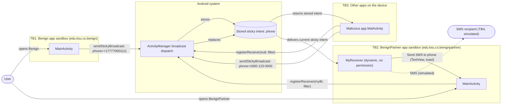
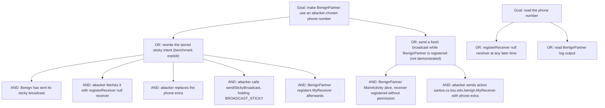

# Threat Model: StickyBroadcast-DataInjection-Lean

## 1. Benchmark

| Field | Value |
|-------|-------|
| Name | StickyBroadcast-DataInjection-Lean |
| Category | ICC (inter-component communication) |
| Ghera path | `benchmarks/ghera/ICC/StickyBroadcast-DataInjection-Lean` |
| Affected Android versions (from README) | "Tested on Android 5.1.1 - Android 8.1" |
| Ghera tag | `Jan2019` (commit `6289f39d`) |
| Build flavors available | `api22` to `api27`, `apiDIST` (from `benchmarks/ghera/Misc/sdkFlavors.gradle`) |
| Date of model | 2026-10-31 |

The Benign app sends a phone number in a sticky broadcast. The system keeps the last sticky intent, so the Malicious app can fetch it later, replace the phone number and send it again as a sticky broadcast. When BenignPartner registers its receiver, it gets the modified intent and acts on the attacker's number. The README also states that sticky broadcasts leak sensitive information to any app that asks for them.

This benchmark has four apps: Benign, BenignPartner, Malicious and Secure. Secure replaces Benign and shares its package name.

## 2. System description

### Components

| Component | App | Type | Exported or reachable from other apps | Notes |
|-----------|-----|------|----------------------------------------|-------|
| `MainActivity` | Benign (`edu.ksu.cs.benign`) | Activity, launcher | Yes (launcher intent filter) | In `onResume` sends `sendStickyBroadcast(i)` with action `santos.cs.ksu.edu.benign.MyReceiver` and extra `phone=+177770001111`. Manifest declares `android.permission.BROADCAST_STICKY`. |
| `MainActivity` | BenignPartner (`edu.ksu.cs.benignpartner`) | Activity, launcher | Yes (launcher intent filter) | In `onCreate` calls `registerReceiver(myBr, new IntentFilter("santos.cs.ksu.edu.benign.MyReceiver"))` with no permission; unregisters in `onDestroy`. Holds a static `TextView tv` that `MyReceiver` writes to. |
| `MyReceiver` | BenignPartner | Broadcast receiver, registered dynamically by `MainActivity`; also declared in the manifest | Dynamic registration: yes, while `MainActivity` is alive. Manifest entry: `android:exported="true"` with no intent filter. | `onReceive` reads the `phone` extra, logs `"Send SMS to " + phnNm`, sets `MainActivity.tv` to `"Send SMS to " + phnNm` and shows a toast `"Sent SMS to " + phnNm`. No check of sender or of the value. No SMS API is called. |
| `MalActivity` | Malicious (`edu.ksu.cs.malicious`) | Activity, launcher | n/a | In `onResume` calls `registerReceiver(null, new IntentFilter("santos.cs.ksu.edu.benign.MyReceiver"))` to fetch the stored sticky intent. If none, toasts "not sticky". Otherwise toasts "sticky", sets `phone=1800-123-0000`, toasts the new value and calls `sendStickyBroadcast(i)`. Manifest declares `android.permission.BROADCAST_STICKY` and nothing else. |
| `MainActivity` | Secure (`edu.ksu.cs.benign`) | Activity, launcher | Yes (launcher intent filter) | Same as Benign, but sends `sendBroadcast(i)` instead of `sendStickyBroadcast(i)` and does not declare `BROADCAST_STICKY`. |

Source files:
- `Benign/app/src/main/java/edu/ksu/cs/benign/MainActivity.java`
- `BenignPartner/app/src/main/java/edu/ksu/cs/benignpartner/MainActivity.java`
- `BenignPartner/app/src/main/java/edu/ksu/cs/benignpartner/MyReceiver.java`
- `Malicious/app/src/main/java/edu/ksu/cs/malicious/MalActivity.java`
- `Secure/app/src/main/java/edu/ksu/cs/benign/MainActivity.java`
- `AndroidManifest.xml` of each app

### Trust boundaries

| ID | Boundary | What crosses it |
|----|----------|-----------------|
| TB1 | Benign app sandbox vs. the Android system | The sticky intent with action `santos.cs.ksu.edu.benign.MyReceiver` and extra `phone`. After this point Benign has no control over who reads or replaces it. |
| TB2 | Android system vs. BenignPartner app sandbox | The stored sticky intent, delivered to `MyReceiver` when BenignPartner registers. BenignPartner cannot tell whether Benign or another app sent it. |
| TB3 | Android system vs. other apps on the device | Any app can fetch the stored sticky intent with `registerReceiver(null, filter)` and replace it with `sendStickyBroadcast`. |
| TB4 | BenignPartner vs. the phone network | The SMS that `MyReceiver` represents. In this Lean benchmark no SMS is sent; the TextView and toast are the observable effect. |

### Data flow diagram



## 3. Assets and attacker model

### Assets

| Asset | Why it matters |
|-------|----------------|
| The phone number in the sticky intent (`+177770001111`) | The README calls it sensitive information. It decides who receives the SMS. |
| Integrity of the phone number that BenignPartner uses | If it is replaced, BenignPartner sends the SMS to the attacker's number. |
| BenignPartner's send-SMS capability | Represented by the TextView and toast in this Lean benchmark. In a real app it would cost money and could carry private content. |
| Phone number in BenignPartner's log | `MyReceiver` logs `"Send SMS to " + phnNm` with `Log.d`. |

### Attacker

A third-party app installed on the same device. This matches the Malicious app in the benchmark.

### Attacker requirements

- Installed on the same device as Benign and BenignPartner.
- Declares `android.permission.BROADCAST_STICKY` in its manifest (the Malicious manifest does). It declares no other permission.
- Knows the action string `santos.cs.ksu.edu.benign.MyReceiver` and the extra name `phone`. Both are in the Benign APK.
- Timing: Benign must have sent its sticky broadcast before Malicious runs, otherwise `registerReceiver(null, filter)` returns `null` and Malicious only shows "not sticky". Malicious must run before BenignPartner registers its receiver. The README orders the steps Benign, Malicious, BenignPartner.
- The user only opens Malicious. The README says the change is made "in the background without the user's knowledge".

## 4. STRIDE

| Category | Threat | Applies | Why |
|----------|--------|---------|-----|
| Spoofing | Malicious sends a sticky intent with Benign's action, and BenignPartner treats it as Benign's message. | Yes | `MyReceiver.onReceive` never checks the sender, and BenignPartner registers the receiver with no permission. |
| Tampering | Malicious replaces the `phone` extra with `1800-123-0000`. | Yes | `MalActivity` calls `i.putExtra("phone", "1800-123-0000")` on the fetched intent and calls `sendStickyBroadcast(i)`. The README says Android "will overwrite the old message with the new one". |
| Repudiation | Nothing records which app supplied the number that BenignPartner used. | Yes | `MyReceiver` logs only the action and the phone number. |
| Information disclosure | Any app can read the phone number at any later time. | Yes | `MalActivity` reads the stored intent with `registerReceiver(null, filter)` and shows its value in a toast. The README summary: sticky broadcasts are "vulnerable to leaking sensitive information". `MyReceiver` also writes the number to the log. |
| Denial of service | Malicious could replace the number with an invalid value so BenignPartner never reaches the right recipient. | Partially | Same mechanism as Tampering. Not part of the benchmark exploit and not tested. |
| Elevation of privilege | Malicious makes BenignPartner "send an SMS" to a number it chose. | Partially | The README describes the SMS being sent to the injected number. The Malicious manifest does not request `SEND_SMS`. In this Lean code BenignPartner does not request `SEND_SMS` either and calls no SMS API, so no real privilege is used. |

## 5. LINDDUN

| Category | Threat | Applies | Why |
|----------|--------|---------|-----|
| Linkability | An app that reads the sticky intent repeatedly can link Benign sessions over time. | Partially | Benign sends the sticky broadcast on every `onResume`. The payload is a constant in this Lean benchmark. |
| Identifiability | The phone number can identify a person. | Yes | The phone number is readable by any app (see Information disclosure). |
| Non-repudiation | A message sent to the attacker's number looks like it came from BenignPartner. | Partially | Applies to a real SMS. This benchmark only shows text on screen. |
| Detectability | An app can tell whether Benign has run since the sticky intent was stored. | Yes | `MalActivity` shows "sticky" or "not sticky" depending on whether the stored intent exists. |
| Disclosure of information | The phone number leaks to other apps. | Yes | Same cause as Information disclosure in STRIDE. |
| Unawareness | The user does not know the number was read or changed. | Yes | README: Malicious "retrieves the sticky broadcast in the background without the user's knowledge". `MalActivity` does show toasts, but they do not explain the change. |
| Non-compliance | Personal data is shared with any app on the device without consent. | Partially | Would matter in a real product. The benchmark uses fixed test data. |

## 6. Attack tree



## 7. Standards mapping

Confidence values:
- **Verified**: the ID and title were checked against the official page.
- **Needs check**: the ID or title could not be confirmed against the official page.

Fit values:
- **Direct**: the standard describes this benchmark's weakness or test as it is.
- **Partial**: the standard covers part of this benchmark, or covers it only with a caveat given in the Fit cell.

CWE and MASVS titles are copied from `docs/threat-models/standards-reference.md`.

| Standard | ID | Title | Confidence | Fit |
|----------|----|-------|------------|-----|
| CWE | CWE-927 | Use of Implicit Intent for Sensitive Communication | Verified | Direct. Benign sends the phone number in an implicit sticky broadcast; the CWE description names sticky broadcasts as a variant. Usage ALLOWED. |
| CWE | CWE-925 | Improper Verification of Intent by Broadcast Receiver | Verified | Partial. BenignPartner's `MyReceiver` does not verify the source of the intent, but the CWE's extended description is about receivers that trust system intents. Usage ALLOWED. |
| CWE | CWE-926 | Improper Export of Android Application Components | Verified | Partial. BenignPartner's receiver is registered without a permission and its manifest entry is `exported="true"`, but the root cause is the sticky send in Benign. Usage ALLOWED. |
| CWE | CWE-940 | Improper Verification of Source of a Communication Channel | Verified | Partial. BenignPartner's `MyReceiver.java` line 17 (`String phnNm = intent.getStringExtra("phone");`) handles an incoming broadcast and takes the number without checking that it comes from Benign, which is the CWE description: the product handles an incoming request "but it does not properly verify that the request is coming from the expected origin". Partial because the root cause is the sticky send in Benign; this covers only the receiver side. It is the most specific entry that fits: of its children shown on the page, CWE-925 (in this table) is about receivers that trust system intents and CWE-939 is about custom URL scheme handlers. Usage ALLOWED. |
| CWE | CWE-532 | Insertion of Sensitive Information into Log File | Verified | Partial. BenignPartner's `MyReceiver.java` line 18 logs `"Send SMS to " + phnNm`, so the phone number goes to the device log (attack tree path C2). The README exploit reads the sticky intent instead, and whether another app can read BenignPartner's log on the test emulator has not been checked. BenignPartner is shared by both pairs, so the Secure fix does not remove this. Usage ALLOWED. |
| OWASP MASVS v2 | MASVS-PLATFORM-1 | The app uses IPC mechanisms securely. | Verified | Direct. Both the sticky send and the unprotected receiver are IPC weaknesses. |
| OWASP MASTG test | MASTG-TEST-0366 | Exported And Unprotected Broadcast Receivers That Expose Sensitive Functionality | Verified | Partial. Covers BenignPartner's unprotected receiver, not the sticky send in Benign. |
| OWASP MASTG test | MASTG-TEST-0029 | Testing for Sensitive Functionality Exposure Through IPC | Verified | Partial. Deprecated, kept for reference only. |
| OWASP MASWE | MASWE-0063 | Insecure Broadcast Receivers | Verified | Partial. Covers the receiver side only. Beta, ID may change. |

CWE-345 (Insufficient Verification of Data Authenticity) was considered and is DISCOURAGED in `standards-reference.md`, so it is not in the table.

CWE-346 (Origin Validation Error), the child of CWE-345 between it and CWE-940, was removed from the table: for `MyReceiver` it says the same thing as CWE-940 in more general terms and adds nothing.

Candidates to check (not in the table):
- A MASWE or MASTG v2 entry that covers sensitive data sent in implicit or sticky broadcasts (the sender side). No ID has been verified.

MITRE ATT&CK for Mobile: No direct match. No technique on attack.mitre.org was verified that describes rewriting another app's sticky broadcast.

## 8. Evidence

All steps below are **Not yet run**. No result has been observed.

### Commands

Build. PowerShell on Windows from the project root, Gradle 4.4 (from each app's `gradle-wrapper.properties`), JDK 8 through `env.ps1`. **Not yet run.**

```powershell
. .\env.ps1
$B = "benchmarks\ghera\ICC\StickyBroadcast-DataInjection-Lean"
# Each app folder needs local.properties with sdk.dir=C:/Android/Sdk (none is present yet)
foreach ($a in "Benign","BenignPartner","Malicious","Secure") {
    Set-Content "$B\$a\local.properties" "sdk.dir=C:/Android/Sdk"
    Push-Location "$B\$a"; .\gradlew.bat assembleDebug; Pop-Location
}
```

Start the emulator and install pair 1. **Not yet run.**

```powershell
. .\env.ps1
emulator -avd ghera27
$B = "benchmarks\ghera\ICC\StickyBroadcast-DataInjection-Lean"
adb install -r "$B\Benign\app\build\outputs\apk\api27\debug\app-api27-debug.apk"
adb install -r "$B\Malicious\app\build\outputs\apk\api27\debug\app-api27-debug.apk"
adb install -r "$B\BenignPartner\app\build\outputs\apk\api27\debug\app-api27-debug.apk"
```

Pair 1, Benign + Malicious + BenignPartner, by hand (README steps 8 to 10). **Not yet run.**

1. `adb logcat -c`
2. Open Benign.
3. Open Malicious. Note the toasts ("sticky", then "Intent data = 1800-123-0000").
4. Open BenignPartner.
5. Read the BenignPartner screen and toast.
6. `adb logcat -d -s BenignPartner StickyBroadcast`

Pair 2, Secure + Malicious + BenignPartner. Secure shares the package name `edu.ksu.cs.benign`. Cold-boot the emulator first so that the sticky intent stored in pair 1 is gone (see Open questions). Step order follows `Testing/secure_app/.../Tests.java`. **Not yet run.**

```powershell
adb uninstall edu.ksu.cs.benign
adb emu kill
emulator -avd ghera27 -no-snapshot-load
adb install -r "$B\Secure\app\build\outputs\apk\api27\debug\app-api27-debug.apk"
```

1. `adb logcat -c`
2. Open BenignPartner, then press Home.
3. Open Secure.
4. Open Malicious. Note the toast.
5. Open BenignPartner.
6. Read the BenignPartner screen.
7. `adb logcat -d -s BenignPartner StickyBroadcast`

Extra check for the residual risk in section 9, without the Malicious app. **Not yet run.**

```powershell
# With BenignPartner open (receiver registered), against the Secure pair
adb shell am broadcast -a santos.cs.ksu.edu.benign.MyReceiver --es phone 1800-123-0000
```

### Expected result (from README and Testing code)

| Pair | Expected | Source | Status |
|------|----------|--------|--------|
| Benign + Malicious + BenignPartner | BenignPartner shows the toast "Sent SMS to 1800-123-0000" and the TextView "Send SMS to 1800-123-0000". | README step 10; `Testing/benign_app/.../Tests.java` asserts the TextView text. | Not yet run |
| Secure + Malicious + BenignPartner | BenignPartner TextView shows "Send SMS to +177770001111". | `Testing/secure_app/.../Tests.java`. The README gives no Secure steps. | Not yet run |

### Observed result

| Pair | Outcome | Observation |
|------|---------|-------------|
| Benign + Malicious + BenignPartner | Not yet observed | Not yet observed |
| Secure + Malicious + BenignPartner | Not yet observed | Not yet observed |

## 9. Mitigation

### What the Secure app does differently

Diff of `Benign/` and `Secure/` (excluding build output and the prebuilt APKs). BenignPartner and Malicious are shared by both pairs and are unchanged.

| File | Benign | Secure |
|------|--------|--------|
| `app/src/main/AndroidManifest.xml` lines 5 to 6 | `<uses-permission android:name="android.permission.BROADCAST_STICKY" />` and a blank line | Removed |
| `app/src/main/java/edu/ksu/cs/benign/MainActivity.java` line 22 (`onResume`) | `sendStickyBroadcast(i);` | `sendBroadcast(i);` |
| `app/src/main/res/values/strings.xml` line 2 | `<string name="app_name">Benign</string>` | `<string name="app_name">Secure</string>` |

The action string and the `phone` extra are unchanged. The broadcast is still implicit and has no receiver permission.

### Assessment of the fix

The fix removes the stored copy, so Malicious finds nothing to read or rewrite later. It does not make the channel safe:

1. **Still an implicit broadcast with no permission.** The README note says it directly: Secure "is still vulnerable to a malicious app that registers for the broadcast message before the message is sent". Such an app gets the phone number (CWE-927 still applies, in its non-sticky form).
2. **BenignPartner is unchanged.** `MyReceiver` is still registered with no permission and still does not check the sender or the value. Any app that sends action `santos.cs.ksu.edu.benign.MyReceiver` with a `phone` extra while BenignPartner's `MainActivity` is alive can still inject a number. The benchmark's Malicious app does not try this; the `adb shell am broadcast` check in section 8 is meant to test it.
3. **Delivery depends on timing.** With a normal broadcast, BenignPartner only gets the number if its receiver is already registered when Secure sends it. The Testing code opens BenignPartner first for this reason. This changes how the apps work together, not only their security.
4. **Stronger alternatives** not used by the Secure app: send an explicit broadcast to BenignPartner (`setPackage("edu.ksu.cs.benignpartner")`); protect both sides with a `signature` permission (`sendBroadcast(i, perm)` and `registerReceiver(..., perm, null)`); do not put the phone number in a broadcast at all. Hypothesis, to test in Step 3: on newer Android versions, a receiver registered with `Context.RECEIVER_NOT_EXPORTED` (API 33 and later) would refuse broadcasts from other apps, which would also block a legitimate cross-app sender like Benign.

## 10. Open questions

- The README says `MyReceiver` "sends an SMS to that number". The Lean code calls no SMS API and BenignPartner does not request `SEND_SMS`; it only sets a TextView and shows a toast. The model follows the code.
- README step 10 quotes the toast "Sent SMS to ...", while the TextView reads "Send SMS to ..." and the Testing code checks the TextView. Both come from `MyReceiver.java` lines 19 and 20.
- BenignPartner's manifest declares `MyReceiver` with `android:exported="true"` and no intent filter, in addition to the dynamic registration. It is not clear whether the static entry is reachable by an explicit intent from another app, and whether it would crash because `MainActivity.tv` is `null` when `MainActivity` is not running. Not covered by the README.
- Whether a stored sticky intent survives the sender's uninstall is not stated in the README or code. The cold boot before pair 2 is a precaution so that pair 1 cannot affect pair 2. Hypothesis, to test in Step 3.
- The protection level of `android.permission.BROADCAST_STICKY` (whether the user is asked to grant it) is not stated in the benchmark. Check it against the Android documentation before claiming the attacker needs no user approval.
- The README says `sendStickyBroadcast` leaks data; whether `sendStickyBroadcast` is deprecated or restricted on newer Android versions is not covered by the benchmark. Hypothesis, to test in Step 3.
- The CWE for missing verification of data authenticity was checked: CWE-345 is DISCOURAGED; CWE-940, a child of its child CWE-346, is in the table in section 7.
- `Benign/` and `Secure/` each contain a prebuilt APK (`StickyBroadcast-DataInjection-Lean-benign.apk`, `...-secure.apk`). The commands above build from source instead; whether the prebuilt APKs match the source is not checked.
