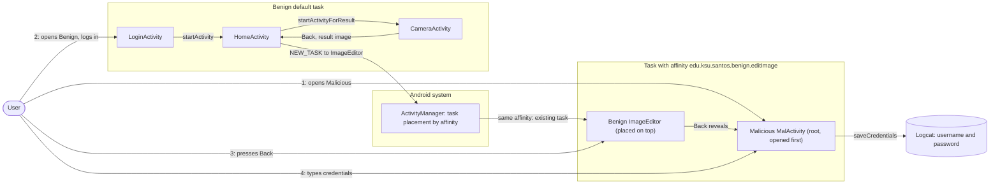
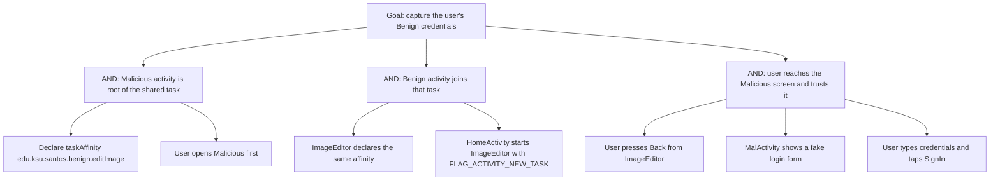

# Threat Model: TaskAffinity-ActivityHijack-Lean

## 1. Benchmark

| Field | Value |
|-------|-------|
| Name | TaskAffinity-ActivityHijack-Lean |
| Category | ICC (inter-component communication) |
| Ghera path | `benchmarks/ghera/ICC/TaskAffinity-ActivityHijack-Lean` |
| Affected Android versions (from README) | "Tested on Android 5.1.1 - Android 8.1" (heading: "Android versions affected") |
| Ghera tag | `Jan2019` (commit `6289f39d`) |
| Build flavors available | `api22` to `api27`, `apiDIST` (from `benchmarks/ghera/Misc/sdkFlavors.gradle`) |
| Date of model | 2026-10-31 |

Benign's `ImageEditor` declares the task affinity `edu.ksu.santos.benign.editImage` and is started with `FLAG_ACTIVITY_NEW_TASK`. The Malicious launcher activity `MalActivity` declares the same affinity. If Malicious was opened first, `ImageEditor` is placed in the task that already holds `MalActivity`, so pressing Back from `ImageEditor` shows `MalActivity`, which now draws a fake login form and logs what the user types.

**Start order (README steps 7 and 8):** launch Malicious first. Then launch Benign, log in with any strings, tap the button to take a picture, press Back to return to `HomeActivity`, tap the text "image", then press Back.

## 2. System description

### Components

| Component | App | Type | Exported or reachable from other apps | Notes |
|-----------|-----|------|----------------------------------------|-------|
| `LoginActivity` | Benign (`edu.ksu.cs.benign`) | Activity, launcher | Yes (launcher intent filter) | Username `R.id.usrnm`, password `R.id.pwd`, button "SignIn". `authenticate` returns true for any non-null strings (`LoginActivity.java` lines 40 to 42), then starts `HomeActivity`. |
| `HomeActivity` | Benign | Activity | No intent filter, no `exported` attribute | "Take Picture" starts `CameraActivity` for a result. Tapping `R.id.imageView` starts `ImageEditor` with extra `image`, action `Home` and `FLAG_ACTIVITY_NEW_TASK`, through `startActivityForResult(intent, 100)` (`HomeActivity.java` lines 38 to 42). |
| `CameraActivity` | Benign | Activity | No intent filter | Sets `RESULT_OK` with `image="image"` in `onResume` (`CameraActivity.java` lines 18 to 20). The user presses Back to return. |
| `ImageEditor` | Benign | Activity | No intent filter | `android:taskAffinity="edu.ksu.santos.benign.editImage"` (manifest lines 21 to 23). Shows the `image` extra in `R.id.editImg`. |
| `MalActivity` | Malicious (`edu.ksu.cs.malicious`) | Activity, launcher | n/a | `android:taskAffinity="edu.ksu.santos.benign.editImage"` (Malicious manifest lines 11 to 13). Static `controlVar` starts at 1; the first `onResume` sets it to 0 (lines 60 to 61). Any later `onResume` replaces the text with Username and Password fields and a "SignIn" button, toasts "Oops! something went wrong please login again..", and on SignIn logs `User : ... Password : ...` with tag `Malicious1` (lines 27 to 59 and 75 to 77). |
| Application | Secure (`edu.ksu.cs.benign`) | `<application>` element | n/a | `android:taskAffinity=""` (Secure manifest line 13). `ImageEditor` has no affinity of its own (line 22). The Java code is the same as Benign. |

Manifest permissions: Benign and Secure declare `android.permission.GET_TASKS` (manifest line 5); no code in either app uses it. Malicious declares none.

Source files:
- `Benign/app/src/main/java/edu/ksu/cs/benign/LoginActivity.java`
- `Benign/app/src/main/java/edu/ksu/cs/benign/HomeActivity.java`
- `Benign/app/src/main/java/edu/ksu/cs/benign/CameraActivity.java`
- `Benign/app/src/main/java/edu/ksu/cs/benign/ImageEditor.java`
- `Malicious/app/src/main/java/edu/ksu/cs/malicious/MalActivity.java`
- `AndroidManifest.xml` of each app

### Trust boundaries

| ID | Boundary | What crosses it |
|----|----------|-----------------|
| TB1 | Benign app vs. other apps, at the task level | The task with affinity `edu.ksu.santos.benign.editImage`, which ends up holding activities of both apps. Benign's `ImageEditor` enters a task whose root belongs to Malicious. |
| TB2 | User vs. the screen | The Back button and the login form. Nothing on screen tells the user which app owns the activity that Back reveals. |
| TB3 | Malicious app vs. the device log | Credentials typed into `MalActivity` are written to logcat. |

### Data flow diagram



## 3. Assets and attacker model

### Assets

| Asset | Why it matters |
|-------|----------------|
| The user's Benign credentials | The README: "The user enters her credentials and the credentails are compromised." In the code, `MalActivity` logs them (`MalActivity.java` line 76). |
| The integrity of Back navigation in Benign | The user expects Back from `ImageEditor` to return to `HomeActivity`; it shows `MalActivity` instead. |

### Attacker

A third-party app installed on the same device. This matches the Malicious app in the benchmark.

### Attacker requirements

- Installed on the same device as Benign.
- No permission needed. The Malicious manifest declares none.
- Knows the task affinity string `edu.ksu.santos.benign.editImage`, which is in Benign's manifest (line 23).
- The user opens Malicious before using Benign's image editor (README step 7), so `MalActivity` is the root of the task and has already run `onResume` once.
- The user then follows the Benign flow and presses Back from `ImageEditor` (README step 8).
- `MalActivity` must look like Benign's login screen for the user to trust it (README).

## 4. STRIDE

| Category | Threat | Applies | Why |
|----------|--------|---------|-----|
| Spoofing | `MalActivity` poses as Benign's login screen. | Yes | `MalActivity.java` lines 27 to 59 build Username, Password and "SignIn" controls and toast a request to log in again. |
| Tampering | Malicious changes the order of screens in Benign's flow. | Yes | `ImageEditor` is placed above `MalActivity` in the shared task (Benign manifest line 23, Malicious manifest line 13, `HomeActivity.java` line 41). |
| Repudiation | Benign has no record that another app's screen was shown in its flow. | Yes | No logging in Benign. |
| Information disclosure | Credentials are captured by Malicious. | Yes | `MalActivity.java` line 56 passes both fields to `saveCredentials`, which logs them (line 76). |
| Denial of service | The user cannot get back to `HomeActivity` with Back. | Partially | Follows from the task order. The README says `MalActivity` then "takes the user back to LoginActivity"; the code does not (see Open questions). |
| Elevation of privilege | Malicious gains rights in Benign. | No | Malicious gets no access to Benign's components or data, only to what the user types. |

## 5. LINDDUN

| Category | Threat | Applies | Why |
|----------|--------|---------|-----|
| Linkability | Captured credentials could link the user's accounts. | Partially | Applies to real credentials. |
| Identifiability | A username identifies the user. | Yes | `MalActivity` logs the username (line 76). |
| Non-repudiation | No user action is attributed. | No | Nothing is recorded against the user. |
| Detectability | Malicious learns when the user leaves Benign's editor. | Partially | `MalActivity.onResume` runs when the user presses Back from `ImageEditor`. |
| Disclosure of information | Credentials disclosed to Malicious. | Yes | See STRIDE Information disclosure. |
| Unawareness | The user is not told that the login screen belongs to another app. | Yes | README: the screen is "similar to LoginActivity in Benign". |
| Non-compliance | Credentials collected without consent. | Partially | Applies to a real app. |

## 6. Attack tree



## 7. Standards mapping

Confidence values:
- **Verified**: the ID and title were checked against the official page.
- **Needs check**: the ID or title could not be confirmed against the official page.

Fit values:
- **Direct**: the standard describes this benchmark's weakness or test as it is.
- **Partial**: the standard covers part of this benchmark, or covers it only with a caveat given in the Fit cell.

CWE and MASVS titles are copied from `docs/threat-models/standards-reference.md`. The MASVS-PLATFORM-1 and MASVS-PLATFORM-3 control pages were read on 2026-10-31. Neither names task hijacking. Android's StrandHogg page (https://developer.android.com/privacy-and-security/risks/strandhogg) files the attack under "MASVS-PLATFORM: Platform Interaction" without naming a control. Both controls are therefore listed as Partial.

| Standard | ID | Title | Confidence | Fit |
|----------|----|-------|------------|-----|
| CWE | CWE-1021 | Improper Restriction of Rendered UI Layers or Frames | Verified | Partial. Benign manifest line 23 and `HomeActivity.java` line 41 let `ImageEditor` be placed in a task whose root is another app's activity, so Back reveals Malicious's UI inside Benign's flow. Partial because the page's description is written for web applications and frames; the mobile link is its alternate term "Tapjacking" and its related attack pattern CAPEC-504 (Task Impersonation). The page shows no child entries. Usage ALLOWED. |
| OWASP MASVS v2 | MASVS-PLATFORM-1 | The app uses IPC mechanisms securely. | Verified | Partial. The fault is in how Benign starts its own activity: a custom `taskAffinity` (manifest line 23) plus `FLAG_ACTIVITY_NEW_TASK` (`HomeActivity.java` line 41). The control page is about IPC used to expose data or functionality to other apps, which only partly covers task placement. |
| OWASP MASVS v2 | MASVS-PLATFORM-3 | The app uses the user interface securely. | Verified | Partial. The harm is credential capture through a look-alike screen (`MalActivity.java` lines 27 to 59). The control page is about sensitive data on screen leaking through platform mechanisms; it lists MASWE-0039 (App Vulnerable to Overlay Attacks) but does not name task hijacking. |

OWASP MASTG test and OWASP MASWE: No direct match among the allowed IDs. MASTG-TEST-0366, MASTG-TEST-0029 and MASWE-0063 are about broadcast receivers or functionality exposed through IPC, while this benchmark is about task placement (Benign manifest line 23).

Candidates to check (not in the table):
- MASWE-0039 (App Vulnerable to Overlay Attacks), listed on the MASVS-PLATFORM-3 page. Not in the allowed list for this batch.
- A MASTG test about task hijacking or `taskAffinity`. No ID has been verified.

MITRE ATT&CK for Mobile: No direct match. No technique on attack.mitre.org was verified that describes task affinity hijacking.

## 8. Evidence

All steps below are **Not yet run**. No result has been observed.

### Commands

Build. PowerShell on Windows from the project root, Gradle 4.4, JDK 8 through `env.ps1`. **Not yet run.**

```powershell
. .\env.ps1
$B = "benchmarks\ghera\ICC\TaskAffinity-ActivityHijack-Lean"
# Each app folder needs local.properties with sdk.dir=C:/Android/Sdk (none is present yet)
foreach ($a in "Benign","Malicious","Secure") {
    Set-Content "$B\$a\local.properties" "sdk.dir=C:/Android/Sdk"
    Push-Location "$B\$a"; .\gradlew.bat assembleDebug; Pop-Location
}
```

Start the emulator and install pair 1. **Not yet run.**

```powershell
. .\env.ps1
emulator -avd ghera27
$B = "benchmarks\ghera\ICC\TaskAffinity-ActivityHijack-Lean"
adb install -r "$B\Benign\app\build\outputs\apk\api27\debug\app-api27-debug.apk"
adb install -r "$B\Malicious\app\build\outputs\apk\api27\debug\app-api27-debug.apk"
```

Pair 1, Benign + Malicious, by hand, in the README start order. **Not yet run.**

1. `adb logcat -c`
2. Open Malicious from the launcher (README step 7). Expected from the code: the text "This app provides useful functionality to the user".
3. Press Home.
4. Open Benign from the launcher. Type any username and password and tap "SignIn".
5. Tap "Take Picture", then press Back. The text "image" should appear.
6. Tap "image". `ImageEditor` should open.
7. `adb shell dumpsys activity activities | findstr /i "affinity Hist"` (record which task holds `ImageEditor`).
8. Press Back. Read the screen.
9. If the Malicious login form is shown, type "user" and "pass" and tap "SignIn".
10. `adb logcat -d -s Malicious1:D`

Pair 2, Secure + Malicious. Secure shares the package name `edu.ksu.cs.benign`. `MalActivity` keeps `controlVar` in a static field, so cold boot first so that pair 1 cannot affect pair 2 (precaution). **Not yet run.**

```powershell
adb uninstall edu.ksu.cs.benign
adb reboot
adb wait-for-device
adb install -r "$B\Secure\app\build\outputs\apk\api27\debug\app-api27-debug.apk"
```

Repeat steps 1 to 10 with Secure in place of Benign. The Secure app's label is still "Benign" (`Secure/app/src/main/res/values/strings.xml` line 2).

Without the Malicious app. The exploit uses no broadcast and no intent from Malicious: it depends on an installed activity that declares a task affinity, which the shell cannot create. So no `adb shell am broadcast` line applies. The closest check is to inspect tasks after step 6 with only Benign or Secure installed. **Not yet run.**

```powershell
adb shell dumpsys activity activities | findstr /i "affinity Hist"
```

### Expected result (from README and Testing code)

| Pair | Expected | Source | Status |
|------|----------|--------|--------|
| Benign + Malicious | After Back from `ImageEditor`, a Malicious login screen appears with fields `mal_username` and `mal_pwd`. | README step 8 ("You will see a login screen pop up similar to the first screen, but this screen belongs to Malicious"); `Testing/benign_app/.../Tests.java` lines 64 to 89 open Malicious then Benign, follow the flow, press Back and type into `mal_username` and `mal_pwd`. | Not yet run |
| Secure + Malicious | After Back, no Malicious login field is found. | `Testing/secure_app/.../Tests.java` lines 68 to 91 expect `UiObjectNotFoundException` for `mal_username`. The README gives no Secure steps. | Not yet run |

### Observed result

| Pair | Outcome | Observation |
|------|---------|-------------|
| Benign + Malicious | Not yet observed | Not yet observed |
| Secure + Malicious | Not yet observed | Not yet observed |

## 9. Mitigation

### What the Secure app does differently

Diff of `Benign/` and `Secure/` (excluding build output, the prebuilt APKs and `local.properties`). The two `gradle-wrapper.properties` files are the same.

| File | Benign | Secure |
|------|--------|--------|
| `app/src/main/AndroidManifest.xml` line 12 (Secure lines 12 to 13) | `android:theme="@style/AppTheme">` | `android:theme="@style/AppTheme"` and `android:taskAffinity="">` on `<application>` |
| `AndroidManifest.xml` lines 21 to 23 (Secure line 22) | `<activity android:name=".ImageEditor" android:taskAffinity="edu.ksu.santos.benign.editImage" />` | `<activity android:name="edu.ksu.cs.benign.ImageEditor" />` |
| `AndroidManifest.xml` lines 13, 20, 24 (Secure 14, 21, 23) | `.LoginActivity`, `.HomeActivity`, `.CameraActivity` | Fully qualified `edu.ksu.cs.benign.` names (same classes) |

All Java files, layouts and `strings.xml` are the same; the Secure label is still "Benign". `HomeActivity` still starts `ImageEditor` with `FLAG_ACTIVITY_NEW_TASK` and `startActivityForResult` (Secure `HomeActivity.java` lines 41 to 42). `GET_TASKS` is still declared.

### Assessment of the fix

The fix removes the shared affinity string, which is what the benchmark exploit relies on. Residual points:

1. **`FLAG_ACTIVITY_NEW_TASK` is still set.** `ImageEditor` is still started in a new task. With an empty affinity, which task it goes to is decided by the platform, not by the code. Dropping the flag would keep `ImageEditor` in Benign's own task.
2. **An empty affinity is still an affinity value.** Whether another app can declare `android:taskAffinity=""` and so match Secure's activities has not been checked. Hypothesis, to test in Step 3.
3. **Platform fix, original attack.** The StrandHogg page (https://developer.android.com/privacy-and-security/risks/strandhogg) says: "The StrandHogg attack / Task affinity vulnerability was originally patched in March 2019". Hypothesis, to test in Step 3: this patch is in the Android 9 platform (SDK 28), so the benchmark exploit fails on SDK 28 and later. The page gives the date but not the version; see Open questions.
4. **Platform fix, newer variant.** The same page says a "newer and more comprehensive variant [was] patched in September 2020" and that "Android SDK versions 30 and newer (Android 11) contain the appropriate OS patches". Its listed mitigation is `android:minSdkVersion="30"`, and it says version 2 "can only be prevented by this SDK version patch". Hypothesis, to test in Step 3: app configuration such as Secure's only partly mitigates the attack, and only devices on SDK 30 or later are fully protected.
5. **Unused permission.** `GET_TASKS` is declared in both apps and used by neither.

The fix is complete for the benchmark exploit as written. Points 1 to 4 limit how far it carries to other attacks.

## 10. Open questions

- The README says `MalActivity` "takes the user back to LoginActivity making it look like the user's session was lost". In the code, the SignIn handler only logs the credentials (`MalActivity.java` lines 53 to 58 and 75 to 77); nothing starts `LoginActivity`. The model follows the code.
- The StrandHogg page gives "March 2019" for the original patch and SDK 30 (Android 11) for the newer variant. It does not say that the original patch is in Android 9 (SDK 28). That version mapping is unconfirmed.
- The README range (5.1.1 to 8.1) and the Testing code (SDK 22 to 27) both end below SDK 28, so neither says what happens on a patched platform.
- `HomeActivity` combines `startActivityForResult` with `FLAG_ACTIVITY_NEW_TASK` (lines 41 to 42). Whether a result can come back across tasks has not been checked; `ImageEditor` sets no result, so it does not affect the exploit.
- Benign and Secure declare `GET_TASKS`, which no code uses.
- The Secure app's label is "Benign", the same as Benign's, so the two are hard to tell apart in the launcher.
- Lean vs Fat: there is no Fat variant of this benchmark under `benchmarks/ghera/ICC/`, so there is nothing to compare.
- Running the build commands in section 8 writes `local.properties` and `build/` folders under `benchmarks/`. Prebuilt APKs are in each app folder; which flavor they were built with has not been checked.
