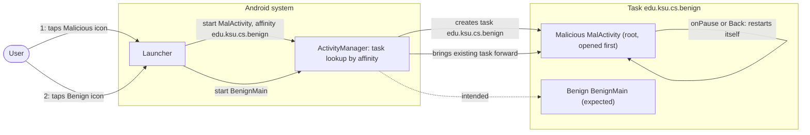
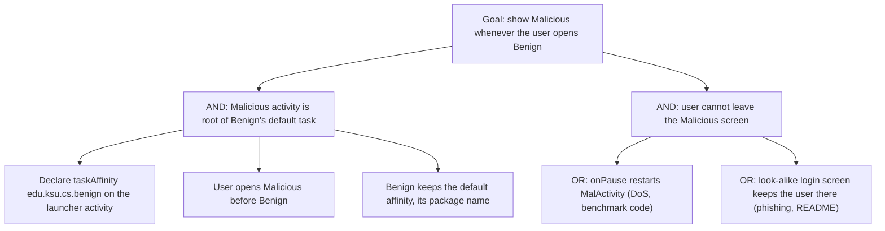

# Threat Model: TaskAffinity-LauncherActivity-PhishingAttack-Lean

## 1. Benchmark

| Field | Value |
|-------|-------|
| Name | TaskAffinity-LauncherActivity-PhishingAttack-Lean |
| Category | ICC (inter-component communication) |
| Ghera path | `benchmarks/ghera/ICC/TaskAffinity-LauncherActivity-PhishingAttack-Lean` |
| Affected Android versions (from README) | "Tested on Android 5.1.1 - Android 7.1" (heading: "Android versions affected") |
| Ghera tag | `Jan2019` (commit `6289f39d`) |
| Build flavors available | `api22` to `api27`, `apiDIST` (from `benchmarks/ghera/Misc/sdkFlavors.gradle`) |
| Date of model | 2026-10-31 |

Benign declares no task affinity, so all its activities use the default task named after its package, `edu.ksu.cs.benign`. The Malicious launcher activity `MalActivity` declares `android:taskAffinity="edu.ksu.cs.benign"`. If Malicious is opened first, `MalActivity` becomes the root of that task, and launching Benign shows `MalActivity` instead of Benign. `MalActivity` restarts itself whenever it is paused or Back is pressed, so the user cannot reach Benign.

**Start order (README steps 7 and 8):** launch Malicious first, then launch Benign. The README: "You will always see Malicious instead of Benign."

## 2. System description

### Components

| Component | App | Type | Exported or reachable from other apps | Notes |
|-----------|-----|------|----------------------------------------|-------|
| `BenignMain` | Benign (`edu.ksu.cs.benign`) | Activity, launcher | Yes (launcher intent filter) | Layout has EditTexts with the text "Username" and "Password" and a "Login" button (`activity_benign_main.xml` lines 10 to 34). The button starts `B2` (`BenignMain.java` line 25). No affinity set. |
| `B2` | Benign | Activity | No intent filter | Empty screen. |
| `MalActivity` | Malicious (`edu.ksu.cs.malicious`) | Activity, launcher | n/a | `android:taskAffinity="edu.ksu.cs.benign"` (Malicious manifest lines 12 to 14). Toasts "OnCreate" and shows "Welcome to Malicious World!!!" (`R.id.mal_text`). `onPause` calls `onBackPressed` (lines 17 to 21), and `onBackPressed` starts `MalActivity` again before finishing (lines 23 to 27). |
| Application | Secure (`edu.ksu.cs.benign`) | `<application>` element | n/a | `android:taskAffinity=""` (Secure manifest line 11). Secure's `B2` layout adds the text "Secured Activity". The Java code is the same apart from import order. |

Manifest permissions: none of the three apps declares a permission.

Source files:
- `Benign/app/src/main/java/edu/ksu/cs/benign/BenignMain.java`
- `Benign/app/src/main/java/edu/ksu/cs/benign/B2.java`
- `Malicious/app/src/main/java/edu/ksu/cs/malicious/MalActivity.java`
- `AndroidManifest.xml` of each app

### Trust boundaries

| ID | Boundary | What crosses it |
|----|----------|-----------------|
| TB1 | Benign app vs. other apps, at the task level | The task named `edu.ksu.cs.benign`. Malicious places its activity there as the root before Benign runs. |
| TB2 | User vs. the launcher | The user taps Benign's icon and expects Benign. The task that comes forward is rooted in Malicious. |

### Data flow diagram



## 3. Assets and attacker model

### Assets

| Asset | Why it matters |
|-------|----------------|
| Availability of Benign | The README: Malicious "can deny all activities of Benign app from being displayed". |
| The user's trust in the Benign icon | Tapping Benign shows another app's screen. The README also names phishing as a possible use. |
| The user's Benign credentials | Benign's first screen has Username and Password fields. A look-alike `MalActivity` could collect them; the benchmark's `MalActivity` does not. |

### Attacker

A third-party app installed on the same device. This matches the Malicious app in the benchmark.

### Attacker requirements

- Installed on the same device as Benign.
- No permission needed. The Malicious manifest declares none.
- Knows Benign's package name `edu.ksu.cs.benign`, which is the default task name (README).
- The user opens Malicious before Benign (README step 7), so `MalActivity` is the root of the task.
- For phishing, `MalActivity` would have to look like Benign's screen. The benchmark code only shows a welcome text.

## 4. STRIDE

| Category | Threat | Applies | Why |
|----------|--------|---------|-----|
| Spoofing | Malicious appears when the user launches Benign. | Yes | Malicious manifest line 14 puts `MalActivity` in Benign's default task; README step 8. |
| Tampering | Malicious takes over Benign's task. | Yes | `MalActivity` is the root of the task named after Benign's package. |
| Repudiation | Benign cannot record that another app took its task. | Yes | Benign never runs. |
| Information disclosure | Credentials typed into a look-alike screen. | Partially | Possible with a look-alike `MalActivity` (README "phishing attack"). The benchmark `MalActivity` collects nothing. |
| Denial of service | The user cannot reach Benign. | Yes | `MalActivity.java` lines 17 to 27 restart `MalActivity` on every pause and Back. This is the impact named in the README. |
| Elevation of privilege | Malicious gains rights in Benign. | No | Malicious gets no access to Benign's components or data. |

## 5. LINDDUN

| Category | Threat | Applies | Why |
|----------|--------|---------|-----|
| Linkability | No personal data is processed by the benchmark code. | No | `MalActivity` collects nothing. |
| Identifiability | Same. | No | Same reason. |
| Non-repudiation | No user action is attributed. | No | Nothing is recorded against the user. |
| Detectability | Malicious learns when the user tries to open Benign. | Partially | `MalActivity` is resumed when the task comes forward. Not used by the code. |
| Disclosure of information | Credentials could be disclosed to a phishing screen. | Partially | See STRIDE Information disclosure. |
| Unawareness | The user is not told why Benign shows another app. | Yes | README step 8. |
| Non-compliance | A real app's users could be phished without consent. | Partially | Applies to a real app. |

## 6. Attack tree



## 7. Standards mapping

Confidence values:
- **Verified**: the ID and title were checked against the official page.
- **Needs check**: the ID or title could not be confirmed against the official page.

Fit values:
- **Direct**: the standard describes this benchmark's weakness or test as it is.
- **Partial**: the standard covers part of this benchmark, or covers it only with a caveat given in the Fit cell.

CWE and MASVS titles are copied from `docs/threat-models/standards-reference.md`. The MASVS-PLATFORM-1 and MASVS-PLATFORM-3 control pages were read on 2026-10-31. Neither names task hijacking. Android's StrandHogg page (https://developer.android.com/privacy-and-security/risks/strandhogg) files the attack under "MASVS-PLATFORM: Platform Interaction" without naming a control. Both controls are therefore listed as Partial.

| Standard | ID | Title | Confidence | Fit |
|----------|----|-------|------------|-----|
| CWE | CWE-1021 | Improper Restriction of Rendered UI Layers or Frames | Verified | Partial. Benign's manifest sets no `taskAffinity` (lines 5 to 20), so its activities join the default task `edu.ksu.cs.benign`, and Malicious manifest line 14 places another app's activity there as the root; launching Benign then shows that foreign UI. Partial because the page's description is written for web applications and frames, and because the benchmark's impact is denial of service more than click redress; the mobile link is the page's alternate term "Tapjacking" and its related attack pattern CAPEC-504 (Task Impersonation). The page shows no child entries. Usage ALLOWED. |
| OWASP MASVS v2 | MASVS-PLATFORM-1 | The app uses IPC mechanisms securely. | Verified | Partial. The fix is a manifest setting that controls how the system places Benign's activities (Secure manifest line 11). The control page is about IPC used to expose data or functionality to other apps, which only partly covers task placement. |
| OWASP MASVS v2 | MASVS-PLATFORM-3 | The app uses the user interface securely. | Verified | Partial. Another app's screen replaces Benign's first screen, which has credential fields (`activity_benign_main.xml` lines 10 to 25). The control page is about sensitive data on screen leaking through platform mechanisms and lists MASWE-0039 (App Vulnerable to Overlay Attacks); it does not name task hijacking, and the benchmark `MalActivity` collects no data. |

OWASP MASTG test and OWASP MASWE: No direct match among the IDs in the reference file. MASTG-TEST-0364, MASTG-TEST-0365, MASTG-TEST-0366, MASTG-TEST-0029 and MASWE-0018 are about exported components without access control, and MASWE-0032 is about insecure intents, while this benchmark is about task placement (Malicious manifest line 14).

Candidates to check (not in the table):
- MASWE-0039 (App Vulnerable to Overlay Attacks) is in the reference file but not used: its page is about attacker-controlled windows drawn over the app and defences such as touch filtering (controls shown on the page: MASVS-PLATFORM-3, MASVS-CODE-1), while task hijacking places another app's activity in the app's task.
- A MASTG test about task hijacking or `taskAffinity`. No ID has been verified.

MITRE ATT&CK for Mobile: No direct match. No technique on attack.mitre.org was verified that describes task affinity hijacking.

## 8. Evidence

All steps below are **Not yet run**. No result has been observed.

The README range ends at Android 7.1. The `ghera27` emulator runs API 27 (Android 8.1), which is outside that range but inside the Testing code's range (`@SdkSuppress(minSdkVersion = 22, maxSdkVersion = 27)`).

### Commands

Build. PowerShell on Windows from the project root, Gradle 4.4, JDK 8 through `env.ps1`. **Not yet run.**

```powershell
. .\env.ps1
$B = "benchmarks\ghera\ICC\TaskAffinity-LauncherActivity-PhishingAttack-Lean"
# Each app folder needs local.properties with sdk.dir=C:/Android/Sdk (none is present yet)
foreach ($a in "Benign","Malicious","Secure") {
    Set-Content "$B\$a\local.properties" "sdk.dir=C:/Android/Sdk"
    Push-Location "$B\$a"; .\gradlew.bat assembleDebug; Pop-Location
}
```

Start the emulator and install pair 1. **Not yet run.**

```powershell
. .\env.ps1
emulator -avd ghera27
$B = "benchmarks\ghera\ICC\TaskAffinity-LauncherActivity-PhishingAttack-Lean"
adb install -r "$B\Benign\app\build\outputs\apk\api27\debug\app-api27-debug.apk"
adb install -r "$B\Malicious\app\build\outputs\apk\api27\debug\app-api27-debug.apk"
```

Pair 1, Benign + Malicious, by hand, in the README start order. Open both apps from the launcher's app drawer, as the Testing code does. **Not yet run.**

1. Open Malicious from the app drawer (README step 7). Expected from the code: "Welcome to Malicious World!!!".
2. Press Home.
3. Open Benign from the app drawer (README step 8).
4. Read the screen.
5. `adb shell dumpsys activity activities | findstr /i "affinity Hist"` (record which activities are in task `edu.ksu.cs.benign`).
6. Press Back, then press Home, and note whether `MalActivity` comes back each time.
7. `adb shell am force-stop edu.ksu.cs.malicious` (to recover the device after the test).

Pair 2, Secure + Malicious. Secure shares the package name `edu.ksu.cs.benign`. Cold boot first so that no task from pair 1 remains (precaution). **Not yet run.**

```powershell
adb uninstall edu.ksu.cs.benign
adb reboot
adb wait-for-device
adb install -r "$B\Secure\app\build\outputs\apk\api27\debug\app-api27-debug.apk"
```

Repeat steps 1 to 7 with Secure in place of Benign. The Secure app's label is still "Benign" (`Secure/app/src/main/res/values/strings.xml` line 2).

Without the Malicious app. The exploit uses no broadcast and no intent from Malicious: it depends on an installed activity that declares a task affinity, which the shell cannot create. So no `adb shell am broadcast` line applies. The closest check is to inspect Benign's task with only Benign or Secure installed. **Not yet run.**

```powershell
adb shell am start -W -n edu.ksu.cs.benign/.BenignMain
adb shell dumpsys activity activities | findstr /i "affinity Hist"
```

### Expected result (from README and Testing code)

| Pair | Expected | Source | Status |
|------|----------|--------|--------|
| Benign + Malicious | Opening Benign shows Malicious with "Welcome to Malicious World!!!". | README step 8 ("You will always see Malicious instead of Benign"); `Testing/benign_app/.../Tests.java` lines 66 to 78 open Malicious, press Home, open Benign and assert `mal_text` is "Welcome to Malicious World!!!". | Not yet run |
| Secure + Malicious | Opening Secure shows its own screen with "Username". | `Testing/secure_app/.../Tests.java` lines 62 to 84 open Malicious, press Home, open the app labelled "Benign" and fail if no text containing "Username" is found. The README gives no Secure steps. | Not yet run |

### Observed result

| Pair | Outcome | Observation |
|------|---------|-------------|
| Benign + Malicious | Not yet observed | Not yet observed |
| Secure + Malicious | Not yet observed | Not yet observed |

## 9. Mitigation

### What the Secure app does differently

Diff of `Benign/` and `Secure/` (excluding build output, the prebuilt APKs, `local.properties` and the timestamp line in `gradle-wrapper.properties`).

| File | Benign | Secure |
|------|--------|--------|
| `app/src/main/AndroidManifest.xml` (Secure line 11) | none | `android:taskAffinity=""` on `<application>` |
| `app/src/main/res/layout/activity_b2.xml` (Secure lines 8 to 14) | none | TextView `R.id.textView` with text "Secured Activity" |
| `activity_b2.xml` line 3 and `activity_benign_main.xml` line 3 | `xmlns:app="http://schemas.android.com/apk/res-auto"` | Removed (no effect) |
| `app/src/main/java/edu/ksu/cs/benign/B2.java` and `BenignMain.java` | `import android.support.v7.app.AppCompatActivity;` first | Same import, moved (no effect) |

`strings.xml` is the same in both, so the Secure label is "Benign".

### Assessment of the fix

The fix moves Secure's activities out of the task named after its package, so a Malicious activity with `taskAffinity="edu.ksu.cs.benign"` no longer shares a task with them. Residual points:

1. **An empty affinity is still an affinity value.** Whether another app can declare `android:taskAffinity=""` and so share a task with Secure has not been checked. Hypothesis, to test in Step 3.
2. **The device-wide nuisance remains.** `MalActivity` still restarts itself on every pause (`MalActivity.java` lines 17 to 27). That is a property of Malicious, not of Benign, and no Benign setting changes it.
3. **Platform fix, original attack.** The StrandHogg page (https://developer.android.com/privacy-and-security/risks/strandhogg) says: "The StrandHogg attack / Task affinity vulnerability was originally patched in March 2019". Hypothesis, to test in Step 3: this patch is in the Android 9 platform (SDK 28), so the benchmark exploit fails on SDK 28 and later. The page gives the date but not the version; see Open questions.
4. **Platform fix, newer variant.** The same page says a "newer and more comprehensive variant [was] patched in September 2020" and that "Android SDK versions 30 and newer (Android 11) contain the appropriate OS patches". Its listed mitigation is `android:minSdkVersion="30"`, and it says version 2 "can only be prevented by this SDK version patch". Hypothesis, to test in Step 3: app configuration such as Secure's only partly mitigates the attack, and only devices on SDK 30 or later are fully protected.

The fix is complete for the benchmark exploit as written. Points 1, 3 and 4 limit how far it carries.

## 10. Open questions

- The README says Malicious sets its affinity to `cs.ksu.edu.benign` and that Benign's default task is `cs.ksu.edu.benign`. The code uses `edu.ksu.cs.benign` (Malicious manifest line 14; Benign package, manifest line 3). The model follows the code.
- The README title and summary name a phishing attack. The benchmark `MalActivity` shows only "Welcome to Malicious World!!!" and collects nothing; the code demonstrates denial of service.
- The README says `MalActivity` "will be root of the task ... (i.e., be on top of the task stack)". Root and top are different positions in a task; the README step 8 result is consistent with either.
- The README range is Android 5.1.1 to 7.1, while the Testing code runs up to SDK 27 (Android 8.1). What to expect on `ghera27` is therefore stated only by the Testing code.
- The StrandHogg page gives "March 2019" for the original patch and SDK 30 (Android 11) for the newer variant. It does not say that the original patch is in Android 9 (SDK 28). That version mapping is unconfirmed.
- The Secure app's label is "Benign", the same as Benign's; the Secure test relies on this when it taps "Benign" in the app drawer.
- Lean vs Fat: there is no Fat variant of this benchmark under `benchmarks/ghera/ICC/`, so there is nothing to compare.
- Running the build commands in section 8 writes `local.properties` and `build/` folders under `benchmarks/`. Prebuilt APKs are in each app folder; which flavor they were built with has not been checked.
