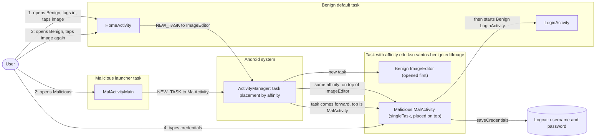
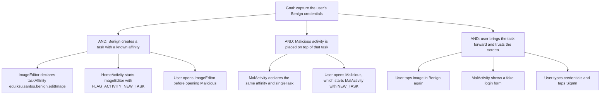

# Threat Model: TaskAffinity-PhishingAttack-Lean

## 1. Benchmark

| Field | Value |
|-------|-------|
| Name | TaskAffinity-PhishingAttack-Lean |
| Category | ICC (inter-component communication) |
| Ghera path | `benchmarks/ghera/ICC/TaskAffinity-PhishingAttack-Lean` |
| Affected Android versions (from README) | "Tested on Android 5.1.1 - Android 8.1" (heading: "Android versions affected") |
| Ghera tag | `Jan2019` (commit `6289f39d`) |
| Build flavors available | `api22` to `api27`, `apiDIST` (from `benchmarks/ghera/Misc/sdkFlavors.gradle`) |
| Date of model | 2026-10-31 |

Benign's `ImageEditor` declares the task affinity `edu.ksu.santos.benign.editImage` and is started with `FLAG_ACTIVITY_NEW_TASK`, so it runs in its own task. Malicious's `MalActivity` declares the same affinity and `launchMode="singleTask"`, and Malicious's launcher starts it with `FLAG_ACTIVITY_NEW_TASK`. Once the user has opened `ImageEditor` and then opened Malicious, `MalActivity` sits on top of that task. When the user next taps the image in Benign, the task comes forward with `MalActivity` on top, showing a fake login screen that logs the credentials.

**Start order (README steps 7 to 9):** launch Benign first, log in, tap "Take Picture", press Back, tap the text "image" so that `ImageEditor` opens. Then launch Malicious. Then launch Benign again and tap the text "image".

## 2. System description

### Components

| Component | App | Type | Exported or reachable from other apps | Notes |
|-----------|-----|------|----------------------------------------|-------|
| Application | Benign (`edu.ksu.cs.benign`) | `<application>` element | n/a | Already sets `android:taskAffinity=""` (Benign manifest line 13). |
| `LoginActivity` | Benign | Activity, launcher | Yes (launcher intent filter) | Username `R.id.usrnm`, password `R.id.pwd`, button "SignIn". `authenticate` returns true for any non-null strings (`LoginActivity.java` lines 40 to 42), then starts `HomeActivity`. |
| `HomeActivity` | Benign | Activity | No intent filter | "Take Picture" starts `CameraActivity` for a result. Tapping `R.id.imageView` starts `ImageEditor` with extra `image`, action `Home` and `FLAG_ACTIVITY_NEW_TASK`, through `startActivityForResult(intent, 100)` (`HomeActivity.java` lines 38 to 42). |
| `CameraActivity` | Benign | Activity | No intent filter | Sets `RESULT_OK` with `image="image"` in `onResume` (`CameraActivity.java` lines 18 to 20). |
| `ImageEditor` | Benign | Activity | No intent filter | `android:taskAffinity="edu.ksu.santos.benign.editImage"` overrides the application setting (Benign manifest lines 22 to 24). Shows the `image` extra in `R.id.editImg`. |
| `MalActivityMain` | Malicious (`edu.ksu.cs.malicious`) | Activity, launcher | n/a | `onCreate` starts `MalActivity` with `FLAG_ACTIVITY_NEW_TASK` (`MalActivityMain.java` line 13). |
| `MalActivity` | Malicious | Activity | No intent filter | `android:launchMode="singleTask"` and `android:taskAffinity="edu.ksu.santos.benign.editImage"` (Malicious manifest lines 11 to 14). Static `mal` starts false; the first `onResume` shows nothing and sets it to true (line 47). Any later `onResume` shows a login layout, toasts "we lost your session. Please login again", and on SignIn logs `Username = ... Password = ...` with tag `Malicious`, toasts "Incorrect password! Please try again" and starts Benign's `LoginActivity` (lines 27 to 45 and 50 to 52). `onBackPressed` also starts Benign's `LoginActivity` (lines 54 to 60). |
| `ImageEditor` | Secure (`edu.ksu.cs.benign`) | Activity | No intent filter | No affinity of its own (Secure manifest line 22), so it falls back to the application's `android:taskAffinity=""` (line 12). The Java code is the same as Benign. |

Manifest permissions: Benign and Secure declare `android.permission.GET_TASKS` (manifest line 5); no code in either app uses it. Malicious declares none.

Source files:
- `Benign/app/src/main/java/edu/ksu/cs/benign/LoginActivity.java`
- `Benign/app/src/main/java/edu/ksu/cs/benign/HomeActivity.java`
- `Benign/app/src/main/java/edu/ksu/cs/benign/CameraActivity.java`
- `Benign/app/src/main/java/edu/ksu/cs/benign/ImageEditor.java`
- `Malicious/app/src/main/java/edu/ksu/cs/malicious/MalActivityMain.java`
- `Malicious/app/src/main/java/edu/ksu/cs/malicious/MalActivity.java`
- `AndroidManifest.xml` of each app

### Trust boundaries

| ID | Boundary | What crosses it |
|----|----------|-----------------|
| TB1 | Benign app vs. other apps, at the task level | The task with affinity `edu.ksu.santos.benign.editImage`, created by Benign for `ImageEditor` and then joined by `MalActivity`. |
| TB2 | User vs. the screen | The tap on "image" in Benign, which the user expects to open `ImageEditor`, and the login form that appears instead. |
| TB3 | Malicious app vs. the device log | Credentials typed into `MalActivity` are written to logcat. |

### Data flow diagram



## 3. Assets and attacker model

### Assets

| Asset | Why it matters |
|-------|----------------|
| The user's Benign credentials | The README: "The user enters her credentials and the credentials are saved by MalActivity." In the code, `MalActivity` logs them (`MalActivity.java` line 51). |
| The integrity of Benign's navigation | The user taps "image" in Benign and expects `ImageEditor`; another app's screen appears. |

### Attacker

A third-party app installed on the same device. This matches the Malicious app in the benchmark.

### Attacker requirements

- Installed on the same device as Benign.
- No permission needed. The Malicious manifest declares none.
- Knows the task affinity string `edu.ksu.santos.benign.editImage`, which is in Benign's manifest (line 24).
- The task for `ImageEditor` must already exist, so the user must have opened `ImageEditor` before opening Malicious (README step 7).
- The user opens Malicious once (README step 8), which places `MalActivity` in that task.
- The user returns to Benign and taps "image" (README step 9).
- `MalActivity` must look like Benign's login screen for the user to trust it (README).

## 4. STRIDE

| Category | Threat | Applies | Why |
|----------|--------|---------|-----|
| Spoofing | `MalActivity` poses as Benign's login screen. | Yes | Malicious layout `activity_mal.xml` has Username, Password and "SignIn"; `MalActivity.java` line 32 toasts "we lost your session. Please login again". |
| Tampering | Malicious inserts its activity into a task that Benign created. | Yes | Benign manifest line 24, Malicious manifest lines 13 to 14, `MalActivityMain.java` line 13. |
| Repudiation | Benign has no record that another app's screen replaced its editor. | Yes | No logging in Benign. |
| Information disclosure | Credentials are captured by Malicious. | Yes | `MalActivity.java` lines 36 to 38 read both fields and `saveCredentials` logs them (line 51). |
| Denial of service | The user cannot reach `ImageEditor` while `MalActivity` is on top. | Partially | Follows from the task order. After SignIn or Back, `MalActivity` sends the user to Benign's `LoginActivity` (lines 40 to 43, 55 to 59). |
| Elevation of privilege | Malicious gains rights in Benign. | No | `MalActivity` only starts Benign's exported launcher `LoginActivity`. |

## 5. LINDDUN

| Category | Threat | Applies | Why |
|----------|--------|---------|-----|
| Linkability | Captured credentials could link the user's accounts. | Partially | Applies to real credentials. |
| Identifiability | A username identifies the user. | Yes | `MalActivity` logs the username (line 51). |
| Non-repudiation | No user action is attributed. | No | Nothing is recorded against the user. |
| Detectability | Malicious learns when the user opens Benign's editor. | Partially | `MalActivity.onResume` runs when the task comes forward. |
| Disclosure of information | Credentials disclosed to Malicious. | Yes | See STRIDE Information disclosure. |
| Unawareness | The user is not told that the login screen belongs to another app. | Yes | README: the screen "looks like the Login screen of the benign image editor app". |
| Non-compliance | Credentials collected without consent. | Partially | Applies to a real app. |

## 6. Attack tree



## 7. Standards mapping

Confidence values:
- **Verified**: the ID and title were checked against the official page.
- **Needs check**: the ID or title could not be confirmed against the official page.

Fit values:
- **Direct**: the standard describes this benchmark's weakness or test as it is.
- **Partial**: the standard covers part of this benchmark, or covers it only with a caveat given in the Fit cell.

CWE and MASVS titles are copied from `docs/threat-models/standards-reference.md`. The MASVS-PLATFORM-1 and MASVS-PLATFORM-3 control pages were read on 2026-10-31. Neither names task hijacking. Android's StrandHogg page (https://developer.android.com/privacy-and-security/risks/strandhogg) files the attack under "MASVS-PLATFORM: Platform Interaction" without naming a control. Both controls are therefore listed as Partial.

| Standard | ID | Title | Confidence | Fit |
|----------|----|-------|------------|-----|
| CWE | CWE-1021 | Improper Restriction of Rendered UI Layers or Frames | Verified | Partial. Benign manifest line 24 and `HomeActivity.java` line 41 put `ImageEditor` in a task with a fixed, guessable affinity that another app can join, so Malicious's UI is shown on top when Benign brings the task forward. Partial because the page's description is written for web applications and frames; the mobile link is its alternate term "Tapjacking" and its related attack pattern CAPEC-504 (Task Impersonation). The page shows no child entries. Usage ALLOWED. |
| OWASP MASVS v2 | MASVS-PLATFORM-1 | The app uses IPC mechanisms securely. | Verified | Partial. The fault is in how Benign starts its own activity: a custom `taskAffinity` (manifest line 24) plus `FLAG_ACTIVITY_NEW_TASK` (`HomeActivity.java` line 41). The control page is about IPC used to expose data or functionality to other apps, which only partly covers task placement. |
| OWASP MASVS v2 | MASVS-PLATFORM-3 | The app uses the user interface securely. | Verified | Partial. The harm is credential capture through a look-alike screen (`MalActivity.java` lines 27 to 45). The control page is about sensitive data on screen leaking through platform mechanisms; it lists MASWE-0039 (App Vulnerable to Overlay Attacks) but does not name task hijacking. |

OWASP MASTG test and OWASP MASWE: No direct match among the allowed IDs. MASTG-TEST-0366, MASTG-TEST-0029 and MASWE-0063 are about broadcast receivers or functionality exposed through IPC, while this benchmark is about task placement (Benign manifest line 24).

Candidates to check (not in the table):
- MASWE-0039 (App Vulnerable to Overlay Attacks), listed on the MASVS-PLATFORM-3 page. Not in the allowed list for this batch.
- A MASTG test about task hijacking or `taskAffinity`. No ID has been verified.

MITRE ATT&CK for Mobile: No direct match. No technique on attack.mitre.org was verified that describes task affinity hijacking.

## 8. Evidence

All steps below are **Not yet run**. No result has been observed.

### Commands

Build. PowerShell on Windows from the project root, Gradle 4.4, JDK 8 through `env.ps1`. **Not yet run.**

```powershell
. .\env.ps1
$B = "benchmarks\ghera\ICC\TaskAffinity-PhishingAttack-Lean"
# Each app folder needs local.properties with sdk.dir=C:/Android/Sdk (none is present yet)
foreach ($a in "Benign","Malicious","Secure") {
    Set-Content "$B\$a\local.properties" "sdk.dir=C:/Android/Sdk"
    Push-Location "$B\$a"; .\gradlew.bat assembleDebug; Pop-Location
}
```

Start the emulator and install pair 1. **Not yet run.**

```powershell
. .\env.ps1
emulator -avd ghera27
$B = "benchmarks\ghera\ICC\TaskAffinity-PhishingAttack-Lean"
adb install -r "$B\Benign\app\build\outputs\apk\api27\debug\app-api27-debug.apk"
adb install -r "$B\Malicious\app\build\outputs\apk\api27\debug\app-api27-debug.apk"
```

Pair 1, Benign + Malicious, by hand, in the README start order. **Not yet run.**

1. `adb logcat -c`
2. Open Benign (README step 7). Type any username and password and tap "SignIn".
3. Tap "Take Picture", then press Back. The text "image" should appear.
4. Tap "image". `ImageEditor` should show "image".
5. Press Home. Open Malicious (README step 8).
6. `adb shell dumpsys activity activities | findstr /i "affinity Hist"` (record which task holds `ImageEditor` and `MalActivity`).
7. Press Home. Open Benign (README step 9). `HomeActivity` should show "image".
8. Tap "image". Read the screen.
9. If the Malicious login form is shown, type "user" and "pass" and tap "SignIn". Note which screen follows.
10. `adb logcat -d -s Malicious:D`

Pair 2, Secure + Malicious. Secure shares the package name `edu.ksu.cs.benign`. `MalActivity` keeps `mal` in a static field, so cold boot first so that pair 1 cannot affect pair 2 (precaution). **Not yet run.**

```powershell
adb uninstall edu.ksu.cs.benign
adb reboot
adb wait-for-device
adb install -r "$B\Secure\app\build\outputs\apk\api27\debug\app-api27-debug.apk"
```

Repeat steps 1 to 10 with Secure in place of Benign. Secure's label is "Secure".

Without the Malicious app. The exploit uses no broadcast and no intent from Malicious: it depends on an installed activity that declares a task affinity, which the shell cannot create. So no `adb shell am broadcast` line applies. The closest check is to inspect tasks after step 4 with only Benign or Secure installed. **Not yet run.**

```powershell
adb shell dumpsys activity activities | findstr /i "affinity Hist"
```

### Expected result (from README and Testing code)

| Pair | Expected | Source | Status |
|------|----------|--------|--------|
| Benign + Malicious | At step 8, Malicious appears with a login screen (`username` and `pwd` fields). | README step 9 ("You will see Malicious appear with a login screen that looks like Benign.LoginActivity"); `Testing/benign_app/.../Tests.java` lines 63 to 97 follow the same order and type into Malicious `username` and `pwd`. | Not yet run |
| Secure + Malicious | At step 8, Secure's `ImageEditor` shows "image". | `Testing/secure_app/.../Tests.java` lines 65 to 97 follow the same order and assert `editImg` is "image" (for SDK above 21). The README gives no Secure steps. | Not yet run |

### Observed result

| Pair | Outcome | Observation |
|------|---------|-------------|
| Benign + Malicious | Not yet observed | Not yet observed |
| Secure + Malicious | Not yet observed | Not yet observed |

## 9. Mitigation

### What the Secure app does differently

Diff of `Benign/` and `Secure/` (excluding build output, the prebuilt APKs and `local.properties`). The two `gradle-wrapper.properties` files are the same.

| File | Benign | Secure |
|------|--------|--------|
| `app/src/main/AndroidManifest.xml` lines 22 to 24 (Secure line 22) | `<activity android:name=".ImageEditor" android:taskAffinity="edu.ksu.santos.benign.editImage" />` | `<activity android:name="edu.ksu.cs.benign.ImageEditor" />` |
| `AndroidManifest.xml` lines 12 to 13 (Secure lines 12 to 13) | `android:theme="@style/AppTheme"` then `android:taskAffinity="">` | Same two attributes in the other order (no effect) |
| `AndroidManifest.xml` lines 14, 21, 25 (Secure 14, 21, 23) | `.LoginActivity`, `.HomeActivity`, `.CameraActivity` | Fully qualified `edu.ksu.cs.benign.` names (same classes) |
| `app/src/main/res/values/strings.xml` line 2 | `Benign` | `Secure` |

The only change with an effect is removing `ImageEditor`'s own affinity. Benign already set `android:taskAffinity=""` on `<application>`; it did not help because `ImageEditor` overrode it. `HomeActivity` still starts `ImageEditor` with `FLAG_ACTIVITY_NEW_TASK` (Secure `HomeActivity.java` line 41). `GET_TASKS` is still declared.

### Assessment of the fix

The fix removes the guessable affinity string that Malicious copies. Residual points:

1. **`FLAG_ACTIVITY_NEW_TASK` is still set.** `ImageEditor` is still started in a new task. With an empty affinity, which task it goes to is decided by the platform, not by the code. Dropping the flag would keep `ImageEditor` in Benign's own task.
2. **An empty affinity is still an affinity value.** Whether another app can declare `android:taskAffinity=""` and so join Secure's tasks has not been checked. Hypothesis, to test in Step 3.
3. **Platform fix, original attack.** The StrandHogg page (https://developer.android.com/privacy-and-security/risks/strandhogg) says: "The StrandHogg attack / Task affinity vulnerability was originally patched in March 2019". Hypothesis, to test in Step 3: this patch is in the Android 9 platform (SDK 28), so the benchmark exploit fails on SDK 28 and later. The page gives the date but not the version; see Open questions.
4. **Platform fix, newer variant.** The same page says a "newer and more comprehensive variant [was] patched in September 2020" and that "Android SDK versions 30 and newer (Android 11) contain the appropriate OS patches". Its listed mitigation is `android:minSdkVersion="30"`, and it says version 2 "can only be prevented by this SDK version patch". Hypothesis, to test in Step 3: app configuration such as Secure's only partly mitigates the attack, and only devices on SDK 30 or later are fully protected.
5. **Unused permission.** `GET_TASKS` is declared in both apps and used by neither.

The fix is complete for the benchmark exploit as written. Points 1 to 4 limit how far it carries.

## 10. Open questions

- The README says the user can "edit the image and send it back to HomeActivity" and that `HomeActivity` then shows "the last edited image". In the code, `ImageEditor` only displays the `image` extra and sets no result (`ImageEditor.java` lines 19 to 26). The model follows the code.
- The README says the user is "navigated to an activity in the malicious app i.e. MalActivity". The Malicious launcher is `MalActivityMain`, which starts `MalActivity` (`MalActivityMain.java` line 13); the README does not mention `MalActivityMain`.
- Benign already sets `android:taskAffinity=""` on `<application>` (manifest line 13), the same setting other Secure apps in this family add. Here it is not enough because `ImageEditor` overrides it.
- The StrandHogg page gives "March 2019" for the original patch and SDK 30 (Android 11) for the newer variant. It does not say that the original patch is in Android 9 (SDK 28). That version mapping is unconfirmed.
- `HomeActivity` combines `startActivityForResult` with `FLAG_ACTIVITY_NEW_TASK` (lines 41 to 42). Whether a result can come back across tasks has not been checked; `ImageEditor` sets no result, so it does not affect the exploit.
- Benign and Secure declare `GET_TASKS`, which no code uses.
- The Testing code reuses the `img_view` object found before Malicious was opened (`Testing/benign_app/.../Tests.java` lines 79 to 88). Whether that still finds the view after Benign is reopened has not been checked.
- Lean vs Fat: there is no Fat variant of this benchmark under `benchmarks/ghera/ICC/`, so there is nothing to compare.
- Running the build commands in section 8 writes `local.properties` and `build/` folders under `benchmarks/`. Prebuilt APKs are in each app folder; which flavor they were built with has not been checked.
