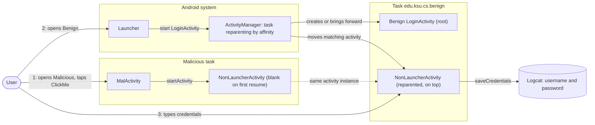
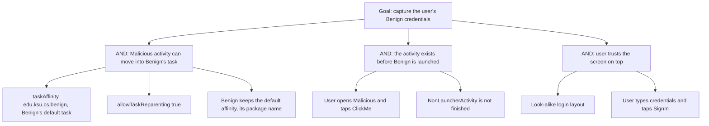

# Threat Model: TaskAffinityAndReparenting-PhishingAndDoSAttack-Lean

## 1. Benchmark

| Field | Value |
|-------|-------|
| Name | TaskAffinityAndReparenting-PhishingAndDoSAttack-Lean |
| Category | ICC (inter-component communication) |
| Ghera path | `benchmarks/ghera/ICC/TaskAffinityAndReparenting-PhishingAndDoSAttack-Lean` |
| Affected Android versions (from README) | "Tested on Android 5.1.1 - Android 8.1" (heading: "Android versions affected") |
| Ghera tag | `Jan2019` (commit `6289f39d`) |
| Build flavors available | `api22` to `api27`, `apiDIST` (from `benchmarks/ghera/Misc/sdkFlavors.gradle`) |
| Date of model | 2026-10-31 |

Benign declares no task affinity, so its activities use the default task named after its package, `edu.ksu.cs.benign`. Malicious's `NonLauncherActivity` declares `android:taskAffinity="edu.ksu.cs.benign"` and `android:allowTaskReparenting="true"`. Once the user has opened it from Malicious, launching Benign moves `NonLauncherActivity` into Benign's task on top, where it shows a login screen that looks like Benign's and logs the credentials.

**Start order (README steps 7 and 8):** launch Malicious first and click the button ("ClickMe"); an empty screen appears. Then launch Benign. The README: "You will always see Malicious displaying a login screen that looks exactly like Benign."

## 2. System description

### Components

| Component | App | Type | Exported or reachable from other apps | Notes |
|-----------|-----|------|----------------------------------------|-------|
| `LoginActivity` | Benign (`edu.ksu.cs.benign`) | Activity, launcher | Yes (launcher intent filter) | Username `R.id.usrnm` (hint "Username"), password `R.id.pwd`, button "SignIn". `authenticate` returns true for any non-null strings (`LoginActivity.java` lines 40 to 42), then starts `HomeActivity`. No affinity set. |
| `HomeActivity` | Benign | Activity | No intent filter | "Take Picture" sends `MediaStore.ACTION_IMAGE_CAPTURE` for a result if a camera app resolves it (`HomeActivity.java` lines 35 to 38); tapping the image starts `ImageEditor` with the bitmap (lines 44 to 54). Not on the exploit path. |
| `ImageEditor` | Benign | Activity | No intent filter | Shows the bitmap. Not on the exploit path. |
| `MalActivity` | Malicious (`edu.ksu.cs.malicious`) | Activity, launcher | n/a | The button "ClickMe" (`R.id.btn`) starts `NonLauncherActivity` with a plain explicit intent (`MalActivity.java` line 25). |
| `NonLauncherActivity` | Malicious | Activity | No intent filter | `android:allowTaskReparenting="true"` and `android:taskAffinity="edu.ksu.cs.benign"` (Malicious manifest lines 18 to 21). Static `disp` starts false; the first `onResume` shows nothing and sets it to true (line 34). Any later `onResume` shows a login layout (Username, Password, "SignIn") and on SignIn logs `User : ... Password : ...` with tag `Malicious` (lines 22 to 33 and 37 to 39). |
| Application | Secure (`edu.ksu.cs.benign`) | `<application>` element | n/a | `android:taskAffinity=""` (Secure manifest line 10). The Java code is the same as Benign apart from one removed comment. |

Manifest permissions: none of the three apps declares a permission.

Source files:
- `Benign/app/src/main/java/edu/ksu/cs/benign/LoginActivity.java`
- `Benign/app/src/main/java/edu/ksu/cs/benign/HomeActivity.java`
- `Benign/app/src/main/java/edu/ksu/cs/benign/ImageEditor.java`
- `Malicious/app/src/main/java/edu/ksu/cs/malicious/MalActivity.java`
- `Malicious/app/src/main/java/edu/ksu/cs/malicious/NonLauncherActivity.java`
- `AndroidManifest.xml` of each app
- `source-script.ps1` (benchmark harness hooks)

### Trust boundaries

| ID | Boundary | What crosses it |
|----|----------|-----------------|
| TB1 | Benign app vs. other apps, at the task level | `NonLauncherActivity`, which the system moves from Malicious's task into Benign's default task `edu.ksu.cs.benign` when Benign's task comes forward. |
| TB2 | User vs. the launcher | The user taps Benign's icon and expects Benign's login. The top of the task is Malicious's look-alike. |
| TB3 | Malicious app vs. the device log | Credentials typed into `NonLauncherActivity` are written to logcat. |

### Data flow diagram



## 3. Assets and attacker model

### Assets

| Asset | Why it matters |
|-------|----------------|
| The user's Benign credentials | The README: `NonLauncherActivity` "will be displayed to steal user's credentials". In the code it logs them (`NonLauncherActivity.java` line 38). |
| Availability of Benign | The README names denial of service: the reparented activity is on top whenever Benign is launched. |
| The user's trust in the Benign icon | Tapping Benign shows another app's screen. |

### Attacker

A third-party app installed on the same device. This matches the Malicious app in the benchmark.

### Attacker requirements

- Installed on the same device as Benign.
- No permission needed. The Malicious manifest declares none.
- Knows Benign's package name `edu.ksu.cs.benign`, the default task name (README).
- The user opens Malicious and taps "ClickMe" before opening Benign (README step 7), and `NonLauncherActivity` is not finished in between (README: "if NonLauncherActivity was started (and not terminated) earlier").
- `NonLauncherActivity` must look like Benign's login screen (README: it "looks exactly like the Benign app's screen").

## 4. STRIDE

| Category | Threat | Applies | Why |
|----------|--------|---------|-----|
| Spoofing | `NonLauncherActivity` poses as Benign's login screen. | Yes | Malicious layout `activity_non_launcher.xml` has Username, Password and "SignIn", like Benign's `activity_login.xml`. |
| Tampering | Malicious inserts its activity into Benign's task. | Yes | Malicious manifest lines 20 to 21 (`allowTaskReparenting`, `taskAffinity="edu.ksu.cs.benign"`). |
| Repudiation | Benign has no record that another app's screen covered its login. | Yes | No logging in Benign. |
| Information disclosure | Credentials are captured by Malicious. | Yes | `NonLauncherActivity.java` line 30 passes both fields to `saveCredentials`, which logs them (line 38). |
| Denial of service | The user sees Malicious instead of Benign. | Partially | Named in the README title and summary. The code has no logic beyond showing the login screen; whether Back reaches Benign's `LoginActivity` underneath has not been checked. |
| Elevation of privilege | Malicious gains rights in Benign. | No | Malicious gets no access to Benign's components or data. |

## 5. LINDDUN

| Category | Threat | Applies | Why |
|----------|--------|---------|-----|
| Linkability | Captured credentials could link the user's accounts. | Partially | Applies to real credentials. |
| Identifiability | A username identifies the user. | Yes | `NonLauncherActivity` logs the username (line 38). |
| Non-repudiation | No user action is attributed. | No | Nothing is recorded against the user. |
| Detectability | Malicious learns when the user opens Benign. | Partially | `NonLauncherActivity.onResume` runs when Benign's task comes forward. |
| Disclosure of information | Credentials disclosed to Malicious. | Yes | See STRIDE Information disclosure. |
| Unawareness | The user is not told that the login screen belongs to another app. | Yes | README: it "looks exactly like" Benign. |
| Non-compliance | Credentials collected without consent. | Partially | Applies to a real app. |

## 6. Attack tree



## 7. Standards mapping

Confidence values:
- **Verified**: the ID and title were checked against the official page.
- **Needs check**: the ID or title could not be confirmed against the official page.

Fit values:
- **Direct**: the standard describes this benchmark's weakness or test as it is.
- **Partial**: the standard covers part of this benchmark, or covers it only with a caveat given in the Fit cell.

CWE and MASVS titles are copied from `docs/threat-models/standards-reference.md`. The MASVS-PLATFORM-1 and MASVS-PLATFORM-3 control pages were read on 2026-10-31. Neither names task hijacking. Android's StrandHogg page (https://developer.android.com/privacy-and-security/risks/strandhogg) files the attack under "MASVS-PLATFORM: Platform Interaction" without naming a control and names `allowTaskReparenting` and `taskAffinity` as the settings it exploits. Both controls are therefore listed as Partial.

| Standard | ID | Title | Confidence | Fit |
|----------|----|-------|------------|-----|
| CWE | CWE-1021 | Improper Restriction of Rendered UI Layers or Frames | Verified | Partial. Benign's manifest sets no `taskAffinity` (lines 5 to 20), so its task carries the guessable name `edu.ksu.cs.benign`, and Malicious manifest lines 20 to 21 let another app's activity be moved on top of it; launching Benign then shows that foreign UI. Partial because the page's description is written for web applications and frames; the mobile link is its alternate term "Tapjacking" and its related attack pattern CAPEC-504 (Task Impersonation). The page shows no child entries. Usage ALLOWED. |
| OWASP MASVS v2 | MASVS-PLATFORM-1 | The app uses IPC mechanisms securely. | Verified | Partial. The fix is a manifest setting that controls which task Benign's activities belong to (Secure manifest line 10). The control page is about IPC used to expose data or functionality to other apps, which only partly covers task placement. |
| OWASP MASVS v2 | MASVS-PLATFORM-3 | The app uses the user interface securely. | Verified | Partial. The harm is credential capture through a look-alike screen (`NonLauncherActivity.java` lines 22 to 33). The control page is about sensitive data on screen leaking through platform mechanisms; it lists MASWE-0039 (App Vulnerable to Overlay Attacks) but does not name task hijacking. |

OWASP MASTG test and OWASP MASWE: No direct match among the IDs in the reference file. MASTG-TEST-0364, MASTG-TEST-0365, MASTG-TEST-0366, MASTG-TEST-0029 and MASWE-0018 are about exported components without access control, and MASWE-0032 is about insecure intents, while this benchmark is about task reparenting (Malicious manifest line 20).

Candidates to check (not in the table):
- MASWE-0039 (App Vulnerable to Overlay Attacks) is in the reference file but not used: its page is about attacker-controlled windows drawn over the app and defences such as touch filtering (controls shown on the page: MASVS-PLATFORM-3, MASVS-CODE-1), while task hijacking places another app's activity in the app's task.
- A MASTG test about task hijacking, `taskAffinity` or `allowTaskReparenting`. No ID has been verified.

MITRE ATT&CK for Mobile: No direct match. No technique on attack.mitre.org was verified that describes task reparenting to show a phishing screen.

## 8. Evidence

All steps below are **Not yet run**. No result has been observed.

### Commands

Build. PowerShell on Windows from the project root, Gradle 4.4, JDK 8 through `env.ps1`. **Not yet run.**

```powershell
. .\env.ps1
$B = "benchmarks\ghera\ICC\TaskAffinityAndReparenting-PhishingAndDoSAttack-Lean"
# Each app folder needs local.properties with sdk.dir=C:/Android/Sdk (none is present yet)
foreach ($a in "Benign","Malicious","Secure") {
    Set-Content "$B\$a\local.properties" "sdk.dir=C:/Android/Sdk"
    Push-Location "$B\$a"; .\gradlew.bat assembleDebug; Pop-Location
}
```

Start the emulator and install pair 1. **Not yet run.**

```powershell
. .\env.ps1
emulator -avd ghera27
$B = "benchmarks\ghera\ICC\TaskAffinityAndReparenting-PhishingAndDoSAttack-Lean"
adb install -r "$B\Benign\app\build\outputs\apk\api27\debug\app-api27-debug.apk"
adb install -r "$B\Malicious\app\build\outputs\apk\api27\debug\app-api27-debug.apk"
```

Pair 1, Benign + Malicious, by hand, in the README start order. Open both apps from the launcher's app drawer, as the Testing code does. **Not yet run.**

1. `adb logcat -c`
2. Open Malicious (README step 7) and tap "ClickMe". Expected from the code and README: an empty screen.
3. `adb shell dumpsys activity activities | findstr /i "affinity Hist"` (record the task of `NonLauncherActivity`).
4. Press Home. Open Benign (README step 8).
5. Read the screen.
6. `adb shell dumpsys activity activities | findstr /i "affinity Hist"` (record whether `NonLauncherActivity` is now in task `edu.ksu.cs.benign`).
7. If the login form is shown, type "user" and "pass" and tap "SignIn".
8. `adb logcat -d -s Malicious:D`
9. Press Back once and note which screen appears.

Pair 2, Secure + Malicious. Secure shares the package name `edu.ksu.cs.benign`. The benchmark's own harness reboots the device before installing Secure (`source-script.ps1` lines 12 to 16, when `$strict` is 0), and `NonLauncherActivity` keeps `disp` in a static field, so cold boot first. **Not yet run.**

```powershell
adb uninstall edu.ksu.cs.benign
adb reboot
adb wait-for-device
adb install -r "$B\Secure\app\build\outputs\apk\api27\debug\app-api27-debug.apk"
```

Repeat steps 1 to 9 with Secure in place of Benign. The Secure app's label is still "Benign" (`Secure/app/src/main/res/values/strings.xml` line 2).

Without the Malicious app. The exploit uses no broadcast and no intent from Malicious: it depends on an installed activity that declares a task affinity and allows reparenting, which the shell cannot create. So no `adb shell am broadcast` line applies. The closest check is to inspect Benign's task with only Benign or Secure installed. **Not yet run.**

```powershell
adb shell am start -W -n edu.ksu.cs.benign/.LoginActivity
adb shell dumpsys activity activities | findstr /i "affinity Hist"
```

### Expected result (from README and Testing code)

| Pair | Expected | Source | Status |
|------|----------|--------|--------|
| Benign + Malicious | Opening Benign shows Malicious's login screen (field `username`). | README step 8 ("You will always see Malicious displaying a login screen that looks exactly like Benign"); `Testing/benign_app/.../Tests.java` lines 64 to 81 open Malicious, tap `btn`, press Home, open Benign and type into Malicious `username`. | Not yet run |
| Secure + Malicious | Opening Secure shows its own login screen (field `usrnm`). | `Testing/secure_app/.../Tests.java` lines 57 to 74 follow the same order and type into Secure's `usrnm`. The README gives no Secure steps. | Not yet run |

### Observed result

| Pair | Outcome | Observation |
|------|---------|-------------|
| Benign + Malicious | Not yet observed | Not yet observed |
| Secure + Malicious | Not yet observed | Not yet observed |

## 9. Mitigation

### What the Secure app does differently

Diff of `Benign/` and `Secure/` (excluding build output, the prebuilt APKs, `local.properties`, the timestamp line in `gradle-wrapper.properties` and the merge leftover files listed in Open questions).

| File | Benign | Secure |
|------|--------|--------|
| `app/src/main/AndroidManifest.xml` (Secure line 10) | none | `android:taskAffinity=""` on `<application>` |
| `app/src/main/java/edu/ksu/cs/benign/HomeActivity.java` line 46 | `//if(iv.getDrawingCache()==null) Toast.makeText(...);` (comment) | Removed (no effect) |

`strings.xml` is the same in both, so the Secure label is "Benign".

### Assessment of the fix

The fix gives Secure's activities a task affinity that no longer equals the package name, so `NonLauncherActivity` (affinity `edu.ksu.cs.benign`) has no Secure task to move into. Residual points:

1. **An empty affinity is still an affinity value.** Whether another app can declare `android:taskAffinity=""` together with `allowTaskReparenting="true"` and so move into Secure's task has not been checked. Hypothesis, to test in Step 3.
2. **The fix relies on the attacker using the package name.** The README describes this attack only with the default affinity; Secure removes that default and adds nothing else (no `launchMode`, no check of the task on resume).
3. **Platform fix, original attack.** The StrandHogg page (https://developer.android.com/privacy-and-security/risks/strandhogg) says: "The StrandHogg attack / Task affinity vulnerability was originally patched in March 2019". Hypothesis, to test in Step 3: this patch is in the Android 9 platform (SDK 28), so the benchmark exploit fails on SDK 28 and later. The page gives the date but not the version; see Open questions.
4. **Platform fix, newer variant.** The same page says a "newer and more comprehensive variant [was] patched in September 2020" and that "Android SDK versions 30 and newer (Android 11) contain the appropriate OS patches". Its listed mitigation is `android:minSdkVersion="30"`, and it says version 2 "can only be prevented by this SDK version patch". Hypothesis, to test in Step 3: app configuration such as Secure's only partly mitigates the attack, and only devices on SDK 30 or later are fully protected.

The fix is complete for the benchmark exploit as written. Points 1, 3 and 4 limit how far it carries.

## 10. Open questions

- The README says task reparenting lets an activity "request to always be at the top of a task". That wording is the README's own; the code only sets `allowTaskReparenting="true"` (Malicious manifest line 20). How the platform orders the reparented activity has not been checked.
- The README title and summary name a denial of service attack. The code shows only the phishing screen; there is no code that keeps the user from leaving it.
- Benign and Secure each contain four merge leftover files, `ImageEditor.java~HEAD`, `ImageEditor.java~4772fefaa594e1f9aa0d6df8f18c228c0c0138ac`, `LoginActivity.java~HEAD` and `LoginActivity.java~4772fefaa594e1f9aa0d6df8f18c228c0c0138ac`, in `app/src/main/java/edu/ksu/cs/benign/`. They match the `.java` files of the same name and are not compiled.
- `source-script.ps1` reboots the device before installing Secure only when `$strict` is 0 (lines 12 to 16). What `$strict` means is not documented in the benchmark.
- The README spells the activity "NonLaunchcerActivity" once and the summary has "serivce"; the class is `NonLauncherActivity`.
- Benign's `HomeActivity` uses the device camera app (`MediaStore.ACTION_IMAGE_CAPTURE`). Whether `ghera27` has a camera app is irrelevant to the exploit, which never reaches `HomeActivity`.
- The StrandHogg page gives "March 2019" for the original patch and SDK 30 (Android 11) for the newer variant. It does not say that the original patch is in Android 9 (SDK 28). That version mapping is unconfirmed.
- The Secure app's label is "Benign", the same as Benign's; the Secure test relies on this when it taps "Benign" in the app drawer.
- Lean vs Fat: there is no Fat variant of this benchmark under `benchmarks/ghera/ICC/`, so there is nothing to compare.
- Running the build commands in section 8 writes `local.properties` and `build/` folders under `benchmarks/`. Prebuilt APKs are in each app folder; which flavor they were built with has not been checked.
