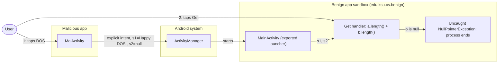
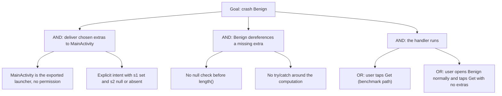

# Threat Model: UnhandledException-DOS-Lean

## 1. Benchmark

| Field | Value |
|-------|-------|
| Name | UnhandledException-DOS-Lean |
| Category | ICC (inter-component communication) |
| Ghera path | `benchmarks/ghera/ICC/UnhandledException-DOS-Lean` |
| Affected Android versions (from README) | "Tested on Android 5.1.1 - Android 8.1" (heading: "Android versions affected") |
| Ghera tag | `Jan2019` (commit `6289f39d`) |
| Build flavors available | `api22` to `api27`, `apiDIST` (from `benchmarks/ghera/Misc/sdkFlavors.gradle`) |
| Date of model | 2026-11-01 |

Benign's launcher activity `MainActivity` reads two string extras, `s1` and `s2`, and when the user taps "Get" computes `a.length() + b.length()` without checking for `null`. The Malicious app starts `MainActivity` with `s1="Happy DOS!"` and `s2=null`, so the tap throws a `NullPointerException` that nothing catches and Benign crashes.

**Start order (README step 6):** start Malicious and tap "DOS". The README says "You will see a Benign app crashing"; from the code, the crash happens only after the user also taps "Get" in Benign (see Open questions). The Benign Testing code uses a different order: it opens Benign first, then Malicious, taps "DOS", then taps Benign's "Get" (`Testing/benign_app/.../Tests.java` lines 73 to 83).

## 2. System description

### Components

| Component | App | Type | Exported or reachable from other apps | Notes |
|-----------|-----|------|----------------------------------------|-------|
| `MainActivity` | Benign (`edu.ksu.cs.benign`) | Activity, launcher | Yes (launcher intent filter, no permission) | The "Get" button (`R.id.get`) reads `s1` and `s2` with `getStringExtra` and sets `R.id.concat` to `"total length:" + (a.length() + b.length())` (`MainActivity.java` lines 25 to 29). No null check, no try/catch. `finish()` is overridden to call `System.exit(0)` (lines 34 to 38). |
| `MalActivity` | Malicious (`edu.ksu.cs.malicious`) | Activity, launcher | n/a | "DOS" starts `edu.ksu.cs.benign/edu.ksu.cs.benign.MainActivity` with `s1="Happy DOS!"` and `s2=null` (`MalActivity.java` lines 27 to 32). |
| `MainActivity` | Secure (`edu.ksu.cs.benign`) | Activity, launcher | Same as Benign | No "Get" button. In `onResume`, if the intent has extras it interleaves `s1` and `s2` inside `try { ... } catch (NullPointerException e)` and shows "Concatenated string: ..." or "NullPointerException"; with no extras it shows "Nothing to concatenate" (Secure `MainActivity.java` lines 19 to 43). |

Manifest permissions: none of the three apps declares a permission.

Source files:
- `Benign/app/src/main/java/edu/ksu/cs/benign/MainActivity.java`
- `Malicious/app/src/main/java/edu/ksu/cs/malicious/MalActivity.java`
- `Secure/app/src/main/java/edu/ksu/cs/benign/MainActivity.java`
- `AndroidManifest.xml` of each app

### Trust boundaries

| ID | Boundary | What crosses it |
|----|----------|-----------------|
| TB1 | Benign app sandbox vs. other apps | The explicit intent to `MainActivity` with the extras `s1` and `s2`, whose values (including their absence) the caller chooses. |
| TB2 | Inside Benign: intent data vs. computation | `s1` and `s2` are dereferenced in the click handler without validation. |

### Data flow diagram



## 3. Assets and attacker model

### Assets

| Asset | Why it matters |
|-------|----------------|
| Availability of Benign | The README's impact: "resulting in the crash of Benign app". |
| Benign's in-memory state | A crash ends the process; anything not saved is lost. The benchmark has no such state. |

### Attacker

A third-party app installed on the same device. This matches the Malicious app in the benchmark.

### Attacker requirements

- Installed on the same device as Benign.
- No permission needed. The Malicious manifest declares none.
- Knows Benign's package, the class `edu.ksu.cs.benign.MainActivity` and the extra names `s1` and `s2`. The first is in the manifest; the others are in Benign's code.
- From the code, the user must tap "Get" in Benign after Malicious starts it. The README does not mention this step.

## 4. STRIDE

| Category | Threat | Applies | Why |
|----------|--------|---------|-----|
| Spoofing | Malicious starts Benign with data as if from a normal caller. | Partially | `MainActivity` accepts extras from any caller; spoofing is not needed, since there is no caller check to pass. |
| Tampering | Malicious controls the input to Benign's computation. | Yes | `s1` and `s2` come from the caller (`MainActivity.java` lines 27 to 28). |
| Repudiation | Benign keeps no record of which app sent the input. | Yes | No logging. |
| Information disclosure | Data is returned to Malicious. | No | Nothing is sent back. |
| Denial of service | Benign crashes. | Yes | `MainActivity.java` line 29 calls `length()` on `null`; no handler catches the exception. This is the impact named in the README. |
| Elevation of privilege | Malicious gains rights in Benign. | No | The only effect is the crash. |

## 5. LINDDUN

| Category | Threat | Applies | Why |
|----------|--------|---------|-----|
| Linkability | No personal data is processed. | No | The extras are constant strings. |
| Identifiability | Same. | No | Same reason. |
| Non-repudiation | No user action is attributed. | No | Nothing is recorded. |
| Detectability | An app can tell that Benign is installed by starting `MainActivity`. | Partially | Not used by the benchmark code. |
| Disclosure of information | No data is disclosed. | No | See STRIDE Information disclosure. |
| Unawareness | The user sees Benign crash without knowing another app caused it. | Yes | Nothing tells the user which app started Benign. |
| Non-compliance | No personal data is processed. | No | Same reason. |

## 6. Attack tree



## 7. Standards mapping

Confidence values:
- **Verified**: the ID and title were checked against the official page.
- **Needs check**: the ID or title could not be confirmed against the official page.

Fit values:
- **Direct**: the standard describes this benchmark's weakness or test as it is.
- **Partial**: the standard covers part of this benchmark, or covers it only with a caveat given in the Fit cell.

CWE, MASVS, MASTG and MASWE titles are copied from `docs/threat-models/standards-reference.md`.

| Standard | ID | Title | Confidence | Fit |
|----------|----|-------|------------|-----|
| CWE | CWE-476 | NULL Pointer Dereference | Verified | Direct. `getStringExtra("s2")` returns `null` for the Malicious intent and `MainActivity.java` line 29 calls `b.length()` on it. Usage ALLOWED. |
| CWE | CWE-248 | Uncaught Exception | Verified | Direct. The `NullPointerException` from line 29 is not caught anywhere in `MainActivity.java`, so it ends the process. This is the README's framing ("do not handle unchecked exceptions"). Usage ALLOWED. |
| OWASP MASVS v2 | MASVS-CODE-4 | The app validates and sanitizes all untrusted inputs. | Verified | Direct. The extras from another app are used without validation (`MainActivity.java` lines 27 to 29). |
| OWASP MASVS v2 | MASVS-PLATFORM-1 | The app uses IPC mechanisms securely. | Verified | Partial. The input arrives through an intent from another app, but the fault is input handling, not the IPC mechanism. |

CWE-20 (Improper Input Validation) was considered and is DISCOURAGED in `standards-reference.md`, so it is not in the table; CWE-476 is the more specific entry used instead.

OWASP MASTG test and OWASP MASWE: No direct match among the IDs in the reference file. MASTG-TEST-0364 and MASWE-0018 are about components that expose sensitive functionality without access control; here the exposed effect is a crash, and adding a permission is not the remedy (`MainActivity` is the launcher). The broadcast receiver test MASTG-TEST-0366 does not apply, since the benchmark has no receiver.

Candidates to check (not in the table):
- MASWE-0050 (Unsafe Handling of Untrusted Data), listed on the MASWE index page. Not in the reference file.
- CWE-395 for the Secure app's choice to catch `NullPointerException` instead of checking for `null` (section 9). Not in the reference file and not reviewed.

MITRE ATT&CK for Mobile: No direct match. No technique on attack.mitre.org was verified that describes crashing another app through malformed intent extras.

## 8. Evidence

All steps below are **Not yet run**. No result has been observed.

### Commands

Build. PowerShell on Windows from the project root, Gradle 4.4, JDK 8 through `env.ps1`. **Not yet run.**

```powershell
. .\env.ps1
$B = "benchmarks\ghera\ICC\UnhandledException-DOS-Lean"
# Each app folder needs local.properties with sdk.dir=C:/Android/Sdk (none is present yet)
foreach ($a in "Benign","Malicious","Secure") {
    Set-Content "$B\$a\local.properties" "sdk.dir=C:/Android/Sdk"
    Push-Location "$B\$a"; .\gradlew.bat assembleDebug; Pop-Location
}
```

Start the emulator and install pair 1. **Not yet run.**

```powershell
. .\env.ps1
emulator -avd ghera27
$B = "benchmarks\ghera\ICC\UnhandledException-DOS-Lean"
adb install -r "$B\Benign\app\build\outputs\apk\api27\debug\app-api27-debug.apk"
adb install -r "$B\Malicious\app\build\outputs\apk\api27\debug\app-api27-debug.apk"
```

Pair 1, Benign + Malicious, by hand, in the README start order. **Not yet run.**

1. `adb logcat -c`
2. Open Malicious and tap "DOS" (README step 6).
3. Read the screen. Note whether Benign has crashed already (README) or is showing "Hello World!" and the "Get" button (code).
4. If Benign is showing, tap "Get".
5. Read the screen.
6. `adb logcat -d -s AndroidRuntime:E MAL:D`

Pair 2, Secure + Malicious. Secure shares the package name `edu.ksu.cs.benign`. **Not yet run.**

```powershell
adb uninstall edu.ksu.cs.benign
adb install -r "$B\Secure\app\build\outputs\apk\api27\debug\app-api27-debug.apk"
```

Repeat steps 1 to 6 with Secure in place of Benign. Secure has no "Get" button; read the text in `R.id.concat` at step 3.

No-attacker check. This exploit uses no broadcast, so the `adb shell am broadcast` line is replaced by `am start` lines that send the same input from the shell. **Not yet run.**

```powershell
adb shell am start -n edu.ksu.cs.benign/.MainActivity --es s1 "Happy DOS!"
# then tap "Get" (Benign); read the text (Secure)
adb shell am start -S -n edu.ksu.cs.benign/.MainActivity
# no extras at all; then tap "Get" (Benign); read the text (Secure)
adb logcat -d -s AndroidRuntime:E
```

What it can show: that the crash needs no other app, because the shell can leave `s2` out in the same way; and, with the second line, whether Benign crashes even when opened with no extras, as the code suggests (both values are `null`). What it cannot show: that a missing extra (shell) and an extra explicitly set to `null` (Malicious, `MalActivity.java` line 30) behave the same, although both read back as `null` through `getStringExtra`.

### Expected result (from README and Testing code)

| Pair | Expected | Source | Status |
|------|----------|--------|--------|
| Benign + Malicious | Benign crashes with a `NullPointerException`. | README step 6 ("You will see a Benign app crashing"); `Testing/benign_app/.../Tests.java` lines 73 to 83 tap `dos`, then Benign's `get`, and expect `NullPointerException`. The README Note says the automated tests "fail to execute due to limitations of Android SDK". | Not yet run |
| Secure + Malicious | Secure shows "NullPointerException" in `R.id.concat` and keeps running. | `Testing/secure_app/.../Tests.java` lines 65 to 70 tap `dos` and assert `concat` is "NullPointerException". That test is limited to SDK 19 to 25 (line 25), so it does not run on API 27. The README gives no Secure steps. | Not yet run |

### Observed result

| Pair | Outcome | Observation |
|------|---------|-------------|
| Benign + Malicious | Not yet observed | Not yet observed |
| Secure + Malicious | Not yet observed | Not yet observed |

## 9. Mitigation

### What the Secure app does differently

Diff of `Benign/` and `Secure/` (excluding build output, the prebuilt APKs, `local.properties` and the timestamp line in `gradle-wrapper.properties`).

| File | Benign | Secure |
|------|--------|--------|
| `app/src/main/java/edu/ksu/cs/benign/MainActivity.java` lines 21 to 31 (Secure lines 19 to 43) | Click handler on `R.id.get` that computes `a.length() + b.length()` | No handler. In `onResume`: if `intent.getExtras() != null`, interleave `s1` and `s2` with a `StringBuilder` inside `try`, `catch (NullPointerException e)` sets "NullPointerException"; else "Nothing to concatenate" |
| `MainActivity.java` lines 34 to 38 | `finish()` override calling `System.exit(0)` | Removed |
| `MainActivity.java` lines 6 to 7 | Imports `View`, `Button` | Removed |
| `app/src/main/res/layout/activity_main.xml` lines 17 to 26 | Button `R.id.get` with text "Get" | Removed |
| `app/src/main/AndroidManifest.xml` line 20 | Blank line | Removed (no effect) |
| `app/src/main/res/values/strings.xml` line 2 | `Benign` | `Secure` |

### Assessment of the fix

The fix stops the crash in the benchmark exploit, because the `NullPointerException` is caught. Residual points:

1. **Catching instead of checking.** Secure catches `NullPointerException` (line 38) rather than testing `a` and `b` for `null` before use. Any other unchecked exception in the same block is still uncaught.
2. **Only one exception type.** Anything else thrown while reading the extras (for example while unparcelling them in `getExtras()`, line 21) is outside the `try` block. Whether a crafted extra can trigger such an exception has not been checked.
3. **Different behaviour, not the same feature fixed.** Secure drops the "Get" button and the length sum and adds an interleaving routine. The interleaving has a logic error: after the loop `i` equals the shorter length, so `a.length() < i` (line 31) is never true and the rest of a longer `s2` is never appended. This does not affect security.
4. **`System.exit(0)` removed.** Benign's `finish()` override ended the process on every finish; Secure drops it.
5. **Newer Android versions.** Hypothesis, to test in Step 3: newer Android versions do not change this weakness, because the `null` comes from app code reading a missing extra; at most the crash dialog behaviour differs.

The fix is complete for the benchmark exploit as written. Point 1 is the main gap: the pattern is still to let the exception happen.

## 10. Open questions

- README step 6 says that after tapping "DOS" "You will see a Benign app crashing". From the code, Benign only crashes after the user taps "Get" (`MainActivity.java` lines 22 to 29); the Benign Testing code also taps `get` (line 83).
- From the code, Benign also crashes without any attacker: opening it from the launcher and tapping "Get" reads two missing extras (both `null`). The README does not mention this.
- The README Note says the automated tests "fail to execute due to limitations of Android SDK" and links an issue tracker entry that was not checked.
- The Benign test expects a `NullPointerException` in the test (`thrown.expect`, line 82), while the exception is thrown in Benign's process. Whether the test can pass at all is unclear and may relate to the README Note.
- The Secure test is limited to SDK 19 to 25 (`Testing/secure_app/.../Tests.java` line 25), while the Benign test and the build flavors cover API 22 to 27. On `ghera27` the Secure test does not run.
- The README step list has no "Start emulator" step (it goes from 3, Create an emulator, to 4, Build and install Benign).
- Benign overrides `finish()` to call `System.exit(0)` (lines 34 to 38). Its purpose is not explained.
- Lean vs Fat: there is no Fat variant of this benchmark under `benchmarks/ghera/ICC/`, so there is nothing to compare.
- Running the build commands in section 8 writes `local.properties` and `build/` folders under `benchmarks/`. Prebuilt APKs are in each app folder; which flavor they were built with has not been checked.
