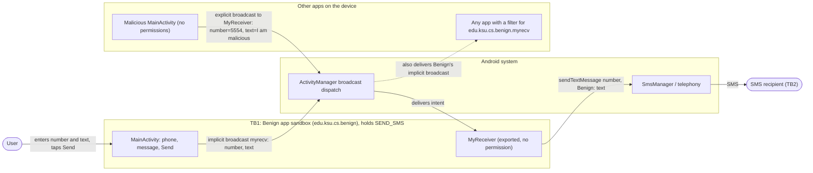
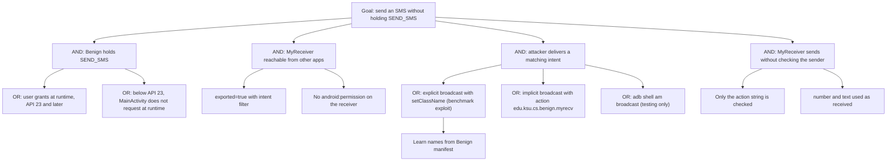

# Threat Model: UnprotectedBroadcastRecv-PrivEscalation-Lean

## 1. Benchmark

| Field | Value |
|-------|-------|
| Name | UnprotectedBroadcastRecv-PrivEscalation-Lean |
| Category | ICC (inter-component communication) |
| Ghera path | `benchmarks/ghera/ICC/UnprotectedBroadcastRecv-PrivEscalation-Lean` |
| Affected Android versions (from README) | "Tested on Android 5.1.1 - Android 8.1" |
| Ghera tag | `Jan2019` (commit `6289f39d`) |
| Build flavors available | `api22` to `api27`, `apiDIST` (from `benchmarks/ghera/Misc/sdkFlavors.gradle`) |
| Date of model | 2026-10-31 |

The Benign app holds `SEND_SMS` and has an exported broadcast receiver, `MyReceiver`, that sends an SMS with the number and text taken from the intent extras. The receiver has no permission. The Malicious app, which declares no permissions, sends an explicit broadcast to `MyReceiver` and makes Benign send an SMS for it. The README calls this "a privilege escalation attack or a confused deputy attack".

## 2. System description

### Components

| Component | App | Type | Exported or reachable from other apps | Notes |
|-----------|-----|------|----------------------------------------|-------|
| `MainActivity` | Benign (`edu.ksu.cs.benign`) | Activity, launcher | Yes (launcher intent filter) | If `SEND_SMS` and `READ_PHONE_STATE` are granted, enables the Send button; on API 23 and later requests them otherwise and throws `RuntimeException(new SecurityException())` if either is denied. Send builds an implicit intent `edu.ksu.cs.benign.myrecv` with extras `number` and `text` from two EditTexts and calls `sendBroadcast(intent)`. |
| `MyReceiver` | Benign | Broadcast receiver, declared in manifest | Yes (`android:exported="true"`, intent filter for action `edu.ksu.cs.benign.myrecv`, category `DEFAULT`, no permission) | If the action is `edu.ksu.cs.benign.myrecv`, reads `number` and `text`, prefixes the text with `"Benign: "` and calls `SmsManager.getDefault().sendTextMessage(number, null, text, null, null)`. Logs "Message sent". No check of the sender. |
| `MainActivity` | Malicious (`edu.ksu.cs.malicious`) | Activity, launcher | n/a | In `onCreate` builds an intent with action `edu.ksu.cs.benign.myrecv`, `setPackage("edu.ksu.cs.benign")`, `setClassName("edu.ksu.cs.benign", "edu.ksu.cs.benign.MyReceiver")`, extras `number=5554` and `text="I am malicious"`, and calls `sendBroadcast(intent)`. No user action needed beyond opening the app. Manifest declares no permissions. |
| `MyReceiver` | Secure (`edu.ksu.cs.benign`) | Broadcast receiver | Manifest adds `android:permission="edu.ksu.cs.secure.permission1"` | Same code as Benign except the prefix `"Secure: "` and log tag. The manifest declares a permission with a different name, `edu.ksu.cs.benign.permission1` (`protectionLevel="signature"`). See section 9. |

Manifest permissions: Benign and Secure declare `SEND_SMS` and `READ_PHONE_STATE`. Malicious declares none.

Source files:
- `Benign/app/src/main/java/edu/ksu/cs/benign/MainActivity.java`
- `Benign/app/src/main/java/edu/ksu/cs/benign/MyReceiver.java`
- `Malicious/app/src/main/java/edu/ksu/cs/malicious/MainActivity.java`
- `Secure/app/src/main/AndroidManifest.xml`
- `Secure/app/src/main/java/edu/ksu/cs/benign/MyReceiver.java`
- `AndroidManifest.xml` of each app

### Trust boundaries

| ID | Boundary | What crosses it |
|----|----------|-----------------|
| TB1 | Benign app sandbox vs. other apps on the device | Broadcasts to `MyReceiver` with action `edu.ksu.cs.benign.myrecv` and extras `number`, `text`: explicit ones from Malicious, and Benign's own implicit one. |
| TB2 | Benign app vs. the phone network | The SMS sent with Benign's `SEND_SMS` permission to the number in the intent. |

### Data flow diagram



## 3. Assets and attacker model

### Assets

| Asset | Why it matters |
|-------|----------------|
| Benign's `SEND_SMS` capability | A permission the user granted to Benign only. Misuse can cost money (premium numbers), spam contacts or send messages in the user's name. |
| Integrity of the SMS recipient and text | Taken from the intent extras without checks. |
| The number and text the user types into Benign | Sent in an implicit broadcast, so other apps can receive them. |

### Attacker

A third-party app installed on the same device. This matches the Malicious app in the benchmark.

### Attacker requirements

- Installed on the same device as Benign.
- No Android permissions (the Malicious manifest declares none).
- Knows the package name, the receiver class name, the action string and the extra names `number` and `text`. All are in Benign's manifest and code.
- Benign must hold `SEND_SMS`. README step 6: start Benign and "make sure in Settings that Benign has the permission to send SMS".
- The user only opens Malicious. The broadcast is sent in `onCreate` with no further interaction.

## 4. STRIDE

| Category | Threat | Applies | Why |
|----------|--------|---------|-----|
| Spoofing | Malicious sends an intent that `MyReceiver` treats as coming from Benign's own `MainActivity`. | Yes | `MyReceiver` checks only the action string, which Malicious sets to the same value. There is no sender check and no permission. |
| Tampering | Attacker chooses the recipient and most of the text. | Yes | `number` and `text` are used as received. Only the `"Benign: "` prefix is fixed. |
| Repudiation | The SMS is sent from the user's device by Benign; nothing records that Malicious asked for it. | Yes | `MyReceiver` logs only "Message sent". |
| Information disclosure | The number and text the user enters in Benign can be received by other apps. | Yes (not demonstrated) | `MainActivity` sends them with an implicit `sendBroadcast(intent)` with no receiver permission and no target package. Not part of the README exploit. |
| Denial of service | Repeated broadcasts make Benign send many SMS messages. | Partially | Each broadcast sends one SMS. Impact is cost and spam, not loss of device function. Not tested. |
| Elevation of privilege | An app without `SEND_SMS` sends SMS through Benign. | Yes | README: "Malicious is able to perform a privileged operation like sending SMS without having the required permission." |

## 5. LINDDUN

| Category | Threat | Applies | Why |
|----------|--------|---------|-----|
| Linkability | An app that receives Benign's implicit broadcast can link the user's messages over time. | Partially | Possible through the implicit broadcast only. |
| Identifiability | Recipient numbers and message text can identify the user and their contacts. | Yes (not demonstrated) | Same implicit broadcast carries both. |
| Non-repudiation | Messages chosen by the attacker are sent from the user's number. | Yes | The recipient sees an SMS from the user's device. |
| Detectability | An app can tell when the user sends a message with Benign. | Partially | Same implicit broadcast. |
| Disclosure of information | Message content leaks to other apps. | Yes (not demonstrated) | Same cause as Information disclosure in STRIDE. |
| Unawareness | The user is not asked or told when Malicious triggers an SMS. | Yes | `MyReceiver` sends without any UI. README step 8 has the user check the messaging app's inbox afterwards. |
| Non-compliance | Messages are sent in the user's name without consent. | Partially | Would matter in a real product. |

## 6. Attack tree



## 7. Standards mapping

Confidence values:
- **Verified**: the ID and title were checked against the official page.
- **Needs check**: the ID or title could not be confirmed against the official page.

Fit values:
- **Direct**: the standard describes this benchmark's weakness or test as it is.
- **Partial**: the standard covers part of this benchmark, or covers it only with a caveat given in the Fit cell.

CWE and MASVS titles are copied from `docs/threat-models/standards-reference.md`.

| Standard | ID | Title | Confidence | Fit |
|----------|----|-------|------------|-----|
| CWE | CWE-926 | Improper Export of Android Application Components | Verified | Direct. `MyReceiver` is exported with no permission and exposes SMS sending. Usage ALLOWED. |
| CWE | CWE-441 | Unintended Proxy or Intermediary | Verified | Direct. The CWE description says the product forwards a request from an upstream component to an external actor without preserving the original source, which is the confused deputy pattern the README describes ("Confused Deputy" is an alternate term on the page): `MyReceiver` takes the number and text from any app and sends the SMS as Benign. Usage ALLOWED-WITH-REVIEW. Mapping notes review: the Rationale and Comment say this is a Class that may have more appropriate Base-level children, so the children should be examined. Children shown on the page: CWE-918 (Server-Side Request Forgery) and CWE-1021 (Improper Restriction of Rendered UI Layers or Frames). Neither fits better, because CWE-918 covers a web server fetching a URL and CWE-1021 covers web UI frames, so CWE-441 is kept. |
| CWE | CWE-862 | Missing Authorization | Verified | Partial. `MyReceiver` performs a privileged action with no authorization check. The CWE is generic; CWE-926 is more specific to Android. Usage ALLOWED-WITH-REVIEW. Mapping notes review: the Rationale and Comment say this is a Class that may have more appropriate Base-level children, so the children should be examined. Children shown on the page: CWE-425 (Direct Request), CWE-638 (Not Using Complete Mediation), CWE-939 (Improper Authorization in Handler for Custom URL Scheme) and CWE-1314 (Missing Write Protection for Parametric Data Values). None fits better: CWE-939 is the closest, but it covers custom URL scheme handlers, not broadcast receivers; CWE-425 covers restricted web URLs, CWE-638 covers checks not repeated on every access, and CWE-1314 covers hardware sensor values. CWE-862 is kept. |
| CWE | CWE-927 | Use of Implicit Intent for Sensitive Communication | Verified | Partial. Applies only to Benign's own implicit broadcast of the number and text, not to the README exploit. Usage ALLOWED. |
| OWASP MASVS v2 | MASVS-PLATFORM-1 | The app uses IPC mechanisms securely. | Verified | Direct. |
| OWASP MASTG test | MASTG-TEST-0366 | Exported And Unprotected Broadcast Receivers That Expose Sensitive Functionality | Verified | Direct. Primary test. |
| OWASP MASTG test | MASTG-TEST-0029 | Testing for Sensitive Functionality Exposure Through IPC | Verified | Partial. Deprecated, kept for reference only. |
| OWASP MASWE | MASWE-0018 | Lack of Authentication or Authorization on App Components | Verified | Direct. `MyReceiver` is exported with no permission (Benign manifest lines 22 to 24) and sends an SMS for any caller (`MyReceiver.java` line 21); the page lists "Missing or Weak Permissions on Exported Components" and names broadcast receivers. Controls shown on the page: MASVS-AUTH-1, MASVS-PLATFORM-1, MASVS-STORAGE-2. |

Candidates to check (not in the table):
- None beyond the IDs above.

MITRE ATT&CK for Mobile: No direct match. No technique on attack.mitre.org was verified that describes abusing another app's exported component to send SMS, and the README references a 2014 SMS issue rather than an ATT&CK technique.

## 8. Evidence

All steps below are **Not yet run**. No result has been observed.

### Commands

Build. PowerShell on Windows from the project root, Gradle 4.4, JDK 8 through `env.ps1`. **Not yet run.**

```powershell
. .\env.ps1
$B = "benchmarks\ghera\ICC\UnprotectedBroadcastRecv-PrivEscalation-Lean"
# Each app folder needs local.properties with sdk.dir=C:/Android/Sdk (none is present yet)
foreach ($a in "Benign","Malicious","Secure") {
    Set-Content "$B\$a\local.properties" "sdk.dir=C:/Android/Sdk"
    Push-Location "$B\$a"; .\gradlew.bat assembleDebug; Pop-Location
}
```

Start the emulator and install pair 1. **Not yet run.**

```powershell
. .\env.ps1
emulator -avd ghera27
$B = "benchmarks\ghera\ICC\UnprotectedBroadcastRecv-PrivEscalation-Lean"
adb install -r "$B\Benign\app\build\outputs\apk\api27\debug\app-api27-debug.apk"
adb install -r "$B\Malicious\app\build\outputs\apk\api27\debug\app-api27-debug.apk"
```

Pair 1, Benign + Malicious, by hand (README steps 6 to 8). **Not yet run.**

1. `adb logcat -c`
2. Open Benign. Grant both permission prompts (SMS and Phone). If either is denied, Benign throws a `RuntimeException`.
3. Press Home.
4. Open Malicious. Do nothing else in it; it sends the broadcast in `onCreate`.
5. Open the default messaging app and look for a message to `5554`.
6. `adb logcat -d -s Benign`

Pair 2, Secure + Malicious. Secure shares the package name `edu.ksu.cs.benign`. **Not yet run.**

```powershell
adb uninstall edu.ksu.cs.benign
adb install -r "$B\Secure\app\build\outputs\apk\api27\debug\app-api27-debug.apk"
```

Repeat steps 1 to 6 with Secure in place of Benign, and use `adb logcat -d -s Secure` in step 6. Also run `adb logcat -d | findstr /i "Permission Denial"` after step 4.

Secure's own Send button, to check whether Secure still works for its user (see section 9). **Not yet run.**

1. Open Secure, type `5554` and a short text, tap Send.
2. Look for a message starting with "Secure: " in the messaging app.

The same broadcast without the Malicious app. **Not yet run.**

```powershell
adb shell am broadcast -a edu.ksu.cs.benign.myrecv -n edu.ksu.cs.benign/.MyReceiver --es number 5554 --es text "I am malicious"
```

### Expected result (from README and Testing code)

| Pair | Expected | Source | Status |
|------|----------|--------|--------|
| Benign + Malicious | The messaging app shows a sent message with the body "I am malicious". From the code, the body would be "Benign: I am malicious" to `5554`. | README step 8; `Testing/benign_app/.../Tests.java` looks for text containing "Benign:". | Not yet run |
| Secure + Malicious | No message containing "Secure:" appears. | `Testing/secure_app/.../Tests.java` expects `UiObjectNotFoundException` for text containing "Secure:". The README gives no Secure steps. | Not yet run |

### Observed result

| Pair | Outcome | Observation |
|------|---------|-------------|
| Benign + Malicious | Not yet observed | Not yet observed |
| Secure + Malicious | Not yet observed | Not yet observed |

## 9. Mitigation

### What the Secure app does differently

Diff of `Benign/` and `Secure/` (excluding build output, the prebuilt APKs and the timestamp line in `gradle-wrapper.properties`).

| File | Benign | Secure |
|------|--------|--------|
| `app/src/main/AndroidManifest.xml` after line 4 (Secure lines 5 to 7) | Not present | `<permission android:name="edu.ksu.cs.benign.permission1" android:protectionLevel="signature" />` |
| `AndroidManifest.xml` line 24 (Secure lines 27 to 28) | `android:exported="true">` | `android:exported="true"` and `android:permission="edu.ksu.cs.secure.permission1">` |
| `AndroidManifest.xml` lines 13 and 22 (Secure 16 and 25) | `.MainActivity`, `.MyReceiver` | Fully qualified `edu.ksu.cs.benign.MainActivity`, `edu.ksu.cs.benign.MyReceiver` (same classes) |
| `app/src/main/java/edu/ksu/cs/benign/MyReceiver.java` line 19 | `text = "Benign: " + text;` | `text = "Secure: " + text;` |
| `MyReceiver.java` line 22 | `Log.d("Benign", "Message sent");` | `Log.d("Secure", "Message sent");` |
| `app/src/main/java/edu/ksu/cs/benign/MainActivity.java` Secure line 34 | n/a | Blank line added (no effect) |

`MainActivity` still sends the same implicit broadcast. `MyReceiver` logic is otherwise unchanged.

### Assessment of the fix

The intent is clear (a `signature` permission on the receiver), but the code does not implement it as written:

1. **Permission name mismatch.** The manifest declares `edu.ksu.cs.benign.permission1` with `protectionLevel="signature"`, but the receiver requires `edu.ksu.cs.secure.permission1`, which no app in the benchmark declares. The declared signature permission is never used. Hypothesis, to test in Step 3: the receiver is still protected in practice, because no app can be granted a permission that nobody has defined, so the Malicious broadcast is dropped. This would match the Testing code's expectation.
2. **Undefined permission can be claimed by an attacker.** Hypothesis, to test in Step 3: a malicious app could itself define `edu.ksu.cs.secure.permission1` with a normal protection level, request it, and then pass the receiver's check. With the intended name `edu.ksu.cs.benign.permission1` this would not work, because Secure already defines it as `signature`.
3. **Secure's own Send button may stop working.** Secure does not request `edu.ksu.cs.secure.permission1` with `uses-permission`, and its own `MainActivity` sends the broadcast that `MyReceiver` handles. Hypothesis, to test in Step 3: the system skips the permission check when sender and receiver are the same app, so the button still works. The "Secure's own Send button" steps in section 8 are meant to check this.
4. **The implicit broadcast is unchanged.** `MainActivity` still sends the user's number and text with an implicit `sendBroadcast(intent)`, so other apps can still receive them (CWE-927).
5. **Stronger alternatives** not used by the Secure app: fix the permission name; set `android:exported="false"` and send the intent explicitly within the app (`setPackage(getPackageName())` or a direct call), since Benign is the only intended sender; ask the user to confirm before sending each SMS.

## 10. Open questions

- The README says the message body is "I am malicious". `MyReceiver` prefixes `"Benign: "`, and the Testing code looks for "Benign:". The model follows the code.
- The Malicious app sends to `5554`. Whether that is the `ghera27` emulator's own number, so the message appears as both sent and received, is not stated in the benchmark.
- Benign requests `READ_PHONE_STATE` and requires it before enabling Send, but no code reads phone state. Its purpose is not explained.
- Whether the Secure permission name mismatch (`edu.ksu.cs.benign.permission1` declared, `edu.ksu.cs.secure.permission1` required) is a typo in the benchmark. See section 9, items 1 to 3.
- **Lean vs. Fat variants differ substantially** (from the two READMEs and the Fat source):
  - Target: Lean uses a purpose-built Benign app with an exported `MyReceiver`. Fat targets a real system app, `com.android.mms`, and its exported `com.android.mms.transaction.SmsReceiver`; the folder ships `Mms.apk` and has no Benign or Secure app.
  - Android version: Lean is "Tested on Android 5.1.1 - Android 8.1". Fat is "Tested on Android 4.4".
  - Attacker permissions: Lean Malicious declares none. Fat Malicious declares `READ_SMS`.
  - Exploit: Lean sends an explicit broadcast with `number` and `text` extras. Fat reads a draft with body "another test sms1!" from `content://sms/draft` (the user must create it first, README step 6) and calls `sendOrderedBroadcast` with action `com.android.mms.transaction.MESSAGE_SENT`, the draft URI as data, explicit class `SmsReceiver`, and initial result code `SmsManager.RESULT_ERROR_RADIO_OFF`.
  - Build: Lean uses the shared `sdkFlavors.gradle` (API 22 to 27). Fat's `Malicious/app/build.gradle` sets `compileSdkVersion 25`, `minSdkVersion 17`, `targetSdkVersion 19` and no flavors. Its `applicationId` is `edu.ksu.cs.benign` while its manifest package is `edu.ksu.cs.malicious`.
  - Both READMEs share the same summary idea, the same reference to Issue #35 ("explore CVE-2014-8610 to create new lean") and the same seclists link. The Lean variant appears to be a re-creation of the Fat exploit pattern in app code. The Fat README describes Android 4.4 with the system `com.android.mms` app; whether it can be run on the API 27 `ghera27` emulator has not been checked.
- Hypothesis, to test in Step 3: on newer Android versions, sending SMS from a background receiver, or exporting receivers with intent filters, may be restricted (for example, apps targeting API 31 and later must set `android:exported` explicitly). This could change whether the exploit works without changing the weakness.
