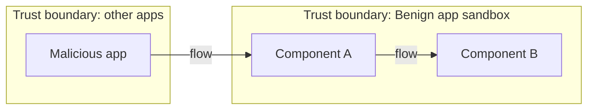
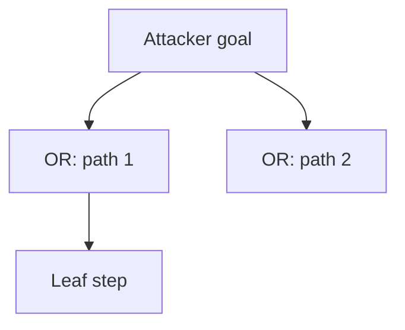

# Threat Model: <Benchmark name>

Copy this file to `docs/threat-models/<Category>-<BenchmarkName>.md` and fill in every section.
Remove the guidance lines (lines in italics) once the section is complete.

## 1. Benchmark

| Field | Value |
|-------|-------|
| Name | |
| Category | |
| Ghera path | `benchmarks/ghera/<Category>/<Benchmark>` |
| Affected Android versions (from README) | |
| Ghera tag | |
| Date of model | |

_Summary of the vulnerability in one or two sentences, based on the benchmark README._

## 2. System description

### Components

| Component | App | Type | Exported or reachable from other apps | Notes |
|-----------|-----|------|----------------------------------------|-------|
| | Benign | | | |
| | Malicious | | | |

### Trust boundaries

_List each boundary and what crosses it (for example: app sandbox of Benign vs. other apps on the device, device vs. network)._

| ID | Boundary | What crosses it |
|----|----------|-----------------|
| TB1 | | |

### Data flow diagram

_Mermaid flowchart. Show processes, data stores, external entities, data flows, and trust boundaries as subgraphs._



## 3. Assets and attacker model

### Assets

| Asset | Why it matters |
|-------|----------------|
| | |

### Attacker

_Who the attacker is (for example: a third-party app installed on the same device, a network attacker, a person with physical access)._

### Attacker requirements

_What the attacker needs: permissions, installation, user interaction, timing, knowledge of action strings or package names, device state._

## 4. STRIDE

| Category | Threat | Applies | Why |
|----------|--------|---------|-----|
| Spoofing | | | |
| Tampering | | | |
| Repudiation | | | |
| Information disclosure | | | |
| Denial of service | | | |
| Elevation of privilege | | | |

## 5. LINDDUN

| Category | Threat | Applies | Why |
|----------|--------|---------|-----|
| Linkability | | | |
| Identifiability | | | |
| Non-repudiation | | | |
| Detectability | | | |
| Disclosure of information | | | |
| Unawareness | | | |
| Non-compliance | | | |

## 6. Attack tree

_Mermaid diagram with the attacker goal at the root. Use OR / AND labels on intermediate nodes._



## 7. Standards mapping

Confidence values:
- **Verified**: the ID and title were checked against the official source.
- **Needs check**: the ID or title has not been confirmed against the official source.

Fit values:
- **Direct**: the standard describes this benchmark's weakness or test as it is.
- **Partial**: the standard covers part of this benchmark, or covers it only with a caveat. Give the caveat in the Fit cell.

For a CWE whose Usage in `docs/threat-models/standards-reference.md` is ALLOWED-WITH-REVIEW, the Fit cell must contain the outcome of the review, never an instruction to the reader. Read the Vulnerability Mapping Notes on the saved CWE page, give the Rationale and Comment in one short sentence, list the child entries shown on the page, and state whether any child fits better. If a child fits better, say so: switch the row to that ID only if it is already in the reference file, otherwise list it under "Candidates to check".

Do not invent IDs. List a standard only if the fit is Direct or Partial. If nothing fits, write "No direct match" and explain why.

| Standard | ID | Title | Confidence | Fit |
|----------|----|-------|------------|-----|
| CWE | | | | |
| OWASP MASVS v2 | | | | |
| OWASP MASTG test | | | | |
| OWASP MASWE | | | | |
| MITRE ATT&CK for Mobile | | | | |

## 8. Evidence

### Screenshots

_Link each screenshot in `docs/screenshots/`. Use the naming pattern `<Benchmark>-<pair>-<step>.png`._

| Pair | Step | Screenshot |
|------|------|------------|
| Benign + Malicious | | |
| Secure + Malicious | | |

### Commands

_The exact commands used to build, install, and run the exploit, in order, including the shell and working directory._

```powershell
# commands here
```

### Observed result

| Pair | Outcome | Observation |
|------|---------|-------------|
| Benign + Malicious | | |
| Secure + Malicious | | |

## 9. Mitigation

### What the Secure app does differently

_Based on a diff of the Benign and Secure source under `benchmarks/`. Quote the relevant lines and give file paths._

| File | Benign | Secure |
|------|--------|--------|
| | | |

### Assessment of the fix

_Does the fix fully address the threat? Note residual risks and stronger alternatives._

## 10. Open questions

_Anything unverified, inconsistent between README and code, or left for later work._
