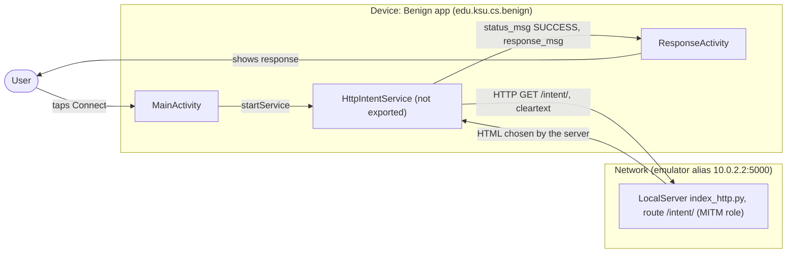
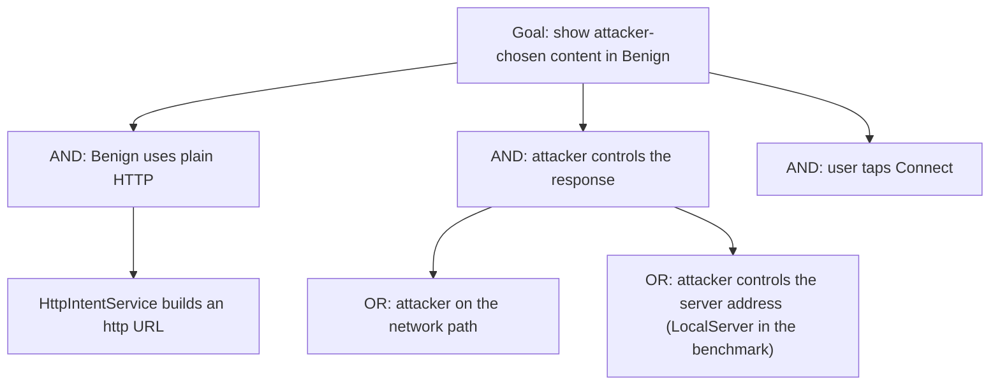

# Threat Model: HttpConnection-MITM-Lean

## 1. Benchmark

| Field | Value |
|-------|-------|
| Name | HttpConnection-MITM-Lean |
| Category | Web |
| Ghera path | `benchmarks/ghera/Web/HttpConnection-MITM-Lean` |
| Affected Android versions (from README) | "Tested on Android 5.1.1 - Android 8.1" (heading: "Android versions affected") |
| Ghera tag | `Jan2019` (commit `6289f39d`) |
| Build flavors available | `api22` to `api27`, `apiDIST` (from `benchmarks/ghera/Misc/sdkFlavors.gradle`) |
| Date of model | 2026-11-01 |

Benign downloads content from a web server over plain HTTP with `HttpURLConnection` and shows the response in an activity. The README casts the local test server as a man-in-the-middle that "masquerades as the web server"; because the connection is unencrypted and unauthenticated, Benign shows whatever that server returns.

**Start order (README steps 1, 7 and 8):** start the local web server first, then build and install Benign, launch it and tap "Connect". There is no Malicious app; the attacker role is played by the local server.

## 2. System description

### Components

| Component | App | Type | Exported or reachable from other apps | Notes |
|-----------|-----|------|----------------------------------------|-------|
| `MainActivity` | Benign (`edu.ksu.cs.benign`) | Activity, launcher | Yes (launcher intent filter) | The button `R.id.button` starts `HttpIntentService` (`MainActivity.java` line 24). |
| `HttpIntentService` | Benign | `IntentService` | No (`android:exported="false"`, manifest lines 21 to 23) | Builds `"http://" + local_server_ipv4 + ":" + local_server_port + url_extention`, opens an `HttpURLConnection`, reads up to 5000 characters and starts `ResponseActivity` with `status_msg="SUCCESS"` and the response text (`HttpIntentService.java` lines 31 to 41). On `IOException` it throws `RuntimeException` (line 46). |
| `ResponseActivity` | Benign | Activity | No intent filter | If `status_msg` is "SUCCESS", shows "Response From Server:" and the response text (`ResponseActivity.java` lines 14 to 24). |
| Build values | Benign | Gradle `resValue` | n/a | `local_server_ipv4` is "10.0.2.2" and `local_server_port` is "5000" (`Misc/web-config.gradle` lines 13 to 14); `url_extention` is "/intent/" (`strings.xml` line 3). |
| LocalServer `index_http.py` | Test server (attacker role) | Flask app | Listens on `localhost`, default port | Route `/intent/` renders `templates/intentSender.html` (`index_http.py` lines 43 to 46; `app.run('localhost', debug=True)`, line 59). |
| `HttpIntentService` | Secure (`edu.ksu.cs.benign`) | `IntentService` | Same | Uses `"https://"` (Secure line 33) and catches `SSLHandshakeException`, starting `ResponseActivity` with `status_msg="FAILURE"` (Secure lines 45 to 51). |
| `ResponseActivity` | Secure | Activity | Same | Shows "SSL Handshake failed" only when `status_msg` is "FAILURE"; it no longer shows a successful response (Secure lines 16 to 18). |

Manifest permissions: Benign and Secure request `android.permission.INTERNET` (manifest line 5).

Source files:
- `Benign/app/src/main/java/edu/ksu/cs/benign/MainActivity.java`
- `Benign/app/src/main/java/edu/ksu/cs/benign/HttpIntentService.java`
- `Benign/app/src/main/java/edu/ksu/cs/benign/ResponseActivity.java`
- `Secure/app/src/main/java/edu/ksu/cs/benign/HttpIntentService.java`, `ResponseActivity.java`
- `benchmarks/ghera/Misc/web-config.gradle`, `benchmarks/ghera/Misc/LocalServer/index_http.py`

### Trust boundaries

| ID | Boundary | What crosses it |
|----|----------|-----------------|
| TB1 | Device vs. network | The HTTP request from `HttpIntentService` and the response body. Neither is encrypted nor authenticated. |
| TB2 | Network content vs. Benign UI | The response text, shown verbatim in `ResponseActivity`. |

### Data flow diagram



## 3. Assets and attacker model

### Assets

| Asset | Why it matters |
|-------|----------------|
| Integrity of the downloaded content | Benign shows whatever arrives (`ResponseActivity.java` line 23). The README: the MITM can "spoof the address of the server". |
| Confidentiality of the request and response | Sent in cleartext. The benchmark transfers no secret. |

### Attacker

A network attacker between the device and the server who can read and replace HTTP traffic. In the benchmark this role is played by the local Flask server.

### Attacker requirements

- Position on the network path, or control of the server address the app resolves. The benchmark uses the emulator's host alias `10.0.2.2` (`web-config.gradle` line 13).
- No app on the device and no permission.
- The user taps "Connect".

## 4. STRIDE

| Category | Threat | Applies | Why |
|----------|--------|---------|-----|
| Spoofing | The attacker poses as the server. | Yes | Plain HTTP has no server authentication (`HttpIntentService.java` line 31). README: the MITM "masquerades as the web server". |
| Tampering | The attacker changes the response. | Yes | The response is shown verbatim (`ResponseActivity.java` lines 21 to 23). |
| Repudiation | Benign cannot tell which server answered. | Yes | No logging of the peer. |
| Information disclosure | The attacker reads the traffic. | Partially | Cleartext; the benchmark sends no sensitive data. |
| Denial of service | A failed connection crashes the service. | Partially | From the code: `IOException` is rethrown as `RuntimeException` (line 46). |
| Elevation of privilege | Network content gains rights in Benign. | No | The response is only displayed as text. |

## 5. LINDDUN

| Category | Threat | Applies | Why |
|----------|--------|---------|-----|
| Linkability | Cleartext requests can be linked to the device. | Partially | Applies to real traffic. |
| Identifiability | Same. | Partially | Same. |
| Non-repudiation | No user action is attributed. | No | Nothing is recorded. |
| Detectability | An observer sees that the user tapped "Connect". | Yes | The request is visible on the network. |
| Disclosure of information | Content is readable on the network. | Partially | No sensitive data in the benchmark. |
| Unawareness | The user is not told the content is unauthenticated. | Yes | `ResponseActivity` presents it as "Response From Server:". |
| Non-compliance | Personal data over cleartext would breach policy. | Partially | Applies to a real app. |

## 6. Attack tree



## 7. Standards mapping

Confidence values:
- **Verified**: the ID and title were checked against the official page.
- **Needs check**: the ID or title could not be confirmed against the official page.

Fit values:
- **Direct**: the standard describes this benchmark's weakness or test as it is.
- **Partial**: the standard covers part of this benchmark, or covers it only with a caveat given in the Fit cell.

Titles are copied from `docs/threat-models/standards-reference.md`.

| Standard | ID | Title | Confidence | Fit |
|----------|----|-------|------------|-----|
| CWE | CWE-319 | Cleartext Transmission of Sensitive Information | Verified | Partial. `HttpIntentService.java` lines 31 to 35 fetch the content over `http://` with no encryption. Partial because the benchmark content is not sensitive; the README's concern is spoofing and tampering, which the CWE does not name. Usage ALLOWED. |
| OWASP MASVS v2 | MASVS-NETWORK-1 | The app secures all network traffic according to the current best practices. | Verified | Direct. The fix moves the connection to `https://` (Secure `HttpIntentService.java` line 33). |
| OWASP MASWE | MASWE-0026 | Network Traffic Not Encrypted | Verified | Direct. `HttpIntentService.java` line 31 builds an `http://` URL; the page says cleartext remains a weakness "even when no sensitive data is being transmitted", because attackers "may disrupt app functionality or deceive" users. Controls shown on the page: MASVS-NETWORK-1. |

OWASP MASTG test: No direct match among the IDs in the reference file; none of them covers network traffic.

Candidates to check (not in the table):
- CWE-300 (Channel Accessible by Non-Endpoint) for the spoofing and tampering the README describes. Not in the reference file.
- A MASTG test for cleartext traffic. No such test is in the reference file.

MITRE ATT&CK for Mobile: No direct match. No technique on attack.mitre.org was verified that describes intercepting an app's cleartext HTTP download.

## 8. Evidence

All steps below are **Not yet run**. No result has been observed.

### Local test server (from `benchmarks/ghera/Misc/LocalServer/README.md`)

**Not yet run.** The README requires Python 2.6 or 3.3 or higher, `pip install Flask`, then `python index_http.py` for the HTTP server (check in a browser at `http://localhost:5000/test/`). `index_http.py` binds to `localhost` with Flask's default port (line 59). The apps connect to `10.0.2.2:5000`, which `Misc/web-config.gradle` (lines 2 to 4 and 13 to 14) describes as the emulator's alias for the host loopback interface. This benchmark requests `http://10.0.2.2:5000/intent/`. The benchmark's own harness starts the server the same way (`source-script.ps1` line 2) and stops it with `http://localhost:5000/shutdown` (line 22).

```powershell
# separate PowerShell window, not yet run
cd benchmarks\ghera\Misc\LocalServer
pip install Flask
python index_http.py
```

### Commands

Build. PowerShell on Windows from the project root, Gradle 4.4, JDK 8 through `env.ps1`. **Not yet run.**

```powershell
. .\env.ps1
$B = "benchmarks\ghera\Web\HttpConnection-MITM-Lean"
# Each app folder needs local.properties with sdk.dir=C:/Android/Sdk (none is present yet)
foreach ($a in "Benign","Secure") {
    Set-Content "$B\$a\local.properties" "sdk.dir=C:/Android/Sdk"
    Push-Location "$B\$a"; .\gradlew.bat assembleDebug; Pop-Location
}
```

Start the emulator and install Benign. **Not yet run.**

```powershell
emulator -avd ghera27
adb install -r "$B\Benign\app\build\outputs\apk\api27\debug\app-api27-debug.apk"
```

Pair 1, Benign + attacker server, by hand (README steps 1 and 8). **Not yet run.**

1. Start the local server as above.
2. `adb logcat -c`
3. Open Benign and tap "Connect".
4. Read the screen: heading and response text.
5. `adb logcat -d -s AndroidRuntime:E`

Pair 2, Secure + attacker server. Secure shares the package name `edu.ksu.cs.benign`. **Not yet run.**

```powershell
adb uninstall edu.ksu.cs.benign
adb install -r "$B\Secure\app\build\outputs\apk\api27\debug\app-api27-debug.apk"
```

Repeat steps 1 to 5 with Secure, with the same HTTP server running (as the harness does).

No-attacker check. There is no broadcast and no Malicious app, so the `adb shell am broadcast` line is replaced by fetching the same URL from the host. **Not yet run.**

```powershell
curl.exe -i http://localhost:5000/intent/
adb shell am start -n edu.ksu.cs.benign/.MainActivity
```

What it can show: the exact content and headers the server returns to Benign, and that nothing in the response authenticates the server. What it cannot show: interception on a real network path, since the server here is the endpoint itself.

### Expected result (from README and Testing code)

| Pair | Expected | Source | Status |
|------|----------|--------|--------|
| Benign + server | `ResponseActivity` shows "Response From Server:" and the server's HTML. | README step 8 ("An activity should display the response from MITM"); `Testing/benign_app/.../Tests.java` lines 65 to 77 tap the button and assert the heading is "Response From Server:". | Not yet run |
| Secure + server | `ResponseActivity` shows "SSL Handshake failed". | `Testing/secure_app/.../Tests.java` lines 65 to 77 assert the heading is "SSL Handshake failed". The README gives no Secure steps. | Not yet run |

### Observed result

| Pair | Outcome | Observation |
|------|---------|-------------|
| Benign + server | Not yet observed | Not yet observed |
| Secure + server | Not yet observed | Not yet observed |

## 9. Mitigation

### What the Secure app does differently

Diff of `Benign/` and `Secure/` (excluding build output, the prebuilt APKs, `local.properties` and the timestamp line in `gradle-wrapper.properties`).

| File | Benign | Secure |
|------|--------|--------|
| `HttpIntentService.java` line 31 (Secure line 33) | `String urlString = "http://" + ...` | `String urlString = "https://" + ...` |
| `HttpIntentService.java` (Secure lines 14 and 45 to 51) | none | `import javax.net.ssl.SSLHandshakeException;` and a `catch (SSLHandshakeException e)` that starts `ResponseActivity` with `status_msg="FAILURE"` |
| `ResponseActivity.java` lines 16 to 24 (Secure lines 16 to 18) | On "SUCCESS", show "Response From Server:" and the response | On "FAILURE", show "SSL Handshake failed"; a successful response is no longer shown |
| `res/layout/activity_response.xml` lines 19 and 26 | Placeholder texts | "Placeholder" and empty text |
| `res/values/dimens.xml` line 5 | `20dp` | `16dp` |
| `AndroidManifest.xml` lines 13, 22, 25 | Short class names | Fully qualified names (same classes) |
| `MainActivity.java` | Import order | Import order changed (no effect) |
| `res/values/strings.xml` line 2 | `Benign` | `Secure` |

### Assessment of the fix

Switching to HTTPS with the platform's default certificate checks is the right fix. Residual points:

1. **The Secure test does not show a working secure connection.** The harness starts only the HTTP server (`source-script.ps1` line 2), so Secure's `https://` request goes to a server that does not speak TLS. The test then passes on "SSL Handshake failed". Secure never shows a successful response, even with a trusted HTTPS server (Secure `ResponseActivity.java` lines 16 to 18).
2. **Only one exception type is handled.** Other `IOException`s are still rethrown as `RuntimeException`. Whether connecting with TLS to a plain HTTP port raises `SSLHandshakeException` or another `SSLException` subclass has not been checked.
3. **No pinning or network security configuration.** Secure relies on the default trust store; that is enough for this weakness.
4. **Newer Android versions.** Hypothesis, to test in Step 3: apps that target API 28 or later have cleartext traffic blocked by default, so Benign's `http://` request would fail unless cleartext is allowed in the manifest or a network security configuration.

The fix addresses the weakness; point 1 means the benchmark does not demonstrate it working.

## 10. Open questions

- README step 6 says to "Edit the *url* field in *Benign/.../HttpIntentService.java*". There is no `url` field; the URL is built from string resources (`HttpIntentService.java` lines 31 to 32, `Misc/web-config.gradle` lines 13 to 14).
- README step 1 links to a LocalServer README on bitbucket; the repository copy is `benchmarks/ghera/Misc/LocalServer/README.md`.
- The route `/intent/` returns `intentSender.html`, a page built for `UnsafeIntentURLImpl-InformationExposure-Lean`; the benchmark only needs any response.
- `index_http.py` binds to `localhost` (line 59); reaching it from the emulator through `10.0.2.2` is stated by the comment in `web-config.gradle`, not checked.
- Lean vs Fat: there is no Fat variant of this benchmark under `benchmarks/ghera/Web/`, so there is nothing to compare.
- Running the build commands in section 8 writes `local.properties` and `build/` folders under `benchmarks/`. Prebuilt APKs are in each app folder.
