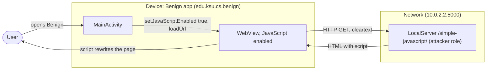
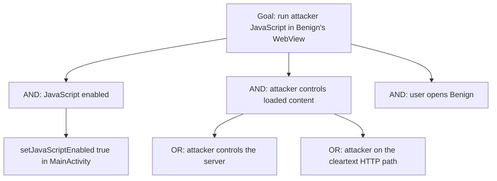

# Threat Model: JavaScriptExecution-CodeInjection-Lean

## 1. Benchmark

| Field | Value |
|-------|-------|
| Name | JavaScriptExecution-CodeInjection-Lean |
| Category | Web |
| Ghera path | `benchmarks/ghera/Web/JavaScriptExecution-CodeInjection-Lean` |
| Affected Android versions (from README) | "Tested on Android 5.1 - Android 8.1" (heading: "Android versions affected") |
| Ghera tag | `Jan2019` (commit `6289f39d`) |
| Build flavors available | `api22` to `api27`, `apiDIST` (from `benchmarks/ghera/Misc/sdkFlavors.gradle`) |
| Date of model | 2026-11-01 |

Benign's `MainActivity` loads a page from a web server over plain HTTP into a `WebView` with JavaScript enabled. The page's script changes the page text, which the README calls behaviour "not expected by the Benign app". Any script the server (or a party on the network path) sends runs in the WebView.

**Start order (README steps 1 and 7):** start the local web server first, then build, install and launch Benign. There is no Malicious app; the attacker role is played by the web content.

## 2. System description

### Components

| Component | App | Type | Exported or reachable from other apps | Notes |
|-----------|-----|------|----------------------------------------|-------|
| `MainActivity` | Benign (`edu.ksu.cs.benign`) | Activity, launcher | Yes (launcher intent filter) | In `onResume` builds `"http://" + local_server_ipv4 + ":" + local_server_port + url_extension` (`MainActivity.java` lines 19 to 20), calls `setJavaScriptEnabled(true)` (line 23) and `loadUrl(url)` (line 24) on `R.id.webview1`. No `WebViewClient`, no JavaScript interface. |
| Build values | Benign | Gradle `resValue` and strings | n/a | `10.0.2.2`, port `5000` (`Misc/web-config.gradle` lines 13 to 14); `url_extension` is "/simple-javascript/" (`strings.xml` line 3). |
| LocalServer `index_http.py` | Test server (attacker role) | Flask app | Listens on `localhost`, default port | Route `/simple-javascript/` renders `simpleJavascript.html` (lines 48 to 51), whose script sets `#demo` to "This text is set by javascript" (template line 8). |
| `MainActivity` | Secure (`edu.ksu.cs.benign`) | Activity, launcher | Same | `setJavaScriptEnabled(false)` (Secure `MainActivity.java` line 23); same URL. |

Manifest permissions: Benign and Secure request `android.permission.INTERNET` (manifest line 5).

Source files:
- `Benign/app/src/main/java/edu/ksu/cs/benign/MainActivity.java`
- `Secure/app/src/main/java/edu/ksu/cs/benign/MainActivity.java`
- `benchmarks/ghera/Misc/web-config.gradle`, `benchmarks/ghera/Misc/LocalServer/index_http.py`, `templates/simpleJavascript.html`

### Trust boundaries

| ID | Boundary | What crosses it |
|----|----------|-----------------|
| TB1 | Device vs. network | The HTTP request and the HTML/JavaScript response, unencrypted. |
| TB2 | Web content vs. Benign's WebView | Server-chosen JavaScript, executed because JavaScript is enabled. |

### Data flow diagram



## 3. Assets and attacker model

### Assets

| Asset | Why it matters |
|-------|----------------|
| Integrity of the page Benign shows | The script changes the page (`simpleJavascript.html` line 8). README: "modifies the HTML page, which is not expected by the Benign app". |
| The WebView's privileges | README: loaded content "executes in the context of the app with the same priveleges as of the app unless instructed otherwise". In this benchmark the WebView has no JavaScript interface and no file access settings. |

### Attacker

Whoever controls the content the WebView loads: the server, or a network attacker on the HTTP path. In the benchmark this is the local Flask server.

### Attacker requirements

- Control of the response from `http://10.0.2.2:5000/simple-javascript/`, by owning the server or sitting on the cleartext path.
- No app on the device and no permission.
- The user opens Benign.

## 4. STRIDE

| Category | Threat | Applies | Why |
|----------|--------|---------|-----|
| Spoofing | Injected content appears as Benign's own page. | Yes | Nothing in the WebView marks the content's origin (`MainActivity.java` line 24). |
| Tampering | Script changes what the user sees. | Yes | `simpleJavascript.html` line 8, executed because of `MainActivity.java` line 23. |
| Repudiation | Benign keeps no record of what ran. | Yes | No `WebViewClient` or logging. |
| Information disclosure | Script reads app data. | Partially | No bridge or file access in this benchmark; a real page could still phish the user. |
| Denial of service | Script makes the page unusable. | Partially | Possible for any script; not shown by the benchmark. |
| Elevation of privilege | Script gains app privileges. | Partially | README claim; this WebView exposes no interface, so nothing beyond page content is reachable. |

## 5. LINDDUN

| Category | Threat | Applies | Why |
|----------|--------|---------|-----|
| Linkability | Script can fingerprint the device. | Partially | General to JavaScript; not in the benchmark. |
| Identifiability | Same. | Partially | Same. |
| Non-repudiation | No user action is attributed. | No | Nothing recorded. |
| Detectability | The server sees each app launch. | Yes | Every `onResume` loads the URL (line 24). |
| Disclosure of information | No app data is read. | No | No bridge or file access. |
| Unawareness | The user is not told the page runs remote code. | Yes | No indication in the UI. |
| Non-compliance | No personal data processed. | No | Constant page. |

## 6. Attack tree



## 7. Standards mapping

Confidence values:
- **Verified**: the ID and title were checked against the official page.
- **Needs check**: the ID or title could not be confirmed against the official page.

Fit values:
- **Direct**: the standard describes this benchmark's weakness or test as it is.
- **Partial**: the standard covers part of this benchmark, or covers it only with a caveat given in the Fit cell.

Titles are copied from `docs/threat-models/standards-reference.md`.

| Standard | ID | Title | Confidence | Fit |
|----------|----|-------|------------|-----|
| CWE | CWE-829 | Inclusion of Functionality from Untrusted Control Sphere | Verified | Partial. `MainActivity.java` lines 23 to 24 enable JavaScript and load a remote page, so the app runs executable code from a server outside its control. Partial because the CWE speaks of importing functionality such as a library; here it is page script. Its children on the page are CWE-98 (PHP include), CWE-827 (DTD control) and CWE-830 (web functionality from another domain); CWE-830 does not fit better because the script is part of the loaded page, not included from a different domain into the app's own page. Usage ALLOWED. |
| CWE | CWE-319 | Cleartext Transmission of Sensitive Information | Verified | Partial. The page and its script come over `http://` (`MainActivity.java` line 19), so a network attacker can replace them. Partial because no sensitive data is sent. Usage ALLOWED. |
| OWASP MASVS v2 | MASVS-PLATFORM-2 | The app uses WebViews securely. | Verified | Direct. The fix is a WebView setting (Secure `MainActivity.java` line 23). |
| OWASP MASWE | MASWE-0035 | WebViews Loading Untrusted Content | Verified | Direct. `MainActivity.java` line 24 loads a page from an HTTP server with JavaScript enabled (line 23); the page covers WebViews that load "URLs, HTML, or JavaScript from untrusted sources". Controls shown on the page: MASVS-PLATFORM-2, MASVS-CODE-4. |
| OWASP MASTG test | MASTG-TEST-0031 | Testing JavaScript Execution in WebViews | Verified | Partial. Deprecated; its banner says JavaScript enabled "is not considered a vulnerability by itself". Kept for reference only: it is the check that flags `setJavaScriptEnabled(true)` at line 23. |

MASVS-NETWORK-1 and MASWE-0026 were considered for the cleartext URL; they are not in the table because the benchmark and its fix are about script execution, and the Secure app keeps `http://`.

Candidates to check (not in the table):
- None beyond the IDs above.

MITRE ATT&CK for Mobile: No direct match. No technique on attack.mitre.org was verified that describes serving script to an app's WebView.

## 8. Evidence

All steps below are **Not yet run**. No result has been observed.

### Local test server (from `benchmarks/ghera/Misc/LocalServer/README.md`)

**Not yet run.** The README requires Python 2.6 or 3.3 or higher, `pip install Flask`, then `python index_http.py` for the HTTP server (check in a browser at `http://localhost:5000/test/`). `index_http.py` binds to `localhost` with Flask's default port (line 59). The apps connect to `10.0.2.2:5000`, the emulator's alias for the host loopback interface (`Misc/web-config.gradle` lines 2 to 4 and 13 to 14). This benchmark loads `http://10.0.2.2:5000/simple-javascript/`. The harness starts the server the same way (`source-script.ps1` line 2) and stops it with `http://localhost:5000/shutdown` (line 22).

```powershell
# separate PowerShell window, not yet run
cd benchmarks\ghera\Misc\LocalServer
pip install Flask
python index_http.py
```

### Commands

Build, emulator and install. **Not yet run.**

```powershell
. .\env.ps1
$B = "benchmarks\ghera\Web\JavaScriptExecution-CodeInjection-Lean"
# Each app folder needs local.properties with sdk.dir=C:/Android/Sdk (none is present yet)
foreach ($a in "Benign","Secure") {
    Set-Content "$B\$a\local.properties" "sdk.dir=C:/Android/Sdk"
    Push-Location "$B\$a"; .\gradlew.bat assembleDebug; Pop-Location
}
emulator -avd ghera27
adb install -r "$B\Benign\app\build\outputs\apk\api27\debug\app-api27-debug.apk"
```

Pair 1, Benign + server, by hand (README steps 1 and 7). **Not yet run.**

1. Start the local server as above.
2. Open Benign.
3. Read the WebView text.

Pair 2, Secure + server. Secure shares the package name `edu.ksu.cs.benign`. **Not yet run.**

```powershell
adb uninstall edu.ksu.cs.benign
adb install -r "$B\Secure\app\build\outputs\apk\api27\debug\app-api27-debug.apk"
```

Repeat steps 1 to 3 with Secure.

No-attacker check. There is no broadcast and no Malicious app, so the `adb shell am broadcast` line is replaced by fetching the page from the host. **Not yet run.**

```powershell
curl.exe http://localhost:5000/simple-javascript/
```

What it can show: the exact HTML and script the WebView receives, including the original text "This is a test web page" that the script replaces. What it cannot show: whether the script runs in the app; only steps 2 to 3 show that.

### Expected result (from README and Testing code)

| Pair | Expected | Source | Status |
|------|----------|--------|--------|
| Benign + server | The WebView shows "This text is set by javascript". | README step 7; `Testing/benign_app/.../Tests.java` lines 67 to 71 assert element `demo` contains that text. | Not yet run |
| Secure + server | The WebView shows "This is a test web page" (script not run). | The Secure test expects `NoMatchingViewException` when querying element `demo` (`Testing/secure_app/.../Tests.java` lines 71 to 76); the visible text follows from `simpleJavascript.html` line 5. The README gives no Secure steps. | Not yet run |

### Observed result

| Pair | Outcome | Observation |
|------|---------|-------------|
| Benign + server | Not yet observed | Not yet observed |
| Secure + server | Not yet observed | Not yet observed |

## 9. Mitigation

### What the Secure app does differently

Diff of `Benign/` and `Secure/` (excluding build output, the prebuilt APKs and `local.properties`).

| File | Benign | Secure |
|------|--------|--------|
| `MainActivity.java` line 23 | `webSettings.setJavaScriptEnabled(true);` | `webSettings.setJavaScriptEnabled(false);` |
| `AndroidManifest.xml` line 12 | `.MainActivity` | `edu.ksu.cs.benign.MainActivity` (same class) |
| `res/values/strings.xml` line 2 | `Benign` | `Secure` |
| `res/values-w820dp/strings.xml` | not present | New file with `app_name` "Secure" and an unused `url` string `file:///data/data/edu.ksu.cs.benign/files/demo1.html` |
| `gradle/wrapper/gradle-wrapper.properties` line 1 | timestamp | different timestamp |

### Assessment of the fix

Disabling JavaScript stops the benchmark's script from running. Residual points:

1. **The page is still fetched over HTTP.** A network attacker can still replace the HTML (content spoofing without script). Loading over HTTPS would protect integrity.
2. **No navigation control.** Without a `WebViewClient`, links in the page open according to platform defaults; not exercised here.
3. **The Secure test passes without the server.** It only expects an exception when querying the WebView with JavaScript disabled, so it passes whether or not the page loaded.
4. **Leftover resource.** `values-w820dp/strings.xml` in Secure defines a `url` pointing to another benchmark's file and is not used.
5. **Newer Android versions.** Hypothesis, to test in Step 3: apps that target API 28 or later have cleartext traffic blocked by default, so the `http://` load would fail unless cleartext is allowed.

The fix is complete for script execution. Point 1 remains.

## 10. Open questions

- The README range starts at "Android 5.1", not "5.1.1" as in most benchmarks; the build flavors start at API 22.
- The README says loaded content runs "with the same priveleges as of the app"; in this WebView there is no JavaScript interface and no file access setting, so what the script can reach beyond the page is not shown.
- `index_http.py` binds to `localhost` (line 59); reaching it from the emulator through `10.0.2.2` is stated by the comment in `web-config.gradle`, not checked.
- Lean vs Fat: there is no Fat variant of this benchmark under `benchmarks/ghera/Web/`, so there is nothing to compare.
- Running the build commands in section 8 writes `local.properties` and `build/` folders under `benchmarks/`. Prebuilt APKs are in each app folder.
