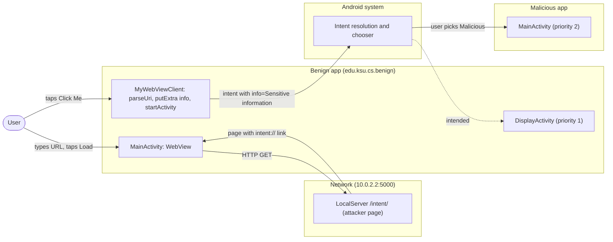
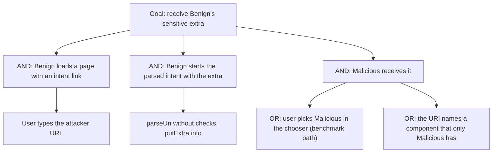

# Threat Model: UnsafeIntentURLImpl-InformationExposure-Lean

## 1. Benchmark

| Field | Value |
|-------|-------|
| Name | UnsafeIntentURLImpl-InformationExposure-Lean |
| Category | Web |
| Ghera path | `benchmarks/ghera/Web/UnsafeIntentURLImpl-InformationExposure-Lean` |
| Affected Android versions (from README) | "Tested on Android 5.1.1 - Android 8.1" (heading: "Android versions affected") |
| Ghera tag | `Jan2019` (commit `6289f39d`) |
| Build flavors available | `api22` to `api27`, `apiDIST` (from `benchmarks/ghera/Misc/sdkFlavors.gradle`) |
| Date of model | 2026-11-01 |

Benign is a small browser. Its `WebViewClient` turns any non-HTTP link that contains "intent" into an `Intent` with `Intent.parseUri`, adds the extra `info="Sensitive information"`, and starts it. The served page `intentSender.html` has a link `intent://ghera/#Intent;scheme=benign;action=edu.ksu.cs.benign.intent.action.DISP;end`. Benign's own `DisplayActivity` and the Malicious app's `MainActivity` both match it; Malicious declares a higher priority, so when the user picks Malicious it receives the sensitive extra.

**Start order (README steps 1, 6 to 8):** start the local web server, install Benign, install Malicious, then open Benign, type `http://serverIP:5000/intent/` and tap the link "Click Me". The Testing code then taps "Malicious" in the chooser and "Just once" (`Testing/benign_app/.../Tests.java` lines 92 to 99), steps the README does not list.

## 2. System description

### Components

| Component | App | Type | Exported or reachable from other apps | Notes |
|-----------|-----|------|----------------------------------------|-------|
| `MainActivity` | Benign (`edu.ksu.cs.benign`) | Activity, launcher | Yes (launcher intent filter) | Enables JavaScript on `R.id.page` (`MainActivity.java` line 28), sets `MyWebViewClient` (line 30) and loads the URL typed in `R.id.url` when "Load" is tapped (lines 31 to 36). |
| `MyWebViewClient` | Benign | `WebViewClient` | n/a | For URLs containing "http" or "https", returns false (WebView loads them). For URLs containing "intent", calls `Intent.parseUri(url, Intent.URI_INTENT_SCHEME)`, `putExtra("info", "Sensitive information")` and `startActivity(intent)` (`MyWebViewClient.java` lines 17 to 24). No check of action, package, component or category. |
| `DisplayActivity` | Benign | Activity | Yes (intent filter with action `edu.ksu.cs.benign.intent.action.DISP`, categories `DEFAULT` and `BROWSABLE`, data `benign://ghera/`, priority 1; manifest lines 22 to 34) | Shows the `info` extra (`DisplayActivity.java` lines 14 to 16). The intended receiver. |
| `MainActivity` | Malicious (`edu.ksu.cs.malicious`) | Activity, launcher | Yes (a second intent filter identical to `DisplayActivity`'s, with priority 2; Malicious manifest lines 17 to 27) | Shows the `info` extra in `R.id.infoText` (`MainActivity.java` lines 15 to 18). |
| LocalServer `index_http.py` | Test server (attacker role) | Flask app | `localhost`, default port | Route `/intent/` renders `intentSender.html` (lines 43 to 46), whose link is at template line 6. |
| `MyWebViewClient` | Secure (`edu.ksu.cs.benign`) | `WebViewClient` | n/a | Adds `info` and starts the intent only if its action is `edu.ksu.cs.benign.intent.action.DISP` and its package is `edu.ksu.cs.benign`; otherwise adds `error_msg="Malformed intent detected"` and still starts the intent; on `URISyntaxException` or `NullPointerException` starts `DisplayActivity` with `error_msg` (Secure `MyWebViewClient.java` lines 22 to 36). |

Manifest permissions: Benign requests `ACCESS_FINE_LOCATION`, `ACCESS_COARSE_LOCATION` and `INTERNET` (manifest lines 5 to 7); no code uses location. Secure requests only `INTERNET`. Malicious requests none.

Source files:
- `Benign/app/src/main/java/edu/ksu/cs/benign/MainActivity.java`, `MyWebViewClient.java`, `DisplayActivity.java`
- `Malicious/app/src/main/java/edu/ksu/cs/malicious/MainActivity.java`
- `Secure/app/src/main/java/edu/ksu/cs/benign/MyWebViewClient.java`, `DisplayActivity.java`
- `AndroidManifest.xml` of each app; `benchmarks/ghera/Misc/LocalServer/templates/intentSender.html`

### Trust boundaries

| ID | Boundary | What crosses it |
|----|----------|-----------------|
| TB1 | Web content vs. Benign | The `intent://` URI from the page, which Benign turns into an intent. |
| TB2 | Benign vs. other apps | The intent Benign starts, carrying `info`, resolved against all installed apps. |
| TB3 | User vs. chooser | Both apps match; the user picks one. |

### Data flow diagram



## 3. Assets and attacker model

### Assets

| Asset | Why it matters |
|-------|----------------|
| The `info` extra | Labelled "Sensitive information" (`MyWebViewClient.java` line 22). README: it is exposed "via intent hijacking". |
| Control over which components Benign starts | Web content chooses the intent's action, data and potentially component through the URI. |

### Attacker

Two cooperating parties: a web page Benign loads (served by the local Flask server), and a third-party app on the device that matches the intent. The README describes this combination.

### Attacker requirements

- A page the user opens in Benign that contains an `intent://` link. The user types the URL (README step 8).
- A Malicious app installed with an intent filter for `edu.ksu.cs.benign.intent.action.DISP`, `benign://ghera/`, and a higher priority (Malicious manifest lines 17 to 27).
- The user taps the link and picks Malicious in the chooser (Testing code lines 92 to 99).
- No permission.

## 4. STRIDE

| Category | Threat | Applies | Why |
|----------|--------|---------|-----|
| Spoofing | Malicious poses as Benign's display screen. | Yes | Identical intent filter with priority 2 (Malicious manifest lines 17 to 27). |
| Tampering | Web content decides what intent Benign starts. | Yes | `Intent.parseUri` on the page's URI with no checks (`MyWebViewClient.java` line 21). |
| Repudiation | Benign does not record where the intent went. | Yes | Only the URL and action are logged (lines 16 and 23). |
| Information disclosure | The sensitive extra reaches Malicious. | Yes | `putExtra("info", ...)` then `startActivity` (lines 22 to 24); Malicious displays it (Malicious `MainActivity.java` line 18). This is the README impact. |
| Denial of service | A malformed `intent:` link crashes Benign. | Partially | From the code: `URISyntaxException` is rethrown as `RuntimeException` (line 28). |
| Elevation of privilege | Web content starts arbitrary activities through Benign. | Partially | Any parsed intent is started with Benign's identity; reachable components are limited to exported ones. |

## 5. LINDDUN

| Category | Threat | Applies | Why |
|----------|--------|---------|-----|
| Linkability | Real sensitive data could link the user. | Partially | Constant string in the benchmark. |
| Identifiability | Same. | Partially | Same. |
| Non-repudiation | No user action is attributed. | No | Nothing recorded. |
| Detectability | Malicious learns when the user follows the link. | Yes | It is started at that moment. |
| Disclosure of information | The extra reaches another app. | Yes | See STRIDE Information disclosure. |
| Unawareness | The user is not told the chooser hands data to the chosen app. | Yes | The chooser shows app names only. |
| Non-compliance | Personal data shared without consent. | Partially | Applies to a real app. |

## 6. Attack tree



## 7. Standards mapping

Confidence values:
- **Verified**: the ID and title were checked against the official page.
- **Needs check**: the ID or title could not be confirmed against the official page.

Fit values:
- **Direct**: the standard describes this benchmark's weakness or test as it is.
- **Partial**: the standard covers part of this benchmark, or covers it only with a caveat given in the Fit cell.

Titles are copied from `docs/threat-models/standards-reference.md`.

| Standard | ID | Title | Confidence | Fit |
|----------|----|-------|------------|-----|
| CWE | CWE-927 | Use of Implicit Intent for Sensitive Communication | Verified | Direct. `MyWebViewClient.java` lines 21 to 24 start an intent with only action and data from the page, carrying `info="Sensitive information"`, so any app with a matching filter can receive it; Malicious does (Malicious manifest lines 17 to 27). Usage ALLOWED. |
| OWASP MASVS v2 | MASVS-PLATFORM-1 | The app uses IPC mechanisms securely. | Verified | Direct. The leak happens through the intent Benign starts (line 24). |
| OWASP MASVS v2 | MASVS-PLATFORM-2 | The app uses WebViews securely. | Verified | Partial. The intent comes from WebView content through `shouldOverrideUrlLoading` (lines 34 to 42); the fix is in the `WebViewClient`, but the leak is an IPC issue. |
| OWASP MASWE | MASWE-0032 | Insecure Intents | Verified | Direct. Benign acts on an untrusted intent from web content and sends sensitive data in it (lines 21 to 24); the page covers "sending sensitive data via implicit intents" and "acting on untrusted intents ... (e.g. calling `startActivity` ...) without validation". Controls shown on the page: MASVS-PLATFORM-1, MASVS-STORAGE-2. |
| OWASP Mobile Top 10 2024 | M4 | Insufficient Input/Output Validation | Verified | Direct. `MyWebViewClient.java` lines 21 to 24 parse an intent from a URL supplied by web content and start it without validation; the page covers "Insufficient validation and sanitization of data from external sources, such as user inputs or network data". The fix adds the missing check (Secure lines 23 to 27). |

OWASP MASTG test: No direct match among the IDs in the reference file. MASTG-TEST-0364 to MASTG-TEST-0366 are about exported components that expose functionality, not about intents built from web content.

Candidates to check (not in the table):
- MASTG-TEST-0028 (Testing Deep Links), listed in the MASTG site navigation. Not in the reference file.

MITRE ATT&CK for Mobile: No direct match. No technique on attack.mitre.org was verified that describes a web page making an app send an intent to another app.

## 8. Evidence

All steps below are **Not yet run**. No result has been observed.

### Local test server (from `benchmarks/ghera/Misc/LocalServer/README.md`)

**Not yet run.** The README requires Python 2.6 or 3.3 or higher, `pip install Flask`, then `python index_http.py` for the HTTP server (check in a browser at `http://localhost:5000/test/`). `index_http.py` binds to `localhost` with Flask's default port (line 59). From the emulator the server is reached at `10.0.2.2:5000` (`Misc/web-config.gradle` lines 2 to 4); this app does not apply `web-config.gradle`, so the user types the URL, and the Testing code builds `http://10.0.2.2:5000/intent/` (`Testing/benign_app/.../Tests.java` lines 76 to 78). The harness starts the server with `source-script.ps1` line 2.

```powershell
# separate PowerShell window, not yet run
cd benchmarks\ghera\Misc\LocalServer
pip install Flask
python index_http.py
```

### Commands

Build, emulator and install. **Not yet run.**

```powershell
. .\env.ps1
$B = "benchmarks\ghera\Web\UnsafeIntentURLImpl-InformationExposure-Lean"
foreach ($a in "Benign","Malicious","Secure") {
    Set-Content "$B\$a\local.properties" "sdk.dir=C:/Android/Sdk"
    Push-Location "$B\$a"; .\gradlew.bat assembleDebug; Pop-Location
}
emulator -avd ghera27
adb install -r "$B\Benign\app\build\outputs\apk\api27\debug\app-api27-debug.apk"
adb install -r "$B\Malicious\app\build\outputs\apk\api27\debug\app-api27-debug.apk"
```

Pair 1, Benign + Malicious, by hand (README step 8, then the Testing code's chooser steps). **Not yet run.**

1. Start the local server.
2. `adb logcat -c`
3. Open Benign, type `http://10.0.2.2:5000/intent/` and tap "Load".
4. Tap "Click Me".
5. Note the chooser entries. Tap "Malicious", then "Just once" if shown.
6. Read the text in Malicious.
7. `adb logcat -d -s "Benign/MyWebViewClient:D"`

Pair 2, Secure + Malicious. Secure shares the package name `edu.ksu.cs.benign`. **Not yet run.**

```powershell
adb uninstall edu.ksu.cs.benign
adb install -r "$B\Secure\app\build\outputs\apk\api27\debug\app-api27-debug.apk"
```

Repeat steps 1 to 7 with Secure; at step 5 note whether a chooser appears at all.

No-attacker check. There is no broadcast, so the `adb shell am broadcast` line is replaced by sending the same intent the page encodes, from the shell. **Not yet run.**

```powershell
adb shell am start -a edu.ksu.cs.benign.intent.action.DISP -c android.intent.category.BROWSABLE -d benign://ghera/ --es info test
```

What it can show: which installed activities match the intent the page encodes (the chooser, or a single target), without the web page. What it cannot show: Benign adding the `info` extra, which only happens when Benign itself parses the link.

### Expected result (from README and Testing code)

| Pair | Expected | Source | Status |
|------|----------|--------|--------|
| Benign + Malicious | Malicious opens and shows "Sensitive information". | README step 8 ("You will see the app Malicious launched and displayed the message "Sensitive Information""); `Testing/benign_app/.../Tests.java` lines 70 to 105 pick Malicious and assert `infoText` is "Sensitive information". | Not yet run |
| Secure + Malicious | Secure's `DisplayActivity` shows "Malformed intent detected". | `Testing/secure_app/.../Tests.java` lines 69 to 96 assert that text. The README gives no Secure steps. | Not yet run |

### Observed result

| Pair | Outcome | Observation |
|------|---------|-------------|
| Benign + Malicious | Not yet observed | Not yet observed |
| Secure + Malicious | Not yet observed | Not yet observed |

## 9. Mitigation

### What the Secure app does differently

Diff of `Benign/` and `Secure/` (excluding build output, the prebuilt APKs and `local.properties`).

| File | Benign | Secure |
|------|--------|--------|
| `MyWebViewClient.java` lines 21 to 28 (Secure lines 21 to 36) | `parseUri`, `putExtra("info", ...)`, `startActivity`; `URISyntaxException` rethrown | Adds `info` only if action is `edu.ksu.cs.benign.intent.action.DISP` and package is `edu.ksu.cs.benign` (lines 23 to 27); otherwise adds `error_msg` and still starts the intent (lines 28 to 31); catches `URISyntaxException` and `NullPointerException` and starts `DisplayActivity` with `error_msg` (lines 32 to 36) |
| `DisplayActivity.java` lines 14 to 16 | Shows `info` in `R.id.textView` | Shows `error_msg` in `R.id.errorText` |
| `AndroidManifest.xml` lines 5 to 6 | Location permissions | Removed |
| `app/build.gradle` line 16 | `apply from: '../../../../Misc/app-dependencies.gradle'` | Inline `dependencies` block |
| `res/values/strings.xml` line 2 | `Benign` | `Secure` |

### Assessment of the fix

The fix stops the benchmark leak: the page's link has no package, so `intent.getPackage()` is `null`, the check throws, and Secure shows "Malformed intent detected". Residual points:

1. **Page intents are still started.** If the parsed intent has an action other than `DISP`, the condition short-circuits before the package check and the `else` branch starts the page's intent anyway (Secure lines 28 to 31), only without `info`. Web content can still make Secure start other exported activities.
2. **Relying on a caught `NullPointerException`.** The safe outcome for the benchmark link depends on `getPackage()` being `null` and the exception being caught (line 32), not on an explicit rule.
3. **No restriction on component or selector.** The URI scheme can carry those fields; Secure does not clear or check them. Hypothesis, to test in Step 3: a crafted link with `package=edu.ksu.cs.benign` and a component would pass the package check.
4. **Stronger alternative.** Build an explicit intent to `DisplayActivity` from the link data instead of starting the parsed intent, and do not put sensitive data in it.

The fix is complete for the benchmark exploit. Point 1 leaves web content able to start intents.

## 10. Open questions

- README step 8 says Malicious shows "Sensitive Information"; the code and tests use "Sensitive information" (`MyWebViewClient.java` line 22).
- The README does not mention the chooser; the Testing code taps "Malicious" and "Just once" (lines 92 to 99).
- Benign requests location permissions that no code uses (manifest lines 5 to 6); Secure drops them.
- The Benign app does not apply `Misc/web-config.gradle`, unlike other Web benchmarks; the URL is typed by hand.
- Lean vs Fat: there is no Fat variant of this benchmark under `benchmarks/ghera/Web/`, so there is nothing to compare.
- Running the build commands in section 8 writes `local.properties` and `build/` folders under `benchmarks/`. Prebuilt APKs are in each app folder.
