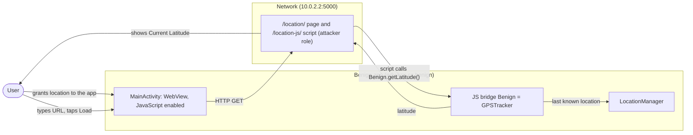
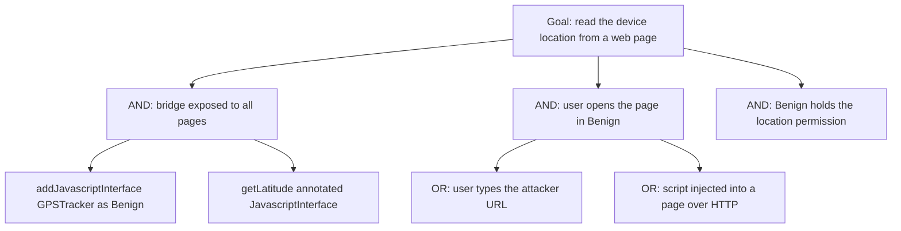

# Threat Model: WebView-NoUserPermission-InformationExposure-Lean

## 1. Benchmark

| Field | Value |
|-------|-------|
| Name | WebView-NoUserPermission-InformationExposure-Lean |
| Category | Web |
| Ghera path | `benchmarks/ghera/Web/WebView-NoUserPermission-InformationExposure-Lean` |
| Affected Android versions (from README) | "Tested on Android 5.1.1 - Android 8.1" (heading: "Android versions affected") |
| Ghera tag | `Jan2019` (commit `6289f39d`) |
| Build flavors available | `api22` to `api27`, `apiDIST` (from `benchmarks/ghera/Misc/sdkFlavors.gradle`) |
| Date of model | 2026-11-01 |

Benign is a simple browser that holds the location permission and exposes a `GPSTracker` object to every page through `addJavascriptInterface(..., "Benign")`. Any page the user opens can call `Benign.getLatitude()` and read the device latitude, without the user being asked. The served page `displayLocation.html` does exactly this.

**Start order (README steps 1, 6, 8 and 9):** start the local web server, install Benign, open Benign (on API 23 or later it asks for the location permission at start), enter the URL of the location page and tap "Load". The Testing code taps "Allow" on the permission dialog first, then loads `http://10.0.2.2:5000/location/` and taps "Show Lat" (`Testing/benign_app/.../Tests.java` lines 72 to 103). There is no Malicious app; the attacker role is played by the web page.

## 2. System description

### Components

| Component | App | Type | Exported or reachable from other apps | Notes |
|-----------|-----|------|----------------------------------------|-------|
| `MainActivity` | Benign (`edu.ksu.cs.benign`) | Activity, launcher | Yes (launcher intent filter) | On API 23 or later requests `ACCESS_FINE_LOCATION` and, once granted, calls `webView.addJavascriptInterface(new GPSTracker(this), "Benign")` (`MainActivity.java` lines 23 to 35 and 57 to 61). Enables JavaScript (line 44) and loads any URL typed in `R.id.url` (line 49). No `WebViewClient`, no origin check. |
| `GPSTracker` | Benign | Class extending `Service`, used as a plain object | Exposed to page JavaScript as `Benign` | `getLatitude()` is annotated `@JavascriptInterface` and returns the last known latitude, or 42.42 if none (`GPSTracker.java` lines 93 to 101). |
| LocalServer `index_http.py` | Test server (attacker role) | Flask app | `localhost`, default port | `/location/` renders `displayLocation.html` (lines 32 to 35); it loads `/location-js/` (template line 9) whose `getLat()` calls `Benign.getLatitude()` and writes "Current Latitude: ..." (`locationScript.js` lines 1 to 9). The page also calls `Benign.getUserApproval()` (template line 10), which exists only in Secure. |
| `GPSTracker` | Secure (`edu.ksu.cs.benign`) | Same | Same | Adds `private static boolean userApproval` (line 20). `getLatitude()` returns the latitude only if `userApproval` is true, otherwise 0.0 (lines 96 to 105). New `@JavascriptInterface getUserApproval()` shows a dialog "This webpage is requesting your location. Do you want to grant it access?" and sets `userApproval` (lines 130 to 146). |

Manifest permissions: Benign and Secure request `ACCESS_FINE_LOCATION`, `ACCESS_COARSE_LOCATION` and `INTERNET` (manifest lines 5 to 7).

Source files:
- `Benign/app/src/main/java/edu/ksu/cs/benign/MainActivity.java`, `GPSTracker.java`
- `Secure/app/src/main/java/edu/ksu/cs/benign/GPSTracker.java`
- `benchmarks/ghera/Misc/LocalServer/templates/displayLocation.html`, `locationScript.js`

### Trust boundaries

| ID | Boundary | What crosses it |
|----|----------|-----------------|
| TB1 | Web content vs. Benign's native code | Calls from page JavaScript to `GPSTracker.getLatitude()` through the bridge, and the latitude returned. |
| TB2 | Benign vs. the user | The runtime location permission, granted to the app as a whole, not to each page. |
| TB3 | Device vs. network | The page and script, fetched over HTTP. |

### Data flow diagram



## 3. Assets and attacker model

### Assets

| Asset | Why it matters |
|-------|----------------|
| The device latitude | Personal location data, protected by a runtime permission the user granted to Benign, not to web pages. |
| The user's consent | README: the app releases the data "without explicitly requesting the user for permission". |

### Attacker

Any web page the user opens in Benign, or a party able to inject script into such a page. In the benchmark the local Flask server serves the page.

### Attacker requirements

- The user opens the attacker's page in Benign (README step 8).
- Benign has the location permission (granted at start on API 23 or later).
- The page knows the bridge name `Benign` and the method `getLatitude`.
- No app on the device.

## 4. STRIDE

| Category | Threat | Applies | Why |
|----------|--------|---------|-----|
| Spoofing | A page acts with Benign's location permission. | Yes | The bridge is added for every page (`MainActivity.java` line 30). |
| Tampering | Page script drives native code. | Partially | Only `getLatitude` is exposed; it reads, it does not change state. |
| Repudiation | Benign does not record which page read the location. | Yes | No logging in `getLatitude`. |
| Information disclosure | The latitude is disclosed to the page. | Yes | `GPSTracker.java` lines 93 to 101; `locationScript.js` line 2. README impact. |
| Denial of service | Not applicable. | No | Nothing is blocked. |
| Elevation of privilege | Web content gets location without holding any permission. | Yes | Same bridge. |

## 5. LINDDUN

| Category | Threat | Applies | Why |
|----------|--------|---------|-----|
| Linkability | Location links the user across visits. | Yes | Any page can read it repeatedly. |
| Identifiability | Location can identify the user. | Yes | Precise location from the GPS or network provider (`GPSTracker.java` lines 45 to 63). |
| Non-repudiation | No user action is attributed. | No | Nothing recorded. |
| Detectability | A page learns that it runs in Benign. | Yes | The `Benign` object exists only there. |
| Disclosure of information | Location disclosed. | Yes | See STRIDE Information disclosure. |
| Unawareness | The user is not asked per page. | Yes | README claim; no prompt in Benign. |
| Non-compliance | Location shared without consent. | Yes | README cites CVE-2014-0806. |

## 6. Attack tree



## 7. Standards mapping

Confidence values:
- **Verified**: the ID and title were checked against the official page.
- **Needs check**: the ID or title could not be confirmed against the official page.

Fit values:
- **Direct**: the standard describes this benchmark's weakness or test as it is.
- **Partial**: the standard covers part of this benchmark, or covers it only with a caveat given in the Fit cell.

Titles are copied from `docs/threat-models/standards-reference.md`.

| Standard | ID | Title | Confidence | Fit |
|----------|----|-------|------------|-----|
| CWE | CWE-359 | Exposure of Private Personal Information to an Unauthorized Actor | Verified | Direct. `GPSTracker.java` lines 93 to 101 return the device latitude to any page through the bridge added at `MainActivity.java` line 30, without the user's consent for that page. Usage ALLOWED. |
| CWE | CWE-749 | Exposed Dangerous Method or Function | Verified | Partial. `getLatitude()` is exposed through `addJavascriptInterface` to all web content with no restriction (`MainActivity.java` lines 30 and 49). Partial because the method only reads data; the CWE's children (CWE-618, ActiveX; CWE-782, IOCTL) are about other technologies, so the entry is kept. Usage ALLOWED. |
| OWASP MASVS v2 | MASVS-PLATFORM-2 | The app uses WebViews securely. | Verified | Direct. The weakness is the WebView bridge; the fix is in the bridge object (Secure `GPSTracker.java` lines 96 to 105). |
| OWASP MASWE | MASWE-0033 | Sensitive Native Functionality Exposed in WebViews | Verified | Direct. Location access is exposed to any loaded page through a JavaScript bridge (`MainActivity.java` line 30, `GPSTracker.java` line 93); the page covers bridges "reachable by untrusted content". Controls shown on the page: MASVS-PLATFORM-2, MASVS-STORAGE-2. |
| OWASP MASTG test | MASTG-TEST-0033 | Testing for Java Objects Exposed Through WebViews | Verified | Partial. Deprecated; the page points to MASTG-TEST-0334. Kept for reference only: it is the check that finds `addJavascriptInterface` with JavaScript enabled (lines 30 and 44). |
| OWASP Mobile Top 10 2024 | M6 | Inadequate Privacy Controls | Verified | Partial. `GPSTracker.java` lines 93 to 101 return the device location to any page through the bridge at `MainActivity.java` line 30 without asking the user; the page names "fine-grained location" as PII and asks "Can users consent to optional PII usage", and Secure adds a consent dialog (Secure `GPSTracker.java` lines 130 to 146). Partial because the page's attack vectors are storage and transmission media, not a WebView bridge. |

Candidates to check (not in the table):
- MASTG-TEST-0334 (Native Code Exposed Through WebViews), the v2 test named in the MASTG-TEST-0033 banner. Not in the reference file.
- MASVS-PRIVACY-1 for location data released to web content. Not used because the fix is a WebView bridge change; the control is in the reference file.

MITRE ATT&CK for Mobile: No direct match. No technique on attack.mitre.org was verified that describes a web page reading location through an app's JavaScript bridge.

## 8. Evidence

All steps below are **Not yet run**. No result has been observed.

### Local test server (from `benchmarks/ghera/Misc/LocalServer/README.md`)

**Not yet run.** The README requires Python 2.6 or 3.3 or higher, `pip install Flask`, then `python index_http.py` (check at `http://localhost:5000/test/`). `index_http.py` binds to `localhost` with Flask's default port (line 59). From the emulator the server is reached at `10.0.2.2:5000` (`Misc/web-config.gradle` lines 2 to 4); this app does not apply `web-config.gradle`, so the user types the URL. The Testing code uses `http://10.0.2.2:5000/location/` (`Testing/benign_app/.../Tests.java` lines 85 to 86). The harness starts the server with `source-script.ps1` line 2.

```powershell
# separate PowerShell window, not yet run
cd benchmarks\ghera\Misc\LocalServer
pip install Flask
python index_http.py
```

### Commands

Build, emulator and install. **Not yet run.**

```powershell
. .\env.ps1
$B = "benchmarks\ghera\Web\WebView-NoUserPermission-InformationExposure-Lean"
foreach ($a in "Benign","Secure") {
    Set-Content "$B\$a\local.properties" "sdk.dir=C:/Android/Sdk"
    Push-Location "$B\$a"; .\gradlew.bat assembleDebug; Pop-Location
}
emulator -avd ghera27
adb install -r "$B\Benign\app\build\outputs\apk\api27\debug\app-api27-debug.apk"
adb emu geo fix -96.58 39.19
```

Pair 1, Benign + page, by hand. **Not yet run.**

1. Start the local server.
2. Open Benign and tap "Allow" on the location permission dialog.
3. Type `http://10.0.2.2:5000/location/` and tap "Load".
4. Tap "Show Lat". Read the text under it.

Pair 2, Secure + page. Secure shares the package name `edu.ksu.cs.benign`. **Not yet run.**

```powershell
adb uninstall edu.ksu.cs.benign
adb install -r "$B\Secure\app\build\outputs\apk\api27\debug\app-api27-debug.apk"
```

Repeat steps 1 to 4 with Secure. After step 3 a "User Approval" dialog is expected; tap "NO" (as the Secure test does), then step 4. Repeat once tapping "YES" to see the approved path.

No-attacker check. There is no broadcast and no Malicious app, so the `adb shell am broadcast` line is replaced by fetching the page and script from the host. **Not yet run.**

```powershell
curl.exe http://localhost:5000/location/
curl.exe http://localhost:5000/location-js/
```

What it can show: the exact calls the page makes into the bridge (`Benign.getLatitude()` and `Benign.getUserApproval()`). What it cannot show: what the app returns; only steps 2 to 4 show that.

### Expected result (from README and Testing code)

| Pair | Expected | Source | Status |
|------|----------|--------|--------|
| Benign + page | The page shows "Current Latitude: ..." with a value. | README step 9; `Testing/benign_app/.../Tests.java` lines 72 to 103 assert element `lat` contains "Current Latitude:". | Not yet run |
| Secure + page (user taps NO) | The page shows "Permission Denied". | `Testing/secure_app/.../Tests.java` lines 71 to 109 tap "NO" and assert "Permission Denied". The README gives no Secure steps. | Not yet run |

### Observed result

| Pair | Outcome | Observation |
|------|---------|-------------|
| Benign + page | Not yet observed | Not yet observed |
| Secure + page | Not yet observed | Not yet observed |

## 9. Mitigation

### What the Secure app does differently

Diff of `Benign/` and `Secure/` (excluding build output, the prebuilt APKs and `local.properties`).

| File | Benign | Secure |
|------|--------|--------|
| `GPSTracker.java` (Secure line 20) | none | `private static boolean userApproval = false;` |
| `GPSTracker.java` lines 95 to 100 (Secure lines 98 to 105) | Returns the latitude, or 42.42 | Returns the latitude or 42.42 only if `userApproval`; otherwise `0.0` |
| `GPSTracker.java` (Secure lines 130 to 146) | none | `@JavascriptInterface public void getUserApproval()` showing a YES/NO dialog that sets `userApproval` |
| `GPSTracker.java` comments | "0 meters", "10 sec" | "10 meters", "10 secs" (no effect) |
| `AndroidManifest.xml` line 15 | `.MainActivity` | Fully qualified name (same class) |
| `res/values/strings.xml` line 2 | `Benign` | `Secure` |

`MainActivity` is unchanged: the bridge is still added for every page.

### Assessment of the fix

Asking the user before returning the location is the right idea, but the implementation is weak. Residual points:

1. **The page asks for its own approval.** `getUserApproval()` is a bridge method the page calls (`displayLocation.html` line 10). A page that never calls it gets 0.0; a page that does gets a dialog that does not name the page.
2. **Approval is global and lasting.** `userApproval` is `static` (line 20), so one "YES" applies to every page and every later visit until the process ends.
3. **The bridge is still exposed to all content.** `MainActivity` still adds it for any URL over HTTP. Limiting the bridge to trusted origins, or using the platform's geolocation permission prompt, would be stronger.
4. **Newer Android versions.** Hypothesis, to test in Step 3: apps that target API 28 or later block cleartext by default, so the HTTP page would not load unless cleartext is allowed.

The fix covers the benchmark test (user taps "NO"). Points 1 and 2 leave consent tied to the page's cooperation and not to its origin.

## 10. Open questions

- README step 7 names `LocalServer/templates/dispLoc.html`; the template is `displayLocation.html`, served at `/location/` (`index_http.py` lines 32 to 35).
- The README summary says `GPSTracker` has "getLatitude() meth..." (truncated line in the README); only `getLatitude` is exposed in the code.
- `displayLocation.html` line 10 calls `Benign.getUserApproval()`, which Benign does not have; what happens to the page script in Benign has not been checked.
- `locationScript.js` compares the returned number with the string `"0"` (line 3); how that comparison treats Secure's `0.0` has not been checked beyond the Secure test's expectation.
- The Benign app does not apply `Misc/web-config.gradle`; the URL is typed by hand.
- Lean vs Fat: there is no Fat variant of this benchmark under `benchmarks/ghera/Web/`, so there is nothing to compare.
- Running the build commands in section 8 writes `local.properties` and `build/` folders under `benchmarks/`. Prebuilt APKs are in each app folder.
