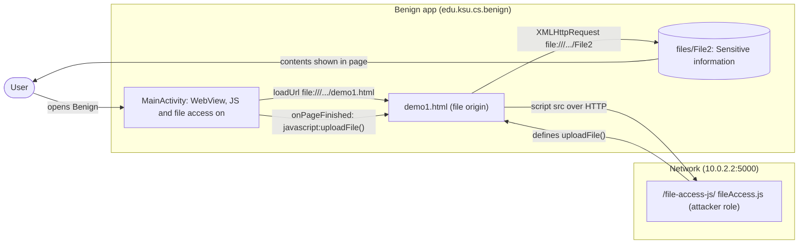
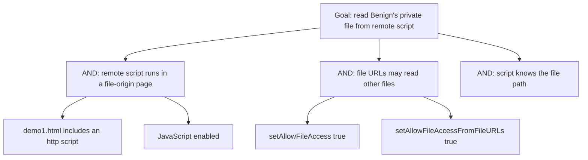

# Threat Model: WebViewAllowFileAccess-UnauthorizedFileAccess-Lean

## 1. Benchmark

| Field | Value |
|-------|-------|
| Name | WebViewAllowFileAccess-UnauthorizedFileAccess-Lean |
| Category | Web |
| Ghera path | `benchmarks/ghera/Web/WebViewAllowFileAccess-UnauthorizedFileAccess-Lean` |
| Affected Android versions (from README) | "Tested on Android 5.1.1 - Android 8.1" (heading: "Android versions affected") |
| Ghera tag | `Jan2019` (commit `6289f39d`) |
| Build flavors available | `api22` to `api27`, `apiDIST` (from `benchmarks/ghera/Misc/sdkFlavors.gradle`) |
| Date of model | 2026-11-01 |

Benign's WebView loads a local page, `file:///data/data/edu.ksu.cs.benign/files/demo1.html`, with JavaScript, file access and file access from file URLs enabled. The page includes a script from an HTTP server. That script runs with the page's `file://` origin, so it can read another private file, `files/File2` ("Sensitive information"), and write it into the page.

**Start order (README steps 1, 7 to 9):** start the local web server, install Benign, push `demo1.html` and `File2` into Benign's internal storage with `adb root` and `adb push`, then launch Benign. There is no Malicious app; the attacker role is played by the remote script.

## 2. System description

### Components

| Component | App | Type | Exported or reachable from other apps | Notes |
|-----------|-----|------|----------------------------------------|-------|
| `MainActivity` | Benign (`edu.ksu.cs.benign`) | Activity, launcher | Yes (launcher intent filter) | Loads `R.string.url` (line 22), sets `MyWebViewClient` (line 23), then `setAllowFileAccess(true)`, `setJavaScriptEnabled(true)` and `setAllowFileAccessFromFileURLs(true)` (`MainActivity.java` lines 24 to 26). |
| `MyWebViewClient` | Benign | `WebViewClient` | n/a | `onPageFinished` runs `javascript:uploadFile()` (`MyWebViewClient.java` line 10), calling a function the remote script defines. |
| `demo1.html` | Benign internal storage (pushed by hand) | HTML file | n/a | Includes `<script src="http://10.0.2.2:5000/file-access-js/">` (benchmark `demo1.html` line 7). |
| `File2` | Benign internal storage (pushed by hand) | Data file | n/a | Contains "Sensitive information". |
| LocalServer `fileAccess.js` | Test server (attacker role) | Script served at `/file-access-js/` (`index_http.py` lines 22 to 25) | n/a | `uploadFile()` reads `file:///data/data/edu.ksu.cs.benign/files/File2` with `XMLHttpRequest`, writes it into `#demo` and shows an `alert` (`fileAccess.js` lines 1 to 18). It does not send the data anywhere. |
| `MainActivity` | Secure (`edu.ksu.cs.benign`) | Activity, launcher | Same | Same, except `setAllowFileAccessFromFileURLs(false)` (Secure line 26). |

Manifest permissions: Benign and Secure request `android.permission.INTERNET` (manifest line 5).

Source files:
- `Benign/app/src/main/java/edu/ksu/cs/benign/MainActivity.java`, `MyWebViewClient.java`, `res/values/strings.xml`
- `demo1.html`, `File2` (benchmark folder)
- `benchmarks/ghera/Misc/LocalServer/templates/fileAccess.js`, `index_http.py`

### Trust boundaries

| ID | Boundary | What crosses it |
|----|----------|-----------------|
| TB1 | Network vs. local page | The remote script, fetched over HTTP into a page with `file://` origin. |
| TB2 | Page script vs. Benign's private files | `XMLHttpRequest` to `file:///data/data/edu.ksu.cs.benign/files/File2`, allowed by the file URL settings. |

### Data flow diagram



## 3. Assets and attacker model

### Assets

| Asset | Why it matters |
|-------|----------------|
| `files/File2` | Private app file labelled "Sensitive information". The README: the script "will be able to access files in the internal file system". |
| Other files in Benign's data directory | Reachable the same way by path. |

### Attacker

Whoever controls the script at `http://10.0.2.2:5000/file-access-js/`: the server owner, or a network attacker on the HTTP path. In the benchmark this is the local Flask server.

### Attacker requirements

- Control of the remote script.
- Knowledge of the target file path (hard-coded in `fileAccess.js` line 2).
- Benign must load the local page that includes the script (README step 8 puts it in place).
- To send the data out, a real script would add a network request; the benchmark script only displays it.

## 4. STRIDE

| Category | Threat | Applies | Why |
|----------|--------|---------|-----|
| Spoofing | Remote script acts as the local page. | Yes | It inherits the `file://` origin of `demo1.html` (line 7). |
| Tampering | Script rewrites the page. | Yes | `fileAccess.js` line 12. |
| Repudiation | Benign does not record which script ran. | Yes | No logging. |
| Information disclosure | Private file read by remote code. | Yes | `fileAccess.js` lines 2 to 12, allowed by `MainActivity.java` lines 24 to 26. README impact. |
| Denial of service | Not shown. | No | The script only reads. |
| Elevation of privilege | Remote code gets app file access. | Yes | Same settings. |

## 5. LINDDUN

| Category | Threat | Applies | Why |
|----------|--------|---------|-----|
| Linkability | Private file contents could link the user. | Partially | Constant in the benchmark. |
| Identifiability | Same. | Partially | Same. |
| Non-repudiation | No user action is attributed. | No | Nothing recorded. |
| Detectability | The server sees each app start. | Yes | The script is fetched on every load. |
| Disclosure of information | Private file read. | Yes | See STRIDE. |
| Unawareness | The user is not told remote code reads app files. | Yes | Only an `alert` with the content appears. |
| Non-compliance | Private data processed by a third party. | Partially | Applies to a real app. |

## 6. Attack tree



## 7. Standards mapping

Confidence values:
- **Verified**: the ID and title were checked against the official page.
- **Needs check**: the ID or title could not be confirmed against the official page.

Fit values:
- **Direct**: the standard describes this benchmark's weakness or test as it is.
- **Partial**: the standard covers part of this benchmark, or covers it only with a caveat given in the Fit cell.

Titles are copied from `docs/threat-models/standards-reference.md`.

| Standard | ID | Title | Confidence | Fit |
|----------|----|-------|------------|-----|
| CWE | CWE-830 | Inclusion of Web Functionality from an Untrusted Source | Verified | Direct. `demo1.html` line 7 includes a script from `http://10.0.2.2:5000` into a page that runs in the app's `file://` origin, so the remote code operates "within the domain of the product" (the CWE description). Variant level; usage ALLOWED. |
| OWASP MASVS v2 | MASVS-PLATFORM-2 | The app uses WebViews securely. | Verified | Direct. The fix is a WebView setting (Secure `MainActivity.java` line 26). |
| OWASP MASWE | MASWE-0034 | WebViews Allow Access to Local Resources with Untrusted Content | Verified | Direct. `MainActivity.java` lines 24 to 26 enable file access and file access from file URLs while the page runs remote script; the page names `setAllowFileAccess` and `setAllowFileAccessFromFileURLs`. Controls shown on the page: MASVS-PLATFORM-2, MASVS-STORAGE-2, MASVS-CODE-4. |
| OWASP MASTG test | MASTG-TEST-0252 | References to Local File Access in WebViews | Verified | Direct. The static test looks for these `WebSettings` calls; `MainActivity.java` lines 24 and 26 are the references. |
| OWASP MASTG test | MASTG-TEST-0253 | Runtime Use of Local File Access APIs in WebViews | Verified | Partial. The dynamic counterpart; it would observe the same settings at run time. No run has been made. |

MASWE-0035 (WebViews Loading Untrusted Content) was considered; MASWE-0034 is more specific to the file access the README describes.

Candidates to check (not in the table):
- None beyond the IDs above.

MITRE ATT&CK for Mobile: No direct match. No technique on attack.mitre.org was verified that describes remote script reading app files through WebView file URL settings.

## 8. Evidence

All steps below are **Not yet run**. No result has been observed.

### Local test server (from `benchmarks/ghera/Misc/LocalServer/README.md`)

**Not yet run.** The README requires Python 2.6 or 3.3 or higher, `pip install Flask`, then `python index_http.py` (check at `http://localhost:5000/test/`). `index_http.py` binds to `localhost` with Flask's default port (line 59). The app does not build a server URL; the local page `demo1.html` includes `http://10.0.2.2:5000/file-access-js/` (line 7), the emulator's alias for the host loopback (`Misc/web-config.gradle` lines 2 to 4). README step 6 says to edit `demo1.html` if another server is used. The harness starts the server (`source-script.ps1` line 2), pushes the files (lines 6 to 8) and stops the server (line 24).

```powershell
# separate PowerShell window, not yet run
cd benchmarks\ghera\Misc\LocalServer
pip install Flask
python index_http.py
```

### Commands

Build, emulator, install and file setup. **Not yet run.**

```powershell
. .\env.ps1
$B = "benchmarks\ghera\Web\WebViewAllowFileAccess-UnauthorizedFileAccess-Lean"
foreach ($a in "Benign","Secure") {
    Set-Content "$B\$a\local.properties" "sdk.dir=C:/Android/Sdk"
    Push-Location "$B\$a"; .\gradlew.bat assembleDebug; Pop-Location
}
emulator -avd ghera27
adb install -r "$B\Benign\app\build\outputs\apk\api27\debug\app-api27-debug.apk"
adb root
adb push "$B\demo1.html" /data/data/edu.ksu.cs.benign/files/demo1.html
adb push "$B\File2" /data/data/edu.ksu.cs.benign/files/File2
```

Pair 1, Benign + script, by hand (README step 9). **Not yet run.**

1. Start the local server.
2. Open Benign.
3. Note any alert and the page text.

Pair 2, Secure + script. Secure shares the package name `edu.ksu.cs.benign`; push the two files again after installing. **Not yet run.**

```powershell
adb uninstall edu.ksu.cs.benign
adb install -r "$B\Secure\app\build\outputs\apk\api27\debug\app-api27-debug.apk"
adb push "$B\demo1.html" /data/data/edu.ksu.cs.benign/files/demo1.html
adb push "$B\File2" /data/data/edu.ksu.cs.benign/files/File2
```

Repeat steps 1 to 3 with Secure.

No-attacker check. There is no broadcast and no Malicious app, so the `adb shell am broadcast` line is replaced by checking what is in place and what the server serves. **Not yet run.**

```powershell
adb shell run-as edu.ksu.cs.benign ls -l files
curl.exe http://localhost:5000/file-access-js/
```

What it can show: that the private files are where the script expects them, and the exact script the page will run. What it cannot show: whether the WebView lets the script read the file; only steps 2 to 3 show that.

### Expected result (from README and Testing code)

| Pair | Expected | Source | Status |
|------|----------|--------|--------|
| Benign + script | The page shows "Sensitive information" (and an alert). | `Testing/benign_app/.../Tests.java` lines 67 to 71 assert element `demo` contains "Sensitive information"; README step 9 text is truncated in the repository copy. | Not yet run |
| Secure + script | The page keeps "This is a test web page". | `Testing/secure_app/.../Tests.java` lines 68 to 72. The README gives no Secure steps. | Not yet run |

### Observed result

| Pair | Outcome | Observation |
|------|---------|-------------|
| Benign + script | Not yet observed | Not yet observed |
| Secure + script | Not yet observed | Not yet observed |

## 9. Mitigation

### What the Secure app does differently

Diff of `Benign/` and `Secure/` (excluding build output, the prebuilt APKs and `local.properties`).

| File | Benign | Secure |
|------|--------|--------|
| `MainActivity.java` line 26 | `webSettings.setAllowFileAccessFromFileURLs(true);` | `webSettings.setAllowFileAccessFromFileURLs(false);` |
| `AndroidManifest.xml` line 12 | `.MainActivity` | Fully qualified name (same class) |
| `res/values/strings.xml` line 2 | `Benign` | `Secure` |
| `res/values-w820dp/strings.xml` | not present | New file with `app_name` "Secure" and the same `url` |

### Assessment of the fix

Blocking file URLs from reading other files stops the benchmark read. Residual points:

1. **Remote script still runs in a local page.** `demo1.html` still includes an HTTP script and JavaScript stays enabled; the script can still rewrite the page or phish the user.
2. **`setAllowFileAccess(true)` remains** (Secure line 24). With file access from file URLs off this mainly allows loading local files, but it is still broader than needed.
3. **Settings applied after `loadUrl`.** Both apps call `loadUrl` (line 22) before changing the settings (lines 24 to 26). Whether the settings apply to the first load has not been checked.
4. **Newer Android versions.** Hypothesis, to test in Step 3: for apps that target API 30 or later `setAllowFileAccess` defaults to false, and apps that target API 28 or later block cleartext by default, which would both change the benchmark's behaviour.

The fix is complete for the file read. Point 1 remains.

## 10. Open questions

- README "Issue" says an application "can inject and execute malicious JavaScript"; in the benchmark the script comes from the web server and Benign itself calls `uploadFile()` from `onPageFinished` (`MyWebViewClient.java` line 10).
- The function is called `uploadFile`, but `fileAccess.js` only reads and displays the file; nothing is uploaded.
- README step 8 needs `adb root`; whether the `ghera27` image allows it has not been checked.
- Secure has a leftover `res/values-w820dp/strings.xml` that duplicates the `url`.
- Lean vs Fat: there is no Fat variant of this benchmark under `benchmarks/ghera/Web/`, so there is nothing to compare.
- Running the build commands in section 8 writes `local.properties` and `build/` folders under `benchmarks/`. Prebuilt APKs are in each app folder.
