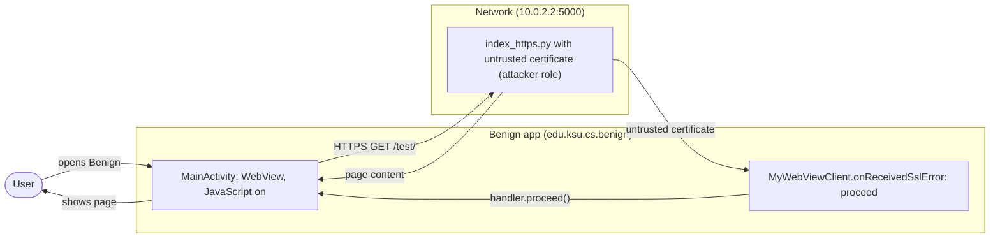
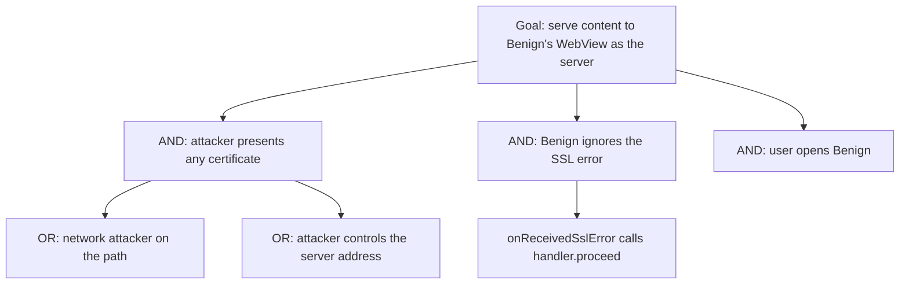

# Threat Model: WebViewIgnoreSSLWarning-MITM-Lean

## 1. Benchmark

| Field | Value |
|-------|-------|
| Name | WebViewIgnoreSSLWarning-MITM-Lean |
| Category | Web |
| Ghera path | `benchmarks/ghera/Web/WebViewIgnoreSSLWarning-MITM-Lean` |
| Affected Android versions (from README) | "Tested on Android 5.1.1 - Android 8.1" (heading: "Android versions affected") |
| Ghera tag | `Jan2019` (commit `6289f39d`) |
| Build flavors available | `api22` to `api27`, `apiDIST` (from `benchmarks/ghera/Misc/sdkFlavors.gradle`) |
| Date of model | 2026-11-01 |

Benign's WebView loads a page over HTTPS from a server whose certificate the device does not trust. Its `WebViewClient.onReceivedSslError` logs the error and calls `handler.proceed()`, so the page loads anyway. Anyone who can present a certificate on that path can serve content to the app.

**Start order (README steps 1, 6 and 7):** start the local web server (the HTTPS variant, as the harness does), install Benign, then launch it. There is no Malicious app; the attacker role is played by the server with the untrusted certificate.

## 2. System description

### Components

| Component | App | Type | Exported or reachable from other apps | Notes |
|-----------|-----|------|----------------------------------------|-------|
| `MainActivity` | Benign (`edu.ksu.cs.benign`) | Activity, launcher | Yes (launcher intent filter) | Enables JavaScript (line 21), builds `"https://" + local_server_ipv4 + ":" + local_server_port + url_extension` (lines 25 to 26), loads it (line 27) and sets `MyWebViewClient` (line 28). |
| `MyWebViewClient` | Benign | `WebViewClient` | n/a | `onReceivedSslError` logs "SSL error detected" and calls `handler.proceed()` (`MyWebViewClient.java` lines 14 to 17). |
| Build values | Benign | Gradle `resValue` and strings | n/a | `10.0.2.2`, port `5000` (`Misc/web-config.gradle` lines 13 to 14); `url_extension` is "/test/" (`strings.xml` line 3). |
| LocalServer `index_https.py` | Test server (attacker role) | Flask app with TLS | `localhost`, port 5000 | `/test/` renders `landingPage.html` ("This is a test web page set up using Flask"); TLS uses `keys/keyOne-publickey.crt` and `keyOne-privatekey.key` (last line of `index_https.py`). |
| `MyWebViewClient` | Secure (`edu.ksu.cs.benign`) | `WebViewClient` | n/a | Calls `handler.cancel()` and `view.loadData("SSL error detected", "text/css", "UTF-8")` (Secure lines 17 to 19). |

Manifest permissions: Benign and Secure request `android.permission.INTERNET` (manifest line 5).

Source files:
- `Benign/app/src/main/java/edu/ksu/cs/benign/MainActivity.java`, `MyWebViewClient.java`
- `Secure/app/src/main/java/edu/ksu/cs/benign/MyWebViewClient.java`
- `benchmarks/ghera/Misc/LocalServer/index_https.py`, `keys/keyOne-publickey.crt`

### Trust boundaries

| ID | Boundary | What crosses it |
|----|----------|-----------------|
| TB1 | Device vs. network | The TLS connection to `10.0.2.2:5000` and the certificate presented. |
| TB2 | TLS error vs. app decision | The `SslError` passed to `onReceivedSslError`, which Benign overrides by proceeding. |

### Data flow diagram



## 3. Assets and attacker model

### Assets

| Asset | Why it matters |
|-------|----------------|
| Integrity and confidentiality of the WebView session | With certificate errors ignored, TLS no longer authenticates the server. |
| The WebView's script context | JavaScript is enabled (line 21), so injected pages run script. |

### Attacker

A network attacker who can present any certificate on the path to the server. In the benchmark the local Flask server with a self-signed certificate plays this role.

### Attacker requirements

- Position on the network path or control of the server address (`10.0.2.2` in the benchmark).
- Any certificate, trusted or not.
- No app on the device and no permission.
- The user opens Benign.

## 4. STRIDE

| Category | Threat | Applies | Why |
|----------|--------|---------|-----|
| Spoofing | The attacker poses as the server. | Yes | `MyWebViewClient.java` line 17 proceeds on any `SslError`. |
| Tampering | The attacker serves or changes the page. | Yes | Same; JavaScript is enabled (line 21). |
| Repudiation | Benign only logs "SSL error detected". | Partially | Line 16; no detail of the error or peer. |
| Information disclosure | Data sent in the session is readable by the attacker. | Partially | The benchmark page sends no data. |
| Denial of service | Not applicable. | No | Errors are ignored rather than blocking. |
| Elevation of privilege | Page script gains app privileges. | No | No bridge or file access in this WebView. |

## 5. LINDDUN

| Category | Threat | Applies | Why |
|----------|--------|---------|-----|
| Linkability | Session traffic visible to the attacker. | Partially | Applies to real traffic. |
| Identifiability | Same. | Partially | Same. |
| Non-repudiation | No user action is attributed. | No | Nothing recorded. |
| Detectability | The attacker sees each app start. | Yes | The page loads in `onResume`. |
| Disclosure of information | Traffic decrypted by the attacker. | Partially | No sensitive data in the benchmark. |
| Unawareness | The user is not warned about the certificate. | Yes | No prompt; `proceed()` is silent. |
| Non-compliance | Personal data over a broken TLS session. | Partially | Applies to a real app. |

## 6. Attack tree



## 7. Standards mapping

Confidence values:
- **Verified**: the ID and title were checked against the official page.
- **Needs check**: the ID or title could not be confirmed against the official page.

Fit values:
- **Direct**: the standard describes this benchmark's weakness or test as it is.
- **Partial**: the standard covers part of this benchmark, or covers it only with a caveat given in the Fit cell.

Titles are copied from `docs/threat-models/standards-reference.md`.

| Standard | ID | Title | Confidence | Fit |
|----------|----|-------|------------|-----|
| CWE | CWE-295 | Improper Certificate Validation | Verified | Direct. `MyWebViewClient.java` line 17 calls `handler.proceed()` for every certificate error, so no certificate is effectively validated. Usage ALLOWED. |
| OWASP MASVS v2 | MASVS-NETWORK-1 | The app secures all network traffic according to the current best practices. | Verified | Direct. The weakness is the TLS session; the fix cancels on error (Secure line 17). |
| OWASP MASVS v2 | MASVS-PLATFORM-2 | The app uses WebViews securely. | Verified | Partial. The faulty decision is made in a `WebViewClient` callback (lines 14 to 17); the control is about WebViews in general. |
| OWASP MASWE | MASWE-0027 | Insecure Certificate Validation | Verified | Direct. The page covers apps "accepting invalid, expired, self-signed, or untrusted certificates without appropriate verification"; Benign accepts all of them at line 17. Controls shown on the page: MASVS-NETWORK-1. |
| OWASP Mobile Top 10 2024 | M5 | Insecure Communication | Verified | Direct. `MyWebViewClient.java` line 17 calls `handler.proceed()` for every certificate error; among the flaws the page covers is "Accepting bad ssl certificates", with self-signed, revoked, expired and wrong host certificates as its examples. |

OWASP MASTG test: No direct match among the IDs in the reference file; none of them covers TLS validation.

Candidates to check (not in the table):
- A MASTG test on `onReceivedSslError` or custom trust evaluation. No such test is in the reference file.

MITRE ATT&CK for Mobile: No direct match. No technique on attack.mitre.org was verified that describes an app accepting an invalid TLS certificate in a WebView.

## 8. Evidence

All steps below are **Not yet run**. No result has been observed.

### Local test server (from `benchmarks/ghera/Misc/LocalServer/README.md`)

**Not yet run.** The README requires Python 2.6 or 3.3 or higher, `pip install Flask`, then `python index_https.py` for the HTTPS server. The README says to check it at `http://localhost:5000/test/`; the script itself serves TLS on port 5000 with `keys/keyOne-publickey.crt` (last line of `index_https.py`), so `https://` is what the app uses. The app connects to `https://10.0.2.2:5000/test/`; `10.0.2.2` is the emulator's alias for the host loopback (`Misc/web-config.gradle` lines 2 to 4 and 13 to 14). The harness starts `index_https.py` (`source-script.ps1` line 2). The certificate's `notAfter` is May 18 2019 (read with `openssl x509 -enddate`), so it is both self-signed and expired.

```powershell
# separate PowerShell window, not yet run
cd benchmarks\ghera\Misc\LocalServer
pip install Flask
python index_https.py
```

### Commands

Build, emulator and install. **Not yet run.**

```powershell
. .\env.ps1
$B = "benchmarks\ghera\Web\WebViewIgnoreSSLWarning-MITM-Lean"
foreach ($a in "Benign","Secure") {
    Set-Content "$B\$a\local.properties" "sdk.dir=C:/Android/Sdk"
    Push-Location "$B\$a"; .\gradlew.bat assembleDebug; Pop-Location
}
emulator -avd ghera27
adb install -r "$B\Benign\app\build\outputs\apk\api27\debug\app-api27-debug.apk"
```

Pair 1, Benign + server, by hand (README step 7). **Not yet run.**

1. Start the HTTPS server.
2. `adb logcat -c`
3. Open Benign and read the page.
4. `adb logcat -d -s WebViewSSLErr:D`

Pair 2, Secure + server. Secure shares the package name `edu.ksu.cs.benign`. **Not yet run.**

```powershell
adb uninstall edu.ksu.cs.benign
adb install -r "$B\Secure\app\build\outputs\apk\api27\debug\app-api27-debug.apk"
```

Repeat steps 1 to 4 with Secure (log tag `WebViewSSLError`).

No-attacker check. There is no broadcast and no Malicious app, so the `adb shell am broadcast` line is replaced by inspecting the certificate the server presents, from the host. **Not yet run.**

```powershell
curl.exe -v https://localhost:5000/test/
curl.exe -k https://localhost:5000/test/
```

What it can show: that a normal client rejects the certificate (first line) and what page is served when the error is ignored (second line, the equivalent of `handler.proceed()`). What it cannot show: the WebView's own decision; only steps 3 to 4 show that.

### Expected result (from README and Testing code)

| Pair | Expected | Source | Status |
|------|----------|--------|--------|
| Benign + server | The page "This is a test web page set up using Flask" loads. | README step 7; `Testing/benign_app/.../Tests.java` lines 67 to 71 assert element `demo` contains that text. | Not yet run |
| Secure + server | The WebView shows "SSL error detected". | `Testing/secure_app/.../Tests.java` lines 67 to 71 assert `body` contains it. The README gives no Secure steps. | Not yet run |

### Observed result

| Pair | Outcome | Observation |
|------|---------|-------------|
| Benign + server | Not yet observed | Not yet observed |
| Secure + server | Not yet observed | Not yet observed |

## 9. Mitigation

### What the Secure app does differently

Diff of `Benign/` and `Secure/` (excluding build output, the prebuilt APKs, `local.properties` and launcher icons).

| File | Benign | Secure |
|------|--------|--------|
| `MyWebViewClient.java` line 17 (Secure lines 17 to 19) | `handler.proceed();` | `handler.cancel();` and `view.loadData("SSL error detected", "text/css", "UTF-8");` |
| `MyWebViewClient.java` line 11 | `TAG = "WebViewSSLErr"` | `TAG = "WebViewSSLError"` |
| `res/layout/activity_main.xml` | `ConstraintLayout` with a fixed-size WebView | `RelativeLayout` with a full-size WebView |
| `res/values/dimens.xml`, `values-w820dp/dimens.xml` | not present | New margin values |
| `AndroidManifest.xml` line 10 | `android:roundIcon` | Removed; round icons differ |
| `MainActivity.java` | Import order | Import order changed (no effect) |
| `res/values/strings.xml` line 2 | `Benign` | `Secure` |

### Assessment of the fix

Cancelling on certificate errors restores TLS server authentication. Residual points:

1. **Error page served as CSS.** `loadData("SSL error detected", "text/css", ...)` uses a CSS MIME type for a message page; the Secure test only checks the body text.
2. **No user choice and no detail.** Every error cancels silently; that is the safe default.
3. **JavaScript still enabled** for whatever loads (Secure line 21); not part of this weakness.
4. **Newer Android versions.** Hypothesis, to test in Step 3: newer WebView versions and Play policy warn about or reject apps that call `proceed()` unconditionally; that would not change Benign's behaviour on the device.

The fix is complete for this weakness.

## 10. Open questions

- The LocalServer README says to check the HTTPS server at `http://localhost:5000/test/`; `index_https.py` serves TLS, so the `http://` URL in the README is likely wrong.
- The `keyOne` certificate expired on May 18 2019; on a current emulator clock the SSL error has at least two causes (untrusted issuer and expiry). The benchmark outcome does not depend on which.
- `index_https.py` binds to `localhost`; reaching it from the emulator through `10.0.2.2` is stated by the comment in `web-config.gradle`, not checked.
- Lean vs Fat: there is no Fat variant of this benchmark under `benchmarks/ghera/Web/`, so there is nothing to compare.
- Running the build commands in section 8 writes `local.properties` and `build/` folders under `benchmarks/`. Prebuilt APKs are in each app folder.
