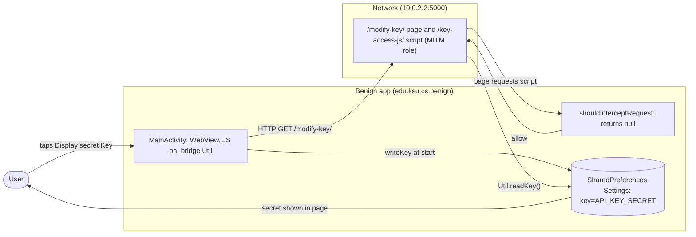
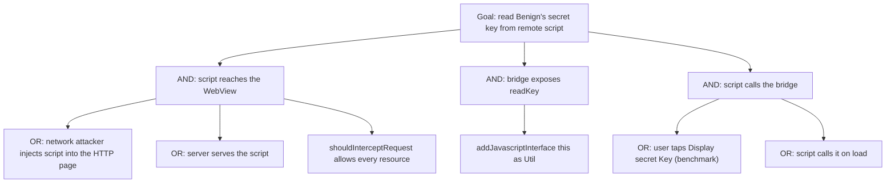

# Threat Model: WebViewInterceptRequest-MITM-Lean

## 1. Benchmark

| Field | Value |
|-------|-------|
| Name | WebViewInterceptRequest-MITM-Lean |
| Category | Web |
| Ghera path | `benchmarks/ghera/Web/WebViewInterceptRequest-MITM-Lean` |
| Affected Android versions (from README) | "Tested on Android 5.1.1 - Android 8.1" (heading: "Android versions affected") |
| Ghera tag | `Jan2019` (commit `6289f39d`) |
| Build flavors available | `api22` to `api27`, `apiDIST` (from `benchmarks/ghera/Misc/sdkFlavors.gradle`) |
| Date of model | 2026-11-01 |

Benign stores a secret key in its private `SharedPreferences` and exposes `readKey()` and `writeKey()` to page JavaScript through `addJavascriptInterface(this, "Util")`. Its WebView loads a page over plain HTTP, and its `shouldInterceptRequest` returns `null` for every resource, so every resource the page asks for is loaded. The server, acting as a man-in-the-middle, adds a script that calls `Util.readKey()` and shows the secret.

**Start order (README steps 1, 7 and 8):** start the local web server, install and launch Benign, then tap "Display secret Key". There is no Malicious app; the attacker role is played by the server.

## 2. System description

### Components

| Component | App | Type | Exported or reachable from other apps | Notes |
|-----------|-----|------|----------------------------------------|-------|
| `MainActivity` | Benign (`edu.ksu.cs.benign`) | Activity, launcher | Yes (launcher intent filter) | `onCreate` calls `writeKey("API_KEY_SECRET")` (line 17). `onResume` loads `"http://" + local_server_ipv4 + ":" + local_server_port + url_extension` (lines 25 to 27), sets `MyWebViewClient` (line 28), `addJavascriptInterface(this, "Util")` (line 29), `setJavaScriptEnabled(true)` (line 30) and `setAllowUniversalAccessFromFileURLs(true)` (line 31). |
| `readKey` / `writeKey` | Benign | `@JavascriptInterface` methods on `MainActivity` | Exposed to every page as `Util` | Read and write the `key` entry of the private `Settings` preferences (`MainActivity.java` lines 34 to 46). |
| `MyWebViewClient` | Benign | `WebViewClient` | n/a | `shouldInterceptRequest` logs the URL and returns `null` (`MyWebViewClient.java` lines 17 to 19). |
| Build values | Benign | Gradle `resValue` and strings | n/a | `10.0.2.2`, port `5000` (`Misc/web-config.gradle` lines 13 to 14); `url_extension` is "/modify-key/" (`strings.xml` line 3). |
| LocalServer | Test server (attacker role) | Flask app | `localhost`, default port | `/modify-key/` renders `modifyKey.html` (`index_http.py` lines 17 to 20), which has buttons "Display secret Key" and "Change secret key" and includes `<script src="http://10.0.2.2:5000/key-access-js/">` (template lines 9 to 13); `keyAccess.js` defines `getKey()` calling `Util.readKey()` and `setKey()` calling `Util.writeKey("Some key")`. |
| `MyWebViewClient` | Secure (`edu.ksu.cs.benign`) | `WebViewClient` | n/a | Returns `null` only for `http://trust.server.edu/expected.js`; for any other URL returns a `WebResourceResponse` of type `text/css` with the body `alert('Abort! The webpage contains untrusted content')` (Secure lines 22 to 42). |

Manifest permissions: Benign and Secure request `android.permission.INTERNET` (manifest line 5).

Source files:
- `Benign/app/src/main/java/edu/ksu/cs/benign/MainActivity.java`, `MyWebViewClient.java`
- `Secure/app/src/main/java/edu/ksu/cs/benign/MyWebViewClient.java`
- `benchmarks/ghera/Misc/LocalServer/templates/modifyKey.html`, `keyAccess.js`

### Trust boundaries

| ID | Boundary | What crosses it |
|----|----------|-----------------|
| TB1 | Device vs. network | The page and its script, over HTTP. |
| TB2 | Web content vs. native code | Calls from page JavaScript to `Util.readKey()` and `Util.writeKey()`, and the secret returned. |
| TB3 | Resource loading vs. app policy | Each resource request passed to `shouldInterceptRequest`, which Benign never filters. |

### Data flow diagram



## 3. Assets and attacker model

### Assets

| Asset | Why it matters |
|-------|----------------|
| The secret key in `SharedPreferences` | README: "API_KEY_SECRET will be displayed, demonstrating that the malicious JavaScript ... gains access to the app's internal/private files". |
| The ability to change the key | `writeKey` is also exposed (`MainActivity.java` lines 34 to 40; `keyAccess.js` `setKey`). |

### Attacker

A network attacker who can inject script into the HTTP page, or the server itself. In the benchmark the local Flask server plays the man-in-the-middle.

### Attacker requirements

- Control of the page or any script it loads, through the cleartext HTTP path.
- Knowledge of the bridge name `Util` and its methods.
- The user taps "Display secret Key" for the benchmark script to call `getKey()`; a real script could call the bridge at load time.
- No app on the device.

## 4. STRIDE

| Category | Threat | Applies | Why |
|----------|--------|---------|-----|
| Spoofing | Injected script acts as trusted app content. | Yes | The bridge is available to any page (`MainActivity.java` line 29). |
| Tampering | Script changes the stored key. | Yes | `writeKey` is exposed (lines 34 to 40). |
| Repudiation | Benign does not record which script used the bridge. | Yes | Only resource URLs are logged (`MyWebViewClient.java` line 18). |
| Information disclosure | The secret is read by remote script. | Yes | `readKey` (lines 42 to 46) called by `keyAccess.js`. README impact. |
| Denial of service | Script overwrites the key with a wrong value. | Partially | Possible through `writeKey`; not exercised by the README. |
| Elevation of privilege | Remote content reaches app-private storage. | Yes | Through the bridge. |

## 5. LINDDUN

| Category | Threat | Applies | Why |
|----------|--------|---------|-----|
| Linkability | A per-app secret could link sessions. | Partially | Constant in the benchmark. |
| Identifiability | Same. | Partially | Same. |
| Non-repudiation | No user action is attributed. | No | Nothing recorded. |
| Detectability | The server sees each app start. | Yes | Page loaded in `onResume`. |
| Disclosure of information | Secret disclosed to remote code. | Yes | See STRIDE. |
| Unawareness | The user is not told the page can read app data. | Yes | No prompt. |
| Non-compliance | App secrets exposed to third parties. | Partially | Applies to a real app. |

## 6. Attack tree



## 7. Standards mapping

Confidence values:
- **Verified**: the ID and title were checked against the official page.
- **Needs check**: the ID or title could not be confirmed against the official page.

Fit values:
- **Direct**: the standard describes this benchmark's weakness or test as it is.
- **Partial**: the standard covers part of this benchmark, or covers it only with a caveat given in the Fit cell.

Titles are copied from `docs/threat-models/standards-reference.md`.

| Standard | ID | Title | Confidence | Fit |
|----------|----|-------|------------|-----|
| CWE | CWE-749 | Exposed Dangerous Method or Function | Verified | Direct. `MainActivity.java` line 29 exposes `readKey` and `writeKey` (lines 34 to 46), which read and write the app's private key, to any page with no restriction. The CWE's children (CWE-618, CWE-782) cover ActiveX and IOCTL, so the entry is kept. Usage ALLOWED. |
| CWE | CWE-829 | Inclusion of Functionality from Untrusted Control Sphere | Verified | Partial. The page loads script from an HTTP server (`modifyKey.html` line 13) and `shouldInterceptRequest` accepts it (`MyWebViewClient.java` line 19). Partial because the root cause the README names is the missing resource check. CWE-830 was considered and not used: the script comes from the same server as the page, not from another domain. Usage ALLOWED. |
| OWASP MASVS v2 | MASVS-PLATFORM-2 | The app uses WebViews securely. | Verified | Direct. Both the bridge and the resource policy are WebView settings; the fix is in `shouldInterceptRequest` (Secure lines 22 to 42). |
| OWASP MASWE | MASWE-0033 | Sensitive Native Functionality Exposed in WebViews | Verified | Direct. The bridge at line 29 gives untrusted content access to app-private storage; the page covers bridges that "are reachable by untrusted content". Controls shown on the page: MASVS-PLATFORM-2, MASVS-STORAGE-2. |
| OWASP MASWE | MASWE-0035 | WebViews Loading Untrusted Content | Verified | Partial. The WebView loads an HTTP page and every resource it requests without validation (`MainActivity.java` line 27, `MyWebViewClient.java` line 19). Partial because the harm comes through the bridge, which MASWE-0033 covers. Controls shown on the page: MASVS-PLATFORM-2, MASVS-CODE-4. |
| OWASP MASTG test | MASTG-TEST-0033 | Testing for Java Objects Exposed Through WebViews | Verified | Partial. Deprecated; the page points to MASTG-TEST-0334. Kept for reference only: it is the check that finds `addJavascriptInterface` with JavaScript enabled (lines 29 to 30). |
| OWASP Mobile Top 10 2024 | M4 | Insufficient Input/Output Validation | Verified | Direct. `MyWebViewClient.java` line 19 returns `null` for every resource request, so the WebView loads any resource from network content without validation; the page covers "Insufficient validation and sanitization of data from external sources, such as user inputs or network data". The fix validates the URL (Secure lines 22 to 42). |

MASWE-0034 was considered for `setAllowUniversalAccessFromFileURLs(true)` (line 31); it is not in the table because the page is loaded over HTTP, not from a file URL.

Candidates to check (not in the table):
- MASTG-TEST-0334 (Native Code Exposed Through WebViews), named in the MASTG-TEST-0033 banner. Not in the reference file.

MITRE ATT&CK for Mobile: No direct match. No technique on attack.mitre.org was verified that describes injected script reading data through an app's JavaScript bridge.

## 8. Evidence

All steps below are **Not yet run**. No result has been observed.

### Local test server (from `benchmarks/ghera/Misc/LocalServer/README.md`)

**Not yet run.** The README requires Python 2.6 or 3.3 or higher, `pip install Flask`, then `python index_http.py` (check at `http://localhost:5000/test/`). `index_http.py` binds to `localhost` with Flask's default port (line 59). The app loads `http://10.0.2.2:5000/modify-key/`; `10.0.2.2` is the emulator's alias for the host loopback (`Misc/web-config.gradle` lines 2 to 4 and 13 to 14). The harness starts the server with `source-script.ps1` line 2.

```powershell
# separate PowerShell window, not yet run
cd benchmarks\ghera\Misc\LocalServer
pip install Flask
python index_http.py
```

### Commands

Build, emulator and install. **Not yet run.**

```powershell
. .\env.ps1
$B = "benchmarks\ghera\Web\WebViewInterceptRequest-MITM-Lean"
foreach ($a in "Benign","Secure") {
    Set-Content "$B\$a\local.properties" "sdk.dir=C:/Android/Sdk"
    Push-Location "$B\$a"; .\gradlew.bat assembleDebug; Pop-Location
}
emulator -avd ghera27
adb install -r "$B\Benign\app\build\outputs\apk\api27\debug\app-api27-debug.apk"
```

Pair 1, Benign + server, by hand (README step 8). **Not yet run.**

1. Start the local server.
2. `adb logcat -c`
3. Open Benign. Tap "Display secret Key". Read the page.
4. `adb logcat -d -s WebViewInterceptReq:D`

Pair 2, Secure + server. Secure shares the package name `edu.ksu.cs.benign`. **Not yet run.**

```powershell
adb uninstall edu.ksu.cs.benign
adb install -r "$B\Secure\app\build\outputs\apk\api27\debug\app-api27-debug.apk"
```

Repeat steps 1 to 4 with Secure; at step 3 read the page before tapping, since Secure is expected to replace it.

No-attacker check. There is no broadcast and no Malicious app, so the `adb shell am broadcast` line is replaced by fetching the page and script from the host. **Not yet run.**

```powershell
curl.exe http://localhost:5000/modify-key/
curl.exe http://localhost:5000/key-access-js/
```

What it can show: the exact bridge calls (`Util.readKey()`, `Util.writeKey(...)`) the served script makes. What it cannot show: whether the bridge answers; only step 3 shows that.

### Expected result (from README and Testing code)

| Pair | Expected | Source | Status |
|------|----------|--------|--------|
| Benign + server | After the tap, the page shows "API_KEY_SECRET". | README step 8; `Testing/benign_app/.../Tests.java` lines 68 to 77 click `get-key-button` and assert `demo` contains "API_KEY_SECRET". | Not yet run |
| Secure + server | The page body shows `alert('Abort! The webpage contains untrusted content')` as text. | `Testing/secure_app/.../Tests.java` lines 67 to 71. The README gives no Secure steps. | Not yet run |

### Observed result

| Pair | Outcome | Observation |
|------|---------|-------------|
| Benign + server | Not yet observed | Not yet observed |
| Secure + server | Not yet observed | Not yet observed |

## 9. Mitigation

### What the Secure app does differently

Diff of `Benign/` and `Secure/` (excluding build output, the prebuilt APKs, `local.properties` and launcher icons).

| File | Benign | Secure |
|------|--------|--------|
| `MyWebViewClient.java` line 19 (Secure lines 22 to 42) | `return null;` | `return getInterceptRequestResponse(req.getUrl().toString());`, which returns `null` only for `http://trust.server.edu/expected.js` and otherwise a `text/css` response containing the alert text |
| `MyWebViewClient.java` (Secure lines 9 to 10) | none | Imports `ByteArrayInputStream`, `InputStream` |
| `AndroidManifest.xml` line 10 | `android:roundIcon` | Removed |
| `res/values/strings.xml` line 2 | `Benign` | `Secure` |
| `app/build.gradle` line 17 | no final newline | final newline (no effect) |

`MainActivity` is unchanged: the bridge, JavaScript and universal file access stay on.

### Assessment of the fix

The fix blocks the attack in the benchmark by refusing every resource except one hard-coded URL. Residual points:

1. **It blocks everything.** The Secure test expects the main page itself to be replaced by the alert text, so Secure no longer shows the page at all. That stops the attack but also the app's function.
2. **The bridge is still exposed.** `addJavascriptInterface(this, "Util")` with `readKey` and `writeKey` remains. Any content that does load, including the allowed URL, can read and change the key. Removing the bridge, or limiting it to trusted origins, would address the cause.
3. **Allow-list by exact string over HTTP.** The one allowed URL is `http://`, so a network attacker can still replace its content.
4. **`setAllowUniversalAccessFromFileURLs(true)` remains** (line 31); unused here but unnecessary.
5. **Newer Android versions.** Hypothesis, to test in Step 3: apps that target API 28 or later block cleartext by default, so the HTTP page would not load unless cleartext is allowed.

The fix stops the benchmark exploit; point 2 means the underlying exposure is unchanged.

## 10. Open questions

- The README names the injected script `myScripts1.js`; the server serves `keyAccess.js` at `/key-access-js/`.
- README step 6 says to edit a `url` field in `res/values/strings.xml`; there is none, only `url_extension`, and the host comes from `web-config.gradle`.
- README step 8 says "Display Secret Key"; the button text is "Display secret Key" (`modifyKey.html` line 9).
- The README says the script gains access to "internal/private files"; it reads `SharedPreferences` through the bridge, not files directly.
- Whether `shouldInterceptRequest` is called for the main page on API 27 (which the Secure test's expectation implies) has not been checked.
- Lean vs Fat: there is no Fat variant of this benchmark under `benchmarks/ghera/Web/`, so there is nothing to compare.
- Running the build commands in section 8 writes `local.properties` and `build/` folders under `benchmarks/`. Prebuilt APKs are in each app folder.
