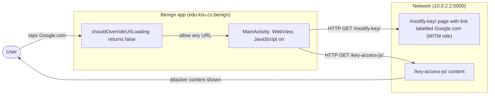
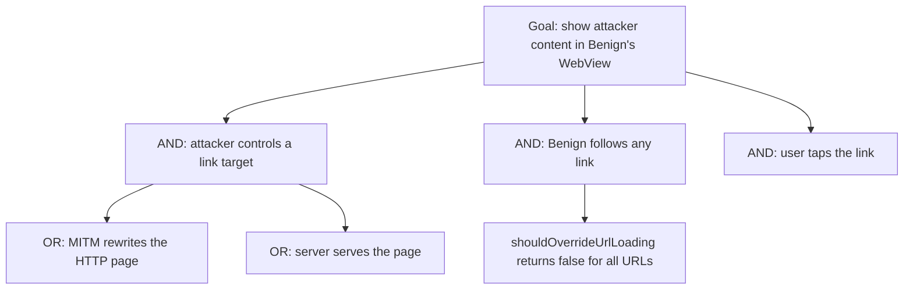

# Threat Model: WebViewOverrideUrl-MITM-Lean

## 1. Benchmark

| Field | Value |
|-------|-------|
| Name | WebViewOverrideUrl-MITM-Lean |
| Category | Web |
| Ghera path | `benchmarks/ghera/Web/WebViewOverrideUrl-MITM-Lean` |
| Affected Android versions (from README) | "Tested on Android 5.1.1 - Android 8.1" (heading: "Android versions affected") |
| Ghera tag | `Jan2019` (commit `6289f39d`) |
| Build flavors available | `api22` to `api27`, `apiDIST` (from `benchmarks/ghera/Misc/sdkFlavors.gradle`) |
| Date of model | 2026-11-01 |

Benign's WebView loads a page over plain HTTP, and its `WebViewClient.shouldOverrideUrlLoading` returns `false` for every URL, so the WebView follows any link without checking it. The served page has a link labelled "Google.com" that actually points to a script on the attacker's server; tapping it loads that content into Benign's WebView.

**Start order (README steps 1, 6 and 7):** start the local web server, install and launch Benign, then tap the link "Google.com". There is no Malicious app; the attacker role is played by the server acting as man-in-the-middle.

## 2. System description

### Components

| Component | App | Type | Exported or reachable from other apps | Notes |
|-----------|-----|------|----------------------------------------|-------|
| `MainActivity` | Benign (`edu.ksu.cs.benign`) | Activity, launcher | Yes (launcher intent filter) | Enables JavaScript (line 21), loads `"http://" + local_server_ipv4 + ":" + local_server_port + url_extension` (lines 22 to 24) and sets `MyWebViewClient` (line 25). No JavaScript interface. |
| `MyWebViewClient` | Benign | `WebViewClient` | n/a | Both `shouldOverrideUrlLoading` overloads log the URL and return `false` (`MyWebViewClient.java` lines 17 to 19 and 27 to 29). |
| Build values | Benign | Gradle `resValue` and strings | n/a | `10.0.2.2`, port `5000` (`Misc/web-config.gradle` lines 13 to 14); `url_extension` is "/modify-key/" (`strings.xml` line 3). |
| LocalServer | Test server (MITM role) | Flask app | `localhost`, default port | `/modify-key/` renders `modifyKey.html`, whose link `<a id="click-google-button" href="http://10.0.2.2:5000/key-access-js/">Google.com</a>` is at template line 12; it also includes the same script at line 13. `/key-access-js/` serves `keyAccess.js` (`index_http.py` lines 27 to 30). |
| `MyWebViewClient` | Secure (`edu.ksu.cs.benign`) | `WebViewClient` | n/a | Both overloads call `getOverrideUrlSettings`, which returns `false` only for `http://trust.server.edu/expected.js`; for any other URL it calls `wv.loadData("URL not trusted", "text/css", "UTF-8")` and returns `true` (Secure `MyWebViewClient.java` lines 13 to 34). |

Manifest permissions: Benign and Secure request `android.permission.INTERNET` (manifest line 5).

Source files:
- `Benign/app/src/main/java/edu/ksu/cs/benign/MainActivity.java`, `MyWebViewClient.java`
- `Secure/app/src/main/java/edu/ksu/cs/benign/MyWebViewClient.java`
- `benchmarks/ghera/Misc/LocalServer/templates/modifyKey.html`, `keyAccess.js`

### Trust boundaries

| ID | Boundary | What crosses it |
|----|----------|-----------------|
| TB1 | Device vs. network | The first page and every page navigated to, over HTTP. |
| TB2 | Navigation vs. app policy | Each link the user follows, passed to `shouldOverrideUrlLoading`, which Benign never checks. |

### Data flow diagram



## 3. Assets and attacker model

### Assets

| Asset | Why it matters |
|-------|----------------|
| Integrity of what the WebView shows | README: "a man-in-the-middle can inject malicious content into the WebView". |
| The user's trust in link labels | The link says "Google.com" but goes to the attacker's server (`modifyKey.html` line 12). |

### Attacker

A network attacker who can change the HTTP page or the pages it links to. In the benchmark the local Flask server plays the man-in-the-middle.

### Attacker requirements

- Control of the HTTP page Benign loads, or of any page it links to.
- The user taps a link (README step 7).
- No app on the device and no permission.

## 4. STRIDE

| Category | Threat | Applies | Why |
|----------|--------|---------|-----|
| Spoofing | A link poses as Google.com. | Yes | `modifyKey.html` line 12; Benign does not check the target (`MyWebViewClient.java` lines 17 to 19). |
| Tampering | The attacker decides what loads next. | Yes | Every navigation is allowed (lines 19 and 29). |
| Repudiation | Benign only logs URLs. | Partially | Lines 18 and 28 log the URL, nothing else. |
| Information disclosure | Data entered on an injected page goes to the attacker. | Partially | Not in the benchmark; the injected content is only displayed. |
| Denial of service | Not applicable. | No | Navigation is never blocked. |
| Elevation of privilege | Injected page gains app privileges. | No | Benign exposes no bridge or file access. |

## 5. LINDDUN

| Category | Threat | Applies | Why |
|----------|--------|---------|-----|
| Linkability | Navigation can be tracked by the attacker. | Partially | Applies to real browsing. |
| Identifiability | Same. | Partially | Same. |
| Non-repudiation | No user action is attributed. | No | Nothing recorded. |
| Detectability | The attacker sees each tap. | Yes | Each navigation is an HTTP request. |
| Disclosure of information | No data is sent in the benchmark. | No | Display only. |
| Unawareness | The user is not told the link goes elsewhere. | Yes | The label differs from the target. |
| Non-compliance | Not applicable. | No | No personal data. |

## 6. Attack tree



## 7. Standards mapping

Confidence values:
- **Verified**: the ID and title were checked against the official page.
- **Needs check**: the ID or title could not be confirmed against the official page.

Fit values:
- **Direct**: the standard describes this benchmark's weakness or test as it is.
- **Partial**: the standard covers part of this benchmark, or covers it only with a caveat given in the Fit cell.

Titles are copied from `docs/threat-models/standards-reference.md`.

| Standard | ID | Title | Confidence | Fit |
|----------|----|-------|------------|-----|
| CWE | CWE-829 | Inclusion of Functionality from Untrusted Control Sphere | Verified | Partial. `MyWebViewClient.java` lines 19 and 29 let the WebView load any page, so content from an untrusted server runs in the app's WebView with JavaScript enabled (`MainActivity.java` line 21). Partial because the CWE is about including executable functionality; here the harm shown is navigation to attacker content. CWE-830 was considered and not used: the content is navigated to, not included into the app's page. Usage ALLOWED. |
| OWASP MASVS v2 | MASVS-PLATFORM-2 | The app uses WebViews securely. | Verified | Direct. The fix is in the `WebViewClient` navigation callback (Secure lines 24 to 34). |
| OWASP MASWE | MASWE-0035 | WebViews Loading Untrusted Content | Verified | Direct. Benign loads an HTTP page (line 24) and lets the user navigate anywhere (lines 19 and 29); the page covers WebViews that "let users navigate to arbitrary sites outside the developer's control". Controls shown on the page: MASVS-PLATFORM-2, MASVS-CODE-4. |
| OWASP Mobile Top 10 2024 | M4 | Insufficient Input/Output Validation | Verified | Direct. `MyWebViewClient.java` lines 19 and 29 return `false` for every navigation, so the WebView loads any URL from network content without validation; the page covers "Insufficient validation and sanitization of data from external sources, such as user inputs or network data". The fix validates the URL (Secure lines 24 to 34). |

OWASP MASTG test: No direct match among the IDs in the reference file. MASTG-TEST-0031 is about JavaScript being enabled, not about navigation checks.

Candidates to check (not in the table):
- A MASTG test on `shouldOverrideUrlLoading` or WebView navigation allow-lists. No such test is in the reference file.

MITRE ATT&CK for Mobile: No direct match. No technique on attack.mitre.org was verified that describes redirecting an app's WebView navigation through a man-in-the-middle.

## 8. Evidence

All steps below are **Not yet run**. No result has been observed.

### Local test server (from `benchmarks/ghera/Misc/LocalServer/README.md`)

**Not yet run.** The README requires Python 2.6 or 3.3 or higher, `pip install Flask`, then `python index_http.py` (check at `http://localhost:5000/test/`). `index_http.py` binds to `localhost` with Flask's default port (line 59). The app loads `http://10.0.2.2:5000/modify-key/`; `10.0.2.2` is the emulator's alias for the host loopback (`Misc/web-config.gradle` lines 2 to 4 and 13 to 14). The harness starts the server with `source-script.ps1` line 2.

```powershell
# separate PowerShell window, not yet run
cd benchmarks\ghera\Misc\LocalServer
pip install Flask
python index_http.py
```

### Commands

Build, emulator and install. **Not yet run.**

```powershell
. .\env.ps1
$B = "benchmarks\ghera\Web\WebViewOverrideUrl-MITM-Lean"
foreach ($a in "Benign","Secure") {
    Set-Content "$B\$a\local.properties" "sdk.dir=C:/Android/Sdk"
    Push-Location "$B\$a"; .\gradlew.bat assembleDebug; Pop-Location
}
emulator -avd ghera27
adb install -r "$B\Benign\app\build\outputs\apk\api27\debug\app-api27-debug.apk"
```

Pair 1, Benign + server, by hand (README step 7). **Not yet run.**

1. Start the local server.
2. `adb logcat -c`
3. Open Benign. Tap "Google.com". Read the page.
4. `adb logcat -d -s WebViewOverrideUrl:D`

Pair 2, Secure + server. Secure shares the package name `edu.ksu.cs.benign`. **Not yet run.**

```powershell
adb uninstall edu.ksu.cs.benign
adb install -r "$B\Secure\app\build\outputs\apk\api27\debug\app-api27-debug.apk"
```

Repeat steps 1 to 4 with Secure.

No-attacker check. There is no broadcast and no Malicious app, so the `adb shell am broadcast` line is replaced by fetching the page and the link target from the host. **Not yet run.**

```powershell
curl.exe http://localhost:5000/modify-key/
curl.exe http://localhost:5000/key-access-js/
```

What it can show: that the link labelled "Google.com" points to the local server and what content it serves. What it cannot show: the WebView's navigation decision; only step 3 shows that.

### Expected result (from README and Testing code)

| Pair | Expected | Source | Status |
|------|----------|--------|--------|
| Benign + server | After the tap, the WebView shows the `keyAccess.js` source text. | README step 7 ("Some JavaScript code will be loaded instead"); `Testing/benign_app/.../Tests.java` lines 68 to 77 click `click-google-button` and assert `body` contains the `getKey`/`setKey` source. | Not yet run |
| Secure + server | After the tap, the WebView shows "URL not trusted". | `Testing/secure_app/.../Tests.java` lines 68 to 77. The README gives no Secure steps. | Not yet run |

### Observed result

| Pair | Outcome | Observation |
|------|---------|-------------|
| Benign + server | Not yet observed | Not yet observed |
| Secure + server | Not yet observed | Not yet observed |

## 9. Mitigation

### What the Secure app does differently

Diff of `Benign/` and `Secure/` (excluding build output, the prebuilt APKs, `local.properties` and launcher icons).

| File | Benign | Secure |
|------|--------|--------|
| `MyWebViewClient.java` lines 19 and 29 (Secure lines 15 and 21) | `return false;` | `return getOverrideUrlSettings(...)` |
| `MyWebViewClient.java` (Secure lines 24 to 34) | none | Allow only `http://trust.server.edu/expected.js`; otherwise `wv.loadData("URL not trusted", "text/css", "UTF-8")` and return `true` |
| `MyWebViewClient.java` lines 12 to 15 and 22 to 25 | Comments | Removed |
| `AndroidManifest.xml` line 10 | `android:roundIcon` | Removed |
| `res/values/strings.xml` line 2 | `Benign` | `Secure` |

### Assessment of the fix

Refusing navigation to untrusted URLs stops the benchmark link. Residual points:

1. **The first page is still untrusted.** `MainActivity` still loads an HTTP page with JavaScript enabled, and `modifyKey.html` line 13 includes the same remote script as a subresource; `shouldOverrideUrlLoading` does not see subresources.
2. **Allow-list by exact string over HTTP.** The single allowed URL is `http://`, so its content can still be replaced on the network.
3. **Blocks all other navigation.** Any other link shows "URL not trusted", which also stops legitimate browsing.
4. **Newer Android versions.** Hypothesis, to test in Step 3: apps that target API 28 or later block cleartext by default, so the HTTP pages would not load unless cleartext is allowed.

The fix is complete for navigation. Point 1 leaves the loaded page's own script in place.

## 10. Open questions

- The README "Issue" spells the method "shouldOverridUrlLoading"; the code overrides `shouldOverrideUrlLoading`.
- The README says the class extends "the default *WebClient*"; it extends `WebViewClient`.
- In Benign, `keyAccess.js` calls `Util.readKey()`, but Benign exposes no `Util` bridge, so the script cannot read anything; the benchmark shows only that the content loads.
- Lean vs Fat: there is no Fat variant of this benchmark under `benchmarks/ghera/Web/`, so there is nothing to compare.
- Running the build commands in section 8 writes `local.properties` and `build/` folders under `benchmarks/`. Prebuilt APKs are in each app folder.
